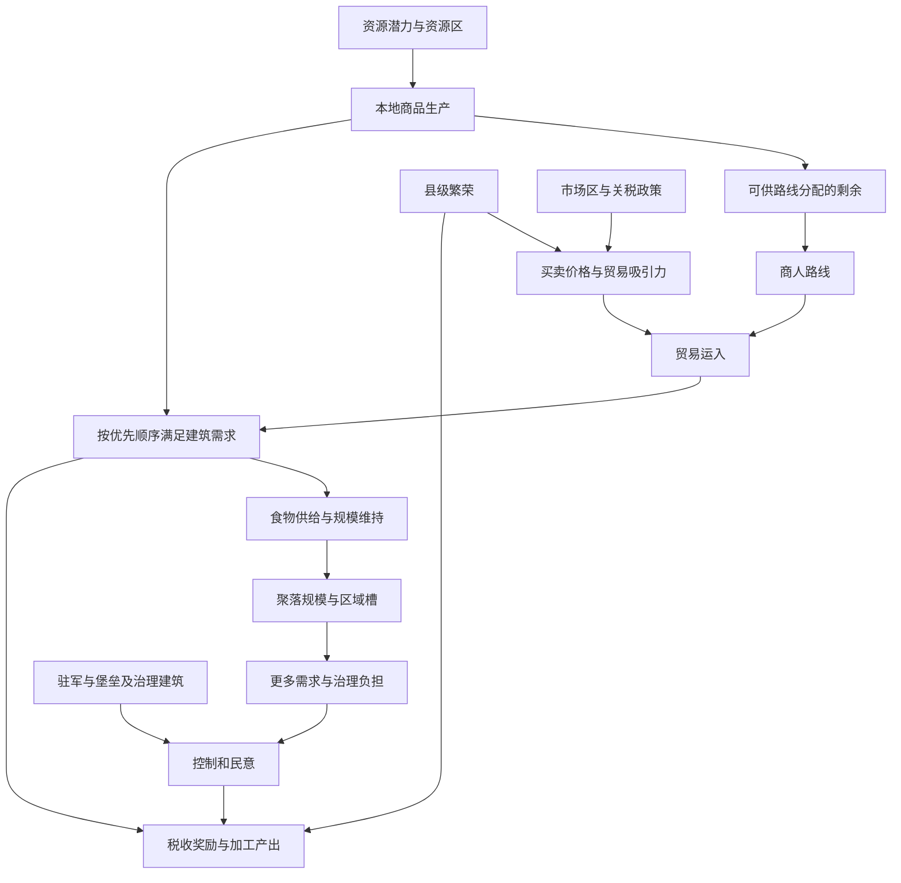
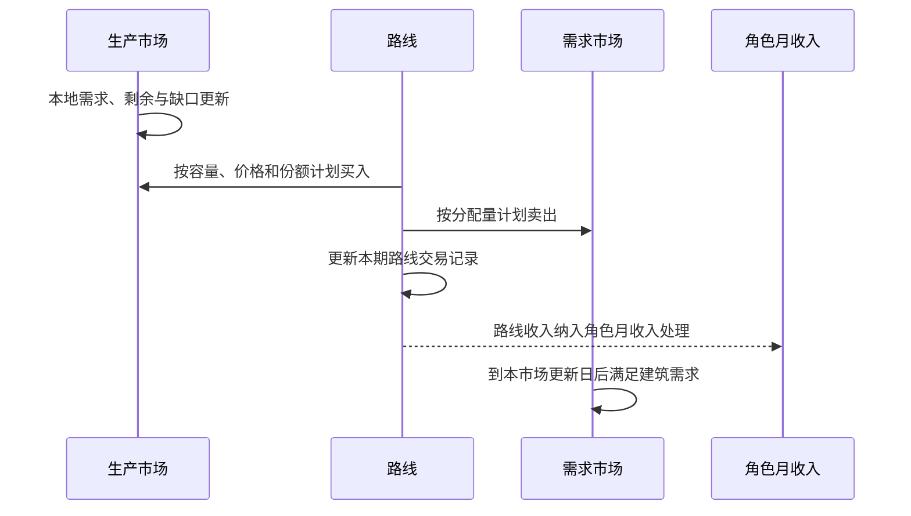

# CK3 1.21「Florin」经济系统分析

研究日期：2026-11-18。本轮执行机器 `machine_id: 4-8e1c2f1861`；本机已从 CK3 1.20.0.4 / Steam build 25734779 更新至 **public 分支 1.21.0（Florin）/ build 26622941**。`2026-11-18T07:00:11.716858Z` 安装回读确认当前/目标 build 相等、下载与部署完成、Steam `StateFlags=4 / UpdateResult=0`；EXE SHA-256 为 `2f2b236a16223891c2da8b167f5f3738d2ae3e6d69de1b4fbe190a5402998acc`。详见[本机更新记录](maintenance/2026-11-18-machine4-ck3-update-and-market-design.md)。

本文分析 1.21 的经济规则及其对“期货市场与虚拟货币市场”MOD 的约束。依据为官方发布公告、开发日志与**本机正式安装的定向静态脚本核对**；未取得完整正式版 changelog，也未运行游戏来验证交易、脚本接口和金融清算。下文分别标注官方说明、开发期数值、正式数据与设计推论；静态定义存在不等于所有开局、政府或 DLC 条件下都生效。[可携带来源索引](ck3-1.21-economy-sources-2026-11-18.json)包含九项官方来源和 113 个原版文件指纹，八组定义计数与文件指纹已通过独立 cmd/Python 复核。

## 1. 结论与版本边界

1.21 将领地建设、资源生产、建筑消费、贸易与治理连成经济网络。地主主要通过税收获益，商人通过运输满足市场缺口获益，市场主人可以征收贸易关税；三种收入来源不能混成同一笔“卖货收入”。新版保留金币等角色资源，同时增加商品流、公司成长和政府专属财政规则，不能用一个 `gold` 数字代表全部经济状态。[官方发布公告](https://steamcommunity.com/games/1158310/announcements/detail/746069122013463406)、[DD8：贸易运行与领地经济](https://steamcommunity.com/games/1158310/announcements/detail/701031128264350037)、[DD4：共和国](https://steamcommunity.com/games/1158310/announcements/detail/677374546802640261)。

最影响金融 MOD 的限制是：**官方明确选择不让供需直接决定商品价格**。原版通过稀缺限制可交易数量，再通过繁荣度、建筑、角色、路线和其他修正形成买卖价。不能把 1.21 描述成已有连续现货撮合、库存订单簿或供需自动浮动价格的市场；期货定价、盯市、保证金与代币汇率需要清楚定义为新增规则。[DD8](https://steamcommunity.com/games/1158310/announcements/detail/701031128264350037)。

### 免费更新与付费内容

| 内容 | 已核官方边界 | 对设计的影响 |
| --- | --- | --- |
| 商品、建筑需求、道路、新建设与基础经济重做 | 免费 1.21 更新 | 基础经济分析适用于未购买 Silk & Silver 的玩家 |
| 可玩商人、公司成长及专属玩法 | Silk & Silver | 商人专属金融内容应单独处理 DLC 条件 |
| 可玩共和国、议会、共和国政治与专属贸易扩张 | Silk & Silver | 公共财政、议会批准等增强内容须明确依赖 |
| 两组新推荐角色与意大利特色内容 | Silk & Silver | 不应成为通用金融层的必要前提 |
| 丝绸之路的新增商人参与 | DD6 说明向 Silk & Silver 用户开放 | 对 Dynastic Cycle 的影响还涉及 All Under Heaven |

免费与付费核心边界由发布公告确认；不能从某种 scope 的存在进一步推定所有政府、所有 DLC 组合均可调用同一玩法。[发布公告](https://steamcommunity.com/games/1158310/announcements/detail/746069122013463406)、[DD6](https://steamcommunity.com/games/1158310/announcements/detail/711160422578783399)。

## 2. 钱、商品与成长资源分别记账

| 对象 | 经济含义 | 不能直接等同的对象 |
| --- | --- | --- |
| 角色个人金币 | 可支出的个人余额；收入、支出、借贷等改变它 | 国家公共国库、商品 gold 的产量、公司声望 |
| 政府国库 | 特定政府下的公共财政；共和国说明包含议会与法令约束 | 当前统治者的私人钱包 |
| 商品数量 | 某市场的生产、需求、可分配份额与路线流量 | 玩家持有的可转账货币余额或真实仓库存货 |
| 税收 | 来自领地、建筑等来源的货币收入，可按税类分别受修正 | 商品售价乘产量的自动分红 |
| 路线收入 | 商业运输形成的月收入，仍有修正和上级分成 | 一次交货时即时进入个人余额的未处理毛利 |
| 贸易专精、Acumen、公司规模、威望 | 专业成长和资格门槛 | 可以自由付款或兑换的金币 |

“个人/公共”不是术语细节。DD4 将共和国国库用于公共建设、法令及头衔兵士等用途，并由共和国首脑与议会制度约束；发布公告同样强调议会对公共资金用途的法律控制。不能据此推定所有角色都有独立公共国库，也不能把名称中带 `treasury` 的旧接口自动解释为新版公共财政。[DD4](https://steamcommunity.com/games/1158310/announcements/detail/677374546802640261)、[发布公告](https://steamcommunity.com/games/1158310/announcements/detail/746069122013463406)。

仓库已有只读材料可证明这一接口风险，不能替本机验证：来源机器 **`xenoamess-full-tower-eb9d2c1186`** 在 `2026-11-18T04:16:09.752962200Z` 的[现金原件](maintenance/2026-11-18-personal-cash-readonly-live.json)明确把旧 `current_treasury` 别名解释为个人钱包，并将真实国库、税类及繁荣度标为未获资格。该来源机读得个人余额 479.86038、月毛收入 1.24674、月支出 1.77975、月净额 -0.53301；这是来源机某一角色的一次观察，不是 1.21 通用数值，更不证明本机已经升级或具备这些接口。[相关接口说明](agent-florin-gold-and-profile-inputs.md)、[来源机迁移记录](ck3-1.21.0-migration-2026-11-18.md)。

## 3. 生产与需求形成真实经营约束

资源潜力、区域、建筑与需求构成生产链。某县可以生产哪些原料由数据定义，资源区提供主产出；加工建筑消耗其他商品后生成进一步产出或税收效果。地主可通过本地生产或贸易供应建筑所需商品，但开一座矿或农场不会自动获得商人卖出该产物的整笔收入。[DD1](https://steamcommunity.com/games/1158310/announcements/detail/552395313313219182)、[DD8](https://steamcommunity.com/games/1158310/announcements/detail/701031128264350037)。

建筑需求有两种层次：明确单品，以及允许替代商品的需求类别，例如谷物类别。需求被满足时获得相应奖励，一些需求可以多次满足。贸易引擎本身一般不会对所有未满足需求统一施罚；具体惩罚来自脚本。例如食物不足会影响聚落维持，其后再传导到规模与民意。因而“缺料”不能统一写成“停工”“负税收”或“强制破产”，须逐建筑核对。[DD2](https://steamcommunity.com/games/1158310/announcements/detail/690882808486299148)、[DD8](https://steamcommunity.com/games/1158310/announcements/detail/701031128264350037)。

本地建筑通常先取得供给，剩余才形成外销 Surplus；未满足部分构成 Deficit。市场中的需求有优先顺序，玩家还可调整普通区域及区域内建筑的顺序。因此，资金充足不意味着某建筑必然获得原料；政治特权、地理位置、需求排序和竞争也会约束结果。金融设计如果承诺“买入合约即必然取得原版实物”，会越过目前已知的交易合同。[DD8](https://steamcommunity.com/games/1158310/announcements/detail/701031128264350037)。

### 区域与建筑的分工

| 区域方向 | 官方说明的主要功能 | 对经济决策的含义 |
| --- | --- | --- |
| 资源区 | 生产当地潜力允许的原料，配套建筑可加工或强化产出 | 决定市场供给结构与部分基础税源 |
| 公会区 | 消耗输入，形成加工品和工匠税等收益 | 收益依赖稳定原料，不能只看面板最大收益 |
| 市场区 | 商业税及对商人卖价的吸引力 | 可以吸引供给，并增强市场主人关税所得 |
| 住房及其他城市区 | 增长聚落、开放进一步发展 | 同时提高食物与治理负担 |
| 乡村区 | 强化农业、采矿等并维持较小聚落 | 小规模并非经营失败，可是专业化选择 |
| 城墙、娱乐等 | 分别帮助控制、民意和消费需求 | 部分槽位用于维持城市，而非直接赚钱 |

新版建筑已迁入区域，不宜把旧版“每个领地选几个最高税建筑”的估值直接搬来。区域的投资、槽位、解锁与内部建筑应一起评估。[DD8](https://steamcommunity.com/games/1158310/announcements/detail/701031128264350037)、[DD9：MOD 接口](https://steamcommunity.com/games/1158310/announcements/detail/699905862545705792)。

## 4. 繁荣、规模与治理相互制约

旧 Development 同时承担“富裕”与“人口”含义；新版将县级 Prosperity 与领地级 Settlement Size 分开。聚落规模开放更多区域，同时带来更高食物、控制与民意成本；繁荣则影响税收及贸易吸引力。高规模、高繁荣与高净收入不能互相替代。[DD1](https://steamcommunity.com/games/1158310/announcements/detail/552395313313219182)、[DD8](https://steamcommunity.com/games/1158310/announcements/detail/701031128264350037)。

控制与民意转向“当前值趋近当地基准”的模型。驻军、堡垒、建筑与其他条件改变基准；一次临时提升并不保证永久维持。城市发展因此需要持续的供给与治理组合，不能用一次性送钱或一次事件奖励代替长期经营。[DD1](https://steamcommunity.com/games/1158310/announcements/detail/552395313313219182)、[DD8](https://steamcommunity.com/games/1158310/announcements/detail/701031128264350037)。

以下是依据官方机制整理的因果关系，箭头表达影响方向，不是引擎精确计算公式：

## 5. 市场与路线：数量分配和地域网络

市场原则上以法理公国建立，组成在开局确定，后续法理漂移不自动迁移市场内的领地。市场主人由市场首府所在县的持有人决定，而非简单等于整个公国的头衔持有人。市场、政治领土和角色财产由此成为三个相关但不同的边界。[DD8](https://steamcommunity.com/games/1158310/announcements/detail/701031128264350037)。

| 路线类型 | 主要使用者与目的 | 已核机制 | 金融设计注意 |
| --- | --- | --- | --- |
| Profit | 商人、共和国，经营利润 | 受容量、长度、市场数、商品数、竞争等约束 | 参考收入应区分毛利、净收入与未实现预测 |
| Distribution | 较高阶地主，境内供给 | 两个本人或封臣市场间搬运基础商品，优先分配；不以赚钱为目的 | 不能把它当无容量限制的赚钱套利工具 |
| Commission | 地主委托商人供应指定商品 | 具有期限，商人承担运输任务；DD6 说明采用前期报酬 | 与期货的预付、违约和任务期限有关，但并非标准期货 |

配送路线取代了较早日志中的 Acquisition Routes。DD5 与 DD8 应作为迭代链阅读，不能把早期路线弱点和后期优先分配规则同时当作最终机制。DD8 表示配送不受通常的容量和长度限制，商业路线只竞争剩余部分；此处“无限”描述该路线不设此项上限，不代表全球供给无限。[DD5](https://steamcommunity.com/games/1158310/announcements/detail/687515256220549926)、[DD8](https://steamcommunity.com/games/1158310/announcements/detail/701031128264350037)。

商品列表顺序决定路线先把容量分给谁，首项也是主要商品并关联专精。竞争力决定各路线对市场池的份额，竞争者未使用完的份额还会再分配。两条自己的路线可能竞争同一池；新增路线数并不必然等比例增加净收益。[DD2](https://steamcommunity.com/games/1158310/announcements/detail/690882808486299148)、[DD8](https://steamcommunity.com/games/1158310/announcements/detail/701031128264350037)。

转口市场可接力运输，让单条短路线构成更长的供应网络。DD5 还说明了商品原点方向约束，以抑制在转口点之间循环转卖获利；DD9 提供了商品 `origin` 数据的说明。金融 MOD 不能默认所有中转市场都能向任何方向无限再出口。[DD5](https://steamcommunity.com/games/1158310/announcements/detail/687515256220549926)、[DD9](https://steamcommunity.com/games/1158310/announcements/detail/699905862545705792)。

### 开发期参数，仅用于理解量级

DD8 公布过 922 市场、44 商品、20 需求类别、16 基础商品；商人基础容量 30、路线长度 10、单利润路线最多 3 市场和 6 商品；聚落规模为 1—10。**正式安装的基础容量已为 35**，其余已核与未核项分列如下，不能整组照抄开发日志。[DD8](https://steamcommunity.com/games/1158310/announcements/detail/701031128264350037)。

较早日志中的基础商品清单、公司方向及路线规则确有变化。DD9 的示例代码也只是演示定义写法，不能用其中一行 `is_basic` 推翻实际游戏数据库。后续核对优先次序应为：已安装目标 build 的实际数据和脚本文档 → 对应正式 changelog → 临近发布日志 → 早期设计日志。

### 本机正式 1.21 数据核对

以下路径均相对安装目录的 `game/`，来源时间为 `2026-11-18T07:08:52Z`；文件指纹与行号见[静态来源索引](ck3-1.21-economy-sources-2026-11-18.json)。定义计数递归读取相应目录的 `.txt`，统计行首顶层定义并检查重名，包含等级与带条件的内容，**不是某个存档实际启用的数量**。

| 正式数据 | 静态结果 | 来源与含义 |
| --- | --- | --- |
| 商品 | 44 个唯一类型，16 个 `is_basic` | `common/trade/trade_good_types/`；与 DD8 量级相符 |
| 商品类别 | 41 个唯一类别，其中 20 个需求类别 | `common/trade/trade_good_categories/`；不能把所有分类都叫需求 |
| 关税档位 | 6 个定义，当前双方费率均依次为 0% 至 5% | `common/trade/trade_market_toll_levels/`；支付率与收入率是两个字段，实际适用还受条件限制 |
| 区域/建筑 | 352 / 3,548 个定义，含各等级 | `common/districts/`、`common/buildings/`；不是 352 种同时可建区域 |
| 道路段/修正集合 | 4,191 个道路定义、1 个修正集合 | `common/roads/road_types/`、`road_modifiers/`；不是 4,191 条动态贸易路线 |
| 领地类型 | 7 个定义 | `common/holdings/` |
| 基础容量 | `BASE_TRADE_CAPACITY=35` | `common/defines/00_defines.txt:2017`；最终容量可有修正 |
| 路线长度/市场数 | 基础长度 10；普通路线基础市场数 3；配送固定 2 | 同文件 `:2005`、`:2011`、`:2013` |
| 携带商品数 | 基础 1，修正后硬上限 6 | 同文件 `:2014`、`:2016`；基础与上限不能混用 |
| 配送资格 | 最低 `duchy`；按头衔等级的基数为 `{0,0,0,1,2,3,4}` | 同文件 `:2010`、`:2057`；仍须核角色实际资格 |
| 关税调整 | 冷却 36 月，默认档位索引 3，默认免税期 10 年 | 同文件 `:2053–2055`；索引 3 在当前档位表对应双方费率各 3%，应查表而非将索引直接当费率 |
| 道路 | 最高等级 5；建设月份数组 `{60,240,480,720,960,0}`，衰退定义 48 月 | 同文件 `:2066–2076`；活跃路线阈值还能跳过常规建设，不能当成固定实测工期 |
| 市场总数 | 未在本轮静态核对中确认 | DD8 的 922 仍为开发期资料，不据目录数反推 |

本机 `00_basic_modifiers.txt` 还保留了规模 0 至 10 的修正定义；其中 0 的存在不自动推翻 DD8 对正常聚落规模 1—10 的说明，它可能服务空置等状态，实际触发条件仍需按消费者核对。

## 6. 价格、份额与结算时点

价格有买入、卖出两端，由基础价格、对应系数、繁荣与多层修正形成；关税在卖出一侧影响净收益。官方机制允许通过建筑或角色能力改变交易价格，而不会自动把每次供需变化转为价格变化。下文给出正式定义能确认的部分，不声称复原了全部引擎计算与结算顺序。[DD8](https://steamcommunity.com/games/1158310/announcements/detail/701031128264350037)、[DD9](https://steamcommunity.com/games/1158310/announcements/detail/699905862545705792)。

正式 `common/defines/00_defines.txt:2022–2036` 的注释和数据进一步给出价格结构：先将基础价与对应加法修正相加，再乘市场繁荣系数、其他乘法修正与买卖侧系数；买入侧系数为 `0.95`，卖出为 `1.0`。繁荣度取市场所属公国内县的平均值；买入繁荣基准 50，低于基准每点按 `0.003` 调整，高于基准的该项系数为 0；卖出基准 0，每点按 `0.005` 调整。它们是正式定义与注释，**尚不是实际交易 accessor 或最终到账公式的运行验证**。

例如原版 `trade_good_grain` 的基础价定义为 `0.04`（`basic_trade_goods.txt:4`）。仅按上述数据、无任何其他修正计算，繁荣 50 时买价为 `0.038`、卖价为 `0.05`；繁荣 100 时买价仍为 `0.038`、卖价为 `0.06`。这是定义推算的单单位示例，不代表可以在同市场无穷循环交易；没有可分配数量、有效路线和结算，价差不会自动变成角色现金，关税及上级分成也尚未扣除。

利润至少要同时看价格和实际分配量。某商品显示很好的价差，但源市场余量不足、目的市场缺口不足、竞争分配不足或路线容量被其他商品占用，都可能使实际收益低于预测。反过来，繁荣、建筑需求和道路改善也可能通过不同渠道提高收入，不能把全部增长归因于“价格上涨”。这是依据官方机制形成的经营推论。

市场与路线按各自分配的更新日轮流处理。DD8 描述了 30 个日桶，以避免全球月初同时结算。收入到账日、路线交易更新日和建筑需求刷新日也不一定相同。一次修改之后，应等待相关结算后观察实际结果；不能用同一天的界面投影证明已经收到利润。[DD8](https://steamcommunity.com/games/1158310/announcements/detail/701031128264350037)。

这是机制顺序示意，不是已经获得调用资格的 MOD 或 Native API。原版市场池不等于可查询的日内库存，路线投影不等于实际成交确认。

## 7. 关税、垄断、道路与政治

关税给市场主人提供了贸易收入渠道。DD8 说明利润路线卖出交易可被征税，买入不征税，部分身份免税；所得归入 commerce tax，并可能继续受税类倍率与上级分成影响。DD9 还明确商人支付率与市场主人收入率是独立数据，可用于补贴或税收损耗设计。不能假设商人扣掉的每枚金币都以一比一进入玩家私人钱包。[DD8](https://steamcommunity.com/games/1158310/announcements/detail/701031128264350037)、[DD9](https://steamcommunity.com/games/1158310/announcements/detail/699905862545705792)。

普通垄断限制竞争者的交易资格，不直接改变价格；剥削式垄断进一步允许在本地建筑之前取走生产，可能破坏本地供给。政治特权可以继承，并不必然因市场主人易主立即消失。垄断的经济风险因而包含断供、关系和治理后果，而不仅是更高收益率。[DD8](https://steamcommunity.com/games/1158310/announcements/detail/701031128264350037)。

道路由贸易活动逐步改善，闲置会衰退；道路可影响路线长度、旅行、商业与当地发展。路线密度和承运商品数量不是同一指标。用于金融指数时，应明确“贸易活跃度”采用哪一种观测，不能把道路等级直接当成商品成交额。[DD2](https://steamcommunity.com/games/1158310/announcements/detail/690882808486299148)、[DD8](https://steamcommunity.com/games/1158310/announcements/detail/701031128264350037)、[DD9](https://steamcommunity.com/games/1158310/announcements/detail/699905862545705792)。

## 8. 税类与地主收益

DD9 明确列出 11 类税收：generic、agricultural、mining、religious、urban、artisan、maritime、tribal、civic、woodland、commerce。税类拥有相应省级月税、领地倍率和角色月收入修正。它们是有针对性的收益渠道，旧版广义 `tax_mult` 不能不加区分地继续应用。[DD9](https://steamcommunity.com/games/1158310/announcements/detail/699905862545705792)。

| 问题 | 应读取或计算的内容 | 不能代替它的数字 |
| --- | --- | --- |
| 农业投资是否赚钱 | 对应税类、需求奖励、建设费用与维护影响 | 世界谷物总产量 |
| 商业区是否提高财政 | 自身商业税、当地关税基数及适用倍率 | 商人显示的买卖价差 |
| 家庭是否有偿付能力 | 可支用个人余额、实际净现金流、承诺支出 | 公共国库或月毛收入 |
| 政府能否援助市场 | 合法公共资金、法律/议会权限及执行成本 | 当选执政者的私人资产 |
| 出现缺料的责任是什么 | 实际缺口、优先顺序、运输和竞争约束 | 单独一项价格涨跌 |

原版经济同时有金币产生与消耗、税收修正和抽象贸易收入，不是已获证明的全世界货币守恒模拟。MOD 可以对自己的客户余额、抵押和结算资金实行严格守恒，但不能未经验证就宣称这一等式覆盖了引擎全部货币来源。这是设计边界，而非对引擎内部实现的完整断言。

## 9. 商人金融：借贷、公司与政治信用

发布公告确认 Creditor 是商人专长之一；DD6 解释商人贷款与债务期间的强牵制关联，并描述债务继承、拒付后果和宗教高利贷规则。较早公开示例区分公开利息、以费用形式隐藏的收益和无息贷款，但精确利率与触发条件仍应读正式脚本，不能直接作为新版统一年利率。[发布公告](https://steamcommunity.com/games/1158310/announcements/detail/746069122013463406)、[DD6](https://steamcommunity.com/games/1158310/announcements/detail/711160422578783399)。

本机正式脚本确认 Usury 制度仍存在：`common/religion/doctrine_group_types/00_doctrine_group_types.txt:343` 定义 `doctrine_usury`，创建可用性带 `has_gdp_dlc_trigger`；`doctrine_types/20_doctrines.txt:2586` 起包含接受、反对、仅对外人、禁止四类定义。`common/character_interactions/11_gdp_merchant_interactions.txt:2803` 起保留公开利息、隐蔽费用、无息三类选项，`common/decisions/dlc_decisions/gdp/gdp_merchant_decisions.txt:2427` 定义拒付高利贷决议。**不能声称宗教限制已被取消，也不能将所有信仰视为一律禁止放贷。** 贷款脚本值中的 `0.25 / 0.15` 是加价参数，尚未证明属于统一年利率；需要连同金额、期限、效果和宗教触发链解释。[正式文件指纹与行号](ck3-1.21-economy-sources-2026-11-18.json)

这为金融 MOD 提供了 CK3 自身的主题：信用来自个人、家族、庇护人与宗教制度；继承、战争和政权改变可以影响债权。原版借贷 interaction 与 MOD 期货保证金账户仍应分开，尤其不能把对某角色的 Strong Hook 当成已经冻结了其金币的抵押。

公司成长也不是额外的钱包。DD2、DD3 将专业经验、Acumen、公司规模与威望联系到商业能力和资格；DD6 又迭代了公司方向。金融界面应同时显示“可花的钱”“已抵押的钱”“公司成长进度”，避免把成长指标当成可立即兑现资产。[DD2](https://steamcommunity.com/games/1158310/announcements/detail/690882808486299148)、[DD3](https://steamcommunity.com/games/1158310/announcements/detail/677373278422041850)、[DD6](https://steamcommunity.com/games/1158310/announcements/detail/711160422578783399)。

## 10. 与 1.20 的迁移差异

| 旧模型或名称 | 1.21 公开变化 | 必须重新评估的消费者 |
| --- | --- | --- |
| Development 同时承担财富与人口 | Prosperity 与 Settlement Size 分离 | 地区估值、建设优先级、经济地图、MOD 效果 |
| 平铺建筑与建筑槽 | District 包含建筑 | 建设列表、槽位检查、建筑效果与存档迁移 |
| Control 增长、趋向满值的旧假设 | 当前值趋向当地控制基准 | 新征服治理、驻军收益、恢复时间预测 |
| County Opinion 旧名称及单向惩罚理解 | Popular Opinion 与基准、正向收益 | 民意展示、风险与经济奖励 |
| 广义月税与通用倍率 | 11 个税类 | 收入 DTO、估值与效果说明 |
| 以角色金币和月流为主要经济观测 | 新增商品、需求、市场、路线等关系 | 智能体观察、MOD 参考指数、UI |
| 旧版建筑/开发度脚本调用 | scope、键名及建筑操作域变化 | 脚本引用与实际执行路径 |

DD9 明确列出的迁移例子包括 `development_*` → `prosperity_*`、`county_opinion` → `popular_opinion`，以及建筑操作转入 district scope。仅改 descriptor 的兼容版本无法完成这些迁移。旧脚本名称的机械替换也不足以保证语义正确，例如对“人口”的原效果可能应迁往规模，而非繁荣。[DD9](https://steamcommunity.com/games/1158310/announcements/detail/699905862545705792)。

## 11. MOD 可接入的能力与未证实接口

官方 DD9 提供的是开发者接口线索，下面将它们与尚未确认的生产能力分开：

| 已公开能力 | 可考虑的用途 | 尚不能声称具备 |
| --- | --- | --- |
| `trade_market`、`trade_route`、`trade_monopoly` scope | 市场级状态、路线关联、垄断条件 | 任意读取引擎私有交易明细 |
| 商品与类别数据库及动态修正 | 新商品、行业分类、价格或产量事件 | 自动形成金融订单簿或现货兑换 |
| 市场/路线/垄断变量，市场/路线限时修正 | 经济事件、交易所状态与风险参数 | 完整原子账本与无重复结算保证 |
| Variable Maps | 保存键值关系，如账户、合约索引 | 已核 map 类型、键限制、遍历成本和存档表现 |
| 路线及关税等 `on_action` | 监听部分经济结构变化 | 已证每笔交易/每日价格回调 |
| 新决策 picker | 选择市场、路线、类别或建筑 | 已完成可用的交易终端或图表 |
| 区域和建筑 scope | 交易所建筑与地域条件 | 主模块可任意执行原版内部清算 |

`add_trade_good_price_modifier` 是已公开的价格修正入口，但“能施加修正”不等于“能读到任意最终成交价”。Variable Maps 的存在也不自动解决读档兼容、继承、并发点击、结算顺序与性能。接口语法与实际脚本权限需要在正式安装版文档和最小原型中验证。[DD9](https://steamcommunity.com/games/1158310/announcements/detail/699905862545705792)。

### 候选信号与实际清算必须分层

| 层次 | 输入/职责 | 本报告状态 |
| --- | --- | --- |
| 经济信号 | 原版类别、繁荣、贸易结构、战争、灾害等 | 可提出候选；具体 accessor 待核 |
| 参考指数 | 将信号转换为 MOD 自有基准价与更新时间 | 设计规则，不能冒充原版官方价格 |
| 报价与预览 | 展示手续费、保证金、到期和预计风险 | 不转移余额，不表示已成交 |
| 提交与资格检查 | 重新核账户、期限、抵押和实际选择 | 需要实现，不能用界面缓存代替 |
| 账本清算 | 余额和持仓发生唯一变更 | 需要明确定义和验证生产路径 |
| 到期、违约与继承 | 终结义务、分配损益、处理角色变化 | 需要独立状态机和回归 |
| 原版金币/商品效果 | 通过已核脚本 effect 调整实际游戏对象 | 未验证前保持禁用或受限 |

这一区分也适用于本项目智能体：HTTP 候选、源码实现、软件验证、游戏装载、动作 ACK、独立后态与保存是不同事实。源码存在不能使某金融或原生接口自动获得实机资格。

## 12. 对“期货市场与虚拟货币市场”的具体启示

期货首版适合选择少量有清楚主题的行业指数，采用 MOD 自有现金结算。原版商品与需求为指数提供经济背景，但不能在没有真实接口与库存合同之前承诺从原版市场提取实物。应先验证参考价可读取的程度，再决定是跟随原版最终价格、使用公开宏观信号，还是提供完全独立且有明示规则的价格过程。

原版普通垄断不直接改价，剥削垄断却可能破坏供给。因此，垄断和战争可作为数量风险、信用风险或事件驱动风险，而不必强行映射为简单涨价。对冲效果也要明确：持有一张谷物指数合约，不会自动喂饱角色领地内的缺粮建筑。

虚拟货币应有独立的余额、发行量、储备、兑换承诺和持有人规则。新增一种贸易商品只解决商品定义及生产消费，不能自动提供可转账货币、托管与赎回。若发行者是家族、共和国或商人公司，还须明确由谁承担义务，避免个人死亡、共和国选举或公司搬迁导致无主账户。

手续费、利息、关税、铸币收入和公共税收应分别展示。使用原版借贷、宗教与议会规则可以让金融玩法符合 CK3 的权力关系，但并不意味着所有金融义务都由原版借贷系统保证执行。

AI 与性能也必须纳入设计。原版已采用分桶更新和有限频率重规划；金融 MOD 应优先处理实际账户与未到期合约，避免每天遍历全世界所有角色、全部市场和所有商品。可行的结算频率与保存开销应通过正式脚本原型测量，不能从 Variable Maps 的存在推定大规模高频交易可行。

完整产品规则、界面、平衡和开发阶段见[《期货市场与虚拟货币市场》综合设计](design/futures-and-virtual-currency-markets.md)。本文提供原版依据，不把设计提案写成已经实现的 MOD。

## 13. 后续验证与尚未解决的问题

| 待核项 | 需要的证据 | 当前结论 |
| --- | --- | --- |
| 本机新版安装 | 带本机 machine_id 的 Steam build、launcher 版本、EXE 身份 | 已确认 public / 1.21.0 / build 26622941，见更新记录 |
| 发布版精确参数 | 本机商品、路线、税类、区域和 defines 文件 | 商品/类别/区域等计数和贸易 defines 已核；市场总数及全部消费者未核 |
| 完整 changelog | 官方论坛正式说明或官方等价全文 | 本轮未取得 |
| 价格与数量 accessor | 正式 script docs、真实原版消费者、最小只读原型 | 尚未确认 |
| Variable Maps | 类型、保存、继承和遍历的实际原型 | 尚未确认 |
| 个人钱包与政府国库 | 各政府实际读取/支付来源 | 来源机的个人现金读取不足以覆盖 |
| 贷款与宗教 | 正式 interaction、effect、债务继承与取消脚本 | 教义、三类贷款选项、拒付决议及触发链静态存在已核；继承和实际执行未验证 |
| 金融金币清算 | 实际 effect、结算前后余额和持仓回读 | 尚未实现与实机验收 |

检索使用官方 Steam 新闻 API 获取正文和时间，经其公开 HTTP 跳转取得下面的固定公告链接。原文仅放在本轮外置任务目录，不将长篇官方正文纳入 Git；原文归档为 `C:/workspace/ck3-market-task-20261118/economy-official-raw.json`。可携带的[来源索引](ck3-1.21-economy-sources-2026-11-18.json)包含公开链接、安装身份、静态核对文件和复核范围。采集机器为 `4-8e1c2f1861`；公告检索、安装成功、静态定义与运行验证各自独立。

## 14. 官方来源索引

| 日期（UTC） | 来源 | 使用范围 |
| --- | --- | --- |
| 2026-11-17 | [Silk & Silver 与 Florin 发布公告](https://steamcommunity.com/games/1158310/announcements/detail/746069122013463406) | 已发布版本和免费/付费边界 |
| 2026-11-03 | [DD9：3D Art, Music, Modding](https://steamcommunity.com/games/1158310/announcements/detail/699905862545705792) | scope、变量、税类、区域与脚本迁移 |
| 2026-10-27 | [DD8：Trade in Practice](https://steamcommunity.com/games/1158310/announcements/detail/701031128264350037) | 临近发布的贸易、结算、道路和领地经济 |
| 2026-09-15 | [DD6：Merchants, Republics, & the Silk Road](https://steamcommunity.com/games/1158310/announcements/detail/711160422578783399) | 委托、信用、宗教、共和国与丝路互动 |
| 2026-09-01 | [DD5：Iteration](https://steamcommunity.com/games/1158310/announcements/detail/687515256220549926) | 配送路线迭代、转口与防循环设计 |
| 2026-06-09 | [DD4：Republics Vision](https://steamcommunity.com/games/1158310/announcements/detail/677374546802640261) | 共和国公共财政和议会设计 |
| 2026-05-26 | [DD3：Merchants Vision](https://steamcommunity.com/games/1158310/announcements/detail/677373278422041850) | 公司成长、庇护与专业角色 |
| 2026-05-12 | [DD2：Trade Vision](https://steamcommunity.com/games/1158310/announcements/detail/690882808486299148) | 贸易类别、成长与竞争的初始框架 |
| 2026-04-21 | [DD1：The Vision of Silk & Silver](https://steamcommunity.com/games/1158310/announcements/detail/552395313313219182) | 经济重做目标与旧系统拆分 |

开发日志不能代替最终版本实现；本文保留迭代差异与未知项，不将参考资料整理成已完成安装、脚本接线或实机金融验收的声明。
