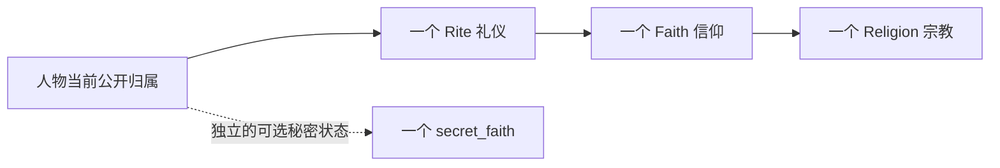

# CK3 人物为什么只有一个当前公开信仰

研究日期：2026-10-26（Asia/Shanghai）。结论来自原版定义、脚本和仓库已有版本绑定的原生实现研究；本轮未执行改宗、秘密改宗或双信仰实机实验。

## 结论与例外

准确说法是：**人物有一个当前公开宗教归属，原版还允许另有一个秘密信仰；没有两个地位相等、被常规接口同时返回的当前公开 Faith。**

“一个人物只可能关联一个 Faith 对象”不成立。原版 `faith` 与 `secret_faith` 可以同时存在，分别表示公开身份和隐藏信奉对象。这不等于两套完整宗教身份与效果自动叠加；具体规则必须看它读取哪一项。

本次读取的 1.20.0.4 已有 Rite 和个人核心教义。不要沿用旧版把 Faith、Rite、个人信念合成一层的解释。

## 单值归属怎样实现



这张图描述语义，不声称已查明秘密信仰的原生内存偏移。

原版 `game/common/religion/rite_types/_rite_types.info:35–40` 为 Rite 定义单个 `faith = key`；`faith_types/_faith_types.info:2–3` 为 Faith 定义必填的单个 `religion = key`。`localization/english/game_concepts_l_english.yml:321` 说明人物和伯爵领拥有 Faith，并遵循其一个 Rite。

[既有 1.20.0.2 原生研究](ck3-native-ai/ck3-1.20.0.2-religion-context.md)闭合了以下字段和 getter：

| 位置 | 语义 |
| --- | --- |
| `Character +0xB4` | 一个完整 RiteID，非 Rite 列表 |
| `Rite +0x4B8` | 一个完整 FaithID |
| `Faith +0x8C` | 一个完整 ReligionID |
| `Character.GetFaith` | 解析人物当前 Rite，再取得该 Rite 的 Faith |

字段常量见 `ck3_autonomous_player/native_bridge/include/xar_bridge/ck3_12002_religion_context.hpp:18–19`；实际 reader 在 `src/ck3_12002_religion_context.cpp:47–57` 读取单值，并对人物和 Rite 的 Faith getter 做一致性检查。

[改宗后态研究](ck3-native-ai/ck3-1.20.0.2-religion-conversion-outcome.md)第 42–43 行记录：setter 将目标 RiteID 覆盖写入人物 `+0xB4`；跨 Faith 时另更新 `+0xB8` 缓存。该缓存不是第二公开信仰槽。[后续 1.20.0.3 研究](ck3-native-ai/religion-self-conversion-action-native-ai-12003.md)也定位到替换当前 Rite 的 setter。

因此，连续两次设置当前信仰的含义是先改为 A、再改为 B，不能据此取得同时属于 A 与 B 的集合。

详细字段和 setter 证据分别绑定各自文档的 EXE，不将旧版地址直接当成本次新验证。仓库的 1.20.0.4 独立 profile 位于 `ck3_autonomous_player/native_bridge/include/xar_bridge/ck3_12004_religion_profile.hpp:10–14`：`Character.GetRite=0x28D2F70`、`Character.GetFaith=0x289E730`、`Rite.GetFaith=0x24FC540`；接线见 `src/ck3_12004_religion_bindings.cpp:70`。

## 秘密信仰确实是例外

本次实际读取原版 `game/common/scripted_effects/00_religious_interaction_effects.txt:1402–1415`：`make_character_crypto_religionist_effect` 检查人物尚无秘密信仰、目标与公开信仰不同，再调用 `set_character_secret_faith` 并添加 `secret_crypto_religionist`。

同一版本的 `game/events/religion_events/false_conversion_events.txt:98–107` 同时保存 `secret_faith` 与 `faith` 两个来源，并提供公开回归原信仰的选项。`game/common/scripted_effects/00_religion_effects.txt:682–686` 的公开改宗流程是：

```text
set_character_faith_with_conversion = secret_faith
remove_character_secret_faith = yes
```

这段原版代码证明：秘密对象能够与公开对象并存；公开身份转换使用替换和清除秘密状态的流程。它不证明每一项秘密信仰教义都像公开教义一样参与常规计算。

### 获取、知情与退出：2026-10-26 续查

人物的隐藏 Faith 归属与 `secret_crypto_religionist` 秘密记录是两个相关对象：前者用于 `secret_faith` 查询，后者接入知情者、曝光和勒索系统。原版 `make_character_crypto_religionist_effect` 同时设置隐藏身份并添加秘密；守卫拒绝已有秘密信仰或目标等于公开 Faith 的情况。秘密有效性也要求隐藏 Faith 存在且不同于公开 Faith，见 `common/scripted_triggers/00_secret_type_triggers.txt:404–420`。

正常游玩已找到的获取入口：

| 入口 | 实际脚本及条件 |
| --- | --- |
| 接受改宗要求时秘密保留旧信仰 | `common/scripted_effects/00_religious_interaction_effects.txt:1279–1282` 触发 `false_conversion.0900`，后者进入改宗选择事件。`events/religion_events/false_conversion_events.txt:820–864` 的秘密保留选项使用 `FALSE_CONVERSION = yes`；它会先改变公开 Rite，再把旧 Faith 设为秘密身份。已有对应秘密或 `forbid_crypto_reconversion` 会阻止这条选项；当前源码没有启用“必须拥有 sanctioned_false_conversion 教义参数”的选项守卫。具体显示文本随人物和家庭分支变化。 |
| 有秘密信仰的监护人传授 | `common/on_action/childhood_on_actions.txt:174–179` 在十五岁生日调用 `secret_faith.1001`；`events/secret_faith_events.txt:16–25` 检查监护人有秘密信仰、受教育者尚无且公开信仰不同。后续事件有成功、失败和泄露分支，不能说所有孩子自动继承。 |
| 特定旅行或剧情事件 | 例如 `events/travel_events/travel_events_fp3.txt:482–504` 提供秘密改宗，`:1298–1314` 的另一个选项还要求玩家及神秘主义／神学家等条件。这里可秘密接受另一个信仰，不只限于保存旧信仰。 |

普通界面的稳定中文定位可用 `localization/simp_chinese/event_localization/religion_events/other_doctrine_events_l_simp_chinese.yml:33–36`：改宗事件的选项表达“口头信奉对方，心里信奉原信仰”。获得以后，`localization/simp_chinese/decisions_l_simp_chinese.yml:852,867` 对应“揭示真正的信仰”和“舍弃秘密信仰”。不能把这些退出决议当作任意选择第二 Faith 的获取入口。

模组在人物 scope 中可调用已有原版封装，例如：

```text
make_character_crypto_religionist_effect = {
    CRYPTO_RELIGION = faith:rabbinic_faith
}
```

示例 Faith key 在当前 `common/religion/faith_types/00_faith_types.txt:2888` 存在；实际产品仍需选择自己的目标，保留原版封装的前置守卫。本轮只核对原版调用与定义，没有执行这段示例。

发现与公开曝光不同。`events/councillor_task_events/spymaster_task_events.txt:1698–1700` 的 `reveal_to` 让特定人物知情；`common/character_interactions/00_character_interactions.txt:1675–1728` 的曝光交互调用 `expose_secret`。同道互相知情还需明确满足秘密 Faith 相同及已知对方秘密，见 `common/scripted_triggers/00_crypto_religionist_triggers.txt:1–15`。向受教育者成功传授的效果还会让监护人与孩子互知对应秘密，见 `00_religious_interaction_effects.txt:1458–1489`。

秘密接入一般勒索系统，但不是一律犯罪：当前 `00_secret_type_triggers.txt:414–419` 将非神职人物归为受谴责，将神职人物归为犯罪。通用 `common/scripted_effects/00_secret_effects.txt:56–85` 按对应分类及 `can_add_hook` 检查产生弱／强勒索牵制；其他可曝光、可勒索资格继续适用。知道或曝光秘密，不自动赋予跨关系范围监禁任何人的权限；监禁仍须满足原版交互及监禁理由检查。

`common/secret_types/00_secret_types.txt:609–615` 的曝光钩子触发 `false_conversion.8000`。该事件提供宣称忠于公开信仰与公开改信秘密信仰的表态选项，**曝光本身没有在这个钩子里直接改宗**。公开改信分支在 `false_conversion_events.txt:1473–1476` 明确替换公开 Faith 并清除秘密 Faith。

保留一个具体实现边界：曝光事件中注释为放弃秘密信仰的分支（`:1458–1471`）只见虔诚、奉献等级和压力等效果，没有显式的 `remove_character_secret_faith`。本轮未实测它最终是否清除隐藏身份，不仅凭选项注释宣称该后态已完成。独立的“舍弃秘密信仰”决议则在 `common/decisions/10_religious_decisions.txt:1370–1390` 明确移除秘密记录并清除隐藏 Faith；要求成年且非狂热。主动公开回归决议也有自己的费用、资格和后续传播条件。

秘密身份的玩法由对应消费者决定，不能当作同时获得两套全部宗教规则或加成。已有专门消费者包括传授、互知、退出与曝光事件；县级假改宗另用 `false_convert` 变量及限期 modifier，不能当作人物秘密记录的同一存储。本文不穷举所有原生消费者，也不宣称已经实测完整生命周期。

## 为什么采用这种模型

以下是根据现有规则结构作出的设计解释，**不是对开发者未公开动机的断言**。

宗教身份会被婚姻、神职、犯罪、宗教敌意、战争、改宗、AI 和界面等系统消费。提供一个当前 Rite／Faith，让这些系统有一个明确的身份入口。具体效果仍可能分别来自 Rite、Faith、个人核心教义和专门脚本，不能说全都只读 Faith。

如果人物同时公开属于两个平等信仰，还需要定义一组原版当前没有普遍提供的组合规则。例如，一方允许多配偶、另一方实行单配偶时，如何判断婚姻合法；一方把某行为视为罪、另一方允许时，谁可以惩罚；宗教敌意是按两者最宽松、最严厉还是主次关系计算。仅把单值改成列表不能回答这些问题。

这属于游戏的数据模型与规则选择，不是宗教在现实中必然互斥，也不是计算机无法存储多个信仰。公开身份与个人实践可以分开；1.20 的个人核心教义正提供了更多个人差异。[官方开发日志](https://store.steampowered.com/news/posts/?appids=1158310&enddate=1778151882&feed=steam_community_announcements)说明个人采用的教义可不同于所属信仰的核心教义，甚至需要秘密实践被禁止的教义。

## 普通模组能做到什么

| 目标 | 与当前引擎模型的关系 |
| --- | --- |
| 公开属于 A、秘密信奉 B | 原版有专用机制；具体资格和效果仍遵循对应流程 |
| 在一个公开身份下实践多种来源的教义 | 可以利用个人核心教义、综摄或自定义规则表达；不自动增加一个公开 Faith |
| 融合双方内容，创建新 Rite／Faith | 结果仍使用一个原生归属；参考[已有融合可行性研究](../mod_religious_ritual_fusion/docs/feasibility-2026-10-24.md) |
| 变量保存第二信仰并定制效果 | 能表达模组自己的第二归属；原版既有消费者不会因此自动改读该变量 |
| 两个平等 Faith 被所有原生系统同时认可 | 不是普通配置开关；需要改变身份接口，并为相关消费者、保存、AI 与 UI 设计一致规则。本轮未实现或实测此能力 |

## 本轮来源与机器边界

- `machine_id: 4-8e1c2f1861`，由 `tools/ck3_live_run_id.py machine` 读回。
- 实际观察时间：`2026-10-25T21:09:18.982631+00:00`。
- 本机游戏根：`C:/Program Files (x86)/Steam/steamapps/common/Crusader Kings III/`，由仓库链接解析；`launcher/launcher-settings.json` 实际读回 `rawVersion=1.20.0.4`。
- 实际读取 EXE：101,040,248 B；本轮 SHA-256 为 `98702f88a547cde2eaf29a85f93b85f68ee4cf8148336a4f7afaeb75319dd518`。旧报告中的 build 25734779 仅作既有定位，本轮未重新读取 appmanifest，不把它写成本轮新增观察。
- 已有 .2/.3 原生研究只按各自精确版本引用。本轮新增验证限于上述原版文本及本机文件身份；没有读取或改变正在运行的游戏状态。
- 研究时原工作树被其他实机场次冻结，文档在独立的稀疏 detached worktree 编写；没有改变原工作树 HEAD 或 tracked 文件。仅新增小型说明，不复制游戏、存档、运行证据或构建载荷；按通用存储策略管理临时索引与工作树。
- 秘密信仰续查观察时间：`2026-10-25T21:30:42.034431+00:00`，同一 `machine_id: 4-8e1c2f1861`；`game/events/religion_events/false_conversion_events.txt` 实际 40,742 B，SHA-256 `3c058eb278a6fc959895fb62316aa9f184a87dc810bdda0221396f1cc22749ac`。仍为原版文本静态研究，没有在运行中的场次执行上述选项、调试命令或状态读取。
