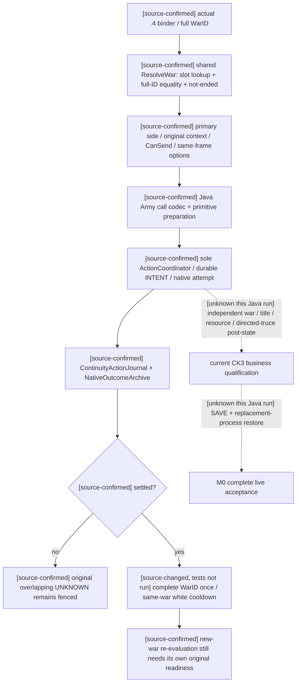

# M0 resume63：完整 WarID、终战一次性与恢复边界

`machine_id: xenoamess-full-tower-eb9d2c1186`。本轮沿 Root/capacity63 的新鲜机器与容量来源工作；本文不新授机器、部署、Steam 或运行资格。2026-10-26 UTC，前两批源码已经采用，Host 的实际测试边界见文末；本 owner 未构建、未运行测试、未启动 CK3。Java G2 完整实机仍为 0/8。

## 当前最有游戏价值的问题

同一玩家先前某场战争的已结算终战，是否会错误阻止另一场完整 WarID 的投降或白和重评？当前 Java `ArmyOrdinaryActionService.rejectReplay` 把共享玩家的 `ResourceClaims.overlaps` 同时用于未解动作隔离与已结算战争身份。前者有必要；后者过宽。不同战争都占用玩家角色，故旧的 confirmed rejection 也能使新战争 surrender 被拒，或把另一场白和误判为仍在本场冷却。

这是源码已证的生产缺口，不声称发生过新的 CK3 故障。最小修复保留未解动作的整个 overlap 守卫；仅在**已结算且已有真实 attempt**分支中，额外精确比较旧 `enforce-demands-W`、`surrender-war-W`、`offer-white-peace-W` 与输入的完整 W。相同完整 WarID 的原 once 规则、白和 719/720 ticks 边界及 MAA 原规则保持。不同完整 WarID 只解除这一个已结算历史屏障，不授合法性、策略选择或第二次动作权限。

## 原版、桥接与实际消费者

按 [REA 方法](../rea-ck3-research/methodology.md)、[工具边界](../rea-ck3-research/tools-and-context.md)、[本轮接口](../rea-ck3-research/resume63-framework-workflow.md)及[原版优先提示词](vanilla-first-implementation-prompt.md)先核已有来源，未重复导入 PE。

历史 [1.19.0.6 终战树](war-termination.md)已经区分主动提出、接收方评分、auto-accept、最终 CanSend 与实际发送。玩家胜负布尔值是 `player_victory`，由原生 context 内部处理攻守极性；防守者投降是绝对 `attacker_victory`。该版本的 RVA、动态条款与实机信用均不能外推 1.20.0.4。

当前 `.4` 源码链为 `ck3_12004_diplomacy.cpp::BindDiplomacyImage` 绑定实际 Core/Commands → 共享 `ck3_12002_diplomacy.cpp::ReadWarTerminationOptions` → `ResolveDiplomacyWar` → `ck3_12002_world.cpp::ResolveWar`。源码最后一个函数先以低 24 位找 slot，再核对象保存的**完整输入 ID**相等且 ended 为零。低位只是存储索引；Java 的 `16777239` 和 `33554455` 夹具共享低位 23，但不是同一战争。这是已读我方共享桥接实现，不冒充本轮已经从原版 PE 重新证明完整 resolver 的所有 producer/caller。

`0x2494B40` 在当前绑定中实际是 side descriptor 的 `ContainsParticipant`，不是 War resolver。初次给 REA owner 的错标签已经更正；没有按它进行 resolver 采样。当前 `.4` 的 context `0xCF57D0`、CanSend `0x307C020`、answer score `0x307C440` 仅沿已有来源引用。本轮统一 backend 正优先处理 Root 选定的独立 callee，没有为 M0 新导 PE、调用原生函数或采样这些入口。

终战结果的观察仍须分域。[WAR31 独立后验](war31-r0197-one-shot-live-result-2026-09-28.md)、[存档停战槽方向](war31-truce-slot-direction-2026-09-28.md)及[领地效果脚本顺序](war31-dejure-title-effect-sequence-2026-09-27.md)属于历史 1.19.0.6；缺明确机器身份的历史记录按 `machine_id: unknown` 使用。它们证明应分别读旧完整 WarID 缺席、title holder/liege、当前与累计资源、owner→toward 停战及独立保存/恢复，不能仅凭 WarID 消失宣称全部物质条款完整，也不能把保存六天后的差分倒填成提交同帧因果。

## 本轮已采用的三叶小 cut

开发根为 `D:/codex-ck3-demos/2026-10-25-java-g2-complete31-h5r5/java/ck3-control`。Root 明确认领、capacity63 在原 Root pool 内授予完整 128 KiB，无新 hold；本批净增 14,812 B。Host 是唯一构建/BUILD/m2 writer。本 owner 未编译或运行。两份旧候选先按当前实际 bytes/SHA 重核，再只采用相关 hunk；没有使用历史执行卡。

| 开发根下目标 | 本轮前像 | 当前后像 |
| --- | --- | --- |
| `native-transport/src/main/java/org/xar/ck3/control/nativebridge/capabilities/army/ArmyOrdinaryActionService.java` | 40470 B；`b934716b3aad83c7576ce6465a60e3731a7ee8530f493c89113397d0687852f3` | 41005 B；`5be6b55b82e1e24395807fdc379367e72893ed0983ec50e9f9db3aa5f73e6362` |
| `native-transport/src/test/java/org/xar/ck3/control/nativebridge/capabilities/army/ArmyOrdinaryActionBoundaryTest.java` | 9692 B；`a5a1aecc5734097ea345dc230c99d9675c43adbe2c9e657fd15467dcb0ba0b7e` | 14115 B；`7363a50ff10e5c52d27f8cd108d2c483eb21b1c13c70f7168206d75db3ff1f5b` |
| `local-service/src/test/java/org/xar/ck3/control/nativebridge/capabilities/army/ArmyTerminalReplayArchiveTest.java` | 不存在；CREATE_NEW | 9854 B；`51f9029f2a5101828ef74a167f59a3f44c813a94680d113a9eaaf9a173c427e5` |

Boundary 的新增回归经过现行 `ArmyCallCodec`、原 primitive、`NativeWire` 负 ACK decoder、`ActionEffects.validate` 后才把 receipt 交 replay guard，覆盖普通不同 ID、同 slot 不同世代、同 WarID once、白和 719/720 及 UNKNOWN 跨战争隔离。它是软件生产/消费合同，不是持久 writer 正例。

新 LS 两项测试补持久链：现行 `ArmyOrdinaryActionPreparation.primitive` → 真实 `NativeGameTransport`/`ActionCoordinator` → 唯一 writer 和 `NativeOutcomeArchive` → `ActionReceiptCodec` → writer reopen → `ContinuityActionJournal` 原件 → replay consumer。受控 I/O 返回一个明确标为 software 的 refusal token；installed domain replay 从同原 token 与归档材料重推 confirmed rejection，不声称 CK3 拒绝。另一项真实 ACK 后缺独立后态，保留 UNKNOWN，重新读同动作 ID 不再次提交。两项均检查 ledger/sequence 与实际 native write 计数不变。

必要测试选择已交 Host：NT `ArmyOrdinaryActionBoundaryTest` 8 项与 `ArmyOrdinaryWarClaimsTest` 3 项；LS `ArmyTerminalReplayArchiveTest` 2 项。**这些是应执行选择，不是已通过计数。** 现行 AWIF 未改，未放宽 deadline、validity、lint、守卫或断言。根仓缺完整 `native-transport`/`application` 模块，按 Root 更正不创建半模块镜像；i61 与最终完整图由 Delivery 唯一写入。

## 尚未闭合的 cold 与迁移问题

当前 Python `strategy.py:20524–20534::_history_after_latest_restore` 只在 effective command 为 restore 且 `ok is True` 时切历史；原 `native_driver.py:30484–30491` 的 raw 历史 helper 同样要求严格成功。Java `WarExitEvidence` 的两个 history 方法与 `WarExitCapabilities.effectiveAfterRestore` 原先均缺该成功判断。失败或未知 restore 清空终战 history 是另一个确定迁移偏差。

Root 后续批准、与 Host 开放写入窗口协调后，已在同开发根采用**独立第二 cut**，只增加三处 `OrdinaryHistory.successful(value)`。该共享函数只接受 `OpportunityJson.Bool(true)`，false、null、缺失、数值 1 均不通过。raw helper 保留原 native-driver 的 raw 命令职责；effective 两入口保留 strategy 的 auto-turn wrapper 职责。它们读取已存在的历史语义，不以请求 ACK 创造新的恢复资格。

| 第二 cut 目标（均为 `application/src/.../planning/warexit/`） | 本轮前像 | 当前后像 |
| --- | --- | --- |
| `main/java/org/xar/ck3/control/application/planning/warexit/WarExitEvidence.java` | 19345 B；`b499cf78c39fd4ff60498ac2c7ccdddd8dcb8d461309fc390e394b3fcf2a0062` | 19419 B；`ba8b3f9994486b621c5510444f6c01a9b855917d8d8481a862b1c942396542ac` |
| `main/java/org/xar/ck3/control/application/planning/warexit/WarExitCapabilities.java` | 10041 B；`f81f018b94aa0900942dc843c8dc4a0537ae571bcc4dd22a0e6f94c2320d9605` | 10078 B；`f71b940ae4808c45811ed403d2a0154ec2119eb0558b790f7ea71cd70307bdd2` |
| `test/java/org/xar/ck3/control/application/planning/warexit/WarExitHistoryFenceConsumerTest.java` | 14269 B；`76ca671827a19a7b985aaca347da53be63221285173f62bc149aa2674891996b` | 19650 B；`424211113dd482ff85f37ac9df14b9418f799f647272e9e6b2486d12ab9d1eea` |

第二 cut 净增 5,492 B，两批合计 20,304 B。新三项测试走当前 JSON 编码/解析、`WarExitCapabilities.project`、实际 LegacyWarExitPolicy 消费与两个 history 入口，覆盖 raw/auto-turn 的四种非 true 状态、已提交 once、UNKNOWN surrender、普通 defender 白和 cooldown、成功 restore 切界，以及切界之后的新 UNKNOWN 仍保留。该 test 类总 11 项，已交 Host 为必要选择，**未编译、未运行**。丢失的旧 R01 body 没有冒称恢复，也没有把这些软件输入授为实际 cold restore。

Cold17 已核真实原件 `D:/ck3-state/ck3-java-g2-resume61-m0-cold01/controls/ACTUAL-RESULT47.json`：strict5 实际生成 15 classes 并 PASS；whole17 于 180.210251001 秒超时，JUnit found/started/pass/fail 全 UNKNOWN。原 stdout/stderr 均为 0 B。`acceptance/coldrun47/before-cleanup.json` 仅列 Java PID251364 与 conhost PID220124，关闭后 Job0；没有 thread stack。该 suite 使用自有 Replay/Fixture，不能把 M3 AWIF 的 nested-query 耗时直接外推为其根因。

不再次无诊断重跑旧 Jar。有效下一步是保留原 20 秒 caller/30 秒 validity 与全部断言，对实际方法 start/finish 或 owned Java deadline 前的 `Thread.print` 留证，先定位等待/循环/文件验证成本，再修共享路径。外层 exit、超时、原生 ACK、独立后态、保存和恢复继续分别报告。

本轮成本仅小源读取、精确 source delta 与本页，未做性能 A/B；模型 token 未计量，没有速度或 token 节省结论。当前有效基线及失败保留由统一存储策略复核，不在本页续期或删除。

## Host 已返回的实际测试终态

以上三叶和第二 cut 的“未运行”描述是采用当时状态。后续 Host 回执分别确认：NT `ArmyOrdinaryActionBoundaryTest` 8/8、`ArmyOrdinaryWarClaimsTest` 3/3 为实际零 F/E/skip；APP `WarExitHistoryFenceConsumerTest` 11 项在第 93 批实际通过。两项 LS `ArmyTerminalReplayArchiveTest` 在第 96 批为 **2 F、0 E、0 skip**，不是通过。

第 96 批 close 为 `D:/codex-ck3-background/ck3-java-g2-resume-r4-20261025/resume63/host_integration/AFFECTED96-CANCELLED-FINAL-CLOSE01.json`，9272 B，SHA-256 `e67226056af0c531c5c98f37a6fa72948aef83a881876ea5e4bcfd89944801a5`。该批 fresh XML 实际 106 项：55 success、11 F、40 E；另 14 项未产出。不能把本 owner 的 NT/APP 小范围通过外推为整批或 LS 通过。

已直接读取 BUILD 下 `ck3-control-local-service/surefire-reports/TEST-org.xar.ck3.control.nativebridge.capabilities.army.ArmyTerminalReplayArchiveTest.xml`。两个方法各耗约 38/39 秒，均在 `terminalCommand:43` → AWIF `command:813` → `ready:699` 停于 `outer frozen observation/deadline expired before planning read publication`，尚未进入 terminal producer、归档或 replay 断言。XML 没有缺少 `episode_identity_pending` 的报错；其他 suite 的辅助夹具缺字段不能追认为这两个失败的根因。既不放宽 deadline，也不写本 owner 的假原生字段。此故障和 Cold17 各自等待有界线程/JFR 诊断，不互相替代归因。

## 下一处实际断边：当前 .4 最终接收方答复未回填

可证伪问题：在同一个合法、已 finalize 的终战 context 中，原生最终答复返回 2 时，当前 `.4` 查询是否仍只给出正数 AI 评分与 `recipient_response=unavailable`，使普通白和策略缺少真实最终结果？目前我方生产源码可以直接证实后半段：共享 `DiplomacyBindings` 没有最终 answer callback；`ReadWarTerminationOptions` 只调用 CanSend、raw score、auto-accept，未给三种 option 的既有 `recipient_response` 赋值。反例不能用手造 `would_accept_now=true` 或 AI 正分代替，必须经过同 context 的实际 callback。

实际入口已存在于当前 `.4` 的通用 `InteractionContextBindings12004`：`kInteractionEvaluateAnswerRva12004=0x307BC60`。Family 和 Prisoner 的共享源码已消费同一正式 callback。此次不套旧 `.2`/`.3` 全局偏移，不新采 PE，也不启动原生函数。以下均是已有可读原件的独立复核，不授运行中 CK3 资格；原件所述来源 EXE 为 `1.20.0.4 / Steam25734779 / 98702F88A547CDE2EAF29A85F93B85F68EE4CF8148336A4F7AFAEB75319DD518`。历史采样机器未在这些叶中独立重核，按 `machine_id: unknown` 使用。

| 已持完整 body，RVA 半开区间 | 字节 | 本轮 concat 解码与 held raw 比较及 raw SHA-256 |
| --- | ---: | --- |
| `CF57D0..CF5950`，终战 context | 384 | 相等；`97657caed0834de64eb8b85eff7820331c6aaa25279a855cd0cb75bbdbf5ee20` |
| `3076C70..3076E2C`，two-role 构造 | 444 | 相等；`c1c454a4ab85c2307952a4e6adb446e0bbf54b111d6aaf43323f4f48f4470800` |
| `307BC60..307BD63`，最终 answer 外层 | 259 | 相等、74 条连续覆盖；`d9cf9deb5f428029d6768f761c8de0b505a774612ea5fe6ada98dc518f3ea490` |
| `307BD70..307C016`，mode 分支 | 678 | 相等、完整连续覆盖；`4f2368ab46d541f20ca1706cc457d71fcf1b1dd75e34f1daa3c32987f8f4eaf4` |

合计 1765 B，小于原拟 4 KiB 范围；没有产生新的 raw 或整 PE 派生副本。已检索通用 `shared-span-cache` 的上述精确区间、`current4-context-release` 完整入口缓存，以及旧 continuation 的 `answer-mode-branch-307BD70.json`。没有以文件存在代替逐字节比较。

随后在同一已有 continuation 缓存补核外层直接 callee `307B340..307B6FE`：958 B，concat 与 held raw 逐字节相等；raw SHA `1f5adb0c096cdceb98cb0157e830cfba52467aa088ac6717fb07758276b3c807`。来源为 `actual-helper-source/answer-initial-gate-307B340.json`，57740 B、SHA `75813618e8f2a2ff45cfa287b99ff7be6d67ac1a2536e0893437f6627c698dbc`，其 `capture.cache` 指向 `shared-span-cache/new-0307B340-0307B6FE.bin`。总复核 body 为 2723 B，仍不新增采样或占用 provider slot。两个 null sink 使该 body 内对应输出/分配分支跳过；角色相等或其 `3148BB0` predicate 为真时返回 0，否则返回 3 供外层继续求值。该 opaque predicate 的 body 与精确名称未展开，不将它改写成我方自建 auto-accept 算法。

来源定位：

- `Z:/ck3_mod_rewrite_process_assets/g2-parallel-20261007/battle-pursuit/migration-steam25734779/actual4-domain/diplomacy-map/first01/war_resolution_context-DETAIL.json`，54128 B，`b987d554977ca61c30f5a19a8fe23b76a6b0cbc1f14eaaf0ba4c892efb4876a4`；raw 由其 `new_capture.cache` 指向共享缓存。
- `Z:/ck3_mod_rewrite_process_assets/g2-background-20261007/upstream-build-migration/prisoner/current4-context-release/construct_two_role_context-DETAIL.json`，65205 B，`2f366d26724ddd67be5694fca113c054893e8f331a166ea8c170ada10a2f55c6`。
- 同目录 `complete-cached/evaluate_answer_complete_cached_function-DETAIL.json`，48389 B，`6306d42c4fcb75a3e7c7453a5435559b2e066f4356ea11dc3b19bfb2e9c03a61`；raw 在 `stitched-caches/new-0307BC60-0307BD63.bin`。
- `D:/codex-ck3-background-spill/native71-continuation-20261010/continuation-39c/actual-helper-source/answer-mode-branch-307BD70.json`，45643 B，`4173ec9eda9221362e6f29c321321c35c258362c4ccbf044aa16b5ad3a1e3e8b`。
- 当前通用入口来源包 `current4-context-release/ROOT-DELIVERY.json`，19612 B，`a7e4eda7c1b1d261b978f949639e120260f748755f8350d91a1bd0220a4fb462`。这只是既有来源包，不是本轮新的 SDK/runtime card。

### ABI、调用顺序与已知未知

`307BC60` 先保存第四参数 R9、第三参数 R8B、第二参数 DL，再从**入口 RSP+0x28**取得第五参数，返回值为 AL/uint8。它先调用 `307B340`；满足其分支时返回 0，否则构造局部参数引用，并依据 context `+0x2E8` 是否为 -1 决定是否评估中间人，再以 mode=1 评估接收方。最终组合还有 `0x48B57EC` 数据表，本轮未读取表值，不推导全状态组合。已有软件合同统一将 0/1 解释为接受，2 为拒绝，其他值 unavailable；生产接入直接消费该最终值，不复制其内部评分算法。

`307BD70` 以 mode=1 到 `307C440` 读 recipient raw score，还读取 definition 的特定标志并走其他 gate。因此 `raw>0` 不是最终接受的充分证据。拟调用精确为 `evaluate_answer(context, 1, 0, nullptr, nullptr)`；第三参数 0 沿现存终战读取语义，和 Family/Prisoner 某些场景所用 1 不混用。两个 null 保持无输出 sink，不额外申请或销毁输出对象。

白和的现行 `WhitePeaceContext` 通过数据库 `+0x1000+3*8` 的 GDbO 定义、two-role 构造完成。完整构造 body 已确认在 `3076E05` 调用 `3078C70` finalize，再于 `3076E2B` 返回；不能再 finalize 第二次。终战 context 现行 default→`CF57D0`，后者局部调用相同 finalized two-role 构造，然后 `CF58CF` 调用 `CF5950` 转入输出；**`CF5950` callee body 本轮未重新持有或展开**。本候选不改变已用的构造/转移/销毁协议，只在原 CanSend 与诊断读取之后、原 destroy 之前消费同一 context。共享 reader 已对每个成功构造的本地 context 销毁一次；未成功返回目标指针的构造分支仍保留既有行为，不在本 cut 推测它的初始化/销毁资格。

原 `.2`/`.3` binder 的 callback 默认 null；不能因共享 reader 更新而把 `.4` RVA 混入旧 binder。`QueryReady` 不新增 optional answer callback 要求，维持旧版本的 options 可读能力。字段不可用时仍输出明确 unavailable/null，不能用 raw 或 auto-accept 回填。新 helper 必须单独调用，避免藏在 `ReadAcceptance` 的多个早退后面而漏掉生命周期分支。

### 最小生产候选与必要真实回归

源码当前未采用本候选，待 Native owner 独审及短 freeze。Root 已授权必要的最小共享 serializer seam，Native63 是唯一 Native 源码 writer，复用可开发 dev61 与 cached target，冻结 Source15 不动；本 owner 只负责本候选与后续 Java packet 消费测试。计划改动只围绕已有合同：

1. 在共享 `ck3_12002_diplomacy.hpp` 增加精确 uint8 answer 函数指针类型与默认 null 字段；当前 `.4` binder 复用已有正式 `BindInteractionContext12004(...).evaluate_answer`，不新建地址模型。
2. 在共享 reader 加独立 `ReadRecipientResponse`：仅在 constructed、validator passed、callback 非 null、raw/auto 诊断各 observable 时调用一次；只接受 0..2，回填现存 response 的 observable/raw/status!=2。surrender、victory 和 white-peace 三条都在原 destroy 之前调用。不改变 submit/UNKNOWN/once/white cooldown/MAA。
3. 扩展现存 `ck3_12002_diplomacy_test.cpp` 的真实 memory query：两种玩家攻守、status 0/1/2/3/255、高 raw+最终 2、validator false、callback null、诊断缺失、CB 禁白和、非 leader，核 callback 入参和调用计数、同一 context 未销毁、每个成功 context 仅销毁一次。binder 回归另核 `.4` 精确地址与错误 SHA 拒绝，旧 `.2`/`.3` 仍 null。
4. 当前实际 serializer 的三个函数 `AppendWarTerminationOption`、`AppendWarTerminationOptions`、`WarTerminationOptionsResultFrame` 位于 `bridge.cpp` 内部，无可链接的共享 seam。初次只查字面 target 误称 fixture 未接 CMake；Native63 实际 configure 已确认原 GLOB+foreach 自动登记它，现复用既有 `xar_ck3_12002_diplomacy_test` target/CTest，不新增同名 target。要报告真正 query→serializer 回归，需将这三个**现存实现**最小抽取到共享 serializer 叶，bridge 和该 fixture 调同一函数，并给该 affected fixture 补必要生产依赖。不能新写一套测试专用 JSON，也不能用 source token/order 测试替代真实序列化。
5. Java `ArmyWarReadCodec` 已在实际原 TOP/token 校验后调用 `NativeTerminationOptions.normalizeNativePacket`，再经 `WarTerminationReadProjection` 留存最终 answer，`ArmyWarPublicResultCodec`/`ArmyWarOriginalResultCodec` 和普通白和 policy 消费现存合同。它已严格要求 available response 有 validated context，status 为整数 0..2 且 would_accept_now 等于 status!=2，因此不增 Java DTO。必要回归应读取第 4 步 query+原 serializer 实际生成的有界 corpus，经过实际 decoder、public/original wire 与 policy，核最终 2/不可用均不变成接受，另核错 WarID、错字段/类型、missing/null 与序列化往返。既有 `WarTerminationReadMigrationTest` 的 Python 原方法比较可保留，但不能用它已有手造 options 正例冒充本次 native producer 结果。

以上是可复核候选及具体生产落点，不是编译或实机完成。是否已有 native query callback 可安全在原 context 消费由 native63 独审；本页不替 runtime 资格或完整 G2 八 M 验收签字。

## 对 M2 阈值 caller 的独立关键 CFG 复核

Root 指定的只读复核于 `2026-10-26T17:57Z` 完成，机器同本文。未取新 PE/provider、未改 SRC。实际输入为 `D:/ck3-state/ck3-java-g2-rea-eval-resume62/tools01/cases/resume63-m2-caller1850d40-01/attempt02/CAPSTONE-DIRECT-STDOUT01.json`，113890 B，SHA `c5745ff332eab71916b9f4011432f1d95d62c4e6bcd7d0d0e4e2109af659ed45`；2835 B raw 的 SHA 为 `ffe82bca56533e3a967555026ea5a76d7eb2eb891bd66c6d7653b4a6a1fbffab`。本 owner 将 638 条 instruction bytes 再拼接与 raw 比较为完全相等，连续覆盖 `[1850D40,1851853)`，独立按 raw signed rel8/rel32 建 successor，而未使用 M2 已生成的 CFG/结论作遍历输入；得到 63 个直接 CALL、67 个直接 jump。

结论须分两件事：**并非所有正常前驱都经过 `18516FB`**。`1851702 MOV R9D,R12D` 的本地前驱为 `18515C2`、`18515E5`、`18515EF`、`18516B2` 和 `18516FB`。例如允许 R15 为 null 的正常路径 `14EA→14F1→14FB(taken)→152B→15C2(taken)→1702→1712` 不经过 `16FB`；它也没执行 `16BB` 的指针覆盖，故 R12D 仍保留已选阈值。不能把“阈值到达 call”误写成“所有路径都 restore”。

反向检查也成立：去掉 `14EA` 或其 `14F1` 存储节点，entry 无路径到实际 `1851712 CALL18528A0`；从 `16BB MOV R12,[RBP+658]` 出发删去 `16FB MOV R12D,[RBP+650]` 后，无正常 CFG 路径到该 call。对 R12/slot650 做有限双值流跟踪，`14EA` 设 A、`151C CMOVNE` 可设 B、`14F1/1524` 保存、`16BB` 设 pointer、`16FB` 恢复，最终 `1702` 仅出现 A/A、B/B；没有 pointer/other 到达。早期 slot650 的其他用途被当前阶段 dominating `14F1` 覆盖，不把整 RF 的该槽统称阈值。

此结论严格使用 CALL 正常返回、Win64 nonvolatile R12 与 caller frame 保持的局部模型。callee 别名/越界写、unwind、外部中间入口、实际 GUI 触发均未证明。A=`DWORD[RVA5C67B18]`、B=`DWORD[RVA5C67B0C]` 的实际值与名字，以及 `459A410` 比较文本仍 UNKNOWN；复核不读取这些数据或给它们补名字。`18516B2` 是真实结构前驱，是否每种前置内存状态都可行不以图可达性替代证明。

## 原生实际生成与 Java 消费采用

Native63 独审后确认旧 dev61 实体也是冻结 Source15，故没有热改它；实际另初始化一次可复用 `D:/codex-ck3-background/ck3-java-g2-resume-r4-20261025/native63/m0-dev01/src/.../native_bridge` 与同包 build，在同目录逐次补必要依赖。本页前述“可开发 dev61”是准备阶段假设，以本次实际根为准。

真实来源为 `D:/ck3-state/ck3-java-g2-resume63-m0-native01/M0-CORPUS-PROVENANCE02.json`，14102 B，SHA `d3ed8fc13f0f824f3c896d01234ca742a58d68b4c326adc8814e54459934ab16`。01 中将 Ninja Windows 分隔符解析为零 source 的错误已由 02 明确更正；实际 affected target 有 23 个生产/fixture CPP。本 owner 已对 02 所列 33 个不同 source、binary、command/build/CTest 与 corpus Ref 逐项读取 bytes/SHA，全 MATCH。3 个抽出的原 serializer body 逐字节保留，bridge 与 query fixture 调用同一实现。

实际 binary 为 `.../m0-dev01/build/xar_ck3_12002_diplomacy_test.exe`，93184 B，SHA `dc00695600a1c7ed6e80083fecac7abacb968fbe00cd89a7a25b849793518509`。第 6 轮仅实际增量编译 2 CXX 并 link，23.706 秒、exit0；既有 CTest 实际 1/1 PASS，0.743 秒；独立 corpus 命令 exit0、0.044 秒、关闭后 active0。前面的 configure/链接失败原件保留，不把最后 2 CXX 说成整个 target 总共只有两个源，也不重建全 runtime。

实际 corpus 为该状态根下 `native-termination-recipient-resume63.ndjson`，18501 B，SHA `bba94a92c96e04d73055005f5474437fa0fec3d3d1e5ad2cfc809e8243dec659`；9 行均由真实 memory query 和共享原 serializer 输出，callback 是明确受控 uint8 软件返回值，未调用游戏函数。正式 step 为 `query-war-termination-options-33554435`、sequence17；玩家50331652、war33554435、日期53175816、持续200天、实际 heap key/index17 由 fixture 构造并经生产 query 读取。title101 不在此 DTO，后续只属于 Java 外层软件 observation。

Host 开放窗口内已 CREATE_NEW 采用两叶并 STOP，无本 owner 构建：

| SRC 下新增叶 | 实际后像 |
| --- | --- |
| `application/src/test/java/org/xar/ck3/control/nativebridge/capabilities/army/ArmyNativeTerminationRecipientTest.java` | 15289 B；`074467e17d3b4db11385e6989550735a8e3dac8f2b57d825c8b67bad3de6d745` |
| `application/src/test/resources/org/xar/ck3/control/nativebridge/capabilities/army/native-termination-recipient-resume63.ndjson` | 18501 B；`bba94a92c96e04d73055005f5474437fa0fec3d3d1e5ad2cfc809e8243dec659`，与原生成文件逐字节相等 |

两叶新增33790 B，M0 累计 SRC 净54094 B，仍在原128KiB净配内。Java 测试正例保留每行原 TOP bytes，实际经过 ArmyCallCodec、receipt decoder、original/public wire；随后另外用现有 `WarExitReads` 的 OPTIONS contract.prepare/decode 生产 same-frame cache，再消费到 `WarExitEvidence`、`OrdinaryWhitePeacePolicy` 与 `WarExitCapabilities`，没有在测试中手填查询 binding。9 个原生正例与 12 个错类型/缺字段/全 WarID 等拒绝向量合于两个 `@Test`，已交 Host 第102批必要选择，**Java 新2项尚未运行或通过**。Native 持久 CI 原样重生成/逐字节比对此资源的落地回执仍待 Native owner，不能只凭静态 corpus 宣称完成持续闭环。

本段只确认软件 query→原 serializer 及 Java 消费源采用，仍不授 CK3 live 接受、终战、后态、存档或 cold 恢复资格；LS Archive2 与 Cold17 仍保留原失败。

后续实际 `fc.exe /b` 比较通过：`M0-NATIVE-JAVA-RESOURCE-COMPARE01.json`，1864 B，SHA `4c056a9f514b537240ec70eb69fbd0d2b2a48ada535a0b8ece8532849e3a392b`，exit0、0.0138984 秒，命令前后双 pins 稳定。它证明原生生成文件与 Java 资源完全相同，不代表持久 CI 已运行。Host102 因前置 contracts 失败，新 Java 两项未执行。其终态后 Host 只开放一行注释修正，原 test 15289 B/`074467e1…de6d745` 精确改为“Persistent CI must…”要求式，现15293 B、SHA `430cfde37c381627dadbea97418d3a05b5a9135bc3e27715f967cf064f4b159f`；资源未改，M0 SRC累计净54098 B。已经 STOP，完整新2项交第103批；不回填102为已跑，不因前置失败跳过本用例。

第103批实际新2项为1 PASS、1 F、0 E/skip，已由 Acceptance 保全。已读实际 `BUILD/application/surefire-reports/TEST-org.xar.ck3.control.nativebridge.capabilities.army.ArmyNativeTerminationRecipientTest.xml`：9个原TOP贯通用例 PASS，0.555 秒；负例方法0.039秒，在第99行的 `1.0` 向量未抛异常。没有将整类记为通过。失败来自测试先把1.0解析成 DecimalNode 再用 mapper 重编码，使恶意 wire 数字可能规范化成1；生产 `ArmyJson.parse` 和 `NativeTerminationOptions` 的整数入口仍明确要求 `isIntegralNumber`，不能据此放松。

Host 开放这一个 APP 测试叶后，已只修测试输入保真并 STOP：test17588 B，SHA `b8e7de52737c2751972fe179a0f3c77c0b3057b2155ec6f32e031d26c0241ecd`。六个错误 status 直接替换原 TOP 的白和整数0 token；ACK 的 result 也保留同一原字节片段，另以原字段 JSON 比较核对切片。`1.0` 在 TOP/result 两处均断言仍为浮点，再交真实 decoder；全部9个正例、12个拒绝向量和原 expected 保留，不改生产或真实 corpus。累计 SRC 净56393 B。RUNTIME106 明确排除 APP 测试域，后续由 Host 对完整2项窄测；此处尚无修后通过结果。

## APP108 独立收口与首帧待办

APP108 实际 exit0、11.3755156秒，完整2/2 PASS、0F/E/skip；默认mvn、T2、-pl application -am，复用SRC/BUILD/m2/TMP，仅实际重编APP test1。独核原件为 `D:/ck3-state/ck3-java-g2-resume61-r7-ls18-regression04/controls/APP108-INDEPENDENT-RESULT01.json`，13348B，SHA `83827cbaf9150e1d16bbcd58d8557b47b6c808c28fee738e1e7c04edea7658c7`；绑定Host同O63的APP108实际3836B/`95ffb182e6777c10f0404dbd078de89eef467a8da8267b58ba4af0e6aad152a5`。本owner再核11个source/POM/corpus、4个class、3份gzip解压及Source107 closure均MATCH；不可变XML gzip2921B/`78f351f25b8bdcb07faa6a68ab66cec12279e6fff5434fc55e8b50a4f6b76681`解压17880B/`4a268930113a683321f57bd953a351576431fadffdd34d6bbae94e10abf5ae3c`，两方法均通过。外Job仍NOT_MEASURED；103的1F保留，Cold17/Archive2没有修后通过，未授Game或fresh Native重生信用。

新桥接实际进入Root且部署资格完成后的最小只读首帧：

- 绑定实际机器、Game PID/出生、EXE/DLL源码与二进制来源、episode、当前玩家、暂停、map与公开/原生revision/date。选择当前完整WarID、player_side、primary leader、primary_opponent_character_id；无战争或非主战领袖不能伪造三路可用。
- 用既有 `query_war_termination_options(ArmyCalls.War)`、真实expected_revision和注册read catalogue，保request_id、原TOP/token/packet及source binding；同时核query_sequence、查询前后同帧、日期、战争身份/攻守/分数、CB、duration和三种option的constructed/validator、raw+scale、auto与recipient_response。JSON错类型、跨帧/日期或不支持build均拒绝资格，不降级猜测。
- 0/1只作该context此刻最终答复，2为拒绝，3/255/null callback/缺诊断保持unavailable；raw正分不补最终接受。防守方原正报价可提议不等于对方已接受。
- receiver身份须分层：snapshot的primary_opponent只是预期收件人；现有options DTO未暴露final context的actor/recipient/intermediary ID，不能把角色重定向后的实际receiver追认为已核。已有pending时可用既有typed outbound-white-peace读核actor/recipient/pending ID；无pending不为核身份另发动作。该身份缺口保UNKNOWN、另交Native资格补证。
- 首帧只读不提交。后续真实动作须唯一writer、原合法通道与独立后态；ACK或答复不代表终战。UNKNOWN不重放，restore只有严格成功才切历史，同完整WarID once/719—720冷却不变；状态不足仅延后该选择，继续其余合法普通规划。无新runner、无本轮SRC写。

