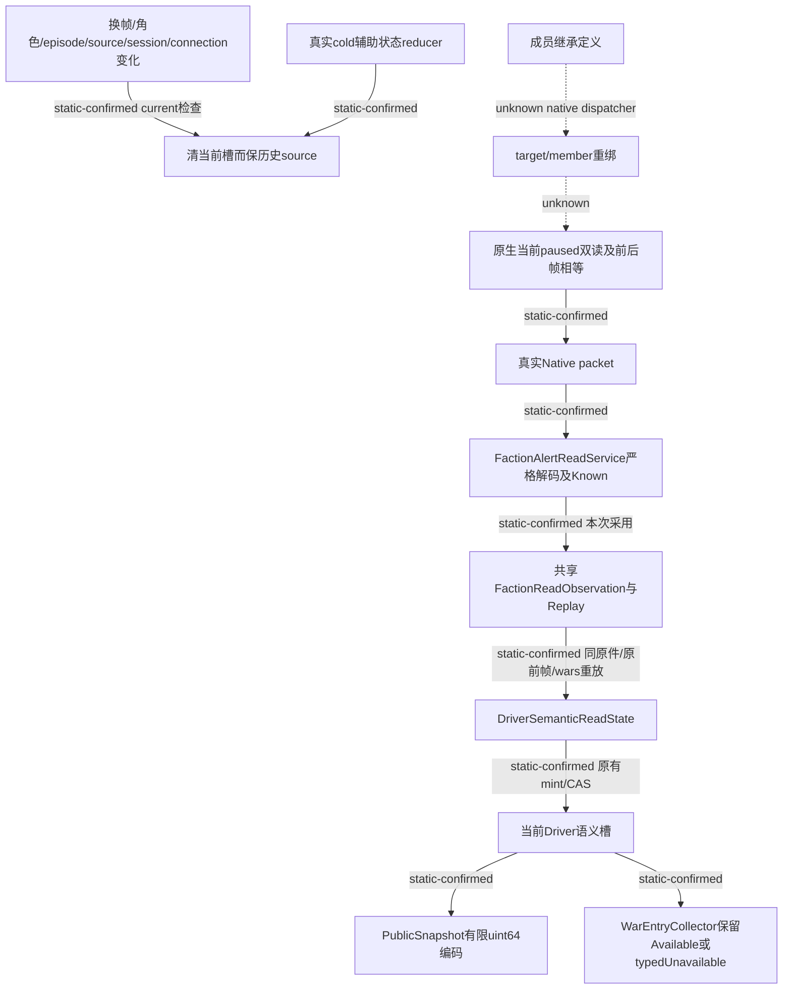

# M1 resume63：同帧根信息与真实 Faction 读取发布

`machine_id: xenoamess-full-tower-eb9d2c1186`。本轮源码观察及采用时间为 `2026-10-26T14:44:57.623Z`，测试补充采用于 `14:46:51.193Z`，同体继承缓存算法断言于 `15:05:25.501Z` 采用。共用生产源码仍为前述精确原件。本页使用 [resume63 新鲜机器/容量记录](</D:/codex-ck3-background/ck3-java-g2-resume-r4-20261025/resume63/capacity/CAPACITY63-TASK-START01.json>) 的机器及根映射；这不证明当前 CK3 Loaded 身份。没有启动 Game、Steam、Defender、JVM、Maven 或 Native 构建。以下变更均为 **SRC 已采用、编译/测试待执行**，没有新增游戏日或 M1 实机信用。

## REA 问题与证据边界

本轮先完整读取 [resume62 交接](../handover/2026-10-26-java-g2-resume62-rea-runtime-handoff.md)、其 source index、[REA 方法](../rea-ck3-research/methodology.md)、[工具边界](../rea-ck3-research/tools-and-context.md)、[本轮框架源码研究](../rea-ck3-research/resume63-framework-workflow.md)及[原版优先实施要求](vanilla-first-implementation-prompt.md)，再沿实际 C++ producer、Python 兼容合同、Java READ、原件重放、语义槽及规划消费者定位缺口。

本题的可证伪问题是：**已有真实 Faction READ 成功并归档时，当前 Java 是否把同一原件发布到普通规划所读的语义槽；换帧、冷清除和主体变化后会否借旧原件重新制造当前数据？** 反例包括 transport UNKNOWN 得到 Known、错误角色/日期/native revision 被接受、没有 source 的 body 被消费、冷清槽重放后恢复旧 body，或 uint64 经公开 JSON 丢精度。

没有为此重新导入全 PE、运行 Ghidra、复制 EXE 或重做已存 RF。REA 的 Evidence ID、schema 自洽、`truthVerified` 或工具 exit 0 均不替代领域结论。新 PE 采样由唯一 REA owner 统筹；本岗先复用现版 `0x2B250B0` 的已存 targeting 原件，下节记录了实际重核结果。真正写 target/member 的 dispatcher 最窄定位入口仍未知。没有新的该类 PE 采样。

本岗另直接读了安装发布包的 `dist/domain/evidence.js:174–198`、`dist/application/investigation/EvidenceLedger.js:208–266` 和 `dist/application/reverse/ReverseEngineeringService.js:134–157,416–566`：semantic ID 包含原始/规范化结果、provider、参数及覆盖承诺，排除展示路径；Unknown 的 `truthVerified` 只是已存 resolution disposition 的投影，更新使用 revision 匹配；raw provider 前后摘要只能检测跨调用变化，不能证明调用中每一瞬间的原字节。因而本页对 native dispatcher 的 UNKNOWN 不会被导入旧 evidence 或 registry 结案消除。该源审没有执行 provider 或产生新 PE 结论。

沿用的机制版本是 CK3 `1.20.0.4` / build `25734779`、EXE SHA `98702f88a547cde2eaf29a85f93b85f68ee4cf8148336a4f7afaeb75319dd518`。这来自既有绑定及本轮 REA owner 的文件重核，不是本岗对当前运行游戏的认证。

## 原版、桥接与我方消费者的实际链

| 链路 | 已证范围 | 未证范围 |
| --- | --- | --- |
| 当前根身份 | full CampaignRoot 在 application-main、paused/map-ready、当前正 revision 下取两个相等 Observation，并要求前后 Frame 相等；解析当前 actor、主头衔、首都、领主/最高领主、政府 | 不能把局部 getter 或旧版 RVA 当当前完整调度器 |
| 直属封臣 | 共享 reader 遍历当前角色 storage，过滤空/fallback、无效代际、死亡、非 immediate-liege-player、无当前主头衔，验证头衔 full-ID 回解，排序且拒重复；整个 Observation 双读比较 | 这是现桥接的完整扫描，尚未定位原版 AI 的候选索引/失效机制；没有性能等价或加速结论 |
| 邻接持有人 | 从当前玩家 subrealm 的实际省份边枚举邻省，排除同 subrealm，取 holder 并去重；related rows 再证明其主头衔、首都、liege/top-liege/关系角色 | 邻县 holder 不自动等于独立 ruler；全 subrealm 县集合、domain 槽数和直持县不互代 |
| 最低派系警报 | CampaignRoot 的 targeting count 与当前 full Faction targeting rows/县压力分别保留 | count 不等于已穷尽全部风险；没有可送礼角色也不等于没有县派系压力 |
| 派系加入/继承 | [88 调用链](g2-m1-membership-callers-12004-resume61-2026-10-26.md)和[90 定义](g2-m1-faction-inheritance-12004-resume61-2026-10-26.md)区分普通 AI、GUI、显式事件和拒命战争；`inherit_membership` 说的是成员继承资格 | target 君主死亡后的实际 target/member 重绑顺序、缓存失效/重算和 dispatcher 仍 UNKNOWN；不能由该开关推导 |
| Java 根缓存 | `CampaignRootContextJson` 严格规范化；`DriverCapabilityStateProducer.campaignRoot` 保留 receipt 原前帧、角色、public/native revision、query sequence 和 connection generation；公共 ROOT 使用当前同源实际 reader | 新 SEM 不能把旧 root body 追认为新鲜；历史 source 保留与当前可消费资格分开 |

现 C++ 源码入口为 `campaign_root_context_v1.cpp:930–1016,1125–1181,2039–2099`、`.4` 的 `ck3_12004_campaign_root_faction.cpp:21–65,92–126`；完整 `.4` 绑定与历史现场范围见 [full CampaignRoot 专题](ck3-1.20.0.4-full-campaign-root.md)。这些是源码/既有原件的复用，没有新增 native 执行信用。



图中的软件边为源审确认；本轮完整 central 回归尚未执行，所有 Game 后态保持未验。没有用注册或 Known 读取修复冒充新增原生能力。

## targeting 谓词的有限原件重核

`2026-10-26T14:54:55.288Z` 在本机重新读取现有 [source map](</Z:/ck3_mod_rewrite_process_assets/g2-background-20261007/upstream-build-migration/campaign-root-metrics-council/targeting-faction01/TARGETING-FACTION-COUNT-SOURCE-MAP.json>)（9230 B，SHA `4213ad9a7376d5f0aee21f6d54bb01f8de2b0c3aea36277d5b759bb4fc617b35`）、[完整旧 decode](</Z:/ck3_mod_rewrite_process_assets/g2-background-20261007/upstream-build-migration/campaign-root-metrics-council/targeting-faction01/capture02/has_targeting_faction_trigger-DETAIL.json>)（24669 B，SHA `b994d8e6071920efd5ba8965149f97db9182de0a32d2e69d1701ef9bfa612eb8`）及两份原字节。历史采样未携带明确机器 ID，故其 `machine_id: unknown`；本轮阅读机器 ID 不能倒填到历史采样。

| 原片段 | bytes / SHA-256 | 实际核对 |
| --- | --- | --- |
| [旧目标 02B250D0..02B25142](</Z:/ck3_mod_rewrite_process_assets/g2-background-20261007/upstream-build-migration/shared-span-cache/old-02B250D0-02B25142.bin>) | 114 / `4a2fcf44725e557bdaea722d47d0d029458d3a90c4a43de2a05b4fadb2268c51` | 32 条连续指令字节匹配；本轮不替旧样本补安装身份 |
| [`.4` 目标 02B250B0..02B25122](</Z:/ck3_mod_rewrite_process_assets/g2-background-20261007/upstream-build-migration/shared-span-cache/new-02B250B0-02B25122.bin>) | 114 / `db3bd0e3dacb4b028c0f0870ca2efccd24cb276e59d5cf84529c6dae67561bf0` | 32 条连续指令字节匹配 |

从 raw rel8 独立重算 `.4` 的七条直接控制边：offset 7→14、12→19、29→66、42→66、59→66、64→73、83→99，全部落在本片段已验证指令边界；offset 98 和113 均为 `ret`。逐条 x64 opcode/操作数复核没有 call、memory store 或范围外直接分支；`cmp [mem]` 是读取，`setne al` 只写寄存器。该复核不是新运行一个 decoder/backend，也没有把 RF metadata 的空值补成完整逻辑函数资格。

实际流程是读取 `RDX` 所指 scope、检查 tag4、取 full CharacterID；对 storage slot 的 index24、容量、对象指针及对象 full-ID 比较；失败则读 fallback。之后读 **Character+0x1C0**，非空时到 land `+0x120` vector，再比较 count `+0xC` 是否为零；空 land 走既存静态 fallback vector 的同一 count 比较。`RCX` 在这段没有作为外部参数使用，不能直接把它当 unary Character getter ABI。静态 fallback 的内容及其他 entry/caller 未在本题取证。

因此它足以支持此局部“是否至少一个 targeting faction”的字段来源，没有任何在该片段内更新 target、继承 member 或重算 AI 的操作。它不能推出全程序没有其他更新，也不能用读取 count 定位完整写入 dispatcher。现版 `.4` 的 `+0x1C0` 与旧 `1.19.0.6` 文献的 `+0x1B8` 必须分开；此前给 REA owner 的消息误带旧 offset，已在本轮原件重核后明确更正。本次读取、重核和简述零新 PE 读取、零 backend、新文件仅本页小增量，模型 token 与整体性能未测。

## 最紧要缺口与最小落地

当前 SRC 的 `DriverSemanticReadState` 没有 `FACTION_ALERTS`，实际 `FactionAlertReadService.Observation` 也未实现 application 下层的共享语义接口。当前 Runtime 的通用 `supports` 门因此不会发布该真实 Known 结果；已有 READ 与归档仍存在。这是既有能力迁移接点缺失。

本轮重新实读 [92 九叶选择](</D:/codex-ck3-background/ck3-java-g2-resume-r4-20261025/resume61/m1_research/current_cohort92/SOURCE-COHORT92.json>)及 [96 Service 重基](</D:/codex-ck3-background/ck3-java-g2-resume-r4-20261025/resume61/m1_research/current_service96/SOURCE-DELTA96.json>)：九个 donor bytes/SHA 全匹配、SRC 四个 replacement 前像全匹配、五个 add 目标全不存在。采用只限这九叶，保留当前 Service 的字段级 serial 编译修复，不递归采用 84、Realm、NEXT 或旧 Runtime/fixture。

1. 共享 `FactionReadObservation` 与 `FactionReadReplay` 把同一完整 selection、原 packet、原 result、原 before-frame/wars、source 和合同重放下沉至 application；没有第二个读取器或 writer。
2. 实际 Service Observation 实现接口并委托共享 decoder；现有 Runtime `afterKnown` 的通用 `supports → observeSemanticRead → publishCapabilityInputs` 调用继续使用同 Session、同 writer 锁及原 CAS。
3. `DriverSemanticReadState` 在 apply/replay/invalidate/cold-clear 中增加有限 Faction 分支。source 只有原 receipt 的 ExactRef；原件重放不能给清空后的 Nil 槽重新赋值。没有来源的已填 body 拒绝。
4. `PublicSnapshotCodec` 只转换实际 Faction body 及可选 county component 的两处 `snapshot_revision`，使用规范十进制字符串；decode 重建数值域后继续严格 normalize、日期/native revision/build/当前 actor 校验。
5. `WarEntryCollector` 保留严格合法的 typed Unavailable 空 actor，Available 仍必须匹配当前玩家。未知和不可用不被解释成安全空集。

采用根为 `D:/codex-ck3-demos/2026-10-25-java-g2-complete31-h5r5/java/ck3-control`。未写冻结图、i61 或根仓半模块镜像。Host 保持 BUILD/m2/build-tools 和整图 capture 的独占写入；本岗已分别报告短源码写入起止，后继增量构建仍须从同一可复用 SRC/BUILD/cache 执行。

## 实际采用的 after pins

下表路径相对上述 SRC。最终中心测试在原92后像上增加本轮 sourced-cold 回归；其余九叶采用原件保持原身份。

| 文件 | bytes | SHA-256 |
| --- | ---: | --- |
| `application/.../capabilities/FactionReadObservation.java` | 521 | `60bd93be125aee4c60bd4281b87705b24a42664ad8eeb108c01e97bfe9ab3d41` |
| `application/.../capabilities/FactionReadReplay.java` | 13274 | `c9bace3f836de2ebeeafdea5a05b683618507ef1270375675d83af06c4b1de27` |
| `native-transport/.../registry/FactionAlertReadService.java` | 33732 | `b08e004ad2956d6bbc589c28d763810993bcd55ccdd09b2bbe31e041140b65e3` |
| `application/.../driver/DriverSemanticReadState.java` | 18038 | `2f7baff892aaca6f1c8c3c1671f1a294aeaa194b5706850831af62fd2a2d1a28` |
| `application/.../driver/PublicSnapshotCodec.java` | 58222 | `c4a15656b1860aae5908cc667015f3db5971b7d83d06eeeb8d3fd83eaf22f0a5` |
| `application/.../planning/warentry/WarEntryCollector.java` | 19349 | `37c84e35c8b85d478f8910d8a2b6aeb322cfb40319ec9b59c05eda8a24588a37` |
| `application/src/test/.../driver/DriverFactionCacheSlotsTest.java` | 2796 | `00ffc66fb5b333231d9d6dc77a7b1e83e1d3c1d8316b50adbdf1b736e9d7ded7` |
| `local-service/src/test/.../root/FactionReadPublicationTest.java` | 33718 | `f8ca1a952d19245da89f4d48f752733296126a5905381bd56655b2c9a332caf0` |
| `local-service/src/test/resources/realm-ordinary/producer-bases.json` | 10992 | `32965884067c0d6d54b75aa6273e784564b6a219a2f7693e38fe257dc622748a` |
| `local-service/src/test/java/org/xar/ck3/control/application/driver/DriverFactionReplayAssertions.java` | 563 | `42e15179b92f3ed133f7f3ec4301d81d88143a1acfa375fb5189a78c23e87f78` |

最后一个是 test-only assertion bridge，直接访问真实 package-private `replaySources`；没有替代实现、`@Test`、main、runner 或新增生产 API。

## 回归与下一步

必要类为 application 的 `org.xar.ck3.control.application.driver.DriverFactionCacheSlotsTest` 三体，以及 local-service 的 `org.xar.ck3.control.service.root.FactionReadPublicationTest` 六体。中心只在 Native packet I/O 使用软件边界；真实 coordinator、guards、archive、StateProducer 原件重放、source/CAS、后续帧、整个 PublicSnapshot 编解码及 WarEntryCollector 走共享生产路径。未实例化完整 `DriverCapabilityRuntime`，其通用调用路径已单独源审。

既有五体覆盖 public revision 与 native revision 不等的真实 receiver、typed Unavailable、UINT64_MAX 的纯序列化、ACK 丢失 UNKNOWN、五种 acknowledged 错 Native body，以及下一真实 Native 帧失效。新增第六体从实际 READ/CAS 后的 `lease.driver().auxiliary()` 出发，经真实 `RootRestoreMaterialProjection.reduceAuxiliary` 清槽，再 JSON 往返和实际 `replaySources`：Nil 不复活、历史 source 保留，换 actor 的 body 和替换 receipt SHA 均须拒绝，整个过程只发原来一次 Native READ。

同一第六体还把实际 source auxiliary 交给 public `LifecycleReducer.clearEpisodeCaches`，再调用同一严格原件重放并要求 Faction 槽 Nil/source 保留；`continueSuccessor:61` 实际调用的正是这份 cache-clear producer。M3 已复核该调用边。这验证继承 consumer 共用的实际缓存算法，没有构造换 actor 的 Known 或私有 Snapshot。

这些断言不授 physical cold Game 启动、完整 SAVE/RESTORE 或自然继承信用。自然继承仍须消费 M3 的真实 lifecycle producer/reducer及私有来源合同；不能借 `inherit_membership` 或同场次标签建立连续性。真实 target/member native 重绑仍 UNKNOWN。

本次采用后的九体 **NOT_RUN**；历史 APP 三体 3/3 仍只证明上一轮那个窄版本。Acceptance 已收到当前 FQName、after pins 和测试范围，待 Host 对受影响模块增量编译成功后取得新的真实编测窗口。不得把 reactor 依赖列表称作全部重编，也不将后继局部成功外推成完整图或 Java M1 实机成功。

## Root launcher 的独立交叉源审

本岗对 launcher owner 的 [02 八叶候选](</D:/codex-ck3-background/ck3-java-g2-resume-r4-20261025/resume63/launcher63/ROOT-V5-CANDIDATE02.json>)（117657 B，SHA `6def2098a611afbafe030a31950eaecdda11d8165772afe92d0f7795c9d5867e`）和 [03 四操作 delta](</D:/codex-ck3-background/ck3-java-g2-resume-r4-20261025/resume63/launcher63/ROOT-V5-CANDIDATE03-DELTA.json>)（4394 B，SHA `67aaa29a57568508118d6e6fb93c0a6ac28d0f11abcbd28f063d2cee3d8f4248`）作只读内存重建。`15:06:29.656Z` 核八叶实际前像、70+4 操作匹配次数及中间后像全部 MATCH，没有写 build-tools 或执行候选。

初稿被本岗指出的两个真实 consumer 反例已在后继闭合：失败没有 evidence 时仍应保留原终态；完整来源不能由 self-reported 非空 witness 数组证明。另与 owner 一同发现 compact/source-drift RED 也会被无条件历史来源验证拒读，03 将普通 `read()` 的非 PASS 诊断与显式严格 `readRootEvidence` 分开。PASS 必须完整来源验证；RED/REJECTED 只读严格原终态和原 stdout，不授 package/source custody。历史验证核真实 binding、standing/delivery 六件物理路径和完整 package/outer/inputBefore source roster，且不把旧窗口当新准入。

03 的 Reader 后像为 21325 B / `12a050426417c6830a249427dc7474dbe93b8aa523b07b9a361932c7a9fb28af`，Shared 测试后像为 29387 B / `f85554f8fcb173e6bf761dbcfc02a026ac07aa58ba9f08813b15bd96c833a4b0`。新增 JUnit 精确为 15 体，三整类共 35 体。本次有限源审未见新的具体阻断，可交 Host 采用和增量编测；并不授已采用、已编译、已测试或运行资格。真实 accepted-package 与 standing-six 的可执行交集、sole start、slow preparation 的 deadline 与漂移路径仍须实际输入验证。

本次十叶逻辑 after 为 191205 B，相对实际前像净增 64718 B，未创建候选副本、PE、缓存或重型输出。采用及本页分别纳入 Root/capacity63 的 D 256 KiB source 净额和 Z 单文档 32 KiB；截至 `2026-10-26T16:40:26.824464Z` 重新复核，无自动续期。活跃源码/原件的继续用途为当前增量构建和完整迁移验收，最迟沿本轮必要基线 `2026-11-02T14:11:19Z` 复核；没有删除或物理释放信用。

## 后继真实原件：成员写入前的候选检查并非必经

`2026-10-26T17:00:00.458Z`，本岗在同一机器只读原件完成独审：[INDEPENDENT-M1-REVIEW01.json](</D:/ck3-state/ck3-java-g2-rea-eval-resume62/tools01/cases/resume63-m1-member-validity01/INDEPENDENT-M1-REVIEW01.json>)，7921 B，SHA `13d885a20d05d6a50390a3bf345900908d333a14fae40bc7aad39c1bad032300`。REA owner 已完成唯一真实查询及 owned close；本岗没有启动 provider、读取 PE 或修改源码。本节前向追加真实结论，原[准备卡](2026-10-27-m1-member-validity-followup.md)及最小 close 保留原状。

fresh RF 的目标12 B为 `f03a6002d641600210fd2505`，独立 LE32 解码为 `[2603AF0,26041D6,525FD10]`。receipt 实际记录17个表项探测、共204 B，不能把整个元数据读取说成只读12 B。新增 body 为854+886=1740 B，复用既存中间26 B；Rizin实际另读1766 B，其中26 B重复。完整拼接 SHA `6b629517b32864d453905389eeb0f9fb360159ff621fba5ee1a9197033debd5e`。这些 body 计数不包含 provider 加载/散列 PE 的成本。

本岗从 raw 独算53条条件/无条件直接分支及32个直接 call 的 signed target，逐条匹配 Capstone/Rizin 的417条指令、1766 B；另有2个间接 call。独立重建74块、121条正常局部边，与 provider 图逐边相等。正常返回是 `41CF`，`41D5` 是 INT3 trap；调用者、异常/unwind及所有 opaque callee 的副作用仍未闭合。图可达不等于实际运行可达，不采用自动 signature 命名 ABI。

实际值流已比准备卡收紧：

- `3B22` 把 stack-probe 后的 RCX 存入 R15；`3B65` 令 RBX=R15+48。该对象的成员向量、ID、类型、leader/war 字段与既有 faction reader 对应。
- EDX full-ID 先存入 EDI，再通过 `5C67568/70`、低24位索引、容量、slot及 `+18` 身份比对解析 R13；失败使用 fallback。局部 writer 没有据此自动证明 fallback 不会被接受。
- 先扫描已有成员 `+8`，重复则退出。新旧 count 与 resize 分支汇入 `3E42` 写 count；旧 count 定位行，`3E56` 写 owner=`[R15+10]`，`3E5D` 写 member=`[R13+18]`。两次 ID 写入之间无分支。
- 七次 push 后，RBP=入口RSP−1158h，因此 `[RBP+1180h]` 是入口RSP+28h 的一个字节。按普通 Win64 参数布局，它位于第五个栈参数的位置；其业务含义及真实 caller 取值未知。

局部正常控制流可概括为：

```text
duplicate member -> return
incoming byte != 0 -> append section
otherwise:
  call 2C7DED0(member, faction, &five_01_bytes, null)
  AL != 0 -> append section
  AL == 0 -> second call with output buffer -> cleanup/exit
append: resize -> count -> owner ID -> member ID
```

第一次 call 位于 `3BCE`，AL 非零通过 `3BD5→3D0F→3D22` 才进入 append；AL 零时 `3C10` 第二次调用，其返回不再作为 append 决策。候选检查究竟消费 persistent validity、can_join 或其他规则，尚无 callee/类型字段来源证明。

`3BA7→3D22` 可绕过这两次调用，独立支配分析确认 `3BCE` 不支配任一 ID store。独审另给普通数值见证：有效非 fallback member、无重复、旧 count=0、入口 byte=1；leader=-1 走 `3D41→3D61`；wanted=1>0，reserve 正常返回可写行且 count仍0，delta=1 初始化一次，再经 `3DEC→3E42` 写两 ID。它不借用 count 溢出的 `3DEE` 分支。该见证明确假设 opaque call 的所述正常返回效果，是局部符号赋值，不是 CK3 自然继承执行。

写入后还可见 member `+1B8` 非空时向该对象 `+110` 写 faction ID，随后有 opaque `2602250`、条件 war 调用及尾部 power 入口 `2601ED0`/`receiver+30` 写入。这里的 member-state `+1B8` 与 land/targeting 向量所用 `+1C0` 是两条边；本 RF 的 `receiver+40` 后续为读取，未出现显式 target 赋值。不能据此排除 callee 内的更新。

因此当前可采用的是“**可跳过的局部 pre-append 候选检查**”，不是“持续资格不运行”或“继承强制跳过资格”。实际继承 caller、其传入 byte、target 重绑、资格检查类别/当前 target 来源仍 UNKNOWN。最窄后继 seed 是已观察到的 `2C7DED0` 与真实传参；本节不授追加查询。Java 继续保留当前 source/frame/actor 的观测语义，成员身份合法不升级为 persistent 资格已验；没有由本题产生新生产字段或资格授予。

后继编测与此 native 查询分开：Host compile88 的 callback checked-IO 已单叶适配为 `UncheckedIOException(cause)`，测试叶 after33866 B / `3f5f9da74bfa8af7357e3bf0fc3a9792a1fc33c50715f9db4c9a732ab76bd5ae`，见 `resume63/m1/M1-COMPILE88-FIX01.json`。Acceptance93 报 application 三体实际3/3 PASS；local-service六体因上游 reactor 失败 SKIPPED/XML ABSENT，仍未授该中心链通过。本岗没有重编或重跑。

## 后继两层 gate：目标输入已定位，类型字段身份仍未知

同一 exact build 的两份新原件分别于 `2026-10-26T17:25:05.420Z`、`17:45:58.324Z` 完成 REA 最小 owned close，均0 owned。本岗只读原件/RAM 独审，未另读 PE、运行 provider 或改 Java。独审分别为：

- [Gate 独审](</D:/ck3-state/ck3-java-g2-rea-eval-resume62/tools01/cases/resume63-m1-gate2c7ded0-01/INDEPENDENT-M1-GATE-REVIEW01.json>)：7913 B / `121f9ebc5bd666a038ba9257415e694c2f2d18d4e0a83a48b02192ae676ba88d`，`17:34:55.639Z` 读回。
- [Base 独审](</D:/ck3-state/ck3-java-g2-rea-eval-resume62/tools01/cases/resume63-m1-base2c7d920-01/INDEPENDENT-M1-BASE-REVIEW01.json>)：8020 B / `fb5f406652df7edd4696ab2e0a9e4c9ae8565ba0d9d980e183d7e6e2f228d7cb`，`17:54:05.130Z` 读回。

`2C7DED0..2C7E1E7` 共791 B/197条，独立 raw/两decode及36块60边一致。其 fresh 包含 RF 共17次表项探测204 B，另有 PE/header/hash 成本。`2C7D920..2C7DC72` fresh 重核已知表项12 B，raw850 B/Capstone207条；Rizin仅展示前849 B/206条。末尾 `DC71=CC` 在正常入口图中孤立，Rizin不含此块。完整 raw 为36块57边，入口可达部分为35块57边，与 provider 逐边一致。不能把 provider 覆盖写成207条/850 B全同；异常、其他 entry 与 opaque call 仍未闭合。

参数流已定位至以下层级：

```text
member writer -> 2C7DED0(member, faction, flags, nullable_output)
  faction+40 full-ID -> character resolver含fallback -> target
  faction+20 -> type
  -> 2C7D920(member, target, flags, type, nullable_output)
       target tag==Char 且 full-ID!=-1
       -> 2C7D7E0(member, target, collector) -> raw Q
       -> optional type/member predicates
  -> further faction/member predicates -> writer TEST AL
```

这里的 target 是进入 gate 时实际读取的 faction `+40`，不是继承后已完成重绑的证明。Base 只检查 tag `43686172h` 与 ID不为−1；它没有据此证明 target 存活、匹配当前玩家或所有 fallback 均被拒。首个 `2C7D7E0` 只显式接收 member、target、collector，flags/type没有作为其普通参数下传。

| flags 的字节偏移 | 实际消费位置 | 本地门控及失败条件 |
| --- | --- | --- |
| `+2` | Gate `2C7DF64` | 非零才调用现绑定的 `2603A90(faction)`；返回AL非零为失败 |
| `+3` | Base `2C7D9FB` | 非零才调用 `28CB780(member)`；返回AL非零为失败，谓词业务身份未知 |
| `+4` | Base `2C7D9D6` | 非零才调用 `2C7E860(member,type,collector)`；返回AL零为失败，类型字段身份未知 |
| `+0/+1` | 两层没有显式读取 | Gate确实把完整指针传给Base；Base未再显式下传该flags指针，不能外推全局不用 |

这些字节均按执行至该点的实际内存值解释。读取发生在若干 opaque call 之后；上游初始化五个01字节不单独证明内存一直不变或被调函数纯读。

AL值流也已闭合到一个明确的 opaque 来源：Base保存 `2C7D7E0` 返回的原始低字节Q，随后只保留Q或清零。其所有正常 RET 都经过 `DBF4 MOVZX EAX,DIL`，所以Base全EAX是0..255中的Q或0，并没有把任意非零值转换为1。Gate保存这个P0，再经过可清零的过滤；正常 Win64 被调函数保存RDI的前提下，Gate的AL仍是P0或0。Gate早返 `XOR AL` 不能普遍约束EAX高位。writer使用的是 `TEST AL`，没有精确数值1的要求。

Gate另读取 faction `+44` leader，沿 `28BC250` 返回对象 `+20`、另一 full-ID registry和对象 `+358` 形成一个本地失败条件；`+358` 业务意义未证。最后还有 `2602720(faction,member,output)` 的AL过滤。不能用这些 call 名、自动字符串注释或共同的错误措辞命名 persistent validity。

可空输出并非已证“只影响文字”：Gate把它转交Base第五参数及末callee的R8；Base按非空输出构造collector，继续本会短路的检查、分配及序列化样调用，且存在静态初始化的全局store路径。各 opaque 副作用未跟随。实际 member writer 的第一次null-output调用决定是否append；失败后的第二次nonnull-output调用，其AL仍被caller忽略，不授第二次append资格。入口byte绕过两次调用的反例继续成立。

目前可以收为“显式使用目标和类型的复合 pre-append 检查”，仍不能判定哪一 native slot 对应 `is_character_valid`、`can_character_join` 或 loader/default。本Base仅把type传给 `2C7E860`，没有读取可命名的类型trigger字段。最窄类型后继是实际call `2C7D9E6→2C7E860(member,type,collector)`；其当前包含RF在本题未知，未执行新查询。

这些结论不改变现有Java观测合同：当前source/frame/actor及成员身份可被消费，persistent资格、自然继承caller、target重绑与首次继承后收敛继续分别UNKNOWN。没有依据本题新增资格DTO、producer或Native调用；原问题卡及各最小close保持原记录。

## Type261：只有一个已见类型字节，表达式所属仍未定

REA 本题于 `2026-10-26T18:26:00.903Z` 最小闭场，0 owned。独审原件为 [INDEPENDENT-M1-TYPE-REVIEW01.json](</D:/ck3-state/ck3-java-g2-rea-eval-resume62/tools01/cases/resume63-m1-type2c7e860-01/INDEPENDENT-M1-TYPE-REVIEW01.json>)，7160 B / `5445e3d09a5cc1e821099aadf01d3f068fb8ea4402fbcec6ed159f51c9ba9006`，`18:32:02.815Z` 读回。原261 B、59条指令、7条直接分支、6个直接/2个间接call及12块16边全部逐字节/目标/图边匹配；有两个正常RET，异常和opaque内部不在本题。没有新Game或本岗provider执行。

父Base实际传入 member、type、nullable collector。本体只显式读 entry type `+E5B` 一个字节：type非空且该字节非零时，直接 `E87C→E952 MOV AL,1` 返回，不调用任何opaque函数。字段的loader/default/脚本身份未知；该子检查的真值不把Base之前已经为零的Q变成整体成员资格。

其余路径保存 member slot，调用 `1D65640` 后，表达式receiver按 **memory64(返回值+EF0)+A90** 派生。调用时RCX仍含member、RDX含type、R8含collector，但形式参数是否使用这些寄存器未知。这个返回值的来源不等于已经证明的type字段；同样没有证明它与type不alias，不能擅称另一个独立对象或global manager。`EF0/A90` 因而没有被闭合为CFactionType trigger slot。

`9D78D0(&local,&memberSlot)` 返回的context进入两个分支：collector非空时显式传给 `372E4D0(receiver,context,collector)`；为空时调用 `372DF10(receiver,context)`，R8未在context调用后重设，不能将其描述为显式null第三参。context的完整内容、两入口的语义等价性及副作用未知。

所选调用的原始AL存入BL，经过真实cleanup后，`TEST BL` 分别走 `XOR AL,AL` 或 `MOV AL,1`。在正常被调函数保存RBX的前提下，**本Type分支的AL确为0/1**；两出口都只赋AL，不能据此把整个EAX当规范bool。cleanup的栈/上下文字段写与virtual call均保留在原件，没有纯函数或仅文本的结论。

这关闭的是类型子检查的实际字段读取与返回消费，并未关闭 `is_character_valid` / `can_character_join` 的字段身份、自然继承caller、target重绑或loaded定义。后继问题须从已持候选来源和实际调用者接续；本节不自动追getter或所有callee。Java源码未改，也没有新增命名的E5B资格字段。


