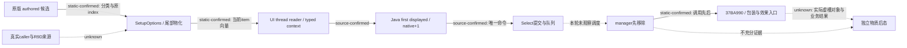

# M2 resume63：实际显示选择、来源知识与独立后态

`machine_id: xenoamess-full-tower-eb9d2c1186`。本岗于 2026-10-26T14:43:19Z 完成下面三叶的精确操作采用与读回；机器身份由本轮 `py tools/ck3_live_run_id.py machine` 实际读回。这里记录源码研究与 Java 采用，编译、JUnit、CK3 启动、新增游戏日、自然事件和物质后态均未执行。本轮 M2 三自然事件（至少两个多选）实机信用仍为 **0**。

研究先读 [resume62 交接](../handover/2026-10-26-java-g2-resume62-rea-runtime-handoff.md)、[来源索引](../handover/2026-10-26-java-g2-resume62-rea-runtime-handoff-source-index.json)、[REA 方法](../rea-ck3-research/methodology.md)、[工具边界](../rea-ck3-research/tools-and-context.md)和[原版优先提示词](vanilla-first-implementation-prompt.md)。本次采用 REA 的问题→精确输入→有限查询→独立检查→结论/未知项方法；本岗不重复启动REA backend，15:05 UTC补充复用唯一REA owner的实际新case并独立核字节关系。当前机器 Ghidra 尚无成功伪代码，Rizin raw Evidence 不当作 native dossier，也不宣称效率或 token 收益。

## 已证原版流程及边界

目标版本引用既有证据的 CK3 `1.20.0.4 / build25734779`，EXE SHA-256 `98702f88a547cde2eaf29a85f93b85f68ee4cf8148336a4f7afaeb75319dd518`。本岗没有重新读取安装 EXE，旧采集的 `machine_id: unknown` 保持原身份。

| 阶段 | 实际来源与本轮可用结论 | 未闭部分 |
|---|---|---|
| 当前事件与窗口 | 当前 .4 typed early handler → request-owned mailbox → UI owning-thread reader → serializer → Java `EventWindowRead` / `EventWindowCodec`。成功读取的内层 unavailable 与外层失败 READ 是两类结果。见[实际分流](java-m2-event-window-unavailable-routing-resume61-20261026.md)。 | 当前自然事件实例、窗口材料及实际读回未取得。源码 DTO 完成不授窗口 available。 |
| 候选生产 | .4 `SetupOptions 18528A0` 对 authored 项分类，随后以 authored index 调用 append；`185D060` 在尾部构造，扩容保序；`18586D0` 将真实传入 index/bool 写入 item `+1B0/+1B4`。见[显示选项研究](event-options-authored-rendered-12004-2026-10-26.md)。 | 真实直接 caller、原 `R9D` 阈值来源、刷新/失效、谓词完整语义与 NPC AI 权重仍 unknown。不能以旧版相似布局补当前语义。 |
| 显示绑定与我方选择 | reader 保留 `rendered_index`、`native_option_index`、shown/enabled；我方当前第一显示项绑定实际 native index，public number 为 `native+1`。 | authored0 不等于 displayed0；显示行数不等于 authored count；无显示项不授权公共负索引提交。 |
| 选择提交 | bridge 重新核当前实例和索引，构造原生命令并提交。原 UI 的 empty-list 分支也存在内部 `-1` → clone/queue 路径，但公共 bridge 拒绝负数。 | submit/queue ACK 不授执行、窗口消失或效果。内部 `-1` 不是新的公共操作方式。 |
| 原生执行 | `29BDDE0` 外层先嵌套移除命令，manager 槽级移除和清理返回后才调用 `37BA990`。见[执行顺序](event-select-execution-poststate-order-12004-2026-10-26.md)及[实际移除](event-removal-container-segments-12004.md)。 | 深拷贝/所有权、ID map/复用、最终释放、SAVE/LOAD 生命周期未全部闭合。窗口消失可以早于最终选项处理。 |
| 最终效果入口 | .4 `37BA990` 的 941 B 已证 choice 范围与 selected option `+310` 调用，以及独立 definition `+208` 调用；二者经过 `3765860` 包装。见[最终入口](event-final-option-dispatch-12004-20261026.md)。 | `3765E50` 的虚槽 `+B0` 具体对象、脚本实际效果与材料后态未全部闭合。某层没读 enabled 不证明禁用项可执行。 |
| 独立后态 | Java 原动作经 `NativeEventEffects`、原归档 verifier 与 journal 保存实际 post-read；原窗口消费与金币/特质/关系等材料结果分记。见[结算合同](../java-event-action-outcome-continuation-20261026.md)。 | 本轮无真实自然事件、实际后态或保存验收。UNKNOWN 不重发原动作。 |

本轮源码事实只证明玩家 GUI、我方 bridge/Java 的对应关系。没有用 GUI 物化路径替代 NPC AI 的候选搜索、评分或权重；没有宣称完整原版 M2 已研究完毕。

## 直接行为缺口与最小修复38

可证伪问题：一份首显示项因禁用或未 advertised 而 `selected_step=null` 的真实计划，在来源知识变为 known 后，public/direct 泛型路径是否会越过该首项？

修前 `EventPolicies.firstDisplayedPlan` 在 selected 为 null 时先返回，未读取来源知识；`PublicEventResolution` 随后自行读取 known，进入后续 enabled 项评分。已有合法首项的 known 评分路径是既有行为，本次只修复 blocked 首项被重新选成后项的分支。

真实 Java 关系为：

1. `RegisteredEventCore` 先处理既有 dedicated / registered 策略；原生窗口与同帧输入无合法推荐时，才进入普通 first-display continuation。
2. `UnhandledEventFallback.planFirstDisplayed` 从当前 materialized rows 挑最小 rendered index，并保存其 native index；首项禁用或缺少对应步骤时保存 null selected。
3. `SourceReviewedEventConsumer.continueWithExistingPlan` 核 roots 后读取持久来源知识，注释 known/unknown；其 blocked 泛型分支保留 null selected、`registry_contract_accepted=false`、`material_effects_verified=false`。既有 faction 专用路径保其原有条件。
4. public resolution 在 dedicated / registered / 既有 source-reviewed faction 策略之后，对 blocked first-display 保留原 null selected；不进入泛型后项评分。显式指定选项入口不由此修改。
5. ordinary continuation 使用同一个来源 reader。若 blocked 首项遇到真正的 `TrustedEventSourceContext.UnavailableException`，先尝试保存原 blocked DATA，再原样抛异常；capture 失败仅加入 suppressed，不降为普通 unknown。合法未知首项仍按原政策继续，不要求预先 registry 通过。
6. `EventRuntimeInstaller.preparePublicEvent` 的现存 caller 在得到 null selected 后保存 blocked 原件并抛 `PublicSelectionRejected`，尚未生成 `ActionCommand`。private pending caller 同样拒绝无 selected 的计划。这里是静态 caller 复核，新增软件测试没有运行这些原生 I/O。

候选来自不可变 [EVENTS36–41 封件](</D:/ck3-state/ck3-java-g2-resume61-r7-ls18-regression04/controls/handover62/ram-ops/EVENTS36-41-RAMOPS01.json>)：91563 B，SHA `ffca05bfab42a450c71e37c10a487c47da36d963a1da849a38f40a7ab8fdbc67`。本岗独立检查其八叶当前前像均匹配，只选 **38 的三叶五个唯一字符串操作**；没有把36/37/39/40/41混入首cut。全部操作先在内存组合，再于实际写入前重核前像，写后逐字节读回。Root 认领与 capacity63 授权只覆盖这次采用，不授编译或实机。

SRC 为 `D:/codex-ck3-demos/2026-10-25-java-g2-complete31-h5r5/java/ck3-control`。

| SRC 相对叶 | 操作数 | 实际 before（bytes / SHA256） | 实际 after（bytes / SHA256） |
|---|---:|---|---|
| `application/.../planning/events/EventPolicies.java` | 3 | 42540 / `235613115242113c874aa7ab8581b9b517c6b0bdfe8a2478c32b4d5a2bc5e15b` | 43896 / `1e1a20de6568eff7575dec6e5cc654dfc92d55f8a617cb17c11fbf2f0fcbd408` |
| `application/.../planning/events/PublicEventResolution.java` | 1 | 18571 / `7c367bc07b47b2daa859e6bf1384ce266f4041862b88ca5580e98e937a10a2a8` | 18716 / `625388b0cbedae738e7f2ff74ec136e063ec88345dde87bad207bd9df439a039` |
| `local-service/.../service/UnknownEventProductionChainTest.java` | 38插入及双revision/合法日历修正 | 44365 / `f132acb6459fc8e726dfe0f4e3cba259cd585af74fdb37ead29752845b91bc3d` | 51574 / `82cc627efe33d0aafc3dfffaa8f87528883960f0d5dda44f11bc446a524acbf2` |

状态为 **SOURCE_ADOPTED / NOT_COMPILED / NOT_RUN / NO_LIVE_CREDIT**。Host63 仍独占 BUILD、Maven m2 与 build-tools；已收到完整 after pins，并请求编译可执行后运行 `UnknownEventProductionChainTest` 整类。14:47:35.908Z 经Host确认无capture后，再从38后的51277 B / `c2ffe3c6918ac0d09a01037ab151c8fa509c72d8b5e5d4cf4615a391debe1daa` 测试前像采用两项唯一操作：真实Driver facts producer的public revision取native+1000，新增blocked用例显式断言两域不同。其他两个生产叶未再修改；此测试加强也未编译或执行。

15:13:08.626Z，源审发现原Harness仍以 `10660101` 冒作CDate raw；真实 `DriverObservationAssembler` v1会调用 `NativeCalendarObservation.project`，该值既早于epoch，也不是whole-day，不能产生Complete。经Host确认域未冻结后，改为单一 `CampaignCalendar.dateToRaw("1066.1.1")`，同步原始snapshot、context、Binding和断言六处使用；保留public/native不同和生产日期守卫。该148 B净增修正已读回，原51426 B / `e1912bae…`是此前真实采用状态，当前pin见上表。此为修改范围内的静态夹具纠正，未冒充已观察JUnit失败或通过。

新增两项测试采用既有真实 journal→scan→worker→analyzer→registry publication→ACK→新帧 producer 链，核 disabled-first 与 unadvertised-first 在 source-known 后 public/direct/ordinary 三入口均 blocked，并核原件、no-followup 与显式 false 权限字段；另一项核 source-root drift 保存 blocked DATA 后仍 unavailable。原整类保留 dedicated/query-required 优先、合法未知首项、序列化、ACK-only未消失未结算、窗口实际推进与独立材料缺失等用例。尚未执行，不记 pass。夹具不授 CK3 选择、Loaded/VFS 或真实材料结果。

## coherent20 的当前真实状态

只读核对 [COHERENT-SOURCE20](</D:/codex-ck3-background/ck3-java-g2-resume-r4-20261025/resume61/m2_research/production_companions20/COHERENT-SOURCE20.json>) 的20个目标后发现：**7叶仍不存在，12叶仍逐字节等旧 actual_current_before，1叶已漂移**。计数是采用38前的观察；38使其中 `EventPolicies` 的当前前像变化。不能把旧整包或已读源码算成接续已采用。

缺失叶为 `IncidentReadIndex` 及其测试、`SessionControllerRetainedDataEntryTest`、`RootBlockedPendingIncidentTest`、`RootFailedReadIncidentTest`、`NativeWindowDiagnostic`、`RetainedIncidentBatchSource`。漂移叶为 `McpAutoTurnEncoderTest`，需独立按当前实现合并，不整叶回退。

后继按实际依赖拆解审阅与验收：

| 链 | 必要生产者→消费者 | 资格边界 |
|---|---|---|
| 原 READ 身份与scan | `IncidentReadIndex` v1/v2/v3 → `EpisodeIncidentJournal` 写/读 → `OfflineScanSource` 对完整原件的消费与回归 | Known receipt、失败 READ 原件和没有 READ 分别编码；失败 DATA不变成成功窗口。 |
| 真失败 READ 捕获 | `ActionPorts.loadFailedReadOriginals` → `NativeOutcomeArchive` 实际依赖 → `RootIncidentRuntime` capture → `EventRuntimeInstaller` / `RootNaturalSuccessionOriginals` 实际调用与 `RootFailedReadIncidentTest` | 实际 before/prepared/outcome/可选 after 的来源齐全；ACK不推造 after，无attempt保留无原件。 |
| 跨批离线接续 | `RetainedIncidentBatchSource` → `RootIncidentRuntime.retainedOriginalBatches` → `RootApplicationSession` / `SessionController` 批边界及回归 | 旧 batch 的失败/ACK/来源保留，不合成 Ready，不重放结果未知的游戏动作。 |
| 共享诊断body | `NativeWindowDiagnostic` → ordinary `EventPolicies.diagnosticWait` 与 private/root caller | 仅统一 DATA 形状，不授新动作。38与旧20此方法hunk不重叠，仍须按当前前像重基。 |

第一条合同通过不能外推后两条已安装。完整同Prepared输入、Root launcher、SERVICE、SDK及全图编译等由其 owner 继续推进，本文件不更改其完成状态。

## 14:57 UTC：cut①合同、journal与scan五叶实际采用

Root明确续派后，本岗只在SRC采用 `IncidentReadIndex.java`、`IncidentReadIndexTest.java`、`EpisodeIncidentJournal.java`、`OfflineScanSource.java`、`EpisodeIncidentJournalTest.java` 五叶，未改首38的生产叶。Host确认当前仅build-tools/reactor POM冻结，授权该领域短写入窗口。写前重新核三份旧前像和两份目标不存在；在内存应用13个生产patch hunk，组合后与coherent20具名donor SHA一致，最后直接原地写入并逐字节读回。新合同和原合同测试也先核donor SHA，再使用CREATE_NEW写入。

实际回执为 [CUT1-SOURCE-ADOPTED63](</D:/codex-ck3-background/ck3-java-g2-resume-r4-20261025/resume63/m2_research/CUT1-SOURCE-ADOPTED63.json>)，观察时间 `2026-10-26T14:57:16.779Z`。本cut状态仍 **SOURCE_ADOPTED / NOT_COMPILED / NOT_RUN**。

| SRC相对叶 | 实际after bytes | 实际after SHA256 |
|---|---:|---|
| `contracts/.../offline/IncidentReadIndex.java` | 7290 | `cb27c2e137da12798aa76b681739ba3a6a2fa753d8869d5d9e9a439a55da26a6` |
| `contracts/.../offline/IncidentReadIndexTest.java` | 5267 | `f093138a8466c649aa39c6afbb7b631d176eb4ca749e790c740436ddaaeb35e6` |
| `application/.../planning/events/EpisodeIncidentJournal.java` | 63022 | `b788f44c0fbbd93d47c5bc1ddebe76fdc172dc5256b138fad4741cbb87b9a263` |
| `wave2-events/.../unhandledevent/OfflineScanSource.java` | 23117 | `0f0ddc216fa4c3feb2726e2af9774f3c12c859e0e49d4a029013998d66be4c45` |
| `application/.../planning/EpisodeIncidentJournalTest.java` | 25673 | `53fb9412e1c1bf9903c130d220af12b29d38ece3b48371639538a6465e8d6c5f` |

单一合同保持 v1无READ原件、v2一份原成功receipt引用、v3真实失败outcome/prepared request/显式可空observed proof及显式dependency refs，原版本读取保留。`IncidentReadIndex`只编码/校验值，不跟随文件或授成功读取；journal物理核原件、写before-index、scan纳入明确refs；`OfflineScanSource`消费同一合同并对完整inventory及各明确角色做读回/recheck。全SRC搜索的v1 before-index生产/读取仅命中journal和OfflineScanSource两类，已在本cut同步；其它wrapper继续消费其已有typed结果。

新增三个物理回归从原journal writer出发，经真实scan/manifest及 `OfflineScanSource.load/recheck`，再经原ACK入口和后续scan；覆盖成功receipt保留、v3缺observed proof但显式null与重复dependency的线表示保留/物理去重、改动后拒绝重放、错误read-ref类型、失败READ不得伪造displayed选择。这里的引用内容明确是synthetic DATA，不能冒充实际coordinator/archive失败语义；后者必须由cut②原producer/caller回归闭合。原 `IncidentReadIndexTest` 保缺失/null/错类型和v1/v2/v3混用拒绝、序列化往返。Host已收到两个完整类的执行请求；当前没有编译或JUnit计数。

本cut四叶在coherent20清单内，另一叶是现存journal测试扩充。上节7缺失/12旧/1漂移是采用前的真实清点；它不继续冒充采用后的状态。真实failed READ writer/caller链及跨批钩子仍未采用，第一条SOURCE_ADOPTED不能授cut②或③已接、Ready、成功窗口、选择或物质结果。

capacity63将M2同一Root净额上限由256KiB增至320KiB以包含目录及小回执余量，全局hold不增。首38加本cut源码after合计238407 B，测试候选9653 B，另有小型实际回执；没有磁盘整after/temp副本。本文仍使用原Z32KiB配额。

## 15:08 UTC：cut②真实失败READ与blocked捕获九叶采用

Root批准以下九叶独占，Host确认仅Tools范围冻结，M3确认没有并写三个Root叶。capacity63沿原Root源池再净分128KiB，M2 complete cap为448KiB，全局hold不增。五份既存SRC前像合计324357 B直接复用，变更后351780 B；四份NEW共45668 B。此cut逻辑净增73091 B，不能将397448 B总after误记为新副本，也不把逻辑净增当实际native allocation。

实际采用、写前末次比较和写后逐字节读回于 `2026-10-26T15:08:25.084Z` 完成，见 [CUT2-SOURCE-ADOPTED63](</D:/codex-ck3-background/ck3-java-g2-resume-r4-20261025/resume63/m2_research/CUT2-SOURCE-ADOPTED63.json>)。五个既存生产叶经24个exact hunk组合，after均等coherent20具名donor；新增RootBlocked测试只将旧的不存在方法 `journal::acknowledgeSourceReview` 修为当前真实 `journal::acknowledge`，没有新增别名。

| SRC相对叶 | after bytes | after SHA256 |
|---|---:|---|
| `application/.../action/ActionPorts.java` | 19260 | `7c614082fdd015fa0580bf4e74b9b93f1d6e96ceda12019d42eba231a2da05f2` |
| `local-service/.../continuity/writer/NativeOutcomeArchive.java` | 109949 | `a8096c4e9bc322967e89b324cf39a121b55a971595da56fdc3af2891b945b70c` |
| `local-service/.../service/root/RootIncidentRuntime.java` | 40595 | `444a3a94984f108ceae37991701b386903df08aab7f5e3e52a10b744c485c024` |
| `local-service/.../service/root/RootNaturalSuccessionOriginals.java` | 113096 | `8839493754580d091271508c81f50100fb0767f04332af4f5ddda94e46d0dd2f` |
| `local-service/.../service/root/EventRuntimeInstaller.java` | 68880 | `c6828e5c99dc785a4a47ae487f3f4e95f650027cce4983b4351ae91428e3292f` |
| `application/.../planning/events/NativeWindowDiagnostic.java` | 3695 | `1b63bda50fd3b2b9c64b743a82a7732c9cc06c2e9f7ad4f1dd8fbfd4f98829fd` |
| `contracts/.../offline/RetainedIncidentBatchSource.java` | 931 | `dab7e9fceaf9945c18e8743faf6a6d71dd8944050c880aa21d28cc689e1bee9b` |
| `local-service/.../service/root/RootBlockedPendingIncidentTest.java` | 23466 | `1567dcad7fa398bff94ae356f510726ac091fb60c2660dd68fe9a79edc965639` |
| `local-service/.../service/root/RootFailedReadIncidentTest.java` | 17576 | `c564bf4435b9eee3878e7c35c01a4d8a90e89c133faf6ea7bb9b6874e6377561` |

当前实际private Source在 `RootPendingUiRuntime.PendingEventSource.read` 核同一installed contract、private scope与完整frame，随后调用 `natural.read`；Installer的 `actual.read` 正消费该Source。新scope只在这次原read中把真实 `Unavailable`/attempt/archive交给原failure observer，DATA保留不重新申请clock或Game窗口；callback和writer head不得漂移。Known内层unavailable或实际disabled私有选择走其原成功receipt的v2捕获，真正失败READ走v3原outcome/prepared/可选observed proof及实际依赖；没有attempt保留无成功凭据的诊断。

`NativeOutcomeArchive.loadFailedReadOriginals`在原writer下跟踪已有reader实际消费的明确原件，保持native Pin/来源验证；没有after时不构造after。RootIncidentRuntime把同一合同交journal/scan。本次共用原有限 `retainedOriginalBatches` helper和Source port，统一旧scan loop；尚未把port装进RootApplicationSession/SessionController批入口，**cut③仍未接**。

Host已收到 `RootBlockedPendingIncidentTest`、`RootFailedReadIncidentTest` 两整类请求。后者从实际软件NativeWire/read coordinator失败出发，涵盖negative ACK、lost response、malformed payload、capture I/O失败、无可用after proof，再经真实capture/冷journal/wire/scan读取；它明确不伪造private Current/parent/Ready，也不授Natural或整Root资格。前者复用既有private read/preparation原件，验证blocked capture及已存来源被改动时拒绝。当前这两类和cut①/38全部 **NOT_COMPILED / NOT_RUN**，没有用源码采用抵扣真实失败、窗口结果、自然多选事件或物质验收。

## 未闭原生问题与下一次现场

已向唯一 REA backend owner 请求先查旧 `18528A0` caller/xref 与原 `R9D` 来源。REA63 复核现有专题仍明确没有该具名直接caller；尚未遍历全D缓存，不能据文档缺命中声明全项目不存在。当前唯一新64MiB case由REA63用于 `1D64290` 的有限230B研究，本岗不重复开后端或重新导全PE。后续如果旧证据不能回答，另给明确 caller 定位范围、字节与预算，不以局部空xref推全图不存在。

15:05:06.885Z，本岗实际读回REA63的 [CASE-RECEIPT01](</D:/ck3-state/ck3-java-g2-rea-eval-resume62/tools01/cases/resume63-callee1d64290-01/CASE-RECEIPT01.json>)（5331 B，SHA `f19a23177229f056000c620423f44ab173eb0f42200d1dfc2b8bda507f7b0269`）、[CROSSCHECK01](</D:/ck3-state/ck3-java-g2-rea-eval-resume62/tools01/cases/resume63-callee1d64290-01/CROSSCHECK01.json>)及独立Capstone输出，再以本岗Node独立重拼48条原字节、230 B、SHA `4aee55a25a91582bad0af6a486f3271ab5d652257f4e0366571fe5e87833d380`、RF `[1D64290,1D64376)` 和6条CALL/2条JZ的有符号相对目标，全部一致。未再次读PE或调用decoder/backend。

人工数据流确认：incoming RDX保入RBX；读取其 `+18` dword并零扩展到local，另写tag4；`1D65640`返回对象的 `+EF0` 指针加 `1930` 后交 `372DF10`，原AL经EBX/BL保留到EAX，没有0/1归一化。在六个direct和两个virtual callee正常返回并遵守nonvolatile RBX的条件下，本地五块六边闭合；不推callee语义、unwind或副作用。原body没有direct `+308` 读取；root/candidate标签依赖具名caller，不是自动签名证明。此predicate gate不是M2窗口选择或材料结果，不据此新增Java兵力/到场/胜率判断。官方REA直接service的实际成功与先前Shared资格拒绝分别保留；outer Job0/peak和模型token仍未测，没有额外Game资格。

新的 Java 现场必须保留每个自然事件的实例/定义ID、实际帧与双revision、玩家/episode、完整显示行顺序与原生native-index、既有策略或首项决策、唯一提交和原回执、原窗口是否消失、独立材料 before/after、下一普通step与保存结果。至少三个自然事件且两个多选的要求不由旧Python、单选、源码或ACK抵扣。

未覆盖事件沿用户规则当场采集、选实际第一显示项并继续；批后离线核原版定义、效果与来源SHA并补共享知识。首项禁用或缺原生通道时保真实诊断，不能改选后项或冒称完成。选择结果未知不重复提交。当前源研究不恢复“先补registry才续行”的旧阻塞规则。

本次没有性能A/B、模型usage或实际token计量，没有普遍优于原版或提速结论。受控写入使用 Root D4MiB 净额中的 M2 256KiB，引用 [CAPACITY63-TASK-START01](</D:/codex-ck3-background/ck3-java-g2-resume-r4-20261025/resume63/capacity/CAPACITY63-TASK-START01.json>)（capacity63通知TTL为2026-10-26T16:40:26Z）；本文≤32KiB计入Root Z4MiB。没有新C盘bulk、冻结图修改、根仓半模块或i61写入。

## 15:32 UTC：cut③采用与23唯一叶冻结

Root批准的最后七叶已在Host短窗、capacity确认原448KiB内之后一次采用。实际写入时间 `2026-10-26T15:32:02.332Z`，写前末次比较、目标不存在检查及写后逐字节读回通过，见 [CUT3-SOURCE-ADOPTED63](</D:/codex-ck3-background/ck3-java-g2-resume-r4-20261025/resume63/m2_research/CUT3-SOURCE-ADOPTED63.json>)：3698 B，SHA `b29ee36865ba7cc0e11969ee311e54518e25c256b9759b7daba9b47064cace24`。逻辑净增26001 B含NEW14792 B，正增长和27529 B。没有磁盘temp或整after副本。

Controller在首次batch前绑定同一retained source，统一当前、旧batch和未成功分析的不可变DATA；失败队列保留原件，不重发UNKNOWN动作。RootApplicationSession在原transport continuity失败时调用同一DATA drain，不生成Ready、batch时钟或报告。生产构造器绑定实际resourceCatalog.offline；两个SAVE/MCP纯软件fixture显式绑定空DATA源，未跑batch的Natural adoption fixture不假绑。new retained-entry测试从冷journal原件进入真实Controller拒绝入口；单纯构造Data不授消费通过。新测试也改用CampaignCalendar合法raw日期。EventPolicies只合并共享diagnosticWait，保38；Mcp测试保当前漂移，只合并两hunk。

最后23叶在 `2026-10-26T15:32:29.088Z` 全部重新只读核pin。以下是唯一当前终态，前文各cut表为采用时历史；Host可据此冻结编译。到本观察点所有新增/修改软件测试仍 **NOT_COMPILED / NOT_RUN**，没有Game命令或新增游戏日。按Root要求停止扩叶，等待Host实际application/LS诊断。

| SRC完整相对叶 | 当前bytes | 当前SHA256 |
|---|---:|---|
| `application/src/main/java/org/xar/ck3/control/application/action/ActionPorts.java` | 19260 | `7c614082fdd015fa0580bf4e74b9b93f1d6e96ceda12019d42eba231a2da05f2` |
| `application/src/main/java/org/xar/ck3/control/application/planning/events/EpisodeIncidentJournal.java` | 63022 | `b788f44c0fbbd93d47c5bc1ddebe76fdc172dc5256b138fad4741cbb87b9a263` |
| `application/src/main/java/org/xar/ck3/control/application/planning/events/EventPolicies.java` | 42368 | `8c88418948151b71dfb01b84503d855f946f4809caca79802a90cfb0fc910eed` |
| `application/src/main/java/org/xar/ck3/control/application/planning/events/NativeWindowDiagnostic.java` | 3695 | `1b63bda50fd3b2b9c64b743a82a7732c9cc06c2e9f7ad4f1dd8fbfd4f98829fd` |
| `application/src/main/java/org/xar/ck3/control/application/planning/events/PublicEventResolution.java` | 18716 | `625388b0cbedae738e7f2ff74ec136e063ec88345dde87bad207bd9df439a039` |
| `application/src/main/java/org/xar/ck3/control/application/session/SessionController.java` | 81491 | `679a680016f2b4a791a46d55de1f3066ae302a3a54902eda08e5c51d5d3ca3da` |
| `application/src/test/java/org/xar/ck3/control/application/planning/EpisodeIncidentJournalTest.java` | 25673 | `53fb9412e1c1bf9903c130d220af12b29d38ece3b48371639538a6465e8d6c5f` |
| `application/src/test/java/org/xar/ck3/control/application/session/SessionControllerRegressionTest.java` | 85218 | `eb30f7b3571804db2c0682c89d9e445fef33ddb4b840fb74b7c2552073cd2225` |
| `application/src/test/java/org/xar/ck3/control/application/session/SessionControllerRetainedDataEntryTest.java` | 14792 | `0e58059b631d8bd771cd96b3d6ea98afcde515d183d668075ddf1137d5987d0d` |
| `contracts/src/main/java/org/xar/ck3/control/contracts/offline/IncidentReadIndex.java` | 7290 | `cb27c2e137da12798aa76b681739ba3a6a2fa753d8869d5d9e9a439a55da26a6` |
| `contracts/src/main/java/org/xar/ck3/control/contracts/offline/RetainedIncidentBatchSource.java` | 931 | `dab7e9fceaf9945c18e8743faf6a6d71dd8944050c880aa21d28cc689e1bee9b` |
| `contracts/src/test/java/org/xar/ck3/control/contracts/offline/IncidentReadIndexTest.java` | 5267 | `f093138a8466c649aa39c6afbb7b631d176eb4ca749e790c740436ddaaeb35e6` |
| `local-service/src/main/java/org/xar/ck3/control/continuity/writer/NativeOutcomeArchive.java` | 109949 | `a8096c4e9bc322967e89b324cf39a121b55a971595da56fdc3af2891b945b70c` |
| `local-service/src/main/java/org/xar/ck3/control/service/root/EventRuntimeInstaller.java` | 68880 | `c6828e5c99dc785a4a47ae487f3f4e95f650027cce4983b4351ae91428e3292f` |
| `local-service/src/main/java/org/xar/ck3/control/service/root/RootApplicationSession.java` | 77858 | `ecd81b0ea4cda12bbb5c59e09eb3d90f53328c4cd1ed3cd0941282bf37f1b17b` |
| `local-service/src/main/java/org/xar/ck3/control/service/root/RootIncidentRuntime.java` | 40595 | `444a3a94984f108ceae37991701b386903df08aab7f5e3e52a10b744c485c024` |
| `local-service/src/main/java/org/xar/ck3/control/service/root/RootNaturalSuccessionOriginals.java` | 113096 | `8839493754580d091271508c81f50100fb0767f04332af4f5ddda94e46d0dd2f` |
| `local-service/src/test/java/org/xar/ck3/control/nativebridge/PublicCheckpointControllerAdoptionTest.java` | 11811 | `3ff1de9005283ec80303c3c52174b837b73217d3847fc16cf87b811eeb57556e` |
| `local-service/src/test/java/org/xar/ck3/control/service/mcp/McpAutoTurnEncoderTest.java` | 26022 | `eeed1e40239559b5e76e2d8c8356f74d577bdf64637233eac6a05c5e4c7b71ef` |
| `local-service/src/test/java/org/xar/ck3/control/service/root/RootBlockedPendingIncidentTest.java` | 23466 | `1567dcad7fa398bff94ae356f510726ac091fb60c2660dd68fe9a79edc965639` |
| `local-service/src/test/java/org/xar/ck3/control/service/root/RootFailedReadIncidentTest.java` | 17576 | `c564bf4435b9eee3878e7c35c01a4d8a90e89c133faf6ea7bb9b6874e6377561` |
| `local-service/src/test/java/org/xar/ck3/control/service/UnknownEventProductionChainTest.java` | 51574 | `82cc627efe33d0aafc3dfffaa8f87528883960f0d5dda44f11bc446a524acbf2` |
| `wave2-events/src/main/java/org/xar/ck3/control/wave2/events/unhandledevent/OfflineScanSource.java` | 23117 | `0f0ddc216fa4c3feb2726e2af9774f3c12c859e0e49d4a029013998d66be4c45` |

待Host执行的九个整类：`UnknownEventProductionChainTest`、`IncidentReadIndexTest`、`EpisodeIncidentJournalTest`、`RootBlockedPendingIncidentTest`、`RootFailedReadIncidentTest`、`SessionControllerRegressionTest`、`SessionControllerRetainedDataEntryTest`、`PublicCheckpointControllerAdoptionTest`、`McpAutoTurnEncoderTest`。依用户要求在复用SRC/BUILD内先局部并发编译必要依赖及消费者，真实局部通过后再完整验收；此处未代执行。

存储为原448KiB cap内：capacity63按前像/after净增及逐叶页、目录、回执余量核得cut③前保守265581 B，加cut③72585 B上界为338166 B，余120586 B；这是预算估算，native allocation仍未测，不是实测物理占用。没有动Root余192KiB。M2三个自然事件/两个多选及独立物质后态仍待新Java实机，源码冻结不授该验收。

