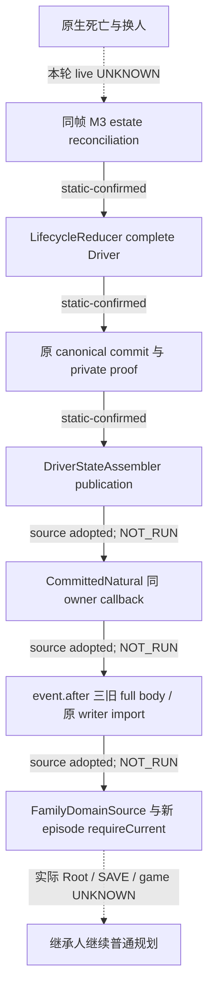

# M3：自然继承、REA 来源复核与 q10 过期诊断

`machine_id: xenoamess-full-tower-eb9d2c1186`。2026-10-26 UTC；本轮机器、实体根与容量事实取自 `resume63/capacity/CAPACITY63-TASK-START01.json`（14:40:26Z）及 `SCOPE63-NET-PARTITIONS01.json`（14:51:27Z）。源码观察和采用在 D 盘可复用 SRC；没有读取新 CK3 PE、启动游戏、操作 Steam/Defender 或初始化 Genesis。源码、编译、软件测试、真实 Root 场景及游戏信用分别记录。

已读 [resume62 交接](../handover/2026-10-26-java-g2-resume62-rea-runtime-handoff.md)及索引、[REA 方法](../rea-ck3-research/methodology.md)、[工具边界](../rea-ck3-research/tools-and-context.md)和[原版优先提示词](vanilla-first-implementation-prompt.md)。本轮按问题→输入/原件→有限查询→独立核对 caller/cache/consumer→结论与 UNKNOWN 工作。纯 Java 与已有原生原件复核属于该等价证据流程；未声称执行了新的 REA native provider。模型 token 未测。

## 真实链与修改结果

Java `M3Research` 是五种 schema 的只读路由，不产生自然继承权威。实际 `LifecycleReducer.continueSuccessor` 要求 paused 的 `played_character_changed`、living successor、完整 MATCHED estate、同帧 successor binding 和旧 episode；随后更新 Driver、goal 与 auxiliary。`LifecycleComposites` 持有真正 parent/commit/private proof，由原 writer 验 canonical event，再发布完整 Driver。

原 mutable 路径只归档 auxiliary 的 `family_marriage_ledger`；普通 Family consumer 读取的却是三份 canonical full body：`FAMILY`、`CHILD_MATRILINEAL`、`DEFAULT_MARRIAGE`。旧 pending episode 或旧 `java_next_episode` marker 会被 strict consumer 拒绝。NEXT 明确要求 physical Game 改变，不能当同 Game natural 授权。原断点见[来源链](natural-succession-canonical-family-domains-2026-10-26.md)，后继见[完整候选](family-natural-same-game-domain-migration-20261026.md)。

采用路径只在 writable `continueOriginal → observe` 和 warm post-publication 点 import；cold `recoverCommittedPendingEpisode` 保持只读。token 核同 issuer、Session、physical owner、actual parent、published complete Driver 与原 canonical event。旧 body 从 event.after 取，较晚 `ALREADY_COMMITTED Receipt.head` 不能代替原事件起点。部分 import 保存真实 Prepared/Receipt；缺返回时读实际 historical import，缺匹配原件保持 UNKNOWN，不重送原动作。保全旧 pending/resolved、扩展字段及 marker，不授关系、付款、婚姻完成或游戏日信用。

## 精确采用与验证边界

当前 cohort 是 Family39 + Lifecycle26 metadata（选原20 Composites 和19的实际 fixture）+ RA83。**19 的 Composites WITHHELD；旧22/34/RA71 selector 不选择。** RA83 修正 preDriver install 读取未绑定 collector 的静态缺口；route key 来自实际 ManagedGame，权威仍来自 private proof。

2026-10-26T14:44:22.405Z 逐叶重验：3 maps 与9 raw pins MATCH，7个 mutable REPLACE 前像 MATCH，2个 NEW ABSENT。完整审阅差分、producer、registered verifier、import、consumer、warm/cold caller 和最终实际 fixture。原件根 `B = D:/codex-ck3-background/ck3-java-g2-resume-r4-20261025/resume61`：

| selector | bytes | SHA-256 |
| --- | ---: | --- |
| `family_ordinary/natural39/SOURCE-DELTA39.json` | 8569 | `99daebfb8cab976bbecf164de469ea1bcf2ef3d35e5dcfc1d38a1e362105d528` |
| `lifecycle/natural_metadata26/SOURCE-DELTA26.json` | 10684 | `0ecd2f25d0f73d74a1fcccb5d208dc390af7e3ff1ea30f095f4ce24503de08b6` |
| `root_assembly/natural83/SOURCE-DELTA83-NATURAL-FAMILY.json` | 8551 | `e6e9d09bc11f139469811f92810ea6c946ae3053fa446e9ce7726ef5ec89db29` |

独审发现真实第10接点：`RootNativeFamilySourcesFactory.prepare` 原 named 来源不含新增 `FamilyNaturalEpisodeMigration`，而配置驱动的 completeClosure 只核调用者列出的来源。已新增 exact named witnesses，包含新 pure producer、NEXT/current consumer、Lifecycle authority 和实际 Root 安装/import caller；全部走原 selected.javaSource，遗漏由原守卫拒绝，无别名补源。该检查不能单独替代实际 cold/Root route 验收。

Root 授权十叶，M1/M5 确认无冲突；Host确认当前 Tools 只捕获 build-tools/reactor POM 后开放短采用窗。**十叶已实际采用 SRC，采用时编译/测试尚未执行。** 精确回执：

- `D:/codex-ck3-background/ck3-java-g2-resume-r4-20261025/resume63/m3_natural_review01/SOURCE-ADOPTED63-NATURAL10.json`，13588B，SHA `0a629f7917e782232d9a9440dad23a37787ef15c6320552287fe24aceb48d47f`。
- 同目录 `SOURCE-REVIEW63-NATURAL10.json`，11961B，SHA `334dfbae6e46ea405b5718268c9648059d073f639608ea333e06429b4a71bdb3`；其状态保留生成时的 NOT_YET_ADOPTED，以上实际采用回执是后继事实。
- 新 factory raw12953B，SHA `c48054cb5c08b2457ee4934328731de3b87f4a3d39d0dd84d32f203a35138206`；SRC逻辑净增52734B。九 raw引用复用；四个 Family mutable前像及 factory前像另存，Lifecycle/fixture/RA复用既有不可变 before。

Host已收到10 actual pins；后继在相同 SRC/BUILD/m2 用受影响 `application`、`local-service` 及必要依赖增量编译。先跑 `FamilyNaturalEpisodeMigrationTest` 五方法与 `FamilyNextEpisodeMigrationTest` 十方法；最终仍须完整验收。真正 Root 场景是 `RootHostBatchAndCloseActualTest#pendingUiActualProductionChain`，要求唯一真实 PendingInputsProducer、原 Core/current/catalog、RecordedFinalization 和 AdmittedCurrent。缺输入按 MISSING_ACTUAL_PENDING_INPUTS 拒绝，不以手造 proof 或空测试替代。本轮 SERVICE、真实 Root、Native 和游戏结果仍未取得。

## q10 的真实失败与下一诊断

原 `RESTORE20-REASON-LS5-ACTUAL-RESULT10.json`：5 started、0 pass、5 fail，270.8796195秒，exit1/Job0、三 MATCH、261 pins MATCH。stdout10861B，SHA `db336b6e6f7f10cee1b97bca2259ed4b9e6e6e289596b4767a31bbb4c8673502`。五方法都先败在 AWIF.ready 的原 nested QUERY，未到各自 restore 断言。4项在 `borrowedPlanningRead` 的 work.apply 返回后（975–976）过期，1项在进入前（968–969）过期。source guard、pin、archive、wire 和 publication 的细分耗时仍 UNKNOWN；旧 TempDir 已不存在，不能从总墙钟猜具体原因。

nested QUERY 还检验同 writer、冻结帧、公/原生 revision 及真实原 guard，`lastNestedRead` 后继仍用。本轮不删除 QUERY、不跳断言、不放20秒 deadline/30秒 validity。已沿 READ coordinator→RootPlanningReadGuard→collector→原 archive/Win32 pin 核源码，没有把过期归咎于单个 I/O 或 OS lock。

现有受管 JUnitBodiesMain 只支持 expected count+整类；没有新增单方法 runner。后继改走 Host 唯一默认 Maven/Surefire，原 `RootRestorePhysicalIdentityTest` 五例，显式 `forkCount=1/reuseForks=false`，录制配置只放业务 fork 的 `argLine`，不录 Maven host。实际3.5.4 plugin descriptor确认 argLine 只作用 fork；parent/local-service POM均无自定义 argLine/forkCount/reuseForks。Host报告当前 main606已编过，测试编译89尚在运行；不将其计为本五例通过。

精确输出为 `D:/ck3-state/ck3-java-g2-resume63-m3-diagnostic01/ls5-class01.jfr`。候选 profile、class-loading=true、stackdepth128、maxsize6m/maxchunksize1m、最终文件≤8MiB；16MiB完整hold只在财务181计一次，包含repository/dump/有限分析，不含测试临时数据。Host测试TMP继续使用现有获准 `D:/codex-ck3-demos/2026-10-22-java-phase1/scratch/complete35-candidate31-h5r5-tmp`；q10的50,487,600B是整managed输出/目录守卫值，不是TempDir峰值，不能据此外推本次TMP预算。

只读核 installed Temurin21.0.10+7（`release` SHA `0b62d36c7fb86d86064d25e54d219b7f83332e462c68284e6a41ec392e476abc`）：`AbstractDCmd`明确 `internal`即StartFlightRecording；`DCmdStart.configureExtended → JFCModel.configure → XmlFlag.configure`实际接受profile的`class-loading`输入，故不只从`jfr configure`外推。仍须以实际录制警告、ActiveSettings和ClassLoad事件核执行；不记已运行。`jfr.exe`24232B，SHA `3d6aa9c66b7b6187590192ec42138ea0cbd6b621882069de129ce21a7a79e7ee`。首段分析拟summary核counts，再有限JVMInformation绑定PID、ForkedBooter和实际参数。registered hot-methods/longest-class-loading均LIMIT25；latencies-by-type缺FileForce，native-methods无LIMIT，不能将这些view外推为完整原生/I/O归因。反射只能按实际采样或事件给范围，不能伪造精确墙钟分摊。新产物/fresh quote/resource前无子JVM，新JFR原件尚未取得；Cold17不与q10混因。

## 原版来源与最小 REA 下一步

exact12004 reader实际使用 `CLandedTitle +0x150/+0x158/+0x15C` 的 ordered successors，在 held-title枚举后发布各头衔 first-heir；不能复用11906的 `+0x278`。actor land-state `+0x3A0` cached succession是不同列表。完整copy不证明 GUI player-heir、死亡分配或完整合法 backup；reader不主动刷新缓存。

已有 exact12004 GetPlayerHeir闭包为 `0x289DCC0 → 0x2B93D50..0x2B94024`，仍不等于死亡 estate writer。早期 special path `0x2B94030` 已有296B原件：`research-plans/gui-getplayerheir-qualification12004-20261019/function-window03.json`，bytes SHA `4c1bc26d07eadaf9bc4087c300b7be9bd96fed2584875354f6fdef9f4c0eb267`，RF至 `0x2B94158`，unwind RVA86677680；special/exclusion续行仍未闭合。旧metadata row151297覆盖相同范围，但原machine_id未知，不倒填本机。已交REA63先复用296B核指令/CFG与范围外边，再决定最小缺失RVA段，不新导全PE。title-cache producer/失效、death writer、首个successor真实后态继续 UNKNOWN。

另确认独立后继缺口：canonical NativeCharacterId 是 signed int32、仅-1为absence，0与其他负值保原样；SuccessionCodec正int32、LifecycleReducer的BigInteger.ONE下界和Family Episode正值域会拒绝合法高位identity。上游 exact12004 C++ campaign first-heir producer仍有 `character_id<=0` 拒绝（`ck3_12004_campaign.cpp:1973`及validator2857）；独立GetPlayerHeir observer允许高位不能替旧campaign DTO授资格。下一cut应同步原生producer/serializer→Model/Codec→Goal→Lifecycle→Family及真实原包/serde回归，不能abs、unsigned或重编号补救；本十叶不混入全域类型迁移，也不声称已完成该身份域。

本页≤32KiB；D独占source/review/adoption完整256KiB归Root D4MiB净额池，不加hold；JFR另有181的16MiB。初始TaskStart资格至2026-10-26T16:40:26.824464Z，自动续期false；后继新范围见下，不复用该旧执行期限。必要原件用途复核2026-11-02；未删旧证据。

## 后继实际局验与有限 native caller

APP93 实际 Natural5 有2F：原101/118行直接比较 `toJson()` 与反序列化节点。完整 JSON 值一致；`GameGeneration.pid`、`ExactRef.bytes` 的 `LongNode` 与 `StrictJson.parse` 配置产生的 `BigIntegerNode` 不相等，不能把这种 Java 节点表示差异说成内容漂移。Host/Root 短窗只准测试叶两处改为完整 `StrictJson.canonical` 字节比较；共享编码仍拒非整数数值，保留所有字段、数组顺序与 null/boolean/string/integer 区别。实际修复回执 `resume63/m3_natural_review01/SOURCE-FIX63-NATURAL-JSON-ASSERTIONS01.json` 为3480B / SHA `a168ff1122dac04d318921d852737c66367ae3ff0ba10e3346400eb3ed29c9eb`。新测试13981B / SHA `5477c29e80030bd93a98902f9eb87ed37a64603463f6ab8e0ed6587a0274d4d9`；Host APP94 实际 Natural5+Next10 共15 pass、0F/E/skip。这个局验不替代实际 Root/private proof，也不给 q10/Cold17 因果信用。

原 LS5 始终是 **一个 `RootRestorePhysicalIdentityTest` 类中的五个方法**；43类导航没有选择它。Host 新独立 JFR 卡仍只准该类的一次 Surefire业务fork，原20s/30s/nested QUERY不变。准备阶段尚未取得原件；后继JFR100的实际失败、原件与分析见下。财务184/185的18:40 review是新范围，不续旧16:40/17:40执行卡。

2026-10-26T17:40:08.776Z，fresh exact PE SHA仍为 `98702f88…19dd518`，新读三片RF均MATCH，只补 `[2B94158,2B941C7)` 111B，复用旧296B，组成407B。另读644B PE/RF metadata与一次101040248B流式digest，没有复制PE、读global值、启动游戏或改SRC。REA官方单次Rizin对派生raw文件实测：p8逐字节MATCH，显式x86/64及实际REX/r64指令覆盖111条；22个直接jump均落本地已解码边界，正常局部29块、2RET；RIP/relative目标以独立BigInt算术核对。Evidence subject仅是派生407B，architecture=null原样保留，不改造为PE native dossier；没有第二decoder或ESIL语义信用。

这个尾部反驳“直接返回title首heir”的捷径。`2B94030` 的RCX是context：`+0`为owner Character指针，`+8`为输入排除指针vector。它从owner House `+1B0`关联Title读首successor，且要求该Title当前holder匹配owner；随后House未命名raw DWORD `+160`必须等于owner或candidate完整ID。新尾调用 `B2E360(begin,end,candidatePointer)`，返回后**重读**vector data/count/end再归零判断；非零拒绝。该指针首匹配/原end正常返回语义复用既持Source25/31，没有重采，初始化副作用与跨调用容器生命周期仍未知。只有随后 `278E8A0(ownerCharacter,candidateCharacter)` 的AL为true才返回candidate；拒绝分支返回原global fallback，不能把未读global值称作字面nullptr。`278E8A0`的条件仍opaque，不命名为alive/dynasty/house资格。

原件根为 `D:/ck3-state/ck3-java-g2-rea-eval-resume62/tools01/cases/resume63-m3-house-title-caller01/`：

| 原件 | bytes | SHA-256 |
| --- | ---: | --- |
| `raw/new-tail111.bin` | 111 | `4c18ef3a8b7716e17205f78a93124a5e216dded54921b44da415ffea38cf86b4` |
| `raw/assembled407.bin` | 407 | `c21433af4d59bfffbf1ef4e7ffd8e6ff779c9b835408115cd1b39185729c18e5` |
| `CONTROL-FLOW01.json` | 28565 | `fc392cd5cc4460564cb1f0e068e8d295e9468d3294dee690f10ecefc205d4bf1` |
| `REA-DIRECT-BUNDLE01.json` | 73036 | `5631d861690bca85df465e45d8282ad4c610ca6c6232cb488bd91f0a399bbb67` |
| `CASE-CLOSED01.json` | 2115 | `c34a2fb5a1504ac1e98110db4a0b3f33ce1867ef4a2eff3d7009e957add7ec94` |
| `CASE-RECEIPT01.json` | 7841 | `442cc638ac1f8a62fbcfccdba3e73da6d72d969fd19441d6b5b21e923a083929` |

先最小close，再做以上解释：capture outer860ms、REA outer1376ms、service204ms；capture/Rizin Job峰值26406912/11968512B，未触帽。17:40:24.013Z已确认两阶段owned退出与四PID缺席，owned0且在新卡期限内；outer/joint峰值和outer Job0仍NOT_MEASURED，不宣称整体提速。此前CAS642在prestart守卫过期，0provider/0新PE，独立失败原样保留；CAS643不是续卡。case逻辑299725B、4K估417792B，完整帽2MiB，没有占JFR16MiB。

直接落地约束仍是三个来源分别保存：每title forecast、原生player-heir结果、实际published successor/实际头衔后态。这里没有新增Java资格启发式，也没有闭合title-law solver、dirty/rebuild writer、death transfer或完整backup域。Root仅新准下一出边 `[278E8A0,278E8C6)` 候选38B；先freshRF/cache条件核对，失败metadata停，另新300+60卡，不沿CAS643自动展开。该出边尚未执行，原LS5/JFR实际材料到达优先消费。

## JFR100 实际观测与有界归因（18:07Z）

Host100 实际只跑原一个类的五个方法：5F、0E/skip，suite188.081s，Maven exit1/whole213.7065699s；所有方法先在 AWIF.ready 的原 nested QUERY 失败，未走到各自 restore 断言。报文为 `outer frozen observation/deadline expired before planning read publication`，位置仍是 work.apply 返回并完成来源/head复核后的975–976守卫；旧q10四例也在这个观察点，不能据此断言两轮同因。20s deadline、30s validity、nested QUERY及lastNestedRead断言全部保留，未修改业务源码。

实际录制为 `D:/ck3-state/ck3-java-g2-resume63-m3-diagnostic01/ls5-class01.jfr`，5412423B，SHA `847a31a70c519de579b374098a23f210cb7ba244526eb24ba4e1e26a854bd81f`。JVMInformation 证明 PID317724、Surefire booter/jvmRun1、JVM start17:45:16.212Z；这是测试fork。ActiveRecording证明17:45:16.548Z已启动本录制，maxSize6.0MB/disk=true；ring最终仅留3chunks，从17:48:03Z开始约23s，因此冷启动及前约167s不在覆盖范围。结束时提交的长duration事件可带更早startTime，不能倒推早段采样也存在。DataLoss为0不能补回被ring正常丢弃的旧chunk。

分析使用不同鲜卡串行执行，未复制录制、未重跑业务。CAS646两个CLI用于summary/JVMInformation；CAS647五个CLI用于有界views与指定23个事件；analysis03卡仅一个CLI核四个FileRead。各CLI实际exit0/stderr空/known child0，outer Job0及joint峰值NOT_MEASURED。原诊断root完整16MiB不含Host测试TMP。原件均在录制同目录：

| 原件 | bytes | SHA-256 |
| --- | ---: | --- |
| `analysis01-summary-jvminfo.json` | 20192 | `6abee168522c7425c5fb85e33c61ab1fa21cb634982207cfea8df3f0077106c6` |
| `analysis02-bounded-views.json` | 39298 | `a53439d96e010a26afc1928d13d78d2ba01065248222d7b3424b15beb4771d9c` |
| `analysis03-four-fileread.json` | 7737 | `f27cbd269b3b76858b2efba63d6e28bd8fd7a52bac2c8c1ec855e397453a8e57` |

保留尾段有1077 NativeMethodSample：FileInputStream.readBytes516（47.91%）、JNA.invokeInt315（29.25%）、JFR.emitEvent85、Windows GetFileAttributesEx82、JNA.invokePointer45、FileDispatcher.force18。这些是顶帧样本比例，不能作为各业务函数的wall分摊。四个长FileRead累计约30.7s，但实际全在 `surefire-forkedjvm-command-thread`（javaThreadId26），经FileInputStream→Surefire CommandDecoder→CommandReader读控制管道，分别10s/10s/10s/742ms、31/31/31/34字节、path N/A。这四项不能作为主线程readiness磁盘读取原因，不能用47.91%顶帧给该结论。

17个main线程FileForce事件实际经过 `ImmutableArtifactStore.writeExistingEmpty:312`、publishReserved、`StorageWriteGuardTestSupport.write:131`，均是最后一个方法的driver-owner artifact pending文件。显示值合计835.7ms，仅统计阈值10ms以上事件，不能外推所有force总量，更不足以单独解释五例超时。10个Java execution样本各仅1个，包含StorageWriteGuardTestSupport.write、HashMap及线程池等；没有足够样本给反射精确耗时。61个ClassLoad属于暖尾段，最长约1.25ms，不能当冷启动类加载耗时。

三个JUnit事件是一个最后方法FAILED及class/engine两个容器SUCCESSFUL；容器成功不能把XML五方法失败改成成功。Host原件 `resume63/host_integration/JFR100-TESTS-ACTUAL01.json`（14105B/SHA `ca33d72ba3d2e51cbebdeaf4ecba87185d86918e7d5e32c673e39f1db3ff2caa`）及 `JFR100-RECORDING-FINAL01.json`（1026B/SHA `80553618e6838406b41416ce1ae021ee483f37a64c3ab347a61b983cc55066e9`）保留失败与录制身份。下一断边是JNA元数据样本的真实caller；当前仅顶帧，不能把全部invokeInt命名为同一Win32操作。未因上述分析放宽来源/身份、缓存全局祖先结果、改TTL或重新录制。

### 有界主线程 caller 的实际补证（18:17Z）

Root另授独立manual scope，work至18:27Z/close18:28Z，只消费这一份，不续旧分析卡。一次已有jfr print仅NativeMethodSample、depth32；Node原spawn包装器流式读，前16个main完整事件、stdout前缀128KiB、摘要64KiB，先达界即只终止自有CLI，不新增runner。实际PID303492、378ms，摘要体60KiB预留帽先达，child.kill返回true且close为exit=null/signal=SIGTERM；这是有意截断的partial，不能写成CLI exit0。实际接受stdout前缀98304B，保存13个main完整事件58424B；stderr空、known owned child0。原件 `analysis04-bounded-main-callers.json` 在上述诊断根，61183B，SHA `93a822ca6f63f1b24e85aaa37316d8bf84faab94c323e688617930ac0e5d9763`，未生成全trace或复制JFR。

13个事件只覆盖17:48:03.564–17:48:04.211约0.647s前缀：7次caller经过StorageWriteGuardTestSupport.scan（6次GetFileAttributes、1次SharedSourceFiles.plainAncestors的NIO metadata），3次经过ImmutableArtifactStore.retainedNativeBytes容量普查，2次archive/readback身份读取，1次force。共同下层链为真实RootPlanningReadGuard→RootGuardChecks→RootGuardEvidence.preservePhysicalRead→NativeOutcomeArchive.preserveMaterial→ImmutableArtifactStore.publish。这证明真实nested planning READ发布正在执行这些身份/容量I/O；只说明采到的caller，不能把13个样本外推为保留23s、五个方法或冷启动的耗时比例。

JFR栈的IdentityBearingFileAttributes.windows:93、LedgerFiles.identity:42仍是当时旧实现；18:17Z只读当前SRC时LedgerFiles已使用新readWithOrdinaryParents、IdentityBearing行号也已变化。故不能把当前源码当作JFR当时前像，也不能按旧栈重复套修新源。ImmutableArtifactStore.directoryStamp的重复祖先读是静态候选，此次13个样本没有命中它，尚不授该候选主因。先消费Host新cut的Runtime/Root5实际结果，再由明确source freeze协调最窄修复；本次分析未改生产或测试源码。

### directoryStamp 单生产叶采用

R106在Ledger新版后readiness仍过期，不能据前述13个旧样本断言dominant原因。Root随后授权将已知的重复祖先观测收敛到现有共享API；Host明确Tools104冻结不含该叶，开放唯一短窗后才写入。`adapters-storage/src/main/java/org/xar/ck3/control/continuity/writer/ImmutableArtifactStore.java` fresh前像23756B/SHA `62fca8ec3271a102e243cb114a5a0c7cc918675a5c1d1c87da44301f9883efa2` MATCH；采用后23616B/SHA `0eb95ccf8d56d86646ebb1bb6640a2a2b277127b0f2119702133e463430a527b`，仅directoryStamp方法净减140B，方法外逐字节不变。

该方法一次调用既有readWithOrdinaryParents(root)，仍要求leaf为非符号链接目录且fileKey为WindowsFileIdentity；共享API对完整root-to-leaf路径逐node进行两次NIO和full WindowsStamp观测、核对相等并要求普通parent目录。返回仍是同一volume/fileId/creation三字段Stamp，checkRoot比较保持原义。没有跨操作缓存、改变reserve/allocation/SHA/读回/prepost、账本、TTL或身份域。新API本就支持directory leaf，contracts11174B/SHA `fda206c00cfcb9069c0bf0baca89a61e7b96e27cd4e7a20b55c596e62a7bbc0d`未改；这是消除具体重复读取的改进，不能预报已解释或解决全部超时。

精确采用回执为 `D:/codex-ck3-background/ck3-java-g2-resume-r4-20261025/resume63/m3_natural_review01/SOURCE-ADOPTED63-STORE-DIRECTORY-STAMP01.json`，3729B/SHA `fb2f659c8c4b097d114d9d2f26a7f68c12b4fcf2612e5a219e84c19996c918a8`，同根保exact before/after原件。SRC readback后STOP；未起Maven、未改BUILD/m2。后继由Host sole writer执行原ImmutableArtifactStoreTest15、RootRestorePhysicalIdentityTest5及实际Archive消费者；此处测试状态仍NOT_RUN。

## 278E8A0 的38B实际前置片（20:46Z）

没有重采已闭407B。Root重新限定qualifier问题，REA63确认无重复后端；新PLAN02-256K为4293B/SHA `941f52770cb252ed329f89a8d29832dcbc885947a2d219e1441f5d0834660526`。ordinary plan check exit0、五个control source语法通过，并真实演练一/两stage最小close（4639/9651ms，exit0）；演练引用已闭C3、旧deadline仍false，不算新研究。literal READY封好后才领取新slot2的300+60卡，执行入口未再重建准备包。

20:46:37Z exact PE完整流式SHA仍MATCH，fresh RF原始12B为 `a0e87802c6e8780210a21005`，匹配 `[278E8A0,278E8C6)/unwind510A210`。只新读38B代码及620B PE/RF metadata，没有复制PE、读global/unwind或追callee。raw38 SHA `454b35457b5ed0bd5454fdde283af68109a2d5264c26d2af855c581d18eb4437`；官方REA/Rizin显式x86/64、p8与原字节一致，pDj按38字节连续覆盖11条指令。subject仍只归派生raw，format unknown/architecture null原样保留，不改成PE native dossier，也没有第二decoder或ESIL语义信用。

RCX是已证caller传入的owner Character，RDX是candidate。前置片先比较双方完整DWORD `+0x18`：相等时jz到原RVA `278E923`。ID不等时，再比较双方raw DWORD `+0x158`（已有来源的House-handle字段）：不等时jnz也到 `278E923`；不同ID且同`+158`只说明继续fallthrough到 `278E8C6`。两条rel8分别107/93，独立BigInt按原VA重算均指向同一`278E923`。

**该38B是匹配的unwind RF范围，不是已闭的完整语义函数。** 两条branch目标都在捕获范围外，末尾fallthrough也出界；本片RET0、CALL0，没有观察到最终布尔返回的AL定义。两次mov eax本身会写入AL低8位，因此不能说AL从未赋值；前向更正原件保留下表。不能把共同目标直接称为false出口，不能把“不同ID且同House字段”提升成AL=true规则，更不能命名alive/dynasty/legal-heir条件。这个反例要求研究在精确RF匹配后仍逐一核实际控制流出口，不能用RF end冒充函数语义完备。

先于富解释完成真实close：20:46:47.003Z两stage exit/close均0、四个exact PID缺席、owned0，且在新卡close期限内。capture owned175ms/峰29687808B，REA service153ms/峰11984896B，均未触帽；outer START2521ms、最小close7870ms，outer Job0/joint峰值NOT_MEASURED。原件根 `D:/ck3-state/ck3-java-g2-rea-eval-resume62/tools01/cases/resume63-m3-player-qualifier38-01/`：

| 原件 | bytes | SHA-256 |
| --- | ---: | --- |
| `raw/new-code38.bin` | 38 | `454b35457b5ed0bd5454fdde283af68109a2d5264c26d2af855c581d18eb4437` |
| `CONTROL-FLOW01.json` | 6126 | `c67e8104b7fc685322485119b5ff7dabe177882f149a68b6cfb6a4b6166c6a80` |
| `REA-DIRECT-BUNDLE01.json` | 9714 | `3c74fd8d832a5cd97f7e1fc11272e27a8800291330a50f841ce9ea460cc90780` |
| `CASE-CLOSED01.json` | 2120 | `6d8f1170324527d80672eb6ce382c8520bcc17db9da50ce1bcfecb09dd9114d0` |
| `CASE-RECEIPT01.json` | 5938 | `fe78a766eb75f22d2ded8d51b4359d946b0fae181c97155e37381b93e3053d1f` |
| `INTERPRETATION-CORRECTION01.json` | 1764 | `5c6f0b8e131387b1d55f20dc17b15419f8a32c63bdd3f5045d0c93fb9683e2fa` |

下一导航只读既持RF表，source machine_id unknown：fallthrough位于 `[278E8C6,278E8E8)/5270C20`，共同branch目标位于 `[278E8E8,278E930)/5270C34`；这两个连续RF共106B，首RF记录RVA `5F515D4`。这些只是下一最小候选范围，尚未新采，必须另获fresh条件和新卡，不复用已闭slot2卡。native最终AL、完整player-heir资格、每title法律/缓存/实际死亡分配仍未闭；signedint32身份债务仍单独记录，SRC保持STOP。
