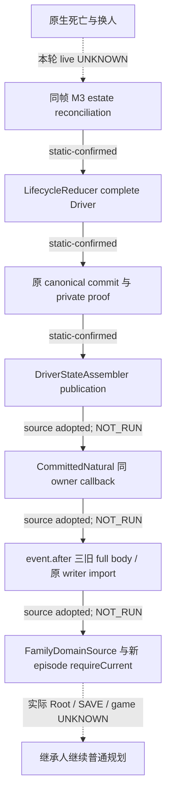

# M3：自然继承、REA 来源复核与 q10 过期诊断

`machine_id: xenoamess-full-tower-eb9d2c1186`。2026-10-26 UTC；本轮机器、实体根与容量事实取自 `resume63/capacity/CAPACITY63-TASK-START01.json`（14:40:26Z）及 `SCOPE63-NET-PARTITIONS01.json`（14:51:27Z）。源码观察和采用在 D 盘可复用 SRC；没有读取新 CK3 PE、启动游戏、操作 Steam/Defender 或初始化 Genesis。源码、编译、软件测试、真实 Root 场景及游戏信用分别记录。

已读 [resume62 交接](../handover/2026-10-26-java-g2-resume62-rea-runtime-handoff.md)及索引、[REA 方法](../rea-ck3-research/methodology.md)、[工具边界](../rea-ck3-research/tools-and-context.md)和[原版优先提示词](vanilla-first-implementation-prompt.md)。本轮按问题→输入/原件→有限查询→独立核对 caller/cache/consumer→结论与 UNKNOWN 工作。纯 Java 与已有原生原件复核属于该等价证据流程；未声称执行了新的 REA native provider。模型 token 未测。

## 真实链与修改结果

Java `M3Research` 是五种 schema 的只读路由，不产生自然继承权威。实际 `LifecycleReducer.continueSuccessor` 要求 paused 的 `played_character_changed`、living successor、完整 MATCHED estate、同帧 successor binding 和旧 episode；随后更新 Driver、goal 与 auxiliary。`LifecycleComposites` 持有真正 parent/commit/private proof，由原 writer 验 canonical event，再发布完整 Driver。

原 mutable 路径只归档 auxiliary 的 `family_marriage_ledger`；普通 Family consumer 读取的却是三份 canonical full body：`FAMILY`、`CHILD_MATRILINEAL`、`DEFAULT_MARRIAGE`。旧 pending episode 或旧 `java_next_episode` marker 会被 strict consumer 拒绝。NEXT 明确要求 physical Game 改变，不能当同 Game natural 授权。原断点见[来源链](natural-succession-canonical-family-domains-2026-10-26.md)，后继见[完整候选](family-natural-same-game-domain-migration-20261026.md)。

采用路径只在 writable `continueOriginal → observe` 和 warm post-publication 点 import；cold `recoverCommittedPendingEpisode` 保持只读。token 核同 issuer、Session、physical owner、actual parent、published complete Driver 与原 canonical event。旧 body 从 event.after 取，较晚 `ALREADY_COMMITTED Receipt.head` 不能代替原事件起点。部分 import 保存真实 Prepared/Receipt；缺返回时读实际 historical import，缺匹配原件保持 UNKNOWN，不重送原动作。保全旧 pending/resolved、扩展字段及 marker，不授关系、付款、婚姻完成或游戏日信用。

## 精确采用与验证边界

当前 cohort 是 Family39 + Lifecycle26 metadata（选原20 Composites 和19的实际 fixture）+ RA83。**19 的 Composites WITHHELD；旧22/34/RA71 selector 不选择。** RA83 修正 preDriver install 读取未绑定 collector 的静态缺口；route key 来自实际 ManagedGame，权威仍来自 private proof。

2026-10-26T14:44:22.405Z 逐叶重验：3 maps 与9 raw pins MATCH，7个 mutable REPLACE 前像 MATCH，2个 NEW ABSENT。完整审阅差分、producer、registered verifier、import、consumer、warm/cold caller 和最终实际 fixture。原件根 `B = D:/codex-ck3-background/ck3-java-g2-resume-r4-20261025/resume61`：

| selector | bytes | SHA-256 |
| --- | ---: | --- |
| `family_ordinary/natural39/SOURCE-DELTA39.json` | 8569 | `99daebfb8cab976bbecf164de469ea1bcf2ef3d35e5dcfc1d38a1e362105d528` |
| `lifecycle/natural_metadata26/SOURCE-DELTA26.json` | 10684 | `0ecd2f25d0f73d74a1fcccb5d208dc390af7e3ff1ea30f095f4ce24503de08b6` |
| `root_assembly/natural83/SOURCE-DELTA83-NATURAL-FAMILY.json` | 8551 | `e6e9d09bc11f139469811f92810ea6c946ae3053fa446e9ce7726ef5ec89db29` |

独审发现真实第10接点：`RootNativeFamilySourcesFactory.prepare` 原 named 来源不含新增 `FamilyNaturalEpisodeMigration`，而配置驱动的 completeClosure 只核调用者列出的来源。已新增 exact named witnesses，包含新 pure producer、NEXT/current consumer、Lifecycle authority 和实际 Root 安装/import caller；全部走原 selected.javaSource，遗漏由原守卫拒绝，无别名补源。该检查不能单独替代实际 cold/Root route 验收。

Root 授权十叶，M1/M5 确认无冲突；Host确认当前 Tools 只捕获 build-tools/reactor POM 后开放短采用窗。**十叶已实际采用 SRC，编译/测试尚未执行。** 精确回执：

- `D:/codex-ck3-background/ck3-java-g2-resume-r4-20261025/resume63/m3_natural_review01/SOURCE-ADOPTED63-NATURAL10.json`，13588B，SHA `0a629f7917e782232d9a9440dad23a37787ef15c6320552287fe24aceb48d47f`。
- 同目录 `SOURCE-REVIEW63-NATURAL10.json`，11961B，SHA `334dfbae6e46ea405b5718268c9648059d073f639608ea333e06429b4a71bdb3`；其状态保留生成时的 NOT_YET_ADOPTED，以上实际采用回执是后继事实。
- 新 factory raw12953B，SHA `c48054cb5c08b2457ee4934328731de3b87f4a3d39d0dd84d32f203a35138206`；SRC逻辑净增52734B。九 raw引用复用；四个 Family mutable前像及 factory前像另存，Lifecycle/fixture/RA复用既有不可变 before。

Host已收到10 actual pins；后继在相同 SRC/BUILD/m2 用受影响 `application`、`local-service` 及必要依赖增量编译。先跑 `FamilyNaturalEpisodeMigrationTest` 五方法与 `FamilyNextEpisodeMigrationTest` 十方法；最终仍须完整验收。真正 Root 场景是 `RootHostBatchAndCloseActualTest#pendingUiActualProductionChain`，要求唯一真实 PendingInputsProducer、原 Core/current/catalog、RecordedFinalization 和 AdmittedCurrent。缺输入按 MISSING_ACTUAL_PENDING_INPUTS 拒绝，不以手造 proof 或空测试替代。本轮 SERVICE、真实 Root、Native 和游戏结果仍未取得。

## q10 的真实失败与下一诊断

原 `RESTORE20-REASON-LS5-ACTUAL-RESULT10.json`：5 started、0 pass、5 fail，270.8796195秒，exit1/Job0、三 MATCH、261 pins MATCH。stdout10861B，SHA `db336b6e6f7f10cee1b97bca2259ed4b9e6e6e289596b4767a31bbb4c8673502`。五方法都先败在 AWIF.ready 的原 nested QUERY，未到各自 restore 断言。4项在 `borrowedPlanningRead` 的 work.apply 返回后（975–976）过期，1项在进入前（968–969）过期。source guard、pin、archive、wire 和 publication 的细分耗时仍 UNKNOWN；旧 TempDir 已不存在，不能从总墙钟猜具体原因。

nested QUERY 还检验同 writer、冻结帧、公/原生 revision 及真实原 guard，`lastNestedRead` 后继仍用。本轮不删除 QUERY、不跳断言、不放20秒 deadline/30秒 validity。已沿 READ coordinator→RootPlanningReadGuard→collector→原 archive/Win32 pin 核源码，没有把过期归咎于单个 I/O 或 OS lock。

现有受管 JUnitBodiesMain 只支持 expected count+整类；没有新增单方法 runner。Root 已批准新窗口按原 LS5 整类加 JFR：profile、stackdepth128、8MiB文件上限。精确输出为 `D:/ck3-state/ck3-java-g2-resume63-m3-diagnostic01/ls5-class01.jfr`；16MiB完整hold只在财务181计一次。Acceptance63在 Host 新 Jar 与 fresh freeze/quote/resource 后执行，M3只读归因。实际 `where jfr` 为 `C:/jdk-21/bin/jfr.exe`。尚无新 JFR 原件，不记已运行或已定位。

## 原版来源与最小 REA 下一步

exact12004 reader实际使用 `CLandedTitle +0x150/+0x158/+0x15C` 的 ordered successors，在 held-title枚举后发布各头衔 first-heir；不能复用11906的 `+0x278`。actor land-state `+0x3A0` cached succession是不同列表。完整copy不证明 GUI player-heir、死亡分配或完整合法 backup；reader不主动刷新缓存。

已有 exact12004 GetPlayerHeir闭包为 `0x289DCC0 → 0x2B93D50..0x2B94024`，仍不等于死亡 estate writer。早期 special path `0x2B94030` 已有296B原件：`research-plans/gui-getplayerheir-qualification12004-20261019/function-window03.json`，bytes SHA `4c1bc26d07eadaf9bc4087c300b7be9bd96fed2584875354f6fdef9f4c0eb267`，RF至 `0x2B94158`，unwind RVA86677680；special/exclusion续行仍未闭合。旧metadata row151297覆盖相同范围，但原machine_id未知，不倒填本机。已交REA63先复用296B核指令/CFG与范围外边，再决定最小缺失RVA段，不新导全PE。title-cache producer/失效、death writer、首个successor真实后态继续 UNKNOWN。

另确认独立后继缺口：canonical NativeCharacterId 是 signed int32、仅-1为absence，0与其他负值保原样；SuccessionCodec正int32、LifecycleReducer的BigInteger.ONE下界和Family Episode正值域会拒绝合法高位identity。上游 exact12004 C++ campaign first-heir producer仍有 `character_id<=0` 拒绝（`ck3_12004_campaign.cpp:1973`及validator2857）；独立GetPlayerHeir observer允许高位不能替旧campaign DTO授资格。下一cut应同步原生producer/serializer→Model/Codec→Goal→Lifecycle→Family及真实原包/serde回归，不能abs、unsigned或重编号补救；本十叶不混入全域类型迁移，也不声称已完成该身份域。

本页≤32KiB；D独占source/review/adoption完整256KiB归Root D4MiB净额池，不加hold；JFR另有181的16MiB。执行资格至2026-10-26T16:40:26.824464Z，自动续期false。必要原件用途复核2026-11-02；未删旧证据。
