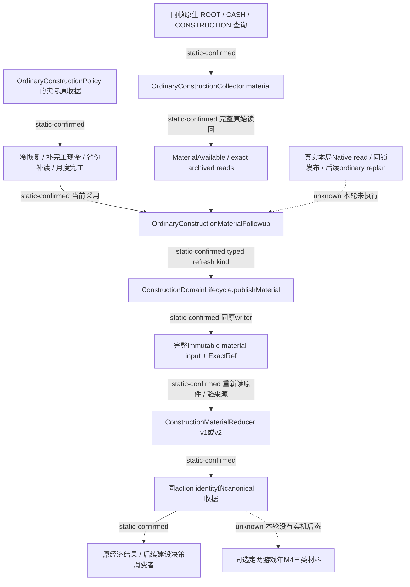
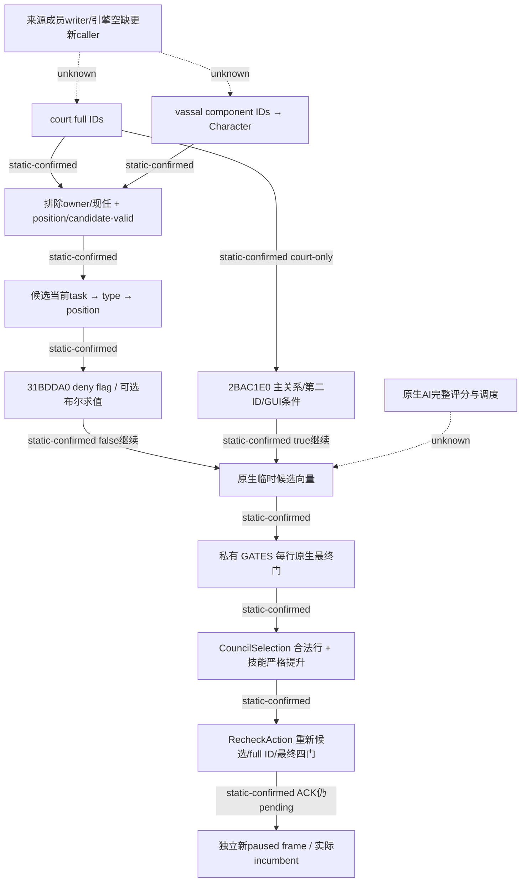

# M4 REA 接续：原生来源、建设现金刷新与未迁移边界

`machine_id: xenoamess-full-tower-eb9d2c1186`。2026-10-26 UTC 接续，身份与根映射复用本轮新鲜 [CAPACITY63-TASK-START01](</D:/codex-ck3-background/ck3-java-g2-resume-r4-20261025/resume63/capacity/CAPACITY63-TASK-START01.json>)。历史源码或字节的机器身份仍按各原件记录，不因本次读取补认当前安装或 Loaded。本文仅覆盖静态研究、精确源码采用及软件回归需求；本岗 CK3 启动、新增游戏日、原生动作均为 0。

## 问题与实际范围

本轮先读 [resume62 交接](../handover/2026-10-26-java-g2-resume62-rea-runtime-handoff.md)、[索引](../handover/2026-10-26-java-g2-resume62-rea-runtime-handoff-source-index.json)、REA [方法](../rea-ck3-research/methodology.md)/[工具边界](../rea-ck3-research/tools-and-context.md)及[原版优先提示词](vanilla-first-implementation-prompt.md)。问题是：Java 普通建设的完工后现金补齐，是否保留 Python 已验证的首次收入观测，而不是重新按冷恢复算法改写它？

反例条件：已有完工收据记录收入 7、观测日期 820；当前 ROOT 收入 999、现金 gross 123、日期 900。补现金只应附实际当前现金；旧收入及日期不得被 ROOT 或现金覆盖。零值、负收入也是实际观测；日期缺失、null 和已知整数不能互换。新观察不能授予取消退款、借款到账、建设完工或 UNKNOWN 重放信用。

研究方法为 REA 允许的等价有界流程：固定原件与合同，复用精确字节/源码，沿 producer→caller→consumer→归档重放检查，再给出可执行软件回归。没有新运行 REA backend、Rizin、Ghidra 或读取 PE；未声称工具提速、token 节省或优于原版 AI。

## 既有原生链与当前 Java 落点

`M4OrdinaryConstructionPort` 只把真实原始 `ObservedRequest` 放入既有 M4 request/source 合同，验证 response 与该原请求相同，再调用唯一原 composer。它不产生原生观测、writer 或提交权。普通建设继续由当前现金、实际承诺、军费及雇佣应急资金门控制；军费输入不足只延后可选建设，不能停止普通战争处理。`OrdinaryConstructionPolicy.revalidateConstruction` 在既有 writer 锁内重读当前来源、资金 pending 与原生合法报价，比较完整 quote，再进入唯一 action。

本轮发现的差异位于其后续材料链：`Followup.COMPLETED_CASH` 原先被解析后丢弃；`publishMaterial` 和归档输入只保留 v1，统一调用冷算法。冷算法允许新 ROOT 收入更新已有完工收据。因此这不是新增原生能力或退款率研究，而是迁移时丢失已有状态分支。

Python 真实生产者 `construction_formal_consumer.py:389–422` 先检查实际同帧 cash gross/readiness。已有收入保留；只有 missing 才填 gross 和实际 packet date。`completed_construction_cash_fields_v1` 只附原 packet，再交原 classifier；它不把 active construction 或 start ACK 变成完工。`:423–439` 还有独立 ROOT 收入 fallback。当前 Java Collector 已取得同帧 ROOT/CASH/CONSTRUCTION；本轮后继在原收入缺失、gross 不可用时，用其中已经验证的实际 ROOT 收入及实际日期补齐，不另造查询或收入来源。两分支仍通过原实际项目/钱包材料查询。

## Council：复用后继原件，关闭过期导航中的两个 UNKNOWN

[候选树](council-candidate-filter-planner-tree-12004-resume61.md)中的两个未展开 filter 已被其后继[过滤与确认 mode](council-native-filters-and-confirmation-mode-12004-resume61.md)、[当前席位/第二 ID](council-candidate-held-position-and-secondary-id-12004-resume61.md)及[主关系读取器](council-primary-relation-cache-crosslink-12004-resume61.md)继续展开。本岗实际读取并 SHA 核对 SOURCE27/SOURCE29 的五个 retained raw，共 921 B，全匹配；没有再请求 355 B，也没有重导 PE。

原生 `2C47EA0` court 来源为 `owner+1C0/+A8` 的 full CharacterID；vassal 来源为 `+218` component ID，经 component+20 转 Character。排除 owner/现任，position-valid `31BCEB0` 与 candidate-valid `31BCF70` 后，两来源均调用 `31BDDA0`，true 排除。court 另调用 `2BAC1E0`，false 排除；vassal 没有此额外 filter。

`2917600` 实际从 candidate+1B8/+F0 的当前 task full ID，经 storage/tag/full-ID roundtrip，读 task+18→type+40 的 position。故共同 filter 的 +2374/+1E38 来源为该 position，而不是 Character extension。`31BDDA0` 是直接 byte deny 或带 owner context 的可选布尔求值，不是人选效用评分。`2BAC1E0` 使用独立的 `28BFC50` 主关系读取器和 `28C0160` 有优先顺序的第二 ID；GUI 的额外接受和普通 owner/+CC 条件应保持区别，不猜字段正式业务名。

当前 `CouncilSelection` 私有路径保留 final_gate_available、already councillor、guest、pending interaction 和 occupied CanConfirm 结果；按合法候选主技能降序/full ID升序，已有 incumbent 时要求严格提升。这是我方确定性政策。任命必须有独立实际 incumbent 变化和 following 消费，不能只计 ACK。公共 Council19 当前缺两项 HELLO 能力，按[实际能力生产链](council-public-capability-production-tree-12004-resume61.md)返回 NotApplicable；不能因公共 DTO 没有 private gates 就声称普通 private 路径绕门。

剩余完整性：成员 writer、引擎死亡/离任后的更新 caller、正式脚本字段名和原生 AI 效用/刷新时序仍未闭合。[空缺/cadence 专题](council-vacancy-cadence-invalidation-12004-resume61.md)中的候选13/14存在同一物理 frame→canonical 发布→replan 可达性问题，未采用、未验证；本轮不重放其旧资格。

## 派系干预与取消/借款资金边界

[派系危险支出专题](faction-gift-observed-danger-spending-12004.md)的实际 AUTO515/531 已证明：合法付 100gold、opinion 提升不能证明退出派系、危险解除或战备收益。新自动送礼应消费同帧、同 faction、同 recipient 的实际 dangerous_response_ready；watch、未知、错 frame/source 或 faction at war 不能作为新支出理由。当前 Java 此链的完整 migration/live 信用仍由对应实际生产回归与本局材料决定，本岗未新增送礼/干预行为。

取消[资源 mutator](construction-cancellation-resource-mutator-310db20-12004-2026-10-26.md)在实际 mode2 下已有 base ADD 等静态结果；[分档函数](construction-cancellation-prepost-classification-2bca600-12004-2026-10-26.md)与[当前账户值](construction-cancellation-current-value-input-28b9490-12004-2026-10-26.md)明确不产生净退款报价。付款项目 incarnation、付款人/当前命令角色差别、实际只读报价和 callbacks 后最终钱包仍须核实。取消仍 Phase-A/private OFF/credit0，不能执行 mutator 来探报价，也不能将本轮现金刷新修复记为退款功能完成。借款同样只在实际到账后用于新支出；UNKNOWN action 不重放。

## 五叶源码采用与真实验证状态

Root 批准精确五叶；capacity63 从 Root D4MiB source pool 净分 256KiB，沿 TASK-START01 的 16:40:26Z 期限，无新增总 hold。Host 确认尚未 capture。本岗于 **2026-10-26T14:43:09.275Z** 在同一可复用 SRC 精确采用旧 M4-CASH22ops：五叶 before SHA 全匹配、22 hunk 都恰好一次，内存构成 after 与候选 expected SHA 全匹配，再实际写入并读回。净源码增长 **20270 B**。没有创建根仓缺模块的半树、写 i61 或触 BUILD/m2/build-tools。

首次采用/原件核对回执为 [M4-CASH-SOURCE-ADOPTED01.json](</D:/codex-ck3-background/ck3-java-g2-resume-r4-20261025/resume63/m4_rea/M4-CASH-SOURCE-ADOPTED01.json>)，7803 B，SHA `e481d5ad1a3aef3b514a845c4a1ce70bba7d131beaa31dd353596fe78f1444b7`。原候选仍是 43152 B / `fd14a3aa416bc1e23b4b3cd29e46fa366432ee25c33ada57721eee96f387aeeb`，其历史 RAM_ONLY 文字不覆盖当前 SOURCE_ADOPTED 事实。

Root 随后批准迁移上述 ROOT fallback，Host 明确允许 Tools cut 期间写这三叶，尚无 LS source capture。本岗于 **2026-10-26T14:55:19.768Z** 精确采用后继七 hunk：reducer 和原两测试叶，净增 19624 B。当前实际采用见 [M4-ROOT-FALLBACK-SOURCE-ADOPTED02.json](</D:/codex-ck3-background/ck3-java-g2-resume-r4-20261025/resume63/m4_rea/M4-ROOT-FALLBACK-SOURCE-ADOPTED02.json>)，5706 B / `c91b2b499d8d7aa0746cb6dc61957f55463cba88e46b7a899fe46fe03fbcc228`；[完整精确七 hunk](</D:/codex-ck3-background/ck3-java-g2-resume-r4-20261025/resume63/m4_rea/M4-ROOT-FALLBACK-OPS02.json>)为 24143 B / `687068281894897dc0017590de9269659adcc40e0400eef2a97c58224750e90f`。五叶及所有本岗 D 小证据合计 189284 B，仍在 complete 256KiB 子预算内；没有临时整树副本。01 及旧22ops保持原身份，02前向记录后继，不回填旧 after SHA。

相对于 `D:/codex-ck3-demos/2026-10-25-java-g2-complete31-h5r5/java/ck3-control`：

| 源码叶 | 实际 after bytes | SHA-256 |
| --- | ---: | --- |
| application/.../finance/ConstructionMaterialReducer.java | 29231 | `8808d258444381f83171ad15c421327975dbf5c08d45f20abd609947557ac4a3` |
| local-service/.../finance/ConstructionDomainLifecycle.java | 43580 | `85122884411bae6f1b8e4c205c547836c4aff07b2ed9a4460fcfc43260b59d15` |
| local-service/.../finance/OrdinaryConstructionMaterialFollowup.java | 7207 | `415d675298236203cefab44897bd5ae587e09e2a4d2dbeb9e144d0e40aa2ce47` |
| local-service/src/test/.../finance/ConstructionMaterialReducerTest.java | 29553 | `33148ddbc61978418f34f206c68761ea20aa42bd7241faec9ac75e51a2b5ab2b` |
| local-service/src/test/.../finance/ConstructionLargeMaterialProductionTest.java | 42061 | `feb560f3076d84c97d4d40153428adbdcb911ab8494df15fb6e01ef692b6b09f` |

v2 输入保 typed RefreshKind；旧 v1 原始 bytes 仍以原冷算法读取。新输入和 lifecycle transition kind 必须相符，prepared zero-dispatch 不进普通材料 reduce。COMPLETED_CASH 要求原收据已经完工；保留已观测的首次 signed64 收入与 date 原形，缺失时优先实际同帧 ready gross，再尝试单独验证的同帧实际 ROOT 收入。ROOT 缺失、null 或不可用保持未知；错 actor/date/revision、类型、scale 或 signed64 范围拒绝。gross 未知不替换原 post cash；NET/EXPENSES 未知不虚构数值。原生 project/wallet 材料、来源和原 writer 验证继续执行。

必要离线回归已交 Host：默认 `mvn`、复用原 SRC/BUILD/m2/TMP，选择 `-pl local-service -am -T2`，两整类 `ConstructionMaterialReducerTest,ConstructionLargeMaterialProductionTest`，上游无该类时 `-Dsurefire.failIfNoSpecifiedTests=false`。当前源码含 **13+5=18 个 @Test 方法**，不是实际 found/started/pass 计数。新增覆盖 signed0/负收入、日期 missing/null、partial cash、wrong frame/类型、v1/v2 archive roundtrip、UNKNOWN/pending 和 prepared分支拒绝。

后继新增整条软件 fixture：实际 `OrdinaryConstructionCollector.material` 及原 `FinanceReadContracts`，只在 Native I/O 边界供应 fixture packets；ROOT raw 经过严格原 normalizer，CASH 明确 unavailable，CONSTRUCTION 保留原材料输入；public revision77 与 native revision3不同。ROOT 0/−1/17及整个 ROOT unavailable 四个分支，把收集器实际 MaterialAvailable 写入真实 Windows immutable archive，在原 writer 中重开、reduce、canonical import/readback、serialize，再交既有 `ConstructionEconomy.classify`。断言缺 cash 不产生 post_cash，原 action/material身份保留，经济分类不因此虚构现金变动。该 fixture 使用已持1781 B ROOT基础夹具（SHA `c280918ca751f6eee63022b2b0815d64a8b266bd10711016248f48fe86938b86`）扩成显式完整`.4`软件包，不是 Loaded/Game证明。

**本岗没有执行 Maven/JUnit，当前 NOT_RUN。** 两类范围是纯 reducer 与真实 Windows archive/writer 软件夹具；类中的 public actual-lifecycle 断言 helper 并未自动授予 physical Native 来源，也不能称完整 Followup→原生读回→同锁 Lifecycle→普通 replan 闭环通过。后继实际测试结果由 Host 新回执补充，完整编译仍须最终一次真实验收。

## 剩余最小施工边界

1. 现金刷新与 ROOT fallback 均已 SOURCE_ADOPTED，必须实际执行两整类回归及改动模块/消费者增量编译；真实 Followup/Lifecycle 物理来源链仍未执行，不能只凭新 fixture 或 enum/codec 宣称整链完成。
2. 继续同一选定、至多两游戏年的窗口取得有用合法建设、议会真实变化、封臣/派系干预材料，保实际日期、episode、Game身份与后态。旧 Robert 分散历史材料不能拼窗，Java编译、HTTP或ACK不计 M4完成。

成本仅记录本岗实际动作：五份 retained raw 921 B 读回、五叶 22 hunk 精确采用和小型证据；新 PE 读取/backend/CK3 都为0。全流程墙钟、人工净工时和模型 token 未可靠计量，不作性能结论。活跃源码与本回执为后继编测输入，最迟 2026-11-02T14:11:19Z 或解除引用时复核，不自动续期、删除或授新执行权限。

## 2026-10-26T23:45Z 前向补注：取消 tooltip 名称定位

machine_id: `xenoamess-full-tower-eb9d2c1186`；本轮新研究 owner 至2026-10-27T12:00Z。本段保留前文采用时点的NOT_RUN。后继Java回归以Host/Acceptance原件为准；本轮CK3启动/游戏日/原生动作/生产源码/Tools/Maven修改均为0。

固定EXE101040248 B / SHA `98702f88a547cde2eaf29a85f93b85f68ee4cf8148336a4f7afaeb75319dd518`。证据目录根T为 `D:/ck3-state/ck3-java-g2-rea-eval-resume62/tools01/cases/`；下表路径均相对T，各旧case及失败原件保留。

| 后继证据 | 相对路径 | bytes / SHA-256 |
| --- | --- | --- |
| ASCII名称 | resume63-m4-cancel-tooltip-names01/NAME-MATCHES01.json | 4894 / `9a96bb29d01668949f8e7b36d548cd0f702971b94ef87af19bbfc9319ab4123f` |
| GUI型包装器 | resume63-m4-guitype-rf12b8bd0-01/RF-DECODE01.json | 16174 / `25b3af564250f7cad833107d6bd449a5d5c5a1e5461b7b86e1dd365be53810cd` |
| SIMD实际 | resume63-m4-cancel-tooltip-simdrefs01/RAW-SIMD-MATCHES01.json | 3386 / `0ee50fc98472a1b3ddb2c6692e910bf793c9be6e8204d8317e314655228fbd7c` |
| SIMD first close | resume63-m4-cancel-tooltip-simdrefs01/ACTUAL-MINIMAL-CLOSE01.json | 1531 / `2deefba9a00fc3821edc570ecb29f32cb1d8bbc013bab38c85d359cc2e5b1de0` |
| held机械审 | resume63-m4-cancel-tooltip-simdrefs01/HELD-RF-REVIEW01.json | 4770 / `57641a54e2fb62d760ba891e7082383c100c009b440dc4caa7fb0731d664f3b7` |

六readable DATA节29886976 B实际完整扫描找到ASCII GUITrackItem(`45404F8`)及GetCancelTooltip(`4540DD8`，16字符+NUL17 B)，UTF16LE为0；四种VA8/RVA4 DATA编码为0，仅排这些编码。mapped.text71141448 B的REX.W LEA/MOV扫描只命中GUI raw `12B8C20`，不能由Tooltip的0推断方法不存在。

同RF仅补346 B、复用192 B、核fresh RF12/UW28后，本地Capstone5.0.7完整解码 `[12B8BD0,12B8DEA)`538 B，内部直接目标均为指令边界。其呈类型注册包装器：GUITrackItem名称→`3E1BDC0`，Self与另一10字节名/两个函数指针→共同`12C07F0`，结果AND；该10字节名实际以MOVSD8+MOVZX2复制。这是原LEA/MOV scanner漏覆盖的已发生反例，尚无CancelTooltip绑定。

据此SIMD题只查目标`4540DD8`：MOVUPS `[REX?]0F10 /r disp32`7/8 B；MOVDQU `F3[REX?]0F6F /r disp32`8/9 B。ModRM&c7=5、carry8；重叠REX/bare按disp anchor合并，上限128×192邻接，129th/短读/身份漂移/超时/输出超限STOP。58同源纯RAM夹具通过，无fixture provider。0仅排两canonical形式，不覆盖MOVDQA/MOVAPS/scalar/VEX/EVEX/其他prefix/base+8。

[实际SIMD原件](<D:/ck3-state/ck3-java-g2-rea-eval-resume62/tools01/cases/resume63-m4-cancel-tooltip-simdrefs01/RAW-SIMD-MATCHES01.json>)完整扫描命中1个MOVUPS raw：`1A5639:0f100598b73904`。requested PE273222136 B（双全SHA+text+192邻接），inner429.2934 ms/owned534 ms/owned峰29683712 B，exit0、无限制触发。physical I/O/outer joint峰/token/全程未计量，不作性能比较。Owned实际child318044/parent216948均absent，0owned/deadline前，先close再解释。

Node readonly同fd/path bigint stat+双完整SHA不是native deny-write/delete或full128资格。既有OwnedCommand/ProviderProcess每题独立ID/PID闭场；正文仅存一次，stdout仅FileRef。旧SIMD卡01NOT_STARTED；新02的metadata失配与缺EXECUTION均在provider前拒绝，按实际合同重核后真实QUERY仅1次。失败原件保留。

[held审查](<D:/ck3-state/ck3-java-g2-rea-eval-resume62/tools01/cases/resume63-m4-cancel-tooltip-simdrefs01/HELD-RF-REVIEW01.json>)无新PE/provider。缓存PDATA唯一row5846为`[1A55D0,1A56AA)`218 B/UW`511DEE0`。旧192从`1A55F9`起，缺入口41 B，RF内仅177 B可复用，末15 B超RF必须排除。若raw起点是真边界，连续已知字节会复制16 B、补NUL16、设R9=&stack40/R8=`12B4480`/RDX=&stack20，再call`12B3E60`；这只是条件性机械解释，未从entry证明可达，不授getter绑定或callee跟随。下一case最小方案为CODE41+freshRF12+UW≤64，复用177拼218；最大requested PE202080613 B，尚未执行。

当前`NativeFinanceReads`仍只接受来源绑定的当前原件rejoin；`ConstructionRefundSource`仍empty quote、completeNetRefundQuote=false、submissionQualified=false、receivedFundsVerified=false、fundingCreditRaw=0。付款项目incarnation/付款人/当前账户、只读净quote及回调后钱包仍UNKNOWN；本轮只提供精确导航，未完成退款、借款执行或M4同窗实机验收。

### 2026-10-27T00:15Z 后继：218字节真实入口已补齐

前段“尚未执行/缺入口41 B”是旧时点；本题已按新独立case完成，并保留旧文。目录为T下 `resume63-m4-cancel-tooltip-rf1a55d0-01/`。仅新增CODE41、fresh RF12、UW实际12 B，复用RF内177 B，排除尾部15 B；完整218 B原始SHA为 `2e3715316b546996f7f0903c5d212b6cdb776043ced4392e48b300cc72627427`。

Capstone5.0.7从真实VA入口解码，官方REA Rizin仅对派生raw执行 `e asm.arch=x86; e asm.bits=64; b 218; p8 218 @ 0; pDj 218 @ 0`。Rizin subject仍format unknown/architecture null，pre/post rawSHA一致、changed=false、未截断；它不是第二次PE读取或Loaded证明。49条指令的offset/size/raw全部一致，完整218 B；仅 `770d` 的Rizin `jnbe`/Capstone `ja` 拼写不同，目标同 `1A56A4`，原输出不改。Rizin的1个unsafe ptr及其他ptr元数据均未消费、不转写为地址；只验safe offset/size及共同原始字节的有符号disp，再用BigInt映射RIP/branch。

因此 `1A5639` 已确认为真实MOVUPS指令；16字节GetCancelTooltip名称复制、NUL16、RDX=&string、R8=`12B4480`、R9=&stack40，进入 `12B3E60` 的call-site地址参数链得到确认。入口到该call前无条件跳分支，但经过不透明分配call `856DB0`，只对其正常返回路径成立。RCX在该call后未明确重设，不能猜GUI receiver；helper/callback均未跟随，业务签名/CanCancel/净退款及钱包仍UNKNOWN。

关键原件（相对该case目录）：

- `RF-DECODE01.json`：7401 B / `70cf0ea67328968c3b76c502fdfa33549b06594d81311607dded5b7cce8c6c91`。
- `REA-DIRECT-EVIDENCE01.json`：34365 B / `fa5e4dae87a6fdfe7667d64180649613f0866e157afc67ee281b71946b6aeb45`。
- [ACTUAL-REVIEW01](<D:/ck3-state/ck3-java-g2-rea-eval-resume62/tools01/cases/resume63-m4-cancel-tooltip-rf1a55d0-01/ACTUAL-REVIEW01.json>)：13162 B / `9fa49ff1f5249f11c37166b7a82ce146f6527aae42354dd286cf213fa2760361`。
- `ACTUAL-MINIMAL-CLOSE01.json`：2744 B / `dca52137318ecfe75c62269acfb91b9217428c4fb227a6029d845abf5d829316`，实际6个child/parent PID全absent、0owned、deadline前；每阶段先close，再解释正文。

实际requested PE bytes为202080561（两完整98702SHA及显式65 B）；Capstone raw218、Rizin wrapper218/服务两个raw218SHA/p8与pDj各218另列，后者合计1090 B显式local代码读取，不冒充physical I/O。三个owned阶段分别234/365/190 ms、峰26853376/22294528/12787712 B，均exit0；只记录局部成本，不作全程性能结论。case实际30文件167950 B logical/241664 B按4KiB计费，未到512KiB上限。

本轮实际回读Java `ConstructionRefundSource`仍25760 B / `62c92cec85598f2edd84260c772a039a3e65b18df16b4a51a444ed66e54dd3ac`；empty quote、qualification false、credit0均保持。此处只关闭指令边界与调用参数缺口，没有授getter业务资格、取消/退款/借款或M4实机完成。
