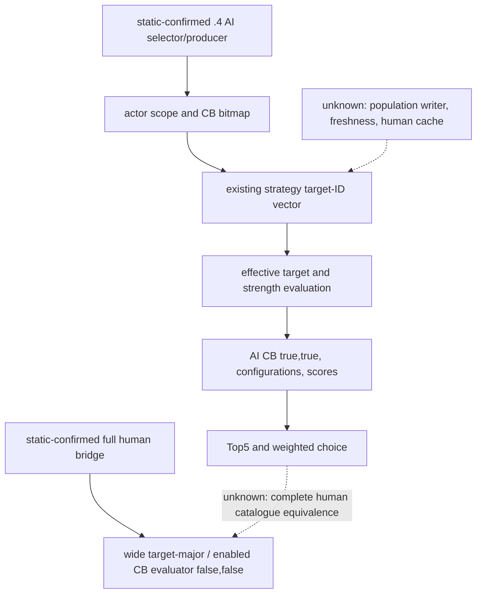
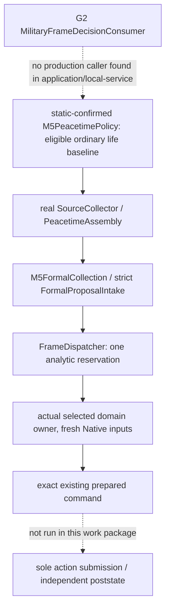
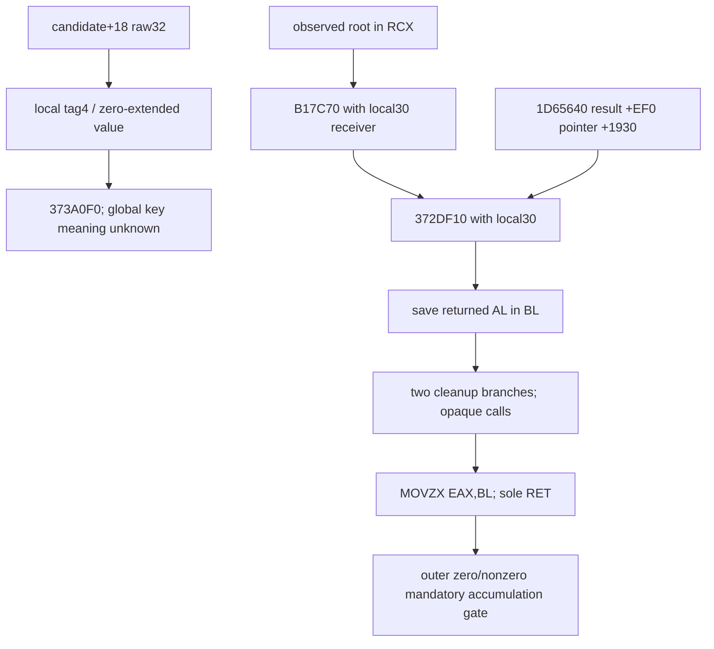

# G2 M5 resume63: source-bound candidates, commander and REA continuation

`machine_id: xenoamess-full-tower-eb9d2c1186`. Observed `2026-10-26T14:44:20Z`; identity was freshly read with `py tools/ck3_live_run_id.py machine`. This is a source review and bounded research continuation. No game, Steam, Defender, Native command, SDK session, compilation or test was run by this work package. Java G2 live credit remains **0/8** in the resumed Java campaign; historical Python M5 completion is a separate result.

The working method is [REA methodology](../rea-ck3-research/methodology.md), [tool/context qualification](../rea-ck3-research/tools-and-context.md), and the [vanilla-first prompt](vanilla-first-implementation-prompt.md). The [resume62 handoff](../handover/2026-10-26-java-g2-resume62-rea-runtime-handoff.md) and its source index were read. Source review, backend output, mechanism interpretation and game verification remain separate claims.

Capacity63 confirms this single CREATE_NEW document is within the Root Z 4 MiB allocation, with an individual 32 KiB ceiling and no new hold. Its navigation receipt is `CAPACITY63-TASK-START01.json` (10483 bytes, SHA prefix `c6f251d`, authority window reported through `2026-10-26T16:40:26Z`). This is not authority for a backend, build or source adoption. The native backend has one separate owner, `/root/rea63`.

## Original candidate flow and the current implementation

The current-version evidence in [declaration-candidate-generation-12004.md](declaration-candidate-generation-12004.md) establishes the following static AI chain for CK3 **1.20.0.4 / Steam 25734779**, EXE SHA-256 `98702f88a547cde2eaf29a85f93b85f68ee4cf8148336a4f7afaeb75319dd518`:

1. `1A6A210` calls producer `1A6A8C0` through `1A6A26D`.
2. It builds actor scope and a CB prefilter bitmap before walking targets.
3. A nonnull `context+20` supplies a strategy-associated target-ID vector at `+A8`; these are AI strategic candidates, not a proven complete human legal catalogue.
4. The walk resolves effective targets and performs strength checks, then evaluates CB/configuration with the AI `true,true` parameter contract.
5. The selector consumes scores, retains at most five and makes a seed-weighted choice.

The original caller/strategy refresh path has writes. `1A2FA50/1A2FAF0` calls `2BAA6F0` and skips normal context construction for current human-player IDs; the nonhuman path can allocate context and replace strategy. Constructor `19E8B00` clears `+A8/+B4`; that is initialization, not a demonstrated nonempty population writer. The actual population writer, invalidation timing and possible retained human context remain unknown. A missing/null/empty human AI cache therefore means **unavailable for this experiment**, not zero legal declarations. Calling the writing manager to populate it is not a qualified read.

The existing full bridge uses target-major enumeration over a wider character set and every enabled CB, then the original final evaluator with `false,false`. Reusing an evaluator does not reproduce the AI target search. Neither AI Top5 nor the prefilter bitmap may replace this complete human catalogue without separate completeness and scope proof. The [existing candidate study](declaration-candidate-generation-12004.md) describes a safe future shadow seam: inspect an existing cache during the same paused full pass while preserving the original output; do not run a second N×C pass just for comparison. No shadow run occurred here.

The historical same-frame intake and dispatch studies bind older **1.19.0.6** samples. R0082, R0133 and R736 may not be joined across separate executions to manufacture five current candidates. A candidate count does not confer a submission or utility contract. Current Java must obtain dynamically discovered distinct legal choices in the same actual paused player/episode/date/native revision, select one through the existing domain owner, and verify the independent material result. No new five-candidate barrier is added to the already completed historical Python path.

## Actual Java callers and authority

The reusable source root inspected here is `D:/codex-ck3-demos/2026-10-25-java-g2-complete31-h5r5/java/ck3-control`. Host63 remains its sole writer and the sole owner of BUILD/m2. These observations do not claim that a new deployed runtime contains the source.

| Actual source path relative to that root | Observed responsibility and limit |
| --- | --- |
| `g2-research/.../g2/m5/M5Research.java` | Calls the original migrated `FormalProposalIntake.collect` once and derives participating-war facts from that exact snapshot. An unavailable war observation does not erase otherwise valid candidates. |
| `g2-research/.../g2/m5/M5PayloadCodec.java` | Persists the original analysis and replays the selector/consumer on decode. It explicitly keeps reservation/action readiness false; `missing`, `null` and an observed ordinary-war plan remain distinct. |
| `wave2-planning/.../jointintake/FormalProposalIntake.java` | Requires one paused map frame and exact source-frame equality. Compact marriage sources preserve distinct candidate IDs. Active wars require the actual complete cash receipt and occupied-resource commitments. |
| `g2-research/.../g2/m5/M5FrameDispatcher.java` | Re-evaluates the actual selector under the same owner's monitor and permits one in-memory analytic reservation. Repetition on that owner returns the existing reservation. This is not a durable intent or native writer. |
| `g2-research/.../g2/m5/MilitaryFrameDecisionConsumer.java` | Combines an explicitly supplied qualified military input with an existing frame owner. Search of actual `application/src` and `local-service/src` found **no production call to `consumeCurrent`**. Its software composition must not be called ordinary-auto deployment. |
| `application/.../planning/military/M5PeacetimePolicy.java` | The actual formal caller: `evaluateJoint` → `M5FormalCollection.collect` → intake/dispatcher → `route`. It admits a life-advance baseline only when no war and no player army exist; active war is explicitly ineligible for this peacetime collector. |
| `application/.../planning/military/M5FormalCollection.java` | Creates the analytic frame owner for that actual collection and returns its original receipt. Its action readiness stays false. Formal domain routing follows separately. |
| `application/.../planning/family/FamilyOrdinaryPolicy.java` | The selected exact family alternative re-enters the same Native read/pending/command path through `evaluateForCandidate`; it does not prepare a command from an analytic receipt. |

`M5PeacetimePolicy.family` checks the freshly revalidated selected family identity and requires the actual command's source, before frame, session, deadline and operation to match the original request. Construction and gift similarly go through their actual owning consumer. A selected analytic candidate without a supported formal route remains query-only. These are source facts; the full application pipeline and Java CK3 outcome were not executed here.

## Commander: preserve receiver, baseline, legality and poststate

The reused [commander quality study](commander-native-quality-counter-policy-12004.md), [candidate observer](army-commander-candidates-observation-12003.md), [assignment provider](army-commander-assignment-provider-12003.md), and [current-role getter study](current-assigned-commander-native-base-quality-12004.md) keep four different facts separate:

- `CArmy+0x120` is the actual assigned character, independently generation/tag resolved and checked against the current-role getter. It is not inferred from pool membership, the army owner or CombatSide's selected commander.
- Candidate enumeration and the player **mode-1** final assignment predicate are separate. Mode 2 requires AI context; it must not qualify a human assignment. A pool row's `can_assign=false` does not invalidate an already observed current commander.
- Native base quality is the established base-score getter, including its modifier term. Generic advantage, martial, prowess, supply and battle win probability are different inputs. Legal zero/negative quality is a value; unavailable current quality stays unknown.
- Assignment ACK/queue acceptance is pending. Completion requires a fresh independent query matching actual public CUnit, internal CArmy, owner, date/episode and actual commander FullID. A historical .3 live loop does not validate the current Java .4 deployment.

The current formal Java `CommanderQualityPolicy` is source-connected to the existing four ordinary-war phases, including `native_war_counterpolicy_hold`. It uses `CommanderQualityCodec.continuePlan`, makes a fresh per-army `CommanderObservationCollector.collect`, and preserves incoming army order. Unavailable or nonactionable rows may continue to the next army; the first actual assignment selection returns through the existing `CommandFactory`. It requires exact public expected revision and the canonical selected army/character step. The current and candidate native base-score comparison belongs to the migrated codec, not to this adapter. No arbitrary cross-army ranking, ETA or win probability is introduced.

This preserves the known quality counterexample: observed current37 versus eligible candidate25 keeps current; observed current0 can be improved; unknown current quality is not coerced to0. Existing original packets and Java tests cover software scopes only until Host executes the actual required tests and game validation.

## Network helper: old five-callee evidence and the next bounded question

The retained `network-helper02` receipt binds original PE bytes to the exact .4 SHA above. Its three declared RF pieces cover `1A20040..1A20128`, **232 bytes / 64 instructions**, with **20 blocks / 31 local normal-flow edges** under the assumption that opaque calls return. The first 106-byte sample was partial; suffix acquisition closed local outgoing noncall edges, not all callee semantics, unwind or game behavior.

Exact retained originals:

- `D:/ck3-state/ck3-java-g2-rea-eval-resume62/tools01/cases/network-helper02/CASE-RECEIPT01.json`: 7284 bytes, SHA-256 `5a8b775fc8656094f61b4c519e99508e0ec0d3a55532e70a8f5e15f615623010`.
- `.../network-helper02/output/r13_war_declare/capstone-network02/stdout.log`: 12069 bytes, SHA-256 `fe4267c5e29735f0c7ef57ff85f2e402e4a8f20cfbb5ef18753c805ec7324864`.
- `.../network-helper02/CONTROL-FLOW01.json`: 3644 bytes, SHA-256 `24fc641e2fa6bb33b3a4044bd5629bfaea07df4f40d6e8afc92ee371e9807f1b`.

| Callee | Caller operands / result use verified from the retained 232 bytes | Remaining semantic gap |
| --- | --- | --- |
| `1D64290` at `1A20056` | `RCX=**config.slot0`, `RDX=candidate`; AL zero skips all accumulation. This gate always runs, even when optional flags are zero. | RF230B body is the single new REA63 request. Its inputs, return, receiver, local CFG and opaque calls require independent review. |
| `2BAA6F0` at `1A2009D` | Runs only when `*config.slot2 == 1`; ECX is `candidate+0x18`; AL nonzero skips accumulation. | Historical body below proves vector-membership mechanics; vector construction, current content and lifecycle were not read here. |
| `2B9D260` at `1A200C0` | When `*config.slot3 == 1`, receives root/candidate and AL nonzero skips. | No body or field meaning is inferred from its address. |
| `28BFCD0` at `1A200CC` | Receives root; returned object `+0x18` is compared with candidate `+0x18`. Unequal reaches accumulation. | Returned pointer identity/nullable contract and ownership semantics remain unknown. |
| `24C5260` at `1A200F5` | Only after the equality case: receiver is root component `+0x1C8` or the pointer loaded from slot RVA `5D1EB40`; AL nonzero skips. | Body, global value and domain role unknown. |

The previously retained body `D:/codex-ck3-demos/2026-10-14-robert-30year/continuation42-cold-prep/cb-discovery-vanilla-12004-research03/human-player-predicate01.json` contains complete RF `2BAA6F0..2BAA74B`, 91 bytes, raw SHA-256 `ceee3223e68d7452f54785295f4daa9a959954d469f54626804730d55f4d10cf`. It uses ECX as a four-byte key, takes an existing vector start/count from object `+22358/+22364`, calls `0x880430`, compares the returned pointer with the vector end, and returns `SETNE AL`. Caller studies identify this as the current-human-player membership predicate. This is reused historical evidence with the same recorded EXE SHA; the current original PE and vector were not re-read by this M5 reviewer.

At `1A200FE`, a null candidate component leaves RAX0; otherwise the code loads qword `[candidate+0x1C0]+0x308`, then executes `ADD qword[*config.slot4], RAX`. There is no local positivity/saturation/overflow policy or normalized boolean return. This proves a conditional local qword accumulation. It does **not** establish effective soldiers, available coalition support, arrival, a legal declaration, a send permission or win probability. Cache refresh, world-state reachability and all unsupported callee semantics remain unknown.

The new bounded research question is whether complete RF `1D64290` explains the mandatory root/candidate predicate and its exact data dependencies. `/root/rea63` owns the sole backend execution and exported originals. This M5 reviewer will independently read its bytes/CFG/caller and update the explanation; no duplicate PE import or analysis is requested. No pseudo/native dossier or token/throughput benefit is assumed from REA naming alone.

## Recoverable Java deficiency: fulfillment dates and cold material evidence

Resume62's `M5-CANDIDATES-PARTIAL01.json` is source-candidate data, not adoption. A fresh read of the saved coherent `date05` selection found **all eight current target preimages matching** the recorded bytes/SHA; the two new test targets are actually absent. The exact external Child01, Ordinary04, Reducer02, NT02 and **19744-byte app04** donors all exist and match. The obsolete 19743-byte draft is not used.

The bounded repair has three linked purposes visible in the complete donor diffs and saved operations:

1. Child matrilineal cold material recovery must use the same `resolution` path and independently refresh its alliance proof in the current Bridge process. Child/default alliance stamps live on the resolved record; family alliance stamps live inside its family object. Their locations must not be conflated.
2. A retained original betrothal may continue into configured adult fulfillment after its prior material/alliance consumption. A fulfillment that remains pending must not be resent.
3. The reducer receives a strongly typed `BigInteger observedDateRaw` **from the exact original read receipt's before-frame date**, both during first import and archive replay. On pending/accepted_pending fulfillment it records `last_checked_date_raw` and clears consumed-checkpoint markers. Same-frame observation converges; date-only progress can trigger one new read. Unavailable reads do not stamp success or a date.

The candidate selection is atomic across:

- `application/.../planning/family/FamilyChildPolicy.java` and `FamilyOrdinaryPolicy.java` from the exact sealed donors.
- `application/.../planning/family/FamilyResultReducer.java` and `local-service/.../planning/family/FamilyMaterialStore.java`.
- `application/.../planning/family/FamilyResultReducerTest.java`, `FamilyPendingProducerTest.java`, and new `FamilyRecordedBetrothalFulfillmentTest.java`.
- New `native-transport/.../planning/family/FamilyMatrilinealMaterialContinuationTest.java`.

Saved literal operations cover six of these leaves (14 operations / 20 declared occurrences); the other two are exact full-file donors. Fresh donor/preimage matching only proves recoverability. At this document's initial cutoff the candidate is **not applied, compiled or tested**. Host must recheck every preimage under its writer before a coherent adoption; no frozen runtime/SDK source is changed. Required software validation is the affected real family tests, including warm/cold pending cadence, date-only advancement, unknown read preservation, original producer to reducer and archive-replay date source. Incremental compilation precedes final whole acceptance; no local result substitutes Java game completion.

## Current result and next execution boundary

The review has identified the actual formal M5 caller, the unconnected analytic military-composition entry, the safe original candidate/cache boundaries, and a fully recoverable Java repair. These are concrete source findings. New backend results, Host source adoption, actual test exit/elapsed/JUnit counts and the eventual same-frame legal-candidate/sole-submit/independent-poststate game result must be appended as actual observations. No empirical performance comparison was run; model tokens, total original-candidate cost and new game days are unmeasured/zero respectively.

## Actual date05 adoption at 14:49Z

Root authorized the coherent eight leaves and their source output within the Root D 4 MiB pool, capped at 256 KiB. The exact paths were sent to M3 and Host; M3's natural-episode nine-leaf scope does not intersect them. Host confirmed no capture/freeze and allowed the short source window. The independent review covered all donor changes, the actual pending-policy caller, original read-date access in both live consume and serialized archive replay, and every direct reducer caller in the reusable source tree. The final eight after-images total **127520 bytes**; the two new tests total **40218 bytes**.

Source adoption was completed and all eight files independently read back at **2026-10-26T14:49:53.168Z**. Status is **SOURCE_ADOPTED_TESTS_NOT_RUN**. The actual command used base64-encoded Node through `cmd.exe`; it verified the immutable handoff packet, all donors and target preimages before modification, then checked exact after bytes/SHA. No build/cache, frozen runtime, SDK, repository half-module or delivery tree was changed. Host received the stop-writing/capture-ready acknowledgement.

Two real adoption failures are retained in the session tool outputs. The first command failed with ENOENT while opening the new native-transport test: its `family` package directory did not exist, after the first three main files had already been written and closed. The first recovery attempt rejected a mixed-separator path during its root check and made no additional writes. The final recovery verified those three exact after-images and the remaining five original preimages, checked canonical absolute targets under the D source root, created only the necessary new test parent directory, completed the remaining five files, and read back the complete coherent set. There is no unresolved half-set or open write handle. These were maintenance-command failures, not Java compiler/test failures.

Every path below is relative to the reusable source root above. The literal package segment for all eight is `org/xar/ck3/control/application/planning/family/`.

| Module / role / filename | After bytes | After SHA-256 |
| --- | ---: | --- |
| `application/src/main/java/.../FamilyChildPolicy.java` | 15418 | `08e602f89a3385e01d6633797321a8f8cb68bc3ea28644a70ff0f92f77010019` |
| `application/src/main/java/.../FamilyOrdinaryPolicy.java` | 38005 | `c04519e94994281b0c716861778288c5509adafcdd66fff82937d93c7a51a689` |
| `application/src/main/java/.../FamilyResultReducer.java` | 8998 | `78e0677d56a38e9a40e94862b06ca39f661376de7f0aacd66cfbf58da9ea8316` |
| `native-transport/src/test/java/.../FamilyMatrilinealMaterialContinuationTest.java` (NEW) | 17602 | `86f6050b34579ce66138168962e6e4bfda725b39628011e6608ca7325cac40ef` |
| `application/src/test/java/.../FamilyRecordedBetrothalFulfillmentTest.java` (NEW) | 22616 | `d2567d9b5ab9dda6ecc7139c25feb7d418b69f3e03c18c243d2338c9860733c4` |
| `local-service/src/main/java/.../FamilyMaterialStore.java` | 7812 | `df01d08b7599037375b93d29787194aeba9945fbfc3ca8dfc77045677908ed7a` |
| `application/src/test/java/.../FamilyResultReducerTest.java` | 4912 | `bedb62100cae9caaa63c9a697a3e316193a1ecccd35e0dc7367b0603fdba0ca7` |
| `application/src/test/java/.../FamilyPendingProducerTest.java` | 12157 | `8bdefe9a6165601e629ffc2ad79a1667223946202dbd48419ef4809b85e213ca` |

At **2026-10-26T14:54:17.605Z**, after Host confirmed the application test scope was open, one comment-only correction superseded the fulfillment-test pin in this historical table. Its donor claimed a separate `FamilyMaterialStoreReplayIntegrationTest`, but a full source-file census found no such class. The comment now states that real sole-writer material replay is outside this software fixture's scope. The current `FamilyRecordedBetrothalFulfillmentTest.java` is **22591 bytes**, SHA-256 **`f9a92f3375886f713426e994d2f12836b0ea8580cef114d161d95f7abccdb260`**; the other seven pins remain unchanged, and the current coherent eight-source total is **127495 bytes**. The previous exact donor pin remains recorded above rather than being silently rewritten. No behavior or test execution changed.

The necessary four whole classes contain 27 test methods by source count: reducer8, pending-producer6, recorded-fulfillment6, matrilineal-continuation7. **None was run in this adoption.** These classes exercise producer/JSON/policy/read-receipt/real-reducer scopes with synthetic Native I/O. They do not directly invoke `FamilyMaterialStore` with the actual local-service writer import. Host's affected application/native-transport/local-service compilation and the actual required integration steps remain necessary; neither the method count nor source matching grants test success, a completed service, assignment or game credit.

## First callee request: blocked before backend

REA63 reported the first actual Shared request as exit1 after approximately 4447 ms; the metadata producer alone had exit0. This reviewer independently read `D:/ck3-state/ck3-java-g2-rea-eval-resume62/tools01/cases/resume63-callee1d64290-01/controls/capstone-callee01-OUTER-STDERR.log`. Its stack rejects a changed exact reference to `D:/codex-ck3-demos/2026-10-19-robert-v20261019-storage01/STORAGE-SHORT-COMMIT-HEAD-V1.json`, through `FileRef.verify` → `validateAttemptFinancial` → completed-accounting/build verification → `SharedOwnedCommand.verifyPackagedSource/authorize`. No decoder or REA backend was launched; there are **no new 230-byte body, instruction or CFG results** from this request. The historical guard and current financial-head CAS problem is being handled in the shared production entry by Root/Host; this work does not bypass the guard or replay the rejected request. All mandatory-callee semantics and game-value unknowns above remain unknown.

## Actual direct REA result and independent M5 review, 15:00Z

Root subsequently authorized a new bounded direct route through the installed official REA service. The Shared rejection above remains a failure. The new route obtained original-PE RF `1D64290..1D64376`, 230 bytes, and current `.pdata` row `[1D64290,1D64376,51E6AC0]`. Raw SHA-256 is **`4aee55a25a91582bad0af6a486f3271ab5d652257f4e0366571fe5e87833d380`**. The original EXE has the same full .4 SHA recorded above; this does not qualify a loaded game.

This M5 reviewer read the originals and independently checked them at **2026-10-26T15:00:07.577Z**, without new PE reads, decoding or backend execution. All paths below are under `D:/ck3-state/ck3-java-g2-rea-eval-resume62/tools01/cases/resume63-callee1d64290-01/`:

| Original | Bytes | Independently read SHA-256 |
| --- | ---: | --- |
| `CAPSTONE-DIRECT-STDOUT01.json` | 10540 | `18a471e183f895ef82ac904ad2d06098539e83401726b61b1dd5e73071e551f6` |
| `REA-DIRECT-EVIDENCE01.json` | 45470 | `76f90a938a32318244fbd2b776ea4fee96d91c8dc9d5fb041579c53af682ab5e` |
| `REA-DIRECT-BUNDLE01.json` | 45746 | `e1049d5354507927c89128988973c7c4c56d4bb14a8a6307c305e6e86bde5a3b` |
| `REA-DIRECT-OWNED01.json` | 23187 | `c2ea8900f60cd88e7820fdef234308b45efbe555476f639ea487cfc369f396aa` |

The retained record is `ev_f6179ccb19d4016ebb60d6d4ec770827de677678c202deafca46564f162a4579`, operation `execute_rizin_command`, provider `rizin`; its provider version/profile are null in the actual record. It is raw command Evidence, not a native-function dossier. The portable bundle's single record equals the flat record by JSON values/types/array order. An initial `JSON.stringify` comparison falsely differed because the exporter sorts object keys; this was corrected with deep value comparison, without weakening content comparison or changing either original.

Independent mechanical checks established:

- All **48** Capstone rows match Rizin `pdfj` in ordered offset, size and bytes, and concatenate to the complete 230-byte raw hash.
- Six direct CALL rel32 and two conditional-JZ rel8 targets were separately recomputed from signed raw displacements. All eight match the reported operands.
- A normal-flow graph independently built from the two conditional branches and fallthrough matches Rizin: starts `1D64290`, `1D6430C`, `1D64343`, `1D6434D`, `1D64362`; edges `290→30C/343`, `30C→343`, `343→34D/362`, `34D→362` (same `1D64` prefix). The sole RET is `1D64375`, the final byte before the RF end. There are no outside noncall transfers.
- This closes only the local **normal** flow assuming all invoked calls return. `.pdata` metadata was read, but the unwind-info body, exception handlers/chains and external callees were not. Five blocks/six edges do not establish complete behavior or absence of exceptions.

### Inputs, receivers and returned byte

The caller's `RCX=root`, `RDX=candidate` provenance is retained from `1A20050..1A20056`. At the new entry, RDX is saved in RBX. The initial RCX value becomes RDX for `B17C70`, with RCX pointing to local `[rsp+30]`. That call is compatible with earlier scope-construction observations, but its full effect/signature is not re-proven by this wrapper.

The only explicit dereference of the saved candidate in these 230 bytes is `MOV EAX,[RBX+18]`. The raw 32-bit value is zero-extended by that instruction and written as a qword to local `[rsp+28]`, next to a dword tag **4** at `[rsp+20]`. The code then calls `373A0F0` with RCX=`&local48`, EDX loaded from global dword RVA `5D4BFB4`, and R8=`&local20`. The concrete global/named-scope meaning remains unknown. Rizin's autogenerated `=0` comment is not an independent current global-value sample. The tag and zero-extension do not authorize a positive-ID normalization or a new wire contract.

Next, `1D65640` returns an object; the wrapper loads a qword from its `+EF0`, adds **1930** to that pointer and passes the resulting receiver plus `&local30` to `372DF10`. The wrapper does not establish `1D65640`'s full ABI, the returned object's concrete type, which loaded predicate occupies that field, or script side effects. `372DF10`'s AL is saved with `MOVZX EBX,AL`, survives the following calls under the platform ABI, and is returned by `MOVZX EAX,BL`. Thus **the low byte is preserved and zero-extended**, not normalized to 0/1; the outer caller only tests zero/nonzero.

The two conditional branches occur after that saved result. They skip or enter cleanup-shaped local paths based on `[rsp+130]` and `[rsp+48]`; they do not replace the saved result. Direct calls are `B17C70`, `373A0F0`, `1D65640`, `372DF10`, `889700`, `889780`. The two indirect calls are at `1D64330` (`[r9+10]`) and `1D6435F` (`[rax+10]`), each supplied an R8D value8. Allocator/destructor meanings are plausible from shape, not established here. The wrapper's explicit writes are stack-local; opaque calls may write elsewhere, so the complete operation is not qualified as pure/read-only.

Rizin's guessed four-argument signature is not an ABI contract. Its alleged `arg_5ch` and `arg_138h` are accesses within the allocated local frame: entry RSP decreases by **1A8** including saved RDI. The initial RCX/RDX uses are proven; additional inherited R8/R9 effects through opaque calls are not ruled out. Saved RBX/RDI and the explicit local stack unwind balance on the normal RET path.

### Consequence for M5 and next finite question

This explains how the mandatory gate obtains and preserves its result: it constructs local scope-like data and delegates to a loaded predicate receiver. It does not identify that predicate's game name or prove its result means alliance support, legal participation, available soldiers, arrival or win probability. Root/candidate relationships, rule values, cache lifetime, external effects and the remaining four outer callees are still open. There is **no new Java bridge/ABI qualification, action authority or game credit**. Existing Java UNKNOWN handling, formal revalidation and independent poststate checks remain in force; the static finding is not a reason to replace them with a cached aggregate.

The more useful next small body is the already identified **119-byte RF at `24C5260`**, after verifying its current original-PE row. It directly controls the outer root-component/fallback-receiver exclusion path, whereas expanding the generic `372DF10` engine would grow scope without identifying the concrete rule. The proposed question is its precise receiver, read operands, returned AL and local transfers; do not follow callees or sample global values in the same request. This is a proposed new question, not an executed request or an assertion that the whole mechanism is closed.

The official service observed owned child spawn→exit0→close at `14:56:50.786Z`, a 1 GiB configured memory limit and 592379904-byte observed Job peak without a limit event; `service.close` returned without error. The recorded service call wall is 6722 ms and whole direct observation 7479 ms. Outer exec Job0/peak and Shared qualification are explicitly **NOT_MEASURED/NOT_GRANTED**. These are one direct-route observations, not a controlled speed/token comparison. No new game day, SDK session or submission was performed by this review.
