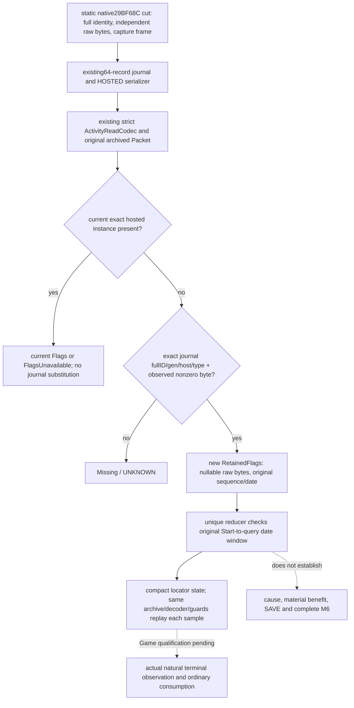

# resume63 M6：四类原生链与 Activity terminal journal 的 Java 接管

`machine_id: xenoamess-full-tower-eb9d2c1186`；2026-10-26 UTC，14:49Z 源审与采用回读。机器身份由本轮 Root 在 [REA 工作流](../rea-ck3-research/resume63-framework-workflow.md)重新核验；本岗没有启动或连接 CK3、Steam、SDK、pipe，也没有修改冻结 SDK。新 EXE 字节读取、REA backend 查询、游戏新增日和业务实机验收均为 0。

本页回答两个不同问题：M6 四类能力有哪些真实原生候选、caller/cache、最终合法性与后态；已存在的 Python 活动终态能力是否真的被 Java 普通主线接走。四类研究不由一个 Sway fixture 或单一活动后态授予全 M6 完成。

## 方法和身份

已读 resume62 [交接](../handover/2026-10-26-java-g2-resume62-rea-runtime-handoff.md)及[索引](../handover/2026-10-26-java-g2-resume62-rea-runtime-handoff-source-index.json)、REA README/methodology/tools-and-context、本轮 framework workflow、[原版优先提示词](vanilla-first-implementation-prompt.md)。本题复用 REA 的可证伪问题、Evidence/Unknown 分离、精确输入与 producer→consumer 检验方法；本岗执行的是有界源码审查，没有冒称 REA provider 运行或 native dossier。

当前源码根 `S=D:/codex-ck3-demos/2026-10-25-java-g2-complete31-h5r5/java/ck3-control`。当前 `.4` 来源合同为 CK3 1.20.0.4 / Steam 25734779，EXE SHA `98702f88a547cde2eaf29a85f93b85f68ee4cf8148336a4f7afaeb75319dd518`；Root 本轮已重新读该文件 SHA。文件绑定不证明进程已经加载此 EXE 或新 Java 代码。旧 1.19/1.20.0.2/1.20.0.3 研究分别保留历史身份，不能直接将地址移作 `.4` callable。

研究假设 H1：Java 既有严格 Activity hosted decoder 已携带终态 cut journal，但 Root final consumer 没有消费它；对象离开 hosted 列表后，即使原件含 exact terminal byte，当前 Java 仍只产生 Missing。反例条件是存在已安装的 downstream journal consumer，或 Root 由同一个 Packet 接走 journal。本岗对 application/local-service/g2 中 `terminalJournal` 的查找无 consumer 命中，再完整读真实 Root bridge；观察支持 H1。查找范围不扩展为全仓不存在其他研究消费者。

## 四类逐边核对

表中“静态”包括既有 exact native 证据和本轮真实源码 caller trace；不是本轮新 Game 样本。unknown 边没有被补成空列表、零效用或合法动作。

| 子类与具体案例 | 候选、调度、索引与缓存 | 过滤、评分、最终合法性与执行 | 独立后态、Java 接线与缺口 |
| --- | --- | --- | --- |
| 谋略：Sway 普通发起与自然结束 | 既有 `.4` 通用交互 `19E82A7→1A2B9C0→1A2B310`；bank/rank index，汇总所需 family marks，经 `1A2BF81→2930260` 只重算被标记 family，`2931C30` union/sort/dedup。Sway 脚本分别声明 liege+neighboring rulers、vassals+peer vassals（前两块各 max10）、councillors；五名到 runtime token/index、loaded Sway bank 和委托 vector 生命周期仍未闭。 | quick gate 逆序 swap-last 删除，max trim/chance/RNG 后 native preparation；sender `307C530`，重准备后 final `307C020` 再 submit。`NativeInteractionQuickFilter`、`NativeInteractionAi` 是 pure reference，不是 live 原生候选 producer。mutation/cache/RNG caller 不能当只读查询重复调用。 | `OrdinarySwayPolicy`/Sway runtime 已有 ordinary、pending、独立 active 与后继消费；`M6Research` 仍明确 P55 Sway-only assessment，其他三类 not_assessed，whole_m6_complete=false。`.4` native end `2A48660→2A4F100→2A4ADF0` 的状态、rawDL、on_invalidated 与具体 cause 分开。后继最小研究是五名真实 token/bank/delegate，不重复全 PE。 |
| 囚犯/制度：向外 gold/current_gold 赎金 | 当前 collection 以玩家 prisoner 完整 ID/实际 jailer 为来源；交互把被赎者转为 secondary_recipient，非统治者的 payer 可重定向为 liege。当前 Java `PrisonerCollector12004.collectRansom` 对返回 collection 每个 ordinal 查当前 quote；release 使用每 ordinal 最新真实条款。原生跨 ransom/release/execute/retain 的统一 scheduler/utility 未闭。 | native context 保留最终 payer/prisoner、九项 ransom mask，当前正式 action 仅选择 gold/current_gold，重查 quote/answer 后 `context.validate`、入队；十三项 release mask/十项成本另有既有链。Java 同王朝/子女/头衔等裁剪是我方已存范围，不能当原生完整候选全集。time_in_prison 的主体是囚犯；原生单位/重置语义仍 unknown，不能从 custody 或首次看见日猜出。 | `PrisonersRuntimeInstaller→PrisonerOrdinaryPolicy12004→NativePrisonerEffects12004` 的 gold 后态为完整 collection 无该囚犯，加 jailer 实际 wallet gain；current_gold 只要求正收益。payer 扣款、hook/herd/influence、条款效果和付款因果均不由这个回执证明。本轮无囚犯代码改动或实机信用。 |
| 非宗教法律：Crown Authority | `.4` active law collection 由 actor context+1C0、active vector+200，DB group+50/+5C、candidate+58/+64，law group+40/key+18。现有 `GovernancePolicies.Crown` 只在前级保留 life-advance 且域 clear 时按 optional cadence 查询；既有 CrownRetry 只改变到期查询时机，不放宽 final terms。 | `.4` actual final `30B1B50..30B1CBD`、reason `30B1CC0..30B1DF5`、cost `30B26B0..30B27CD`；fresh native final terms 为合法性权威。Java Crown policy 选择来源明确的 current upgrade/quote，真实 action/prepare/queue 与独立 verify 分离。旧 `.2` CAddLawCommand ABI 和其 queue AL 纠正只作历史链，不能直接授 `.4` mutation资格。 | `NativeGovernanceEffects.crown` 消费原 submitted request、当前 effective law、五类费用与 pre/post wallet、successor verification；`GovernanceReceipts`/后继普通 cycle 再消费 canonical receipt。它不代表所有 succession law/contract/非宗教决议均已覆盖；原生 rare-task scheduler/tie-break、hypothetical successor 等旧 unknown 仍待对应 actual4 来源。本轮无 law action。 |
| 活动：ordinary Feast 配置、Start、生命周期 | 原生 activity reference `3114E70` 按 rank interval 建索引；builder `1A74080` 消费独立 pending Type* set，cooldown map 与 invalidation set 不是同一缓存，host caller `1A8D530` 可写状态/入队，不能当只读全目录 query。Java ordinary 真链使用现有 planner/hosted 和当前 capital，stage1 option→confirm→stage2 native selectable destination→stage5。 | `OrdinaryFeastPolicy` 优先原 pending reconcile，stage5 实际成本/钱包/保留军费，guest join/到达预测和 final CanStart分别核；提交前在原 writer 内再读 current state/quote。`NativeFeastEffects` 要原 native ACK，再另读 diagnostic+hosted，恰一新 player-hosted Feast及实际扣款；预测/ACK均不是到场或收益。 | `FeastDomainRuntime` 保 canonical exact Start→`FeastFinalSettlement.requireStart` 先重放原 material→`RootActivityFinalReadBridge` 用同 installed decoder/archive/双guard→`ActivityFinalState`。本轮补的是最后一段：existing cut journal→missing-instance final retention→原件冷重放；终态、cause、收益、Save仍各自独立。 |

主要原生专题：[Sway family](sway-target-family-source-navigation-12004-resume61.md)、[Sway end](sway-native-end-source-tree-12004.md)、[七项注册](sway-seven-registration-native-route-12004-2026-10-26.md)、[囚犯当前 Java/安装文本](java-prisoner-installed-currencies-and-completion-resume61-20261026.md)、[囚犯决策树](prisoner-disposition-native-ai-tree-12003.md)、[时长角色/阈值](prisoner-duration-role-and-thresholds-12004-resume61.md)、[当前法律迁移](realm-law-active-query-12004-migration.md)、[Feast migration](activity-feast-mcp-migration-12004.md)、[旧 guest route](activity-feast-stage5-guest-route-proof-1.19.0.6.md)。旧版专题只用于解释原源，不当当前 callable。

## H1 的实际 source evidence 和最小修复

法律执行不是整段unknown。本轮另直接读当前 `.4` `ck3_12004_realm_law_enact_command_v1.cpp`（5458B/SHA `2664b04e1c8ae07af4ee880cd9827104c466c06416ee600699e73bc667a12cd7`）和mutation ABI源（9918B/SHA `5d96164943868e48de18188e206433515de7656ec9faec1119286436a213e4a2`）：actual4 build/SHA proof、target actor/law roundtrip及proof epoch核对后，构造0x30字节命令、调用`288DA20`最终command validator、`2896210`原生clone及`37F06D0` locked queue。队列有明确bool结果，未消费对象/unused结果经原析构清理；没有直接调用executor。本源还固定executor`288D990→28A94D0→28A96C0→28A9570`和select→apply`28A9770`边。此为当前源审，未重读这些PE字节、未执行proof、queue或law动作；旧`.2`专题不替它授runtime资格。

本轮直接读并核 SHA 的既有源码：

| 原件 | bytes | SHA-256 |
| --- | ---: | --- |
| `ck3_autonomous_player/native_bridge/src/activity_terminal_observations_12004.cpp` | 10191 | `66fdcf59a250772e4152e03e2115729b33b2c28165d86ae6e780b39fc857556d` |
| `ck3_autonomous_player/src/xar_autoplayer/bridge/activity_feast_terminal_outcome_v1.py` | 5534 | `b24bdd23bcbf0139605a7ce98f849ca850b471e33d2d661e9fa9709aef3fa692` |
| `ck3_autonomous_player/src/xar_autoplayer/bridge/activity_feast_stage5_start_private_transport.py` | 43343 | `656b02666880395c1bc1e0e3de4d9ff9d1a0d30e1393fc69e1d930aef43b8f3f` |
| `S/native-transport/.../activity/ActivityTerminalJournal.java` | 6116 | `60a2dd54b3b5045b2dd3de8143bf594e9103d8cbfec64bb5176a4e5e29b2657d` |

既有 `.4` native source 在 `29BF685` 写 Activity+422=1 后，于 `29BF68C` 第一 callee 之前复制实际 RSI/RBX，保 full ActivityID/generation、host/type、两个独立可读 byte、opaque QWORD和原 capture frame。源 cut、序号和 QWORD不提供原因或收益。64项 process-lifetime ring 的空/缺失/overflow不证明没有事件。现有 strict Java `ActivityReadCodec.hosted` 已把 `native_terminal_observations` 解成 Known/Rejected/ExplicitNull，完整原 token仍在真实 archived HOSTED read。

Python normalizer 只在 current hosted 缺失时逆序匹配 exact fullID/generation/host/type，至少一项 observed raw byte非零才保留；另一项未读仍为 None。已存在的 current hosted false/false、甚至 unread hosted row，都保留自己的分支。Java 原 Root bridge 缺少此消费，只有 Missing/FlagsUnavailable/Flags。

本轮修改 Root首批批准的五叶，独审后又按Root追加认领修一份公共测试夹具：

1. `ActivityFinalState` 新增独立 `RetainedFlags`，存两个 Optional原始byte、opaque stamp、规范uint64 capture序号和原capture日期；至少一项观察到非零。唯一 reducer 另要求捕获日期在 canonical Start origin 与当前query日期之间。历史cut不使 `observedFinalAt(current)` 成真。
2. `ActivityFinalStateCodec` 在既有 v1 sealed branch 中增 `RETAINED_FLAGS`。未知byte仍JSON null，已读0仍整数0，uint64序号/stamp及signed64日期为规范十进制字符串；读取必须从原archive重放并逐值比较，摘要不能自授来源。
3. `RootActivityFinalReadBridge` 只在当前exact hosted ID缺失时消费既有 decoded Known/available journal，逆序筛 fullID/generation/unsigned host/type和非零byte；不发第二查询、不调用新native函数、不将旧cut搬到query日期。current hosted readable/unread分支均不改变。
4. 两个现有JUnit增加6项聚焦回归：partial-byte/uint64冷热往返、错误byte/date窗；真实软件transport→installed private Packet→同writer archive/双guard→reducer→cold replay；当前falsefalse/unread优先、other generation/nonterminal/rejected journal、日期越窗和篡改原byte拒绝。Fixture不是游戏样本。

## 采用与实际验证边界

Root精确认领、Capacity63 source256KiB/doc32KiB及Host短写窗口后，在同一可复用S采用。首批全部5个旧SHA先读回MATCH；未向根仓写半模块，未改i61/BUILD/m2/build-tools，未复制全图。首批五叶从64298B到83013B，净增18715B；后续公共fixture与日期例修正后，六叶合计从67240B到86397B，净增19157B。预算包含现有source候选/回读，未新增全局hold。

| S相对文件 | before bytes/SHA | adopted bytes/SHA |
| --- | --- | --- |
| `g2-research/src/main/java/org/xar/ck3/control/g2/m6/ActivityFinalState.java` | 7525 / `cf284c84c156e2972660a0136a8b43a390b39149406bc9e92a9c96cb73ba57d5` | 9526 / `341c55a1527e23592bece3dcf10bdc188fd4666203b839ac8a28472e2a76be78` |
| 同目录 `ActivityFinalStateCodec.java` | 8393 / `975a2ec0df336f1d86fb0ec6ee7fc21a1bc6f1edd08975a89a7191622b8a8e9e` | 10467 / `b5389d1eed163deb47f8645fbedf9dba65e72dec3768f54e04bb468849fe6ec5` |
| `g2-research/src/test/java/org/xar/ck3/control/g2/m6/ActivityFinalStateTest.java` | 8248 / `70fa16fb15e87e9a1e3ad4a9610705bbdf35349448cd60bb539540d4626bbc03` | 11591 / `a1655e5c620fb4a151aa07b654830a60efe22e4aed70d267fa4619e6f9ec4f7c` |
| `local-service/src/main/java/org/xar/ck3/control/service/root/RootActivityFinalReadBridge.java` | 7936 / `d2e91b76c035d9ec97a31fda08b4b97018ee81814e33d7a2d17c87d7e626c126` | 9574 / `6d1b8348b49b4319ee0e72430ab4bb5b7d9c798a30d8315ecb2f3c2756e7fcc8` |
| `local-service/src/test/java/org/xar/ck3/control/service/root/RootActivityFinalReadBridgeTest.java` | 32196 / `85d51015b1e7da05ddf80e823a43b9c8eed630fba44c22e282a8303c45c07ded` | 42182 / `86d1a109ddbc6993ae212255f58c17b4159d5e603b51758ba994f35316f72060` |
| 同测试目录 `ActivityFinalIngressData.java` | 2942 / `5545bb3c1979bc9641709c5848523c50110e0939f28b3ed4dd72f7db78a7af87` | 3057 / `2a7984aa6aae00549a22d5712b153f9706339d1ab79d67bce98fd66766239e70` |

Acceptance63独立读完整三main，尚未发现具体生产阻塞；随后在测试源码发现真实夹具漂移：当前共享 `ActionWriterIntegrationFixture.INITIAL_DATE_RAW` 已由 `CampaignCalendar.dateToRaw("1066.9.15")` 产生53144328，而原 `ActivityFinalIngressData` 与新journal例仍使用1000。实际transport直接消费scenario原result，不会修其日期，故新正例在当前日期窗下不可成立；此前999/1001也都在Start之前，没有真正覆盖query之后。此为源审反证，尚未执行，不写成实际JUnit FAIL。

Root追加第六叶认领后，公共 `ActivityFinalIngressData.result()` 同步共享AWIF日期，全部真实消费者复用该修复；新journal正例使用同一常量，负例明确取该日±`CampaignCalendar.TICKS_PER_DAY`。没有放宽生产日期窗，也没有在私有测试wrapper伪造另一日期。首批RootTest41855B/SHA `69a6d50b486ed701545e213e566012145688eaf6cf9ae1a12be08e970da135a1`仅是修正前source状态，最终pin见上表。

这仍不是六叶完整独审、编译或JUnit通过。编译与实际运行由Host63唯一执行；当前为 **SOURCE_ADOPTED / TESTS_NOT_RUN**。已请求复用同SRC/cache，对受影响 g2-research/local-service及必要依赖增量编译，运行既有 `ActivityFinalStateTest,RootActivityFinalReadBridgeTest`，并覆盖共享fixture旧consumer `RootActivityStampIngressTest,RootActivitySavedOriginalGuardTest`。真实命令、并发、实际重编译模块、退出码、耗时与失败须由Host终态另附，不能由本页的建议命令代替。

resume62的 `M6-CANDIDATES-PARTIAL01.json` 已直接读取：可恢复ops实际是Army Core availability与route public CUnit0；它不包含本页四类私有body，未被本次恢复、重放或扩大为M6完整迁移。Sway现有评估继续 whole_m6_complete=false。本题保留未知原因/收益/保存与完整实机验收，未声称候选搜索等价、原生调用提速或模型token节省。

既有native header明确 capture frame没有published revision、episode或额外native clock；ring为process-lifetime。此次保留Python完整身份匹配并增加日期窗，未制造其不存在的因果token。因此，这不能自动资格化同一CK3进程内任意旧存档重载后的新实例终态归属。后续若覆盖该场景，具体入口是canonical Start独立HOSTED原件中已有的journal latest序号，以它建立源绑定watermark，再消费其后真实record；不靠query日期或软件summary补身份。本轮没有采用这项后继，不以它新增首场运行门禁。

下一步先消费Host真实诊断修同源码，再按Root总cut完成全部producer→consumer和最终全编译；合法实机具备时，执行自然Feast终态原件、普通后继消费和保存/恢复。M6四类各自仍须独立真实案例，单一journal fixture不能授四类完成。此页与必要现有源码按统一存储策略复核，最迟2026-11-02或采用/替代/引用解除时更早；本页不续旧执行卡。
