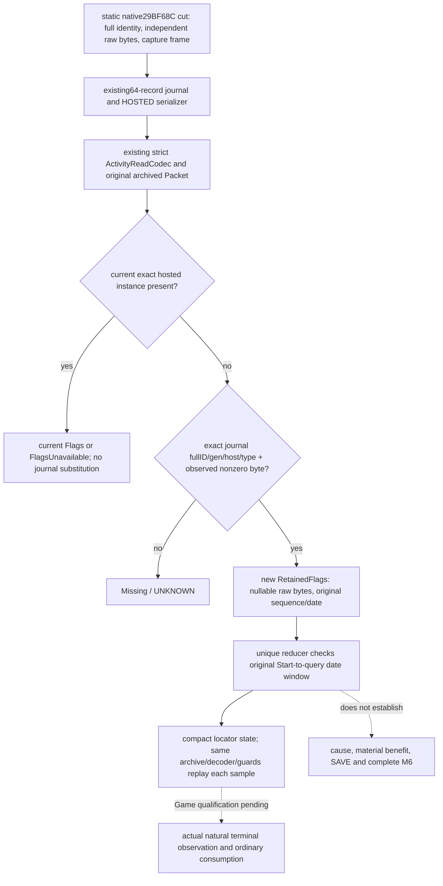

# resume63 M6：四类原生链与 Activity terminal journal 的 Java 接管

`machine_id: xenoamess-full-tower-eb9d2c1186`；2026-10-26 UTC，14:49Z 源审与采用回读。机器身份由本轮 Root 在 [REA 工作流](../rea-ck3-research/resume63-framework-workflow.md)重新核验；本岗没有启动或连接 CK3、Steam、SDK、pipe，也没有修改冻结 SDK。新 EXE 字节读取、REA backend 查询、游戏新增日和业务实机验收均为 0。

本页回答两个不同问题：M6 四类能力有哪些真实原生候选、caller/cache、最终合法性与后态；已存在的 Python 活动终态能力是否真的被 Java 普通主线接走。四类研究不由一个 Sway fixture 或单一活动后态授予全 M6 完成。

## 方法和身份

已读 resume62 [交接](../handover/2026-10-26-java-g2-resume62-rea-runtime-handoff.md)及[索引](../handover/2026-10-26-java-g2-resume62-rea-runtime-handoff-source-index.json)、REA README/methodology/tools-and-context、本轮 framework workflow、[原版优先提示词](vanilla-first-implementation-prompt.md)。本题复用 REA 的可证伪问题、Evidence/Unknown 分离、精确输入与 producer→consumer 检验方法；本岗执行的是有界源码审查，没有冒称 REA provider 运行或 native dossier。

当前源码根 `S=D:/codex-ck3-demos/2026-10-25-java-g2-complete31-h5r5/java/ck3-control`。当前 `.4` 来源合同为 CK3 1.20.0.4 / Steam 25734779，EXE SHA `98702f88a547cde2eaf29a85f93b85f68ee4cf8148336a4f7afaeb75319dd518`；Root 本轮已重新读该文件 SHA。文件绑定不证明进程已经加载此 EXE 或新 Java 代码。旧 1.19/1.20.0.2/1.20.0.3 研究分别保留历史身份，不能直接将地址移作 `.4` callable。

研究假设 H1：Java 既有严格 Activity hosted decoder 已携带终态 cut journal，但 Root final consumer 没有消费它；对象离开 hosted 列表后，即使原件含 exact terminal byte，当前 Java 仍只产生 Missing。反例条件是存在已安装的 downstream journal consumer，或 Root 由同一个 Packet 接走 journal。本岗对 application/local-service/g2 中 `terminalJournal` 的查找无 consumer 命中，再完整读真实 Root bridge；观察支持 H1。查找范围不扩展为全仓不存在其他研究消费者。

## 四类逐边核对

表中“静态”包括既有 exact native 证据和本轮真实源码 caller trace；不是本轮新 Game 样本。unknown 边没有被补成空列表、零效用或合法动作。

| 子类与具体案例 | 候选、调度、索引与缓存 | 过滤、评分、最终合法性与执行 | 独立后态、Java 接线与缺口 |
| --- | --- | --- | --- |
| 谋略：Sway 普通发起与自然结束 | 既有 `.4` 通用交互 `19E82A7→1A2B9C0→1A2B310`；bank/rank index，汇总所需 family marks，经 `1A2BF81→2930260` 只重算被标记 family，`2931C30` union/sort/dedup。Sway 脚本分别声明 liege+neighboring rulers、vassals+peer vassals（前两块各 max10）、councillors；五名到 runtime token/index、loaded Sway bank 和委托 vector 生命周期仍未闭。 | quick gate 逆序 swap-last 删除，max trim/chance/RNG 后 native preparation；sender `307C530`，重准备后 final `307C020` 再 submit。`NativeInteractionQuickFilter`、`NativeInteractionAi` 是 pure reference，不是 live 原生候选 producer。mutation/cache/RNG caller 不能当只读查询重复调用。 | `OrdinarySwayPolicy`/Sway runtime 已有 ordinary、pending、独立 active 与后继消费；`M6Research` 仍明确 P55 Sway-only assessment，其他三类 not_assessed，whole_m6_complete=false。`.4` native end `2A48660→2A4F100→2A4ADF0` 的状态、rawDL、on_invalidated 与具体 cause 分开。后继最小研究是五名真实 token/bank/delegate，不重复全 PE。 |
| 囚犯/制度：向外 gold/current_gold 赎金 | 当前 collection 以玩家 prisoner 完整 ID/实际 jailer 为来源；交互把被赎者转为 secondary_recipient，非统治者的 payer 可重定向为 liege。当前 Java `PrisonerCollector12004.collectRansom` 对返回 collection 每个 ordinal 查当前 quote；release 使用每 ordinal 最新真实条款。原生跨 ransom/release/execute/retain 的统一 scheduler/utility 未闭。 | native context 保留最终 payer/prisoner、九项 ransom mask，当前正式 action 仅选择 gold/current_gold，重查 quote/answer 后 `context.validate`、入队；十三项 release mask/十项成本另有既有链。Java 同王朝/子女/头衔等裁剪是我方已存范围，不能当原生完整候选全集。time_in_prison 的主体是囚犯；原生单位/重置语义仍 unknown，不能从 custody 或首次看见日猜出。 | `PrisonersRuntimeInstaller→PrisonerOrdinaryPolicy12004→NativePrisonerEffects12004` 的 gold 后态为完整 collection 无该囚犯，加 jailer 实际 wallet gain；current_gold 只要求正收益。payer 扣款、hook/herd/influence、条款效果和付款因果均不由这个回执证明。本轮无囚犯代码改动或实机信用。 |
| 非宗教法律：Crown Authority | `.4` active law collection 由 actor context+1C0、active vector+200，DB group+50/+5C、candidate+58/+64，law group+40/key+18。现有 `GovernancePolicies.Crown` 只在前级保留 life-advance 且域 clear 时按 optional cadence 查询；既有 CrownRetry 只改变到期查询时机，不放宽 final terms。 | `.4` actual final `30B1B50..30B1CBD`、reason `30B1CC0..30B1DF5`、cost `30B26B0..30B27CD`；fresh native final terms 为合法性权威。Java Crown policy 选择来源明确的 current upgrade/quote，真实 action/prepare/queue 与独立 verify 分离。旧 `.2` CAddLawCommand ABI 和其 queue AL 纠正只作历史链，不能直接授 `.4` mutation资格。 | `NativeGovernanceEffects.crown` 消费原 submitted request、当前 effective law、五类费用与 pre/post wallet、successor verification；`GovernanceReceipts`/后继普通 cycle 再消费 canonical receipt。它不代表所有 succession law/contract/非宗教决议均已覆盖；原生 rare-task scheduler/tie-break、hypothetical successor 等旧 unknown 仍待对应 actual4 来源。本轮无 law action。 |
| 活动：ordinary Feast 配置、Start、生命周期 | 原生 activity reference `3114E70` 按 rank interval 建索引；builder `1A74080` 消费独立 pending Type* set，cooldown map 与 invalidation set 不是同一缓存，host caller `1A8D530` 可写状态/入队，不能当只读全目录 query。Java ordinary 真链使用现有 planner/hosted 和当前 capital，stage1 option→confirm→stage2 native selectable destination→stage5。 | `OrdinaryFeastPolicy` 优先原 pending reconcile，stage5 实际成本/钱包/保留军费，guest join/到达预测和 final CanStart分别核；提交前在原 writer 内再读 current state/quote。`NativeFeastEffects` 要原 native ACK，再另读 diagnostic+hosted，恰一新 player-hosted Feast及实际扣款；预测/ACK均不是到场或收益。 | `FeastDomainRuntime` 保 canonical exact Start→`FeastFinalSettlement.requireStart` 先重放原 material→`RootActivityFinalReadBridge` 用同 installed decoder/archive/双guard→`ActivityFinalState`。本轮补的是最后一段：existing cut journal→missing-instance final retention→原件冷重放；终态、cause、收益、Save仍各自独立。 |

主要原生专题：[Sway family](sway-target-family-source-navigation-12004-resume61.md)、[Sway end](sway-native-end-source-tree-12004.md)、[七项注册](sway-seven-registration-native-route-12004-2026-10-26.md)、[囚犯当前 Java/安装文本](java-prisoner-installed-currencies-and-completion-resume61-20261026.md)、[囚犯决策树](prisoner-disposition-native-ai-tree-12003.md)、[时长角色/阈值](prisoner-duration-role-and-thresholds-12004-resume61.md)、[当前法律迁移](realm-law-active-query-12004-migration.md)、[Feast migration](activity-feast-mcp-migration-12004.md)、[旧 guest route](activity-feast-stage5-guest-route-proof-1.19.0.6.md)。旧版专题只用于解释原源，不当当前 callable。

## H1 的实际 source evidence 和最小修复

法律执行不是整段unknown。本轮另直接读当前 `.4` `ck3_12004_realm_law_enact_command_v1.cpp`（5458B/SHA `2664b04e1c8ae07af4ee880cd9827104c466c06416ee600699e73bc667a12cd7`）和mutation ABI源（9918B/SHA `5d96164943868e48de18188e206433515de7656ec9faec1119286436a213e4a2`）：actual4 build/SHA proof、target actor/law roundtrip及proof epoch核对后，构造0x30字节命令、调用`288DA20`最终command validator、`2896210`原生clone及`37F06D0` locked queue。队列有明确bool结果，未消费对象/unused结果经原析构清理；没有直接调用executor。本源还固定executor`288D990→28A94D0→28A96C0→28A9570`和select→apply`28A9770`边。此为当前源审，未重读这些PE字节、未执行proof、queue或law动作；旧`.2`专题不替它授runtime资格。

本轮直接读并核 SHA 的既有源码：

| 原件 | bytes | SHA-256 |
| --- | ---: | --- |
| `ck3_autonomous_player/native_bridge/src/activity_terminal_observations_12004.cpp` | 10191 | `66fdcf59a250772e4152e03e2115729b33b2c28165d86ae6e780b39fc857556d` |
| `ck3_autonomous_player/src/xar_autoplayer/bridge/activity_feast_terminal_outcome_v1.py` | 5534 | `b24bdd23bcbf0139605a7ce98f849ca850b471e33d2d661e9fa9709aef3fa692` |
| `ck3_autonomous_player/src/xar_autoplayer/bridge/activity_feast_stage5_start_private_transport.py` | 43343 | `656b02666880395c1bc1e0e3de4d9ff9d1a0d30e1393fc69e1d930aef43b8f3f` |
| `S/native-transport/.../activity/ActivityTerminalJournal.java` | 6116 | `60a2dd54b3b5045b2dd3de8143bf594e9103d8cbfec64bb5176a4e5e29b2657d` |

既有 `.4` native source 在 `29BF685` 写 Activity+422=1 后，于 `29BF68C` 第一 callee 之前复制实际 RSI/RBX，保 full ActivityID/generation、host/type、两个独立可读 byte、opaque QWORD和原 capture frame。源 cut、序号和 QWORD不提供原因或收益。64项 process-lifetime ring 的空/缺失/overflow不证明没有事件。现有 strict Java `ActivityReadCodec.hosted` 已把 `native_terminal_observations` 解成 Known/Rejected/ExplicitNull，完整原 token仍在真实 archived HOSTED read。

Python normalizer 只在 current hosted 缺失时逆序匹配 exact fullID/generation/host/type，至少一项 observed raw byte非零才保留；另一项未读仍为 None。已存在的 current hosted false/false、甚至 unread hosted row，都保留自己的分支。Java 原 Root bridge 缺少此消费，只有 Missing/FlagsUnavailable/Flags。

本轮修改 Root首批批准的五叶，独审后又按Root追加认领修一份公共测试夹具：

1. `ActivityFinalState` 新增独立 `RetainedFlags`，存两个 Optional原始byte、opaque stamp、规范uint64 capture序号和原capture日期；至少一项观察到非零。唯一 reducer 另要求捕获日期在 canonical Start origin 与当前query日期之间。历史cut不使 `observedFinalAt(current)` 成真。
2. `ActivityFinalStateCodec` 在既有 v1 sealed branch 中增 `RETAINED_FLAGS`。未知byte仍JSON null，已读0仍整数0，uint64序号/stamp及signed64日期为规范十进制字符串；读取必须从原archive重放并逐值比较，摘要不能自授来源。
3. `RootActivityFinalReadBridge` 只在当前exact hosted ID缺失时消费既有 decoded Known/available journal，逆序筛 fullID/generation/unsigned host/type和非零byte；不发第二查询、不调用新native函数、不将旧cut搬到query日期。current hosted readable/unread分支均不改变。
4. 两个现有JUnit增加6项聚焦回归：partial-byte/uint64冷热往返、错误byte/date窗；真实软件transport→installed private Packet→同writer archive/双guard→reducer→cold replay；当前falsefalse/unread优先、other generation/nonterminal/rejected journal、日期越窗和篡改原byte拒绝。Fixture不是游戏样本。

## 采用与实际验证边界

Root精确认领、Capacity63 source256KiB/doc32KiB及Host短写窗口后，在同一可复用S采用。首批全部5个旧SHA先读回MATCH；未向根仓写半模块，未改i61/BUILD/m2/build-tools，未复制全图。首批五叶从64298B到83013B，净增18715B；后续公共fixture与日期例修正后，六叶合计从67240B到86397B，净增19157B。预算包含现有source候选/回读，未新增全局hold。

| S相对文件 | before bytes/SHA | adopted bytes/SHA |
| --- | --- | --- |
| `g2-research/src/main/java/org/xar/ck3/control/g2/m6/ActivityFinalState.java` | 7525 / `cf284c84c156e2972660a0136a8b43a390b39149406bc9e92a9c96cb73ba57d5` | 9526 / `341c55a1527e23592bece3dcf10bdc188fd4666203b839ac8a28472e2a76be78` |
| 同目录 `ActivityFinalStateCodec.java` | 8393 / `975a2ec0df336f1d86fb0ec6ee7fc21a1bc6f1edd08975a89a7191622b8a8e9e` | 10467 / `b5389d1eed163deb47f8645fbedf9dba65e72dec3768f54e04bb468849fe6ec5` |
| `g2-research/src/test/java/org/xar/ck3/control/g2/m6/ActivityFinalStateTest.java` | 8248 / `70fa16fb15e87e9a1e3ad4a9610705bbdf35349448cd60bb539540d4626bbc03` | 11591 / `a1655e5c620fb4a151aa07b654830a60efe22e4aed70d267fa4619e6f9ec4f7c` |
| `local-service/src/main/java/org/xar/ck3/control/service/root/RootActivityFinalReadBridge.java` | 7936 / `d2e91b76c035d9ec97a31fda08b4b97018ee81814e33d7a2d17c87d7e626c126` | 9574 / `6d1b8348b49b4319ee0e72430ab4bb5b7d9c798a30d8315ecb2f3c2756e7fcc8` |
| `local-service/src/test/java/org/xar/ck3/control/service/root/RootActivityFinalReadBridgeTest.java` | 32196 / `85d51015b1e7da05ddf80e823a43b9c8eed630fba44c22e282a8303c45c07ded` | 42182 / `86d1a109ddbc6993ae212255f58c17b4159d5e603b51758ba994f35316f72060` |
| 同测试目录 `ActivityFinalIngressData.java` | 2942 / `5545bb3c1979bc9641709c5848523c50110e0939f28b3ed4dd72f7db78a7af87` | 3057 / `2a7984aa6aae00549a22d5712b153f9706339d1ab79d67bce98fd66766239e70` |

Acceptance63独立读完整三main，尚未发现具体生产阻塞；随后在测试源码发现真实夹具漂移：当前共享 `ActionWriterIntegrationFixture.INITIAL_DATE_RAW` 已由 `CampaignCalendar.dateToRaw("1066.9.15")` 产生53144328，而原 `ActivityFinalIngressData` 与新journal例仍使用1000。实际transport直接消费scenario原result，不会修其日期，故新正例在当前日期窗下不可成立；此前999/1001也都在Start之前，没有真正覆盖query之后。此为源审反证，尚未执行，不写成实际JUnit FAIL。

Root追加第六叶认领后，公共 `ActivityFinalIngressData.result()` 同步共享AWIF日期，全部真实消费者复用该修复；新journal正例使用同一常量，负例明确取该日±`CampaignCalendar.TICKS_PER_DAY`。没有放宽生产日期窗，也没有在私有测试wrapper伪造另一日期。首批RootTest41855B/SHA `69a6d50b486ed701545e213e566012145688eaf6cf9ae1a12be08e970da135a1`仅是修正前source状态，最终pin见上表。

这仍不是六叶完整独审、编译或JUnit通过。编译与实际运行由Host63唯一执行；当前为 **SOURCE_ADOPTED / TESTS_NOT_RUN**。已请求复用同SRC/cache，对受影响 g2-research/local-service及必要依赖增量编译，运行既有 `ActivityFinalStateTest,RootActivityFinalReadBridgeTest`，并覆盖共享fixture旧consumer `RootActivityStampIngressTest,RootActivitySavedOriginalGuardTest`。真实命令、并发、实际重编译模块、退出码、耗时与失败须由Host终态另附，不能由本页的建议命令代替。

resume62的 `M6-CANDIDATES-PARTIAL01.json` 已直接读取：可恢复ops实际是Army Core availability与route public CUnit0；它不包含本页四类私有body，未被本次恢复、重放或扩大为M6完整迁移。Sway现有评估继续 whole_m6_complete=false。本题保留未知原因/收益/保存与完整实机验收，未声称候选搜索等价、原生调用提速或模型token节省。

既有native header明确 capture frame没有published revision、episode或额外native clock；ring为process-lifetime。此次保留Python完整身份匹配并增加日期窗，未制造其不存在的因果token。因此，这不能自动资格化同一CK3进程内任意旧存档重载后的新实例终态归属。后续若覆盖该场景，具体入口是canonical Start独立HOSTED原件中已有的journal latest序号，以它建立源绑定watermark，再消费其后真实record；不靠query日期或软件summary补身份。本轮没有采用这项后继，不以它新增首场运行门禁。

下一步先消费Host真实诊断修同源码，再按Root总cut完成全部producer→consumer和最终全编译；合法实机具备时，执行自然Feast终态原件、普通后继消费和保存/恢复。M6四类各自仍须独立真实案例，单一journal fixture不能授四类完成。此页与必要现有源码按统一存储策略复核，最迟2026-11-02或采用/替代/引用解除时更早；本页不续旧执行卡。

## 17:25Z：独立 REA case 闭合四个真实候选委托的边界

用户要求提高研究并发后，Root将raw provider上限改为4个独立case。M6选择原source07已明确未闭的四个`2930260`委托，问题是：**它们各从哪个原receiver/owner取得何种完整ID向量、保持什么顺序，以及哪些调用/递归阻止将它们概括为只读完整枚举？** 反例为不同ID域、fallback/过滤/重排、间接callback或未闭callee。本题不研究理论同PID恢复，不为五个Sway名称缺locator而盲扫名称表，也不重新采集已读57分派或228B token表。

独立case为 `D:/ck3-state/ck3-java-g2-rea-eval-resume62/tools01/cases/resume63-m6-family-delegates01`（以下记为R）。先复用current4 `NATIVE-SOURCE07/NATIVE-GRAPH07`及已持`NEW-PDATA-DIRECTORY.bin`，76次有界元数据读取合912B定位四行；原source04的27个span不覆盖这四入口。检查过的`shared-span-cache/function-match-core`没有完整覆盖body；这不是宣称全机不存在缓存。实际decoder又对当前PE四个RF tuple全部复核后，才读取下表694B新语义字节：

| 当前RF（end exclusive） | unwind RVA | bytes / Capstone指令 | Rizin局部CFG nodes/edges | 原始bytes SHA-256 |
| --- | --- | --- | --- | --- |
| `292EA70..292EAE0` | `510B3B8` | 112 / 31 | 7 / 9 | `4721ffae76489d0adcc1897aac858640a4b80b09803813034fa4cc1e06bfb471` |
| `292EAE0..292EB54` | `51096B8` | 116 / 29 | 12 / 17，含两个出界stub | `e8e15f288bd436e56db3250f94131548de7d93af5dc8b341d21824f47574cdf5` |
| `292EC50..292EDD7` | `5125BA4` | 391 / 107 | 28 / 44 | `e1f36603c2060f581095ba16ac4a9e531c7a68d5afc5052b57d4ce6861743b49` |
| `2932150..293219B` | `5109DB0` | 75 / 23 | 5 / 7 | `00802a50bd943e1041aa3c85571c33f7c38609f99dbb043c266817bf2dad934f` |

执行复用[已成功的方法/最小close模板](../rea-ck3-research/resume63-parallel-raw-method.md)：已有离线Capstone工具独立解码，再调用正式`createReverseEngineeringService.executeRizinCommand`，同一Rizin进程逐seed设置自己的from/to，并限制calls/hasnext/jmp.after，不跟callee/globaldata/unwind正文。新Python生产/runner、Ghidra/full-PE import、Game和SRC写均为0。PE身份哈希和后端加载仍会读原文件；不能把694B语义范围写成整个物理I/O只有694B。

Root认可694B范围后，Capacity发独立slot2卡：`resume63/capacity/REA63-PARALLEL-SLOT2-M6-FAMILY-DELEGATES-AUTHORITY01.json`，3212B/SHA `fcb7c00bab28a3eb452952605e65f31ff096f36b62ba6550c75686e6e78e7393`。T0为17:23:54.534174Z，work截止17:25:54.534174Z，close截止17:26:54.534174Z。完整case8MiB来自原REA预算净分，独立TMP/raw/export/证据，不共享可变DB。Node/解码语法与argv长度先核，minclose单stage和双stage分别在旧已闭M1原件上实演成功；exercise没有冒称本题关闭。

实际顺序与边界：

- decoder exit0，owned child247680于17:25:25.020Z close，内部492ms，峰30,167,040B，低于256MiB。四RF完整字节覆盖694B。
- REA/Rizin exit0，owned child246548于17:25:34.394Z close，内部4670ms，峰592,834,560B，低于1GiB；无内存限额触发，`service.close_error=null`。Evidence为`ev_b5ffd2d29f83c5ddbdd92193281ef9d61537b848fef9dd4c96e72081a8f6fee8`。
- 不等领域解释，立即执行actual minclose；17:25:42.842Z读回所有指定own PID缺失、owned children0、active exec0，且在卡期限内。外层Job0及联合进程峰值仍`NOT_MEASURED`。已通知capacity释放slot2；没有将全机其他进程纳入此结论。

### 机械核对没有抹去RF出界错误

REA返回12个JSON，按4seed逐组核afij/pdfj/agf形状。190/190条指令的地址、size、bytes与独立Capstone逐字节一致，没有extra ops；raw/normalized相等，stdout72096B、stderr528B、未截断且artifact_changed=false。Rizin另读同694B作独立机械对照，不算新增独有1388B；这不是速度/token收益对照。

真实stderr同时有字符串区过大跳过警告，以及`Cannot find function at 0x14292ec48`和`0x14292eb54`。第二RF末尾是`JE292EC48`，其正常续行到`292EB54`；两个目标的图节点只有stub，不能当已读代码。因此仅4/4 RF字节完整；正常局部CFG有3/4在被调函数正常返回的条件下闭合。第二个逻辑函数仍partial，exit0不改变这个事实，未自动扩大读取。

### 实际字段与调用者：四条链不同

`292EA70`保留输入RDX作为output形态receiver。从输入RCX+1C8的非空component+688取得向量；空component改走RIP指向的fallback向量，不能推定为空。向量为data QWORD、signed count DWORD+0C，元素步长8。按存储顺序读取每个指针对象的完整DWORD+18，原样复制到局部DWORD，再以`(output, &localID)`调用`B02D10`。本体没有对这些对象作Char marker或full-ID storage roundtrip。这里闭合了传参顺序/位宽；`B02D10`的append/写效应与向量所有者语义仍unknown。

`292EAE0`从RCX+1C8+80取完整DWORD，空component供应FFFFFFFF；用低24位查index，再比较解析对象+8的完整DWORD，失败改用独立fallback。它接着检查对象+0C为`436F6E66`、+8不为FFFFFFFF，随后就越出本RF。仅此marker不足以独立授具体class名；其output、返回和后续过滤尚未观察，不能把这116B包装成完成的候选函数。

`292EC50`有三个输入：RCX当前receiver、RDX排除对象、R8 output形态receiver。入口比较两对象DWORD+18，不同才把原raw32传给`B02D10`。第一向量来自receiver+1C0+A8（缺component时改调用`16F2C80`）；DWORD步长4。它用当前已知Character manager`5C67568`/fallback`5C67570`做低24位slot及完整DWORD+18校验，再按候选+1B8及其+CC条件筛选。第二向量来自receiver+1C0+218或另一fallback，使用**不同的manager与对象+8 ID域**；其解析对象+20成为递归RCX，而原排除RDX及output R8继续供应自身`292EC50`。`AB84D0`接收output与count，仍只记录调用形态，不猜reserve/修改结果。此体没有visited/depth guard；不证明递归终止、全图候选完整或所有ID都属于Character。

`2932150`先将RCX改为`originalRCX + signextend(DWORD[descriptor+8])`，再间接调用`[descriptor+0]`。返回对象必须有Char marker DWORD+1C、完整DWORD+18不为FFFFFFFF且不等于原对象DWORD+18，才把raw32传给`B02D10`。原生这段没有额外正数筛选，不能因为常见夹具为正就重新编号或拒绝零。它是带有实际callback descriptor/receiver调整的适配链，不能改写成一个未经证明的固定成员读取。

四段本体只看到stack直接store；对子调用/间接callback的外部副作用没有展开，既不能新宣称它们会写哪些业务状态，也不能宣称是纯只读。最初“普通stored-vector copy”假设因此没有获得完整支持：存在混合ID域、原生fallback、过滤、递归和间接callback。五个Sway authored名称→runtime token/index、loaded Sway bank资格及实际callback descriptor仍各自unknown。

### 可审阅原件与精确后继

| R相对文件 | bytes | SHA-256 |
| --- | ---: | --- |
| `PLAN02.json` | 9006 | `486e7677456d21a8fe792ebd598c32a250f783a514f67c2f12d6de1c91e6df6e` |
| `EXECUTION01.json` | 9406 | `3ff173b94e0ed66c41a56f871943c4e3c764dadf41285253cf63ce7fa219a53c` |
| `REA-DIRECT-EVIDENCE01.json` | 169428 | `db4288623959441d5b695b81dc422967574ff5df26258c8e3eb2e2d377be75b6` |
| `REA-DIRECT-BUNDLE01.json` | 169704 | `6210eb63b22ae14f79df470ed4acbe3bdee7163e7aafda0f28bd34a9ccc0efa4` |
| `CAPSTONE-DIRECT-STDOUT01.json` | 37246 | `9b176490bdf862fdd567c2c9cd51d07d1474ee5e3a1bb1c543bb0419837aae13` |
| `MECHANICAL-CHECK01.json` | 3634 | `7d728765278b760abb8c49de00c4c96f441a1ba97e0cd2412e18f894a1b2afc8` |
| `SOURCE-REVIEW01.json` | 6668 | `b193247d7b786dbc6965fc252621a28221a05b951fa33005761dade09e371eb2` |
| `MINIMAL-CLOSE-ACTUAL01.json` | 2107 | `8be188e7f03aac55eadbe215a239e549d9b9cca3ecff36491d20090aaf86667a` |

已持pdata后续4行再做48B元数据读取，给真实出界边的精确后继：`292EB54..292EB88/u5285998`、`292EB88..292EC3E/u52859B0`、`292EC3E..292EC48/u52859C4`、`292EC48..292EC4E/u52859D4`，合250B。它们由本次实际fallthrough/exit目标导出，尚未读其新语义字节；应使用独立新计划/鲜卡，不能重开旧卡或先把它们写成已闭。

Java落地边界：既有`NativeInteractionAi/QuickFilter`继续是reference；当前证据没有产生live guarded family producer，不能替换现有普通Sway搜索路径、按表顺序命名family或将第二ID域强转Character。后续应把实际class/owner/lifetime/trigger和同原件consumer闭合后接单一共享Java合同。本轮研究不修改SRC、不增加Python生产实现，不授动作、收益、游戏日或全M6完成。

## Java93实际XML回读，不能外推Root链

17:32Z后取得并直接核bytes/SHA的原XML：`D:/ck3-state/ck3-java-g2-resume61-r7-ls18-regression04/tools8_63/affected42_93/xml/g2-research/TEST-org.xar.ck3.control.g2.m6.ActivityFinalStateTest.xml`，21051B/SHA `005961c103b8288c6d5d2eea5ef8b52fc43764bab10a2a264533eb65a0f5c1f9`。原suite为8tests/0errors/0failures/0skipped，实际8个testcase；故本轮新增reducer/codec回归已经由Java93 **8/8 PASS**，不是仅源码声明。

对应独核回执`D:/ck3-state/ck3-java-g2-resume61-r7-ls18-regression04/controls/AFFECTED93-INDEPENDENT-XML-PRESERVED01.json`，97828B/SHA `e383710fd1651c4d580b6470f7179cae50e8fca97a3c6a0e942534dfca192d51`。93的APP前置失败使local-service reactor被跳过；`RootActivityFinalReadBridgeTest`、`RootActivityStampIngressTest`、`RootActivitySavedOriginalGuardTest`三类XML均`NOT_EXECUTED_XML_ABSENT`。截至Acceptance63后续96/97状态消息，尚未为这三类补PASS；99选择其他组也不覆盖M6。原Java段的NOT_RUN是采用当时事实，现仅g2 reducer组更新为实际PASS，Root真实transport→archive→replay整组仍待Host执行，不能用本次REA或8个纯域测试抵扣。

## 17:43Z真实续行250B：正常控制流闭合

R2为上述tools01/cases/resume63-m6-family-continuation01。Root限定四RF新250B，旧116B入口离线复用、不重采旧694B；新63/63条指令与官方REA/Rizin逐条地址、长度、bytes匹配。四组三JSON验形，合入旧入口后366B/92条全部可达，普通边均在已持窗口内，RET为292EC4D；闭合以C91B20返回和原生容器不变量为条件，不授callee/异常/生命周期。

入口按已持Conf marker/fullID守卫选对象，其QWORD+70/signed DWORD+7C为DWORD步长4向量。第一ID经5D1DAF0/fallback5D1DAE8解析，低24位slot后比较完整DWORD+10；解析对象或fallback的+160再提供Character fullID，经5C67568/fallback5C67570及完整DWORD+18校验，最后检查Char marker与FFFFFFFF。失败进入fallback不保证skip，第一种ID不能重标Character。292EC0B→C91B20接收原RDX保存的output形态receiver和Character对象指针，与B02D10的localDWORD地址形态不同。未跟callee，不宣称append/去重/纯只读；RAX也未授bool/count合同。

decoder exit0/419ms/peak29573120B；REA exit0/4286ms/peak592363520B。先于解释的minimalclose在17:43:55.755Z确认4own PID不存在、owned0/exec0、时限内。stderr第一RF的Cannot find function 14292EC3E保留，同目标随后第三RF采到2条并匹配；外层首次引号误读未spawn的失败也保留在EXEC-TOOL-OBSERVATION01.json。outer Job0/联合峰值及额外身份hash/loading物理I/O未测，不授性能改善。无SRC/Game动作。

R2/SOURCE-REVIEW01.json 5832B/SHA `f567533ed80fb16e8646e48857f307181b499e122c62a9399bf606c16581d3d2`绑定全部raw、机械、bundle和actualclose FileRef，代替此处重复完整清单。Java reference合同继续有效；此研究不抵扣Root transport→archive→replay验收。

## 五名literal新定位（18:16Z）

R3为上述tools01/cases/resume63-m6-five-literal-query01。按liege/neighboring_rulers/vassals/peer_vassals/councillors顺序，key RVA为449DF7C/46CA640/46CA558/46CA560/46D1710；ASCII各1、UTF16LE各0，REA原字节5/5匹配。R3/SOURCE-REVIEW01.json为7351B/SHA `c02e04a1aaca521b54ec50b39da02b2d4e272487db0d98479c02a28df3ca2722`。仅闭字符串位置，token/index仍未知；18:16:05.092Z已实际close，未跟xref/registry或修改SRC。

## 18:45Z五名→初始ID：原表与记录均已取证

R4=上述cases/resume63-m6-five-initial-records01；SOURCE-GAP01.json保留当时完整表输入不可用、lookup未执行的事实，未把它写成五名MISS。Root随后显式批准新独立R5=上述cases/resume63-m6-five-initial-record-read01，仅新读4471670..44717B0(320B)与46E0D60..4703120(140224B)，总140544B，未扩边/全PE指针扫描/跟xref或callee。这是限定数据读取授权，不是函数body上限的外推。

fresh PE仍为SHA98702f88…，两个窗口各单份binary保留在R5/raw供离线复核；文件名分别new-04471670-044717B0.bin与new-046E0D60-04703120.bin，完整SHA为：

- 320B：`ff1f6eac5bca6c9b02763b106a15b0ccf4c85e0053a8f07bc21586fcf31daa70`
- 140224B：`7ffdea18f4be8e1ef9738bca90b8b76ce947ad89089c188dccc2e1950497f38a`

只按record+8完整QWORD等于五个已证CString的preferred-image VA匹配；每名在表2各唯一命中，表1无匹配，无TOO_MANY。官方REA只p8核这五条原16B，80B全部匹配；原窗离线重查也各唯一。

| key | DWORD+0 initial ID | record RVA |
| --- | ---: | --- |
| liege | 10541 / 0x292D | 46EAE30 |
| neighboring_rulers | 13061 / 0x3305 | 46F1A20 |
| vassals | 13067 / 0x330B | 46F1A80 |
| peer_vassals | 13062 / 0x3306 | 46F1A30 |
| councillors | 14300 / 0x37DC | 46F6600 |

第二列十进制/十六进制只表示**initial ID**。initializer在3F4F198把ID local地址传给3F523B0，3F4F1C9在返回后重读ID再索引存储；child是否及何条件改ID仍未知，不能由数值碰巧对应旧57表便授runtimeOrdinal/57index。本case未跟child，也不生成Java运行时映射。

QUERY exit0/596ms/peak29687808B；REA exit0/5285ms/peak591732736B、serviceclose=null；先于机械领域解释的minimalclose为18:45:00.421Z，4own PID均不存在、owned0/exec0、时限内。R5/SOURCE-REVIEW01.json 8440B/SHA `069930cd8158b5f9ad72d9363821e854803ca3f86aa373b0a7eb3936c2288311`保存完整表、五record、前R3 literal、机械和actualclose精确FileRef。无SRC/Game动作，不授M6四类完成。
