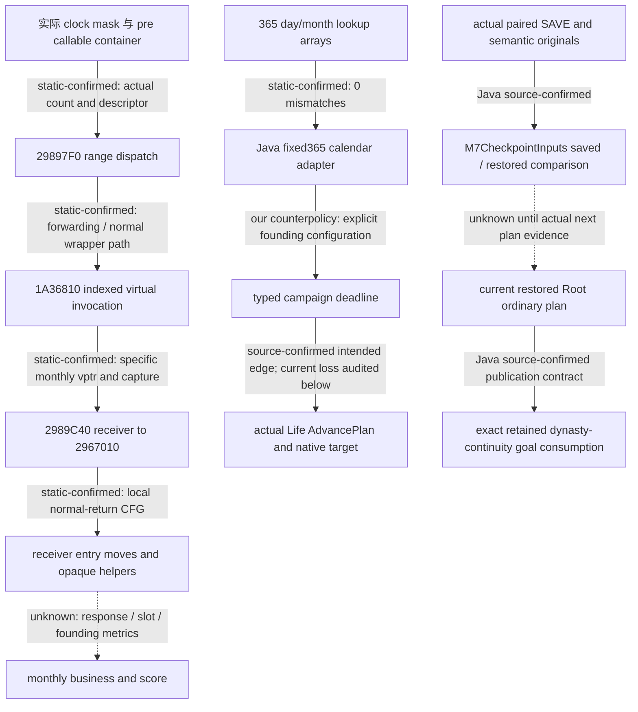

# M7：REA 方法复审、普通意图恢复与实际命令的固定钟上界

2026-10-26，`machine_id: xenoamess-full-tower-eb9d2c1186`。机器身份沿用当前 Root 已核绑定；本岗没有另启机器探针、CK3、Steam、Defender、PE provider 或构建进程。本文为 **SOURCE_ONLY**，不是实机或完整迁移验收。当前 Java 开发根为 `D:/codex-ck3-demos/2026-10-25-java-g2-complete31-h5r5/java/ck3-control`；Host 独占构建输出及缓存，源码仅修改 Root 认领并与 Host 协调窗口的七叶。本文不更新冻结 runtime、SDK 或旧失败原件。

## 问题和证伪标准

M7 要证明的是：同一高级意图随实际 checkpoint 与合法继承保留，在真实当前统治者的下一次完整 ordinary plan 中被消费，并逐项取得 ruler / seed / government 资格。另一个进程中的同日 snapshot、portable JSON 往返、原生 job 完成或 Java 编译，都不能代替这条链。

本轮先复读 [REA 入口](../rea-ck3-research/README.md)、[方法](../rea-ck3-research/methodology.md)、[工具与上下文](../rea-ck3-research/tools-and-context.md)、[resume62 交接](../handover/2026-10-26-java-g2-resume62-rea-runtime-handoff.md)及其[原件索引](../handover/2026-10-26-java-g2-resume62-rea-runtime-handoff-source-index.json)、[原版优先提示词](vanilla-first-implementation-prompt.md)。采用问题 → 输入身份 → 有限原件复用 → 独立核对 → producer / consumer → 明确 UNKNOWN 的流程。没有把 REA 的 wrapper、摘要或 exit 0 视为语义成功；本轮无新 PE 导入，也无速度或模型 token 收益测量。

两个具体可证伪问题：

1. 固定评分钟已经把当前下一普通 Life 步骤限制到边界时，实际 `AdvancePlan`、expected postcondition 和 native ARM target 是否都保留同一 typed cap？如果 Root 只把上界写进 JSON，而实际 Life producer 仍选择 30 天，则反证成立。
2. 真正恢复后的 Root 是否已经执行完整 ordinary planner 并产出同一完整 goal 的 consumption？如果测试只验证 replacement Driver / constructor facts / snapshot，则尚未证明恢复后继续 ordinary plan。

## 原生流程：已闭合部分和未知边

本轮复用 [campaign goal / clock dispatch](campaign-goal-clock-dispatch-12004-20261026.md) 的已封原件。该专题区分来源机器、当前机器采样和历史 machine unknown，绑定 CK3 `1.20.0.4` EXE SHA-256 `98702f88a547cde2eaf29a85f93b85f68ee4cf8148336a4f7afaeb75319dd518`；本岗没有据此追认本机安装或运行状态。

可复用的具体结论为：365 个 month 与 365 个 day lookup 全项与 Java positive-year fixed365 profile 相符；pre container 将原 callable descriptor、实际 begin/end/count 送入 range dispatch；特定 monthly callable 的 capture / vptr / 正常返回路径已静态核验；parallel wait 接受 state 2 / 3，其中 state 2 可绑定到 generic worker 的 callback 正常返回后写入。状态 3 writer / 含义、真实 cadence、callback 的业务结果、monthly response / score slot / founding metrics 的来源仍未闭合。`24BCA30..24BD295` 的 next-date consumer 有局部正常 CFG，不等于完整 native 长期目标策略。

图中 native dispatch、我方评分上界和我方 checkpoint 采用是不同证据域。`dynasty_continuity` 是我方 ordinary intent；未声称原版有同一 Goal JSON、评分 ID、cap 或恢复协议。固定钟变更依据为我方已明确的 counterpolicy 和实际数据流缺口，不能称为“更优原生策略”。

## Java 当前实际链

以下路径均相对于开发根；行号是本轮只读时观察值。

| 环节 | 实际 producer → consumer | 边界 |
| --- | --- | --- |
| 意图 | `g2/m7/OrdinaryCampaignGoal` → `GoalCodec` | `campaignId` / origin 稳定；matched reconciliation 更新 current / progress；完整 persisted plan 必须等于共享 producer |
| 当前请求 | `RootPlanningInputsFactory:255` 从真实完整 SEM 解析 goal → 当前 `PlanningRequest` | current ruler 必须相符；missing 不等于 null，不初始化伪 goal |
| 当前物理身份 | `M7CampaignPolicies.projectGoal:68` → `KernelCheckpointContinuity.Observation` | source epoch、真实 EXE、完整 Game birth、public / native revision、episode、actor、date、full goal |
| 当前普通 plan | `CampaignAdvancePolicy.evaluate` → `publishGoal:147` → `M7KernelPlanConsumer` round-trip | 当前 original request / session / frame 守卫；记录 `campaign_goal_plan_used` 和 `m7_kernel_plan_consumption`；无 submit / SAVE credit |
| Root 绑定 | `RootCampaignPoliciesFactory.Installed.deadline/goal:89` | 同 collector request 引用、真实 owner / writer Session / physical metadata；真实 pin capture/read/verify |
| SAVE | `RootM7CheckpointCapture:33` → `M7CheckpointInputs.saved` | 唯一实际 confirmed canonical SAVE、实际 pair / material / writer head、current metadata；不捕获另一 Game |
| 历史 SAVE | `RootM7HistoricalCheckpointInputs` → `M7CheckpointInputs.recovered` | retained original FileID、canonical ancestry、原 source / driver / semantic；内存命中不替代历史验证 |
| 恢复 | `M7CheckpointInputs.restored:137` → actual `RestoreCheckpointService.requireCurrent` → binding / frozen Driver / attachment head | 同 full goal / campaign origin / ruler episode / machine，且 distinct Game birth；comparison 不授 cold 或 action authority |
| 继承 | 原 `LifecycleReducer.continueSuccessor` → 完整 M3 reconciliation → updated goal → kernel input → campaign policy | 不把 callback return 或 diagnostic state 当作 native character transition；原 predecessor / successor / estate checks 保留 |

`CampaignDeadline.Founding.campaignId` 与 Goal campaign ID 是两个 producer 命名域，当前源码已保留独立。`OrdinaryCampaignSchedule.State` 只要求共享 calendar，不能恢复旧的跨域 ID 相等断言。

当前 Root goal / SAVE capture 传 `Optional.empty()` government；这不是已消费每种政府策略。既有 [government / seed 专题](g2-government-seed-qualification-12004.md) 明确：实现表的 core_supported、spec_ready、unsupported 等是适用状态；两个 feudal rulers / seeds 不增加政府 family 数。需要依赖政府机制的真实策略仍须取得当时 ruler / frame 的实际政府输入，不能借 predecessor profile。

## M7-CAP 四叶二十操作的独立源审

复用原件：

`D:/ck3-state/ck3-java-g2-resume61-r7-ls18-regression04/controls/handover62/ram-ops/M7-CAP-RAMOPS01.json`

本轮实际读回该容器为 34875 B，SHA-256 `83ccc528fed184552523d7fd05fcc6f6b35d6329d4b6298fef00d13cae477dba`；原 JSON 内历史 RAM / 未采用字样保留原时态，不能覆盖下述后继实际采用事实。

本轮先通过 Node 只读原件与实际开发叶，逐项检查二十个 replacement 的前像精确出现次数，并在内存推导后像。**4 / 4 前像大小和 SHA MATCH，20 / 20 replacement exact_occurrences=1，4 / 4 派生后像大小和 SHA MATCH。** 随后 Root 明确认领四叶，Host 确认当前未 capture / 编译并开放短源写窗口；本岗于 `2026-10-26T14:44:50.696Z` 对全部前像和操作再次校验，实际采用四叶二十操作，独立读回 bytes / SHA 全部与下表后像 MATCH。源写窗口已交还 Host；没有触 BUILD / m2 / i61 / 冻结图。未回放旧卡，未编译或运行。

| 开发叶 | 实际前像 bytes / SHA-256 | 预期后像 bytes / SHA-256 |
| --- | --- | --- |
| `local-service/.../root/RootRuntimeCommands.java` | 20966 / `6521f2d8c41c7164970c279cff1578fb166cc20541a2f99d10a7486738d6e606` | 21895 / `a52b77fb2e3bfa5af5dd198e4e20148a1eeadfe2d298aef41e76eb69d3bea395` |
| `application/.../advance/LifeAdvanceCommands.java` | 14260 / `81f74eab53e6fc3087cb5b16f44f3bea1b4f7501845f9bc3ad1e2e740b0e703b` | 15313 / `fe358d814643afa50b667d74f7676a2042e0d2c99d6b375a2b2c34d25a2c7b35` |
| `application/.../advance/AdvanceRewrite.java` | 5280 / `21c51fa5400b520ff8e06840297e6788eaaca8790ff5de35f0c69975b1a0b869` | 5965 / `49960ba6ee10a5d2367ea182afe3c9be9ebd1ff37ec31aefb93bf5c4560a7287` |
| `application/.../advance/LifeAdvanceLifecycleTest.java` | 48533 / `248a132e86508db8620a0ff533e48195b5a77c770f26e7418c38e90792f02718` | 56842 / `42882df28adfd33935a40a7773702fa65f2602bd0036471a9946561bf8c6e113` |

实际缺边为 `RootRuntimeCommands.rewriteDeadline:88` 通过无 cap 的 `prepare`，继续到 `LifeAdvanceCommands:122 shared.prepare`；后者的 `AdvanceRewrite:44` 选择完整默认 horizon，尚未消费 `maximum_target_date_raw`。因此 draft 的边界元数据不证明实际 native clock target 已受限。

候选四叶修复只沿同一 producer：

1. Root 在原 same-request preparation 路径保留 typed cap；Held 连同原 request / args / plan / originalProposal 比较 cap，拒绝同决策身份变换上界。
2. Life 原实际 producer 增 typed cap overload，仍调用同一个 shared composite / readiness / expected builder；有 cap 而未广告 ARM / STATUS / CANCEL 时返回 unavailable，不降级普通 POLLED。
3. 原 `AdvanceRewrite` 严格消费 integer、forward、whole-day 的既有最大目标，再与实际 horizon / cap 取界；one-day 保留 exact sentinel，完整 expected 和 native ARM target 从唯一 `AdvancePlan` 导出。
4. 既有 LifecycleTest 增四个生产链回归：30-day → boundary / exact day；earlier maximum / codec round-trip；bool / decimal / null / 非前向 / 非整日拒绝；缺 sentinel 不降级，也不增加 native action / child / request。

这四例穿过实际 Life producer，未覆盖真实 Root retained-decision custody 的执行。Root 源审与 Host 全编译必要；若进一步补 Root 级回归，应使用已有实际 private fixture，不新增平行 runner 或伪造 context / lease。

## 恢复后普通 plan 的准确缺口

`RootWarmNativeCampaignRestoreAssertions.inspect:102` 调用 `RootWarmNativeCampaignPlanningAssertions.assertActualRestored`。后者核 actual private restored origin、原 native-campaign producer provenance、constructor source、完整 Game / session、source closure、当前 Known / writer head，并拒绝内容相等却无 issuer 的 copy。**它没有调用 `OrdinaryPlanner.plan` / `RootApplicationSession.planPublic`，也没有读取 `campaign_goal_plan_used` / `m7_kernel_plan_consumption`。** 现有 warm fixture 通过不能宣称已经完成恢复后 ordinary plan。

`M7KernelInputsTest.actualMatchedLifecycleReducerFeedsWholeReadinessKernelAndOrdinaryPlan` 现有软件链已从真实 reducer API、完整 M3 reconciliation、更新 Driver、native-envelope assembly 到实际 kernel supplier / campaign policy consumer，并检查完整 uint64 revision 和新 episode。它依然是软件输入，且调用单 policy；不能替代整套 restored Root 普通 planner 或实际 CK3 继承。

另有未改合同边界：普通 Goal / kernel 的历史测试使用 `4278190081` Character ID，但当前 `contracts/NativeCharacterId.java` 明确为 signed int32，仅 `-1` 为 absent，`0` 和其他负值保留原始身份。该数不在 canonical signed 域，不能称作合法高位 Character 证明。M3 已核同一风险并交 Root：`SuccessionModel.Actor` / Binding / Expectation、`SuccessionCodec.positive`、Lifecycle 和 Family 等仍存在 positive 裁剪；`GoalCodec.decodeReconciliation` 也按原 positive M3 合同读取。73 → 74 的继承软件夹具不能证明高位角色继承可用。后继须按 canonical normalizer 同步 Model / Codec → Goal → Lifecycle → Family 与全部持久化 / 测试，并核真实 high-bit 原包；本岗没有单独放宽 M7、取 abs、转 unsigned 或把军队 handle 规则套到 Character，也没有把这项合同风险混入 cap cut。

下一最小验收应沿真实已返回 Root 的 `withPublicPlanning`，在其原 `calls` / borrowed Session / installed / transport / deadline 内取得 `RootPlanningInputsFactory.publicRequest`，调用该 Root 的 `planPublic`。该入口实际运行 Controller 的同一完整 ordinary planner。回执必须保留新当前 frame、全 goal、完整 `PlanTrace`、selected step 及内核 consumption；current ruler / episode / source / public 与 native revision 分别绑定。不可在已有 physical freeze 回调里再造一个请求，或把手工调用 campaign policy 当作完整 planner。

正式生产入口在 `service/mcp/RootMcpPlanning:87–145`：同 public planning scope → `publicRequest` → 实际 `finance.preparePendingFrame` → `root.planPublic` → `RootPublicPlanPresentation`；scope 解除后对实际 pending token 调 `afterPlanning`。测试必须保留这对消费者，不能照抄前半段而漏掉后处理。现有 `RootOrdinaryRestoreCustodyAssertions.restorePublicSaveTwice:39/46` 的 `ActualRestoreCheck` 位于实际恢复发布以后、无内层 freeze，是独立 M7 检查的合理调用位置。

Root 随后批准额外三测试叶；本岗于 `2026-10-26T14:55:22.679Z` 实际采用并读回，下表为当时后像。Host 已收到完整 pins 和默认 CI 测试选择，未运行编译或 JUnit。

| `local-service/src/test/java/org/xar/ck3/control/service/root/` 下测试叶 | bytes | SHA-256 |
| --- | ---: | --- |
| `RootWarmNativeCampaignRestoreAssertions.java` | 10413 | `232d7a9c15da8acb9d37afea3b3b70330d529926a10dc5840d57d3b958669318` |
| `RootM7RestoredOrdinaryPlanAssertions.java` | 10600 | `d1a173ca41ba192c1ea781b5aaaabd85e95cbc0259cff18ff537b02ed273b6ff` |
| `RootM7RestoredOrdinaryPlanAssertionsTest.java` | 11806 | `54b3a53566ee6aed9018f6fe23b8be67979e3b984e2a0dc5090c938317dbe460` |

原 warm constructor / 独立 later READ 检查全部保留；两次 physical inspection 都已解除之后，只有真实 saved Driver goal 为 `Value` 才进入新 helper，原 native-campaign null 分支保留独立语义、不增加 M7 正例。helper 重验实际 private restored origin，再走该 Root 的 public planning / 原 request / finance pending token / 同完整 planner；只有真实 `ActionSelected`、实际 campaign stage 和完整 goal / source / EXE / Game birth / snapshot / public 与 native revision / episode / actor / date 消费均相符才返回。`2026-10-26T14:57:46.988Z` 后像进一步保 actual request / result / qualified source metadata 于 private pass，scope 解除后先消费真实 token 的 `afterPlanning`，然后才作 M7 positive 断言，避免 Wait / Stopped 时提前跳过正式后处理；原 10452 B / `e4289664…` 中间稿未编测，已被表中后像替代。未构造 Core、lease、private proof 或新 SAVE。

默认 CI 新 Test 有五个组件回归：实际 `OrdinaryCampaignGoal` matched continuation producer → `GoalCodec` 与完整 Driver 持久往返 → 实际 `CampaignAdvancePolicy` → `M7KernelPlanConsumer` → 新断言 consumer；保 public `UINT64_MAX` / native `MAX-1`、完整 FILETIME 与原进度。其他四例分别拒绝 missing/null/current-goal 缺失，missing/foreign source / epoch / EXE，另一 full goal / 被删 consumption，以及仍是有效 JSON 的内核 date 漂移。这些软件例未创建完整 Root 或 SAVE / LOAD，不能填补真实恢复分支的执行资格。

M3 复核后明确：当前没有可免费复用的 actual ordinary private Root fixture；`RootPendingUiProductionChainFixture` 需要真实同 Core/current/catalog 及 private AdmittedCurrent/RecordedFinalization 的唯一 ServiceLoader producer，缺输入应返回 `MISSING_ACTUAL_PENDING_INPUTS`。现有 `CheckpointSourceCompositionTest` 的实际 SAVE 软件 producer 默认 goal=null，不能把该输入改造为“原保存的非空意图”。因此完整 helper 的 positive restored Root / full planner 仍 **NOT_RUN**，最小依赖是原受管 startup → actual ordinary goal producer / published Driver → actual confirmed SAVE / retained material → actual restored returned Root 与 installed catalog。后继应复用这条真实保存链，不能以组件五例或 null warm 分支替代。

原始保存 goal 非空时，下一普通 plan 的 campaign/origin/current/progress 与完整 goal-derived policy 必须一致；原保存的合法 null 分支要明确保留，不生成新意图或把“没有消费”算通过。有真实未知 pending action 时只重验原 canonical intent，不能为获得 plan 结果重复提交。该工作目前为源码可施工入口，未新增 helper 或执行权限。

历史 [2026-10-16 successor goal observation](g2-successor-goal-observation-2026-10-16.md) 的后补部分已有 Python 普通 plan consumption，但属于当时来源；没有完整物理 cold anchor，不能追认为新 Java 资格或当前机器实测。

## 状态与下一步

本轮：复用已封原件，四叶二十操作及额外三测试叶已在 Root 认领、当前前像重验 / 新叶检查后实际采用；新 EXE bytes、REA backend import、编译、JUnit、Game starts、new game days、SAVE / RESTORE 均为 0；模型 token 和端到端性能未测。M7 仍未完成，新 Java 八 M 实机仍 0 / 8。after pins 及必要整类 `LifeAdvanceLifecycleTest`、`RootM7RestoredOrdinaryPlanAssertionsTest` 已交 Host，构建和测试仍待实际执行。

最紧要实现是上述 typed cap 丢失；之后从真实 restored Root 完整 planner 取得消费证据。Native 原件已足以支持 calendar adapter 的限定等价范围，继续查 monthly business 时只按具体缺边给有限 RVA / 旧 refs / 问题，不为人数重复导入全 PE。多统治者、种子、政府的完成数必须由各自真实运行逐项增加。

本文上限 32 KiB；只保护小型接手导航与当前未解问题，按统一存储策略在 2026-11-02 UTC 前或依赖解除时提前复核，不自动续期或授权删除原件。
