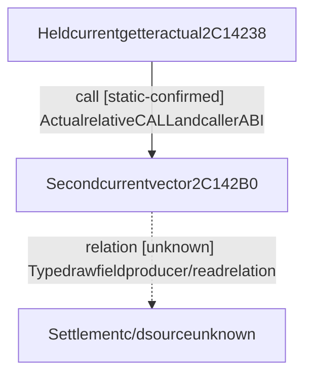

# Research plan: R08-actual4-second-current-military-vector2C142B0

GENERATED from the supplied research plan; no native semantics are inferred.

Question: Which exact sources/branches populate secondcurrentvector; any provenread/write relation with settlementcontext28/30?



| Edge | Declared status | Evidence IDs | Open question |
|---|---|---|---|
| call | static-confirmed | caller |  |
| relation | unknown | caller | Doesactualsecondcomponentread/writeCharacter1C0+28/30; no militarypaidsemanticinference? |

| Observation design | Value |
|---|---|
| mode | offline-only |
| actor_kind | engine |
| owner_scope | Exact4staticsecondcurrentvector; no currentplayer memory |
| identity_kind | definition-key |
| identity_lifetime | Immutable source exact4 only; no runtime eligibility |
| producer_trigger | not-applicable |
| producer | Unknown secondvector2C142B0; firstvector28C43A0 ownedbyformalagent andexcluded |
| caller | Actualheld2C14238CALL2C142B0(out80,Character,optionalbreakdown); publicquerybreakdownnull |
| consumer | Currentgetteraddsreturnedtenresourcevector into calleroutput; settlementfourrawrelationunknown |
| cache_lifetime | Unknown untilsource; no cacheepoch orcalendar claim |
| expected_signal | Oneuniquefullunchainedfunction withcontinuousdecode, typedregisterlineage, allbranches andexactexternalcallee boundaries |
| zero_sample_meaning | Staticfunctioncapture hasno livepaymentsample; noabsenceorpaidclaim |
| stop_condition | Onlytarget2C142B0pdata binarysearch;metadata&lt;=512B/read&lt;=48; requireentrybeginexact2C142B0,uniqueunchainedextent&lt;=8192B beforebody. No callee/read28C43A0/xref/newpointer/wholehash/gameSDKdesktopmainbuild. |
| runtime_window_ref | None |

| Evidence ID | Declared layer | File | SHA-256 | Supports |
|---|---|---|---|---|
| identity | exact-build | C:\ck3-e04-resume-20261015-a01\frozen-game-12004\IDENTITY.actual.json | 15ad8093ca23930d7d440752518d3ce89097dec1b00fe234a5115011782b62b9 | Rootfrozen actual4inputSHA; no rehash |
| layout | exact-build | C:\ck3-e04-resume-20261015-a01\maintenance-parent-r0174-a01\parent28F7939-source-a01\inputs\pe-layout-reused.json | 9f0f3da5fcaf809b8fad13c4310d6abdf3c5a06d98aad113e907ee64c15e7bb4 | Existingsectionmapping andexceptiondirectoryonly |
| caller | source-contract | C:\ck3-e04-resume-20261015-a01\payment-settlement-branch-b-a01\source-read-a02\current_military.asm | 295567d6ead8e4c6aa05fc5d384d7994f9f14fa0be819a3baa95403cc40291ce | Actualheldcurrentgetter2C14238 directCALL2C142B0; ABIout80,Character,optionalbreakdown |

Check result (file integrity and declarations only):

```json
{
  "schema": "xar.native-research-plan-check.v1",
  "result": "plan-consistent",
  "proof_layer": "record-structure-and-file-integrity",
  "semantic_correctness_verified": false,
  "live_execution_performed": false,
  "observation_plan_issues": [
    "offline-only plan does not define a live observation window",
    "the real producer trigger must be located before live sampling"
  ],
  "declared_edges_by_status": {
    "counter-policy": 0,
    "inference": 0,
    "live-confirmed": 0,
    "static-confirmed": 1,
    "unknown": 1
  },
  "enumerated_native_edges": 2,
  "declared_cases_by_status": {
    "pending": 1,
    "observed": 0,
    "not-applicable": 0
  },
  "checked_evidence_files": 3,
  "limitations": [
    "Evidence layers and conclusions are author declarations; hashes bind bytes, not their truth.",
    "Counts cover this enumerated graph only, not all CK3 branches.",
    "A consistent observation plan is not authorization to run or manipulate CK3."
  ],
  "plan_sha256": "e0df655e71c92cf7dace39e9c4f2233ed596f1eefd46f46af5fdf25412e2d107"
}
```
