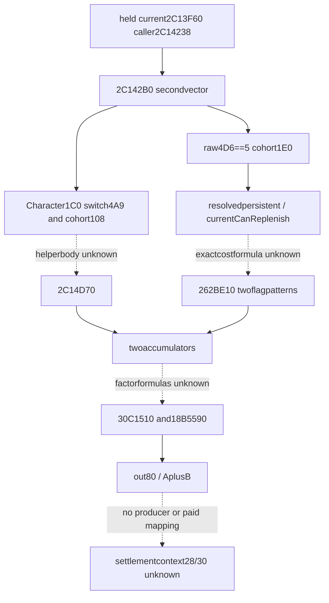

# R08：actual .4 第二个当前军事费用向量

machine_id: desktop-3fevhd2-1c74096080。只读离线源码，精确1.20.0.4 / Steam25734779 / EXE98702f88a547cde2eaf29a85f93b85f68ee4cf8148336a4f7afaeb75319dd518。完整来源为2C142B0..2C14D6F，2751B/650指令，raw SHA6b3b7a7a3228442366a29e2c15676e55b7364bd29268d3ec721a25a5a5608628。232Bmetadata/21reads，唯一unchained(flags2)，全部62个jump目标在完整体内且落在指令边界。未读callee、旧错RVA、全image或新指针；无SDK/游戏/桌面/构建/注入。

上游已持2C14238实际CALL传RCX=out80、RDX=Character、R8=optionalbreakdown；公开current query传null。该函数最终返回原out指针，将两个局部十槽向量经共同factor helper处理后逐槽相加。

| 来源/条件 | 实际调用或数据流 | 证据边界 |
| --- | --- | --- |
| Character1C0 | byte4A9；descriptor108 | 4A9沿用既有补员开关语义。108的FullID逐项解析，交2C14440→2C14D70；helper未展开。 |
| 条件附加cohort | 28C2DF0返回byte4D6==5，才遍历context1E0，再遍历所解析对象2D8/count2E4的persistent FullID | 不给raw byte或中间对象猜政府/兵类名称。 |
| persistent第一分支 | raw Regi28==-1；部分条件调用2C145BE→262C6E0(Regi,Regi+18)。两种分支均调用262BE10(Regi,out80,0,1) | switch关闭、derived total相等或CanReplenish=false走未缩放候选cost；许可true等条件成立时只对返回slot0作modifier算术。不可补员不意味着零费。 |
| persistent另一分支 | Regi28!=-1且Regi130!=Regi134；262BE10(Regi,out80,1,0)，slot0作modifier算术，累加到另一向量 | Regi28不是Character1C0+28；两个bool参数正式名未知。 |
| 统一factor与输出 | 2C1485F→30C1510(out64,Character,0)，2C148A6/148DA→18B5590分别处理向量；2C14CD2..2C14D54 copy+sum | factor及18B5590的公式未展开，不冒称已闭全部费率计算。 |
| optional breakdown | 2C148E2在R8原值null时跳过解释条目路径 | public query走null支路，不要求调用GUI。 |

本体没有直接访问secondary context28/30、2C0/2C8。RBP+2C0/2C8是栈局部，Regi+28是另一个对象，不能因offset重合就连接到结算。即使CanReplenish参与某费用路径，也只证明当前vector计算的条件，不证明实际ADD/SUB、payer、调度周期或事件军实际收费；maintenance_attribution继续unclosed。

SOURCE-CONTRACT.actual.json为全部62分支逐一指定唯一组及原始branch记录，actual-function.asm保留全部650指令；READ-RECEIPT保存每次实际metadata/code读段及前后文件身份。最小未闭helper是实际2C14440→2C14D70，后续是否取源由Root另授scope；本包不扩。第一vector28C43A0由formalcompletion独立持有，另见acceptance/2026-10-16-current-military-vector28c43a0，不复制或重读。

静态检查只核保存字节、完整解码和分支结构，不授游戏业务资格。原截止2026-10-16T07:45:01.597Z按通用存储策略复核；源知识可移机，机器运行与实机资格不外推。
