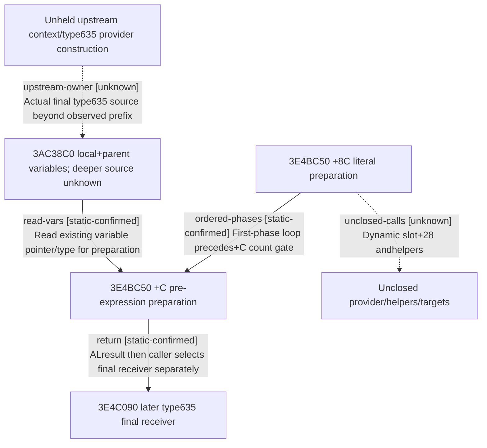

# Research plan: r06-3E4BC50-source-conclusion

GENERATED from the supplied research plan; no native semantics are inferred.

Question: What does the exact3E4C0C6 direct callee3E4BC50 prepare before the type635 final receiver is selected, and can its chain0 case identify an upstream source without executing a provider?



| Edge | Declared status | Evidence IDs | Open question |
|---|---|---|---|
| read-vars | static-confirmed | reviewed-body |  |
| ordered-phases | static-confirmed | reviewed-body |  |
| return | static-confirmed | reviewed-body, source |  |
| unclosed-calls | unknown |  | Callee effects/ABI beyond arguments and local flow were not read; no execution. |
| upstream-owner | unknown |  | No actual eligible provider at depths0..7; frontier8 and upstream construction remainunknown. |

| Observation design | Value |
|---|---|
| mode | offline-only |
| actor_kind | human |
| owner_scope | R189 actor31254 fixed refill expression source; no live sampling in this static task |
| identity_kind | definition-key |
| identity_lifetime | exact1.20.0.4 frozen module identity; source semantics only, no process pointer reuse |
| producer_trigger | not-applicable |
| producer | held actual3E4C090 passes RCX=expressionblock,RDX=&amp;temporaryvariables,R8=&amp;scratch into exact3E4BC50 at3E4C0C6 |
| caller | E8 85 FB FF FF at3E4C0C6, complete held406B caller; direct target independently verified with signedrel32 |
| consumer | 3E4C090 tests callee AL then selects final receiver from lastindex/type635; exact new callee semantics pending source body |
| cache_lifetime | Frozen immutable source only; stat/identity checked before and after bounded reads; not live runtime variables |
| expected_signal | Complete unique pdata/unwind body and chain0 entry/control-flow; explicit metadata-only stop if logical extent unresolved or &gt;8192B |
| zero_sample_meaning | No eligible source from R189 visited0..7 does not prove no final receiver. Static missing/body-stop is unknown, not no-provider. |
| stop_condition | Only3E4BC50, metadata&lt;=512B/48reads, fullfunction&lt;=8192B. No fullEXEhash/header/.text scan/callee expansion; stop on chain ambiguity/stat drift/budget; total a34+a35&lt;=160KiB. |
| runtime_window_ref | None |

| Evidence ID | Declared layer | File | SHA-256 | Supports |
|---|---|---|---|---|
| source | source-contract | D:/workspace/ck3_eternal_recurrence/docs/ck3-native-ai/episode04-r186-refill-parent-prefix-12004.md | be95ff89432e79040cfc732a6e82d291d9f9fa506b55c2d742899c98e9c64540 | Caller/source contract before final receiver, parentprefix semantics and explicit unknown3E4BC50. |
| caller-bytes | exact-build | C:/ck3-e04-resume-20261015-a01/refill-toggle-actual-next-a09/3E4C090.bin | f166a756656cb0276c7c89dd74107c716d264c31f891d16cfed3b247d19ca292 | Exactcomplete406B caller bytes. Signedrel32 edge is checked before any new EXE read. |
| metadata | exact-build | C:/ck3-e04-resume-20261015-a01/r06-3e4bc50-source-a35/READ-metadata.actual.json | 3de90f60b54cb7afc146a6f7c32d95981d9c0695b3bad9a7bd0dc9f7b90f4579 | Exact unique metadata extent; no callee semantics asserted. |
| reviewed-body | source-contract | C:/ck3-e04-resume-20261015-a01/r06-3e4bc50-source-a35/SOURCE-CONTRACT.actual-a35.json | e4773b8d40e55ac609c2427467d93b0c13b31a5f7cf9bbc52631091a00688451 | Human-reviewed full604B local flow, distinct prep counts, existing-variable reads and unknown transitive calls. |

Check result (file integrity and declarations only):

```json
{
  "schema": "xar.native-research-plan-check.v1",
  "result": "plan-consistent",
  "proof_layer": "record-structure-and-file-integrity",
  "semantic_correctness_verified": false,
  "live_execution_performed": false,
  "observation_plan_issues": [
    "offline-only plan does not define a live observation window",
    "the real producer trigger must be located before live sampling"
  ],
  "declared_edges_by_status": {
    "counter-policy": 0,
    "inference": 0,
    "live-confirmed": 0,
    "static-confirmed": 3,
    "unknown": 2
  },
  "enumerated_native_edges": 5,
  "declared_cases_by_status": {
    "pending": 1,
    "observed": 0,
    "not-applicable": 0
  },
  "checked_evidence_files": 4,
  "limitations": [
    "Evidence layers and conclusions are author declarations; hashes bind bytes, not their truth.",
    "Counts cover this enumerated graph only, not all CK3 branches.",
    "A consistent observation plan is not authorization to run or manipulate CK3."
  ],
  "plan_sha256": "67949c41ede4bbc7306ecb46dee6c18a25e8dd282466ef615615a751e13fbd49"
}
```
