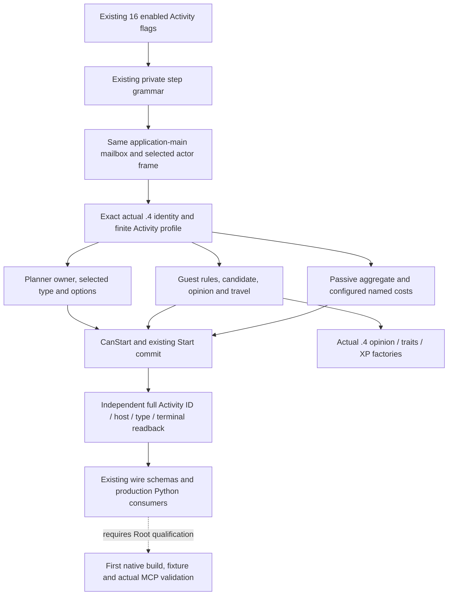
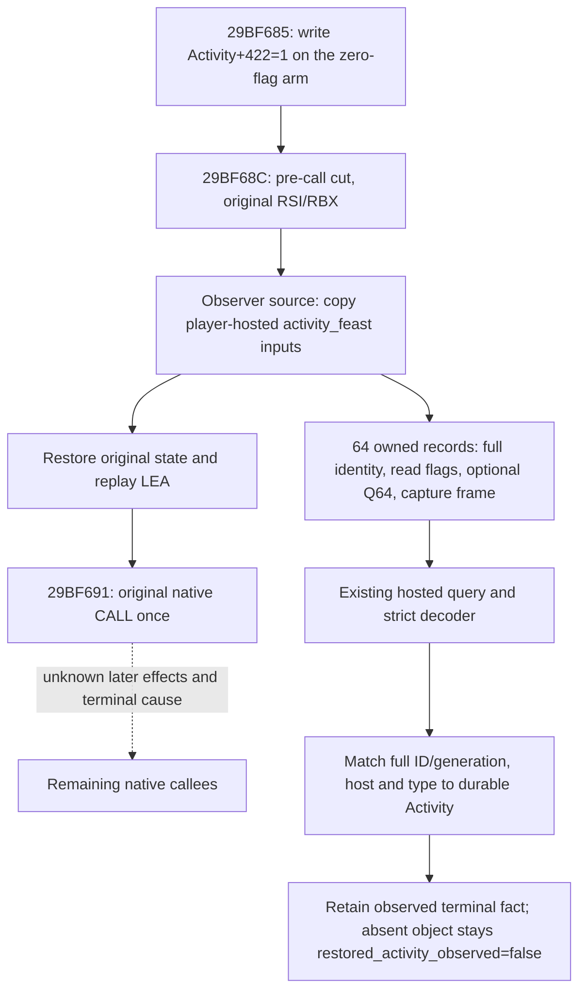
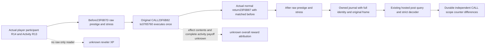
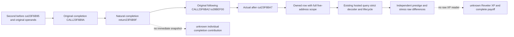
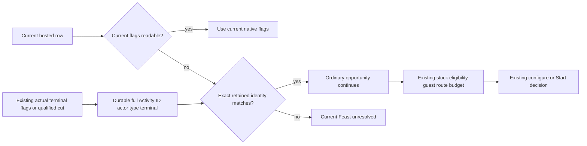

# Adopted Activity and Feast MCP migration to CK3 1.20.0.4

Source-first migration, October 7, 2026 (Asia/Shanghai). The implementation
baseline is `caa4adc3d1278e324cf4ec19774028e9b9138e28`. The current frozen tuple
is CK3 **1.20.0.4**, Steam **25734779**, executable SHA-256
`98702F88A547CDE2EAF29A85F93B85F68EE4CF8148336A4F7AFAEB75319DD518`.
The earlier .2/.3 contracts and live receipts remain historical evidence.

The authoritative adopted coverage assigns sixteen existing enabled flags to
this package: passive slot-12 cost, guest candidate, guest opinion, guest rule
provenance and toggle, planner Open, Stage-1 option read and confirm, Stage-2
destination, gate, location and option read, and Stage-5 CanStart, Gold, full
Feast cost and Start. Their current production route also returns the existing
Start-input and hosted-post/target views. This migration preserves these
schemas, actions and policy. It adds no Activity decision or policy.

The source ledger is external at
`Z:/ck3_mod_rewrite_process_assets/g2-migration-20261007/activity/`.
`common-native/SOURCE-TREE.md` and `PARENT-SOURCE-PLAN.md`,
`planner-native/SOURCE-TREE.md`, `guest-cost-native/SOURCE-TREE.md`, and
`python/SOURCE-TREE.md` were sealed before their implementation. Each finite
mapper receipt retains original ranges, candidates, decoded member operands,
relative/RIP targets, unique I/O and partial attempts. Existing core-global and
command-layout proofs are reused; no whole-image read, hash or runtime contact
is part of this package.

The existing planner .2 ABI retains full IDs, owner `+A0`, handler slots `+3C0`
and `+3D8`, selected type `+1500`, stage `+1AE8`, option rows and actual widget
visibility. Actual .4 mapped code retains those member operands. Direct entry
mappings include CanStart `11B8670 -> 11B8650`, selected province
`11B6C80 -> 11B6C60`, Commit `11B8D90 -> 11B8D70`, and unchanged typed dispatch
`AF39E0`. The ScriptOption identifier belongs to ScriptIdentifierTable:
`3F8A800 -> 3F8A7E0` and `3F8A6F0 -> 3F8A6D0`. It is not the generic type-name
domain. Relative guard displacements are recalculated from the paired actual
instruction site and target while all opcode/member bytes remain exact.

CanStart contains 800 code bytes followed by six DWORD image-relative branch
targets. Its code uses the paired table addresses `11B8990 -> 11B8970`; the
separate temporary vptr `476BAA0 -> 476BAB0` is corroborated by the actual
paired RIP base `476BA70 -> 476BA80`. These two operands and the branch table
are explicitly compared as code/data, not blindly normalized. The selected
Stage-5 source branch is `11B88E8 -> 11B88C8`.

Guest/cost source has a concrete historical literal correction: the actual
.3/.4 rule sentinel is `5D34048`, whereas the old .2 literal was `5D33F48`.
The .4 database getter has displacement byte `3D` instead of `1D`. Rule
vptrs `48B2F20 -> 48B2F30` and `48B2EC0 -> 48B2ED0` come from paired native
operands. Actual selected guest refresh, activation, independent readback,
membership, configured signed cost values and travel ABI remain distinct from
the passive aggregate. The native travel call still begins at `9DFF87`, now
targeting `2BBADC0`. Arrival constructor calendar-table operands changed; its
full equivalence is not claimed because the production view reads raw copied
dates and does not call that constructor.

Actual constructor operands close planner vptrs `45325C8 -> 45325D8` and
`45326A0 -> 45326B0`, HostView `457A138 -> 457A148` and `457A110 -> 457A120`,
and ActivityType `48BFE50 -> 48BFE60`. The remaining identity packet closes
idler `44BC408 -> 44BC418`, handler `44BA890 -> 44BA8A0`, ScriptOption
`48BFD18 -> 48BFD28`, Activity `472E130 -> 472E140` and payload descriptor
vptr `44E6F38 -> 44E6F48`. The two RTTI type descriptors remain `5514438` and
`5514460`; their named classes, linked COL/hierarchies and actual paired stores
are retained in `planner-native/REMAINING-IDENTITY-PROOF.json`. Pointer copy and
move remain `878290`. No common `.rdata` or code delta is assumed.

The explicit .4 GiftOpinion factory uses total opinion `28BC470`, modifier
lookup `25A2EE0`, group lookup `2949A80`, sum `2596290`, database `5D207E0`,
modifier vptrs `48C5380`/`48C5348`, and receiver vptrs `473DE18`/`473DDE0`.
All eleven windows reuse retained exact caches with zero new EXE reads. It
retains recipient-to-actor direction, full-ID resolution, repeated scalar and
keyed modifier semantics. Feast's stable-key hash directly uses the already
closed `3F7E220`; it does not claim an unclosed EventWindow producer.

The independent .4 phase-character factory returns the existing software
Bindings DTO while directly admitting the current SHA and six current
functions. Trait database `89E5B0`/slot `5C67528`, presence `28BB1D0`, tracks
`28BB0D0`, track index `30E56F0`, human-player `2BAA6F0` and knight context
`28BFC50` are bound explicitly. The full tracks/index paths are 251/193 bytes;
the insufficient first-fragment receipts remain preserved. Existing raw trait
definition/name/presence/XP readers are reused. This does not migrate the
separate phase-definition identifier binder.

Python Activity leaves consume the central exact-build provenance contract.
Their existing schemas require no duplicate version table. The single new
compound test exercises current-build production cost, guest, Start-input,
submit and hosted/terminal consumers. Its retained historical payloads plus
synthetic actual .4 hello are fixture inputs, not new .4 native or live proof.
Native fixtures likewise use fake memory and fixture-owned executable thunks.

The single new production Python case first passed on October 7 (outer
2.1765844 seconds, unittest 1/1). Its receipt is
`python/new-production-case-01/RESULT.json`; no old case was run. The unique
native target recipe is `ROOT-HOOK-AND-NATIVE-TARGET.md`, with three new
production fixture groups and one main. Child native build/execution is zero.

Until Root's first formal build and fixtures, this package is a source-backed
implementation candidate. No actual .4 MCP or live action qualification is
claimed. Start acknowledgement remains pending until independent hosted
readback; terminal identity does not itself prove an opinion/resource gain.

Root's first new native fixture on October 7 returned RED in the planner/start
group (exit 1, 0.1523465 seconds), with `actual4 planner/start fixture failed`.
The finite Activity switch omitted the already closed commit mapping
`11B8D90 -> 11B8D70`; the production Start ABI guard consequently attempted a
read at the module base, before capture or commit. The existing 329-byte paired
proof is `planner-native/mapped-functions/planner_feast_commit-DETAIL.json`.
The source fix restores that one mapping and adds an independent literal
entry assertion to the existing planner/start fixture. No guard, frame,
reserve, guest-route, repeated-capture or independent postcondition is relaxed.
This correction has not been built or executed in the child; Root's affected
native fixture retry and actual .4 MCP qualification remain pending. The first
RED artifact is retained at
`Z:/ck3_mod_rewrite_process_assets/g2-background-20261007/upstream-build-migration/joint-domain-first01/activity_new/`.

Root's affected native retry FIRST02 passed the planner/start and guest/cost
groups, then returned RED in hosted/resources (exit 1, 0.1703046 seconds).
Its first hosted query failed the exact-build guard because the finite switch
also omitted host CharacterID write site `23F0195 -> 23F0175`. The hosted
fixture's existing source plan independently pins `23F0175:418987A8030000`.
This source fix restores that one mapping and adds an explicit hosted guard
address assertion. Full identity, attendance, signed balances, known zero and
later terminal assertions remain unchanged. The retained failure is
`Z:/ck3_mod_rewrite_process_assets/g2-background-20261007/upstream-build-migration/joint-domain-first02/activity_new/`.
No child build, execution or new native proof collection was performed;
Root's affected native retry and actual MCP qualification remain pending.

R0054's actual production read on the original paused Robert 29829 campaign
now qualifies the hosted-post read as a `production-live primitive`: the
actual `.4` response reports date `53288256`, native revision 2, queried
public revision 3, no hosted Activities, Gold `83556691`, Piety `43106250`,
prestige `305510310` and stress zero. Treasury, barter and Reveler XP remain
unavailable; this read does not qualify planning or an Activity action. Reuse
`upstream-build-migration/managed-full-h9613-entry02/operator/gameplay-responses/supplement-02-activity-hosted-state.json`;
do not repeat this passed read.

The following guest-source read returned the actual native RED
`exact_activity_feast_guest_candidate_build_unavailable`. Its retained
response is `supplement-03-activity-guest-candidate-source.json` in the same
directory. That error is produced before planner lookup when the required
passive-cost observer is not installed, so it does not prove planner absence.
The existing enabled private route, current SHA and modern build predicate
already admit actual `.4`; its startup descriptor branch instead returns
after journal installation without installing the existing Activity passive
cost and rule-provenance observers. Their frame callback also lacks the
explicit CoreBindings4 reader branch. The unchanged strict04/strict05
configuration enables cost passive, guest candidate and rule provenance.

The minimal central correction is to bind CoreBindings4, use its explicitly
qualified frame reader, and call both existing observer installers before
that actual `.4` startup return under their current flags. This does not need
an Activity leaf or profile change. The cost installer already selects and
verifies actual `.4` refresh `11BA6B0`, return `11B5B3F` and planner/type vptrs
`45325D8`/`48BFE60`. The rule installer already selects refresh `2BBD190`,
effect `3765860` and caller returns `11B8311`/`2BBD30A`, including their exact
prologue and call-site checks. Reuse the held `guest-cost-native` function-map
and `SOURCE-QUALIFICATION.json` proofs; no new EXE read is required. The exact
shared-hook recipe and proof paths are external at
`upstream-build-migration/actual-live-review/ACTIVITY-PASSIVE-CORE4-SHARED-HOOK.md`.

The central owner integrated this correction in
`f328c059b8cd54a4a73bcd80c2738df0a5bc734f`. It was initially recorded as
`source-fix NOT RUN`; the first Root-owned actual retry now returns a valid
`activity-feast-guest-candidate-private-read-v1` response with
`status=planner_unavailable`. Its retained body is
`upstream-build-migration/managed-full-h9613-binding04/live-failed01/retry-failed-feast-guest-candidate.json.body.json`.
It preserves actual `.4` identity, Robert 29829, paused date `53288256`,
native revision 2, public revision 3 and post `native:2`. Root's accepted full
snapshot is the new third snapshot; the two earlier startup snapshots and the
previous guest build-unavailable RED remain retained.

This actual read qualifies a `production-live primitive` returning the typed
planner availability boundary. `normal_refresh_sequence`, `source_fingerprint`,
`native_filtered_pre_invitation` and `candidate` are all null, so candidate
eligibility, costs, native filtering source and candidate-ready are not
qualified. The source status combines an unobserved diagnostic, absent
planner, non-Stage-5 planner, detached or hidden widget and a non-Feast type;
the response does not distinguish those branches. Its `planning_stage=5` is
the requested stage, not an observed planner stage. No additional source
fault follows from this response on the existing campaign without an opened
Feast. Root's retry used the G110-r4 runtime (reported source prefix `9cb`, DLL
prefix `4c39596`, PID 161728); the child performed no build, test, SDK query or
game action. Hosted and fixtures were not replayed. No Activity action,
campaign date or G2 progress credit is added.

## October 11: native completion QWORD in the existing lifecycle read

Root adopted seven production source files for this path as
`SOURCE_ADOPTED_NOT_RUN`. The currently compiled Native84/SDK84 source remains
`594979b0b3d4c5a395639f30b9d5d864b8a31f6d`; that compiled baseline does
not qualify these new fields. No new build, test, project import or game query
was performed for this increment.

The held actual .4 completion fragment writes `Activity+421=1` at
`23F6D3B`, then stores the original RAX QWORD at `Activity+408` at
`23F6D43`. The original 15-byte fragment contains no RAX definition. A subsequent exact
997-byte actual .4 source capture closes its producer: at `23F6D34`, RAX loads
the QWORD at module RVA `5C7E338`. Both the empty loop and normal loop end
reach that load; no call, arithmetic or scaling changes the value before the
store. Its units and interpretation remain unknown. This is a raw completion
stamp input, not a completed timestamp contract; query date and object absence
cannot supply the missing meaning.

The existing hosted and requested-target readers now copy that QWORD under
their existing player, host and full Activity identity checks. They publish
`native_completion_stamp_observed` and `native_completion_stamp_raw`
in the existing same-response views. A successful read preserves all unsigned
64 bits, including zero. The target reader requires both existing samples to
read the same value. Optional read failure or change leaves the stamp
unavailable and preserves the prior identity status and terminal flags.
The wire represents an unavailable raw value as null; older packets may omit
both new fields.

Strict decoding and exact identity normalization carry the pair into
`lifecycle.latest_identity_observation`. Once a value is known, the durable
consumer also retains the whole original source observation in
`lifecycle.native_completion_stamp_observation`, with its original query
date and revision. A later failed read leaves the latest observation unknown
without erasing or relabeling that historical value. The existing Service
result already exposes the lifecycle observation; no additional query or
Service gate was introduced. Completion/invalidation overlap, reward
attribution and action or material outcome credit remain separate.

The exact source-first receipts are the October 11 source-round
`institution-activity-terminal-source-01/DELIVERY.json` files under
`continuation-12` (reader), `continuation-47` (two real serializers)
and `continuation-51` (three Python consumers). The aggregate reference is
`continuation-16/background-g2-source-round-20261011-0907/institution-activity-terminal-source-01/COMPLETION-STAMP-ADOPTION.json`
under `D:/codex-ck3-background-spill/native71-continuation-20261010`.
The raw producer source is `common-native/parent-map01/activity_complete_flags-DETAIL.json`
in the retained Activity ledger. The completed producer closure is recorded in fresh `continuation-03`
`institution-activity-terminal-source-01/SOURCE-CONTRACT.json`, with the
exact `[23F6980,23F6D65)` source packet. The remaining time interpretation
requires an existing standard date/clock contract for the exact `5C7E338`
QWORD. Pre-callee invalidation observation is an independent source increment;
these seven files do not observe a released object.

## October 11: retained native terminal observation before the first callee

Root applied twelve connected production source files as
`SOURCE_ADOPTED_NOT_RUN`: a fixed native observer, the bounded journal and
existing hosted-post reader, the same-response serializer, strict and durable
consumers, four thin Bridge regions and two Runtime source registrations.
The compiled Native84/SDK84 source remains
`594979b0b3d4c5a395639f30b9d5d864b8a31f6d`. No test, project import,
build, native installation or game query qualified this increment.

The exact archived actual .4 body `[29BF660,29BF7C4)` supplies the cut.
Entry RDX is preserved in RBX as the original Activity and RCX in RSI as
its manager. The zero invalidation arm writes `Activity+422=1` at
`29BF685`. The observer replaces only the five-byte
`LEA RCX,[RSP+50]` at `29BF68C`, after that write and before the first
callee. It preserves the reused register/flag state, copies through the
callback with the original RSI/RBX identities, restores and replays the LEA,
then continues at `29BF691`. The original call remains in place once.
The later callees and their release effects remain unclosed; this observation
does not prove storage release, termination cause, reward or material payoff.

The journal copies the original full DWORD Activity ID and generation, host
DWORD, type, independent completed/invalidation bytes and optional raw
completion QWORD while the object is still borrowed at this cut. Its actual
existing Core/GetPlayer frame restricts capture to the current player's
hosted `activity_feast` on the known owner thread. The 64-record process
lifetime ring preserves the original capture frame and coverage diagnostics.
Its software sequence orders retained records; it is not a native clock.
Missing, detached, overflowed or empty coverage does not prove event absence.

The existing hosted-post response now carries the copied journal. A consumer
can retain a known nonzero completed or invalidated byte after the object
leaves the hosted list only when full ID/generation, host and type match its
persisted Activity. An unread other byte stays null. The source cut, query
date and raw completion QWORD never supply terminal flags. The complete
matching row and its original capture frame survive through the existing
lifecycle and Service observation path; a journal-only result keeps
`restored_activity_observed=false`. This closes the source path for retaining
an observed terminal fact after hosted-object removal. It adds no Activity
action, current campaign completion or payoff credit. The `5C7E338` QWORD
producer above is known, but its time units and interpretation remain unknown.

The source flow below separates the original native call from the owned query
data path. Dashed native edges remain unknown; all new bridge edges are source
connections awaiting authorized runtime qualification.

Root's direct producer-to-consumer source review found a deterministic
disconnect before adoption: both new journal filters used the literal
`feast`, while the existing reader and strict consumer use
`activity_feast`. Owner 38 corrected only those two comparisons. The final
`activity_terminal_observations_12004.cpp` is 10,191 bytes with SHA-256
`66fdcf59a250772e4152e03e2115729b33b2c28165d86ae6e780b39fc857556d`.
The prior candidate and its source correction remain separate receipts; this
was a source contract failure and correction, not a runtime failure or pass.

The exact twelve mappings, owner patches and the two-line amendment are
linked by `ACTIVITY-PRECALL-TERMINAL-ADOPTION.json` under
`D:/codex-ck3-background-spill/native71-continuation-20261010/continuation-16/background-g2-source-round-20261011-0907/institution-activity-terminal-source-01/`.
It references the source-first deliveries of owners 12, 38, 47, 51, 62 and
60, and owner 29's exact archived cut proof. Root reported all twelve files
successfully applied with exit 0; no local executable qualification followed.

## October 11: counters around one original participant completion call

Root adopted the eleven connected production mappings as
`SOURCE_ADOPTED_NOT_RUN`. The increment adds a paired fixed observer, a bounded counter
journal, the existing hosted-post response and strict lifecycle consumer,
thin Bridge install/stop hunks and two unconditional Runtime sources. There
was no test, project import, compilation, installation or game observation.
Native84/SDK84 still compiles source
`594979b0b3d4c5a395639f30b9d5d864b8a31f6d`; these new source paths do not
upgrade current campaign, terminal cause, material payoff or readiness.

The held actual .4 completion parent has two calls to `3765760`. This increment
observes only the first conditional call at `23F6B82`, returning to `23F6B87`.
The wrapper passes its original callback and scope operands to dispatch
`3765E50`; neither the transitive script contents nor overall Feast rewards
are inferred. The five-byte pre-cut at `23F6B7D` is `LEA RDX,[RSP+40]`;
the seven-byte post-cut at `23F6B87` is `MOV RCX,[R13+3A0]`. Both instructions
are replayed and the original CALL stays in place once. The post site is also
the guard-bypass target, so post-only arrival cannot produce a paired record.
The observer requires its actual before record, same physical operands and
the copied native return word before emitting the after callback.

R13 is the original Activity, R14 the resolved participant Character with its
actual full DWORD ID, and the scope address is the original parent RSP+40.
R12+370 is the actual effect operand after the host helper; no class,
requested-participant substitution or software physical alias is inferred.
The 354-byte `23F9BB0` source closes the selected-row fast domain only.

The before callback qualifies the actual player participant and raw
`activity_feast` type. Host remains an independently copied DWORD. It reads
the participant's resource extension and independently copies signed prestige
QWORD at +130 and stress DWORD at +2F8 before and after this original call.
The actual .4 retained migration proofs are `actor_prestige_leaf-DETAIL.json`
at `28BE020` and `actor_stress_leaf-DETAIL.json` at `28BC560`. The latter is an
18-byte member proof, not a complete getter return; the complete actual
`2BA9430` parent independently proves signed stress load, its multiplication
by 100000 and the null-extension zero domain. The old .2 `28BC580` address is
not reused as a .4 getter. Unread fields stay null, observed zero stays known,
and XP remains `no_raw_only_reveler_xp_reader`: no TraitDB or native track
getter is called in either callback.

The 64-record journal preserves both faces and coverage in existing hosted-post
`native_completion_effect_counter_observations`. The strict durable consumer
matches full Activity generation, host/type and player participant, retaining
original records and query binding through later missing coverage. A field
difference requires its paired return, both full-ID comparisons true and both
read flags. Software sequences are neither clocks nor cross-process identities;
the differences are not summed or attributed to whole-Feast rewards. Existing
pre-start/post counters and false benefit attribution remain independent;
Service already exposes the lifecycle observation.

Source review caught duplicate same-namespace constant names in the first
journal header and corrected those names before the final header freeze.
That was a source correction, not a compiler or runtime failure/pass; the
final frozen header and CPP pins are recorded in the adoption mappings.
The raw Activity+408 producer remains module `5C7E338`; no exact setter or
standard-clock association was found in the bounded retained contracts, so
its units remain unknown. No further date or generic effect tree was added.

The eleven maps and owner source-first receipts are in
`ACTIVITY-COMPLETION-CALL-COUNTERS-ADOPTION.json` under
`D:/codex-ck3-background-spill/native71-continuation-20261010/background-g2-source-round-20261011-1152/owner-16/activity-completion-effect-counters-01/`.
Closed 0907 sources remain read-only and are not replayed.

## Second completion interval: source-only extension

The reused actual `.4` parent `[23F6980,23F6D65)` supplies the second
`CALL23F6B9A -> 3765760`, whose natural return is `23F6B9F`.
Its actual effect operand is `QWORD[R13+3A0]+8E0`; its context is the
original parent `RSP+40`, with Activity R13 and resolved participant R14.
The first guard bypass also reaches this second call.

The pre-window is the five-byte `LEA RDX,[RSP+40]` at `23F6B95`.
The immediate return has only the three-byte `MOV RCX,R14`, followed
by the existing `CALL23F6BA2 -> 28BEF00`. The selected after-window is
the eleven-byte MOV/CMP span at `23F6BA7`, resuming at `23F6BB2`.
Both original CALLs remain in their natural positions and execute once.
BA7 is a measurement after completion plus that following native call;
it is not an immediate second-return measurement.

| Record | Completion CALL / natural return | Actual after-cut | Intervening CALL / callee |
| --- | --- | --- | --- |
| First | 23F6B82 / 23F6B87 | 23F6B87 | absent |
| Second | 23F6B9A / 23F6B9F | 23F6BA7 | 23F6BA2 / 28BEF00 |

Each owned row preserves this exact scope separately from its raw
prestige/stress faces. The copied native return word matches the actual
after-cut. Strict decoding admits only these two complete tuples.
The existing lifecycle/Service result retains the row and independent
counter differences without summing records or assigning overall Feast
benefit. XP remains unavailable through `no_raw_only_reveler_xp_reader`.

The finite actual 489-byte `28BEF00` source is not a wholly pure getter:
nonnull Character+1B0 / carrier+4F8 returns directly, while its fallback
writes globals and calls initialization/cleanup children. That source
boundary is included in the second interval, with no purity gate and no
child expansion. Its source contract is `owner-03/activity-after-return-
28bef00-source-01/SOURCE-CONTRACT.json` in the 1152 round, SHA-256
`8db41a423801d763dd06ee79341d3ce18e4d7d98490ab2541b22b07639f4fc52`.

This extension is SOURCE_ADOPTED_NOT_RUN: no tests, imports, build or
Game execution. Native84/SDK84 still bind compiled source
`594979b0b3d4c5a395639f30b9d5d864b8a31f6d`; no natural observation or
material payoff credit is added. The Activity+408 source remains the raw
module+5C7E338 QWORD with units unknown.

Root adopted the four thin production patches and the source-first topic while
preserving the first-call package and the already published child-focus and Rite
changes. There is no second observer class, duplicate Runtime registration or
whole-file aggregate adoption. The existing lifecycle and Service retain the
exact per-record interval; they do not deduplicate or sum its material differences.

## 2026-10-11: Reveler XP reuse, NO_NEW

The existing paused owning-thread query already publishes same-actor Reveler XP
and persists its independent raw difference. CapturePost reads
ReadFeastOutcomeValues12002 regardless of a hosted Activity match; the
hosted-post serializer emits outcome_values even when the hosted list is empty.
Python _outcome_values accepts the independent signed-64 XP/null field, and
_record_lifecycle_observation retains it and its raw difference. The retained
terminal path permits this same-actor read after the Activity object disappears.
This source connection needs no new production hunk or query.

The exact .4 function table admits 28BB0D0 (251-byte track getter) and
30E56F0 (193-byte named-track index). The existing Feast reader resolves the
unique lifestyle_reveler definition, observes presence, and requests the empty
default track. Known absence leaves XP null; it does not turn hidden
reveler_points into zero. Known presence plus a successful empty native span
can preserve XP zero; a nonempty default span requires definition track count 1.

The pure-copy completion journal has a separate source frontier. The actual
getter finds the trait-list position, calls 28BA210 at 28BB17F to compute
the XP start, and only then addresses Character +140 with that start. That
callee is not closed in the held surface; neither trait ordinal nor trait-list
position can substitute for its result. 880430 search and raw definition-key
identity are additional unclosed direct-copy dependencies. The journal keeps
its existing no_raw_only_reveler_xp_reader; no native getter is added to an
observer callback. This optional CALL-scope gap is not a blocker for the
already connected paused-query material readback.

Owner03 contract 30cc17cbd3deb4c3c31ea6ed6afb94e600429e2b36999d7518ad82e7928cbb1e
and owner24 delivery fd16a97980da92a7968d622aaaffebc4c58566c36fac08beb5d37ffb2585e8ba
freeze the held-source boundary; owner19 records the existing caller chain.
This is a source knowledge correction with zero production changes, tests,
imports, builds or game execution. Raw .4 width is signed 64 bits; this review
does not qualify XP units, current XP, reward attribution, compiled594, M6 or G2.

The final consumer source receipt is [owner19 DELIVERY](D:/codex-ck3-background-spill/native71-continuation-20261010/background-g2-source-round-20261011-1152/owner-19/activity-reveler-xp-consumer-01/DELIVERY.json),
SHA-256 `4c5ed9e7066cedc7aa5c61631975b0c233bf8dcd3961108e7795e38add63067e`.
It records six exact current caller paths and their source locations. In particular,
the native `CapturePost` entry and the serializer do not require a remaining hosted
row to expose independent actor values; the formal lifecycle retains missing-row
terminal evidence while reading those actor values. This is source reuse evidence,
not a new runtime result or a reason to expand the pure-copy observer.

## 2026-10-11: retained terminal input to the ordinary opportunity branch

Source-first consumer delta: Service._plan_private_feast_normal_v1 currently
returns current_feast_unresolved when a hosted Feast row has unread optional
terminal flags, even if the durable lifecycle already records an explicit
terminal for that exact full Activity ID, actor and activity_feast type.
Existing actual +421/+422 reads or the qualified pre-callee journal supplied
that terminal; the formal consumer already preserves it and uses it on restore.

The ordinary branch will reuse this exact receipt only for unread current
flags on the matching hosted row. Readable current flags remain authoritative,
including known ongoing false/false; other rows remain independently unresolved.
The raw completion stamp and prestige/stress/XP differences never determine
termination or payoff. Current stock eligibility, guest route and budget still
decide whether configuration or another Start is available.

SOURCE_AUTHORED_NOT_RUN: one method-only Service hunk, no producer changes,
new query, flags, tests, imports, builds, Game or live/M6 credit. Native sources
and durable retention are reused, not requalified.

