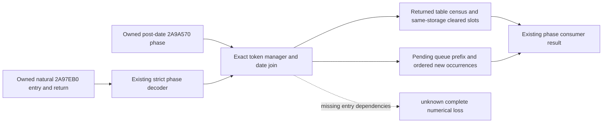

# Actual daily assault return consumption — CK3 1.20.0.4

The existing `project_army_observed_phases_12004` consumer now publishes
`actual_return_outcome_12004` for each owned natural daily assault callback. It
uses the already decoded entry and return copies from `2A97EB0`, joined to the
captured post-date phase at `2A9A570` through the original manager, date and event
tokens. It requires the existing exact source and current-session guard.

The result exposes returned table occupancy and physical controls, the slots
cleared between entry and return when storage and extent match, and the pending
queue suffix when its copied entry prefix is preserved. Queue occurrences retain
their order and full IDs, including duplicates. The end-marker control is excluded
from physical slots. Queue backing may change without changing its prefix.

These are observed callback facts. Raw return bits are not a semantic success
flag; returned state does not fill missing entry dependencies. The existing
conditional loss and group-release consumers continue to use their own inputs.
Full numerical loss, monthly/calendar completeness and later current-state
readiness do not follow from this added projection.

Source delivery: worker 37's `background-g2-offline-20261011` package, using the
compiled Source594 caller as its baseline. Root mounted the same two hunks on
current master; the mount patch needed line-ending adaptation. The native
producer and its decoder are unchanged.

Current classification: **research / SOURCE_ADOPTED_NOT_RUN**. The owner cancelled
tests and local game operations on 2026-10-11. This addition was not imported,
tested, compiled or loaded. Native84/fullSDK84 still represent compiled
`594979b0b3d4c5a395639f30b9d5d864b8a31f6d`. No game days or saves were produced.
The archived exact executable remains CK3 1.20.0.4, Steam build 25734779, SHA-256
`98702F88A547CDE2EAF29A85F93B85F68EE4CF8148336A4F7AFAEB75319DD518`.

Root adoption receipt:
[ROOT-ARMY-RETURN-SOURCE-ADOPTION-20261011.json](D:/codex-ck3-background-spill/native71-continuation-20261010/ROOT-ARMY-RETURN-SOURCE-ADOPTION-20261011.json).
