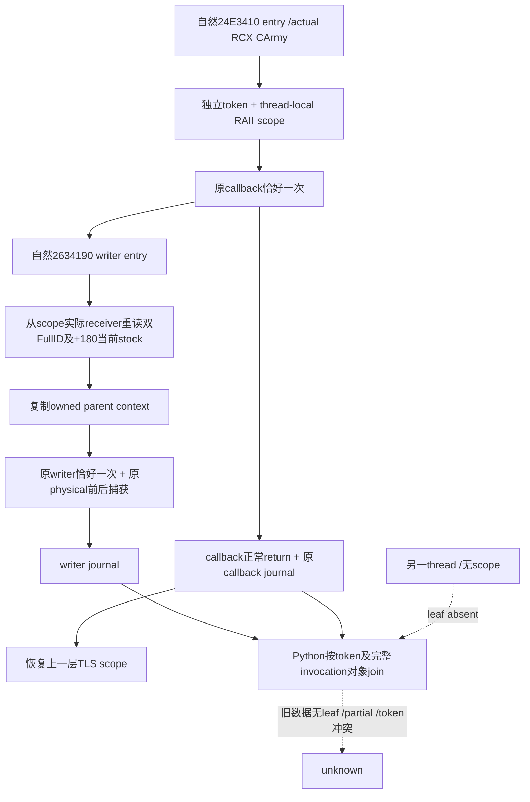

# 自然供给callback与writer的parent关联：1.20.0.4候选

本候选接上[R05已定位的共同调用缺口](episode04-starvation-loss-12004.md)，默认 **OFF**，供下一次正常构建审阅。它基于冻结源码 `1463bd9b4b89612d283dd45ac4ec9efbf22f048d`，只修改外置候选。没有热补丁、部署、CK3/SDK/桌面调用、新EXE游戏字节读取或新实机证据。

目标是 CK3 **1.20.0.4 / Steam25734779 / EXE `98702f88a547cde2eaf29a85f93b85f68ee4cf8148336a4f7afaeb75319dd518`**。执行 `machine_id: desktop-3fevhd2-1c74096080`；本机编译、fixture执行和SYSTEM设置回执由外置 `parent-join-a01/DELIVERY.json` 的观察时间及逐文件pin绑定。其他机器的安装/部署/实机资格不由本候选外推。

## 原调用与receiver来源先核验

既有自然hook `XarActualSupplyCallbackHook12004V1` 从 `g_original` 取得actual `24E3410` trampoline，保存actual RCX `void* army` 和date，然后只在一个位置 `original(army,date)` 转发一次，位于capture fault boundary之外。它不是query调用updater的模拟入口。现有source-contract已把此receiver确认为CArmy：`+10` native FullID、`+124` public CUnit FullID、`+180` signed Q64库存。原生链及捕获类型见[callback来源](army-actual-supply-callback-observation-12004.md)。本候选复用这些具体读法，不把ArRg或CUnit当CArmy，不增加getter/global输入。

既有 `XarActualLossWriterHook12004V1` 同样只转发一个 `original(regiment,request_raw)`；天然writer是 `2634190`，source caller return保留 `24E35FF`供给preferred、`24E377C`围城/劫掠preferred、`2A958E8`未分flags residual。writer仍先capture、原调用一次、再capture物理slot及cache；原来源分类与物理计数均不改。

## 最小观测实现

`XAR_ENABLE_ACTUAL_SUPPLY_PARENT_JOIN_12004` 为默认OFF的CMake选项。OFF时两个原hook不创建TLS scope、不分配token、不新增CArmy读取，新增optional DTO字段不输出，旧wire形状保持。ON只改变bridge自有观测状态，不改变任何CK3字段/函数返回或native source输入。

callback在既有before capture之后、自然original之前创建thread-local RAII scope。scope持有**实际callback RCX receiver**、entry双FullID、passedDate、原caller RVA及由单一atomic分配的进程内token；同时保存真实Win32 thread ID、nesting depth和parent token。scope正常离开或C++栈展开后恢复上一层。另一个thread没有此TLS指针，partial嵌套也遮蔽外层，不能借用外层身份。token不从journal sequence或日期生成，达到uint64上限后保持unavailable，避免wrap重用。

writer entry沿当前thread的实际scope，从那个receiver当场重读 `+10/+124/+180`，核对entry双FullID，复制库存到owned writer DTO。**没有缓存或使用callback entry/return库存充当writer库存。** 原receiver指针只留在scope内部，不作为裸地址发布。失败读和generation变化分别保留nullable值、identity bool及capture flags；没有scope时optional leaf缺席。

| 所在event | optional字段 | 最小内容 |
|---|---|---|
| callback | `supply_parent_invocation_v1` | token、thread ID、depth、parent token、callback caller RVA、固定entryRVA和receiver来源 |
| writer | `supply_parent_context_v1` | 同一invocation对象、当次双FullID、passedDate、`stock_at_writer_entry_raw`及scale100000、receiver身份比较和failure flags |

公共primitive可供R03围城lane复用。writer有scope时均可保全此上下文，具体source stage仍取原caller；residual flags2/0不因此得到区分，围城/raid也不被拆成未观测的两个调用。

后续县/refill lane共用的最小primitive独立在 `ck3_12004_native_invocation_context.hpp`：单一atomic token、单一tagged TLS frame stack、thread/depth/parenttoken及同步typed-payload指针。tags为periodic_supply_callback、county_entry_callback、regular_refill_core、residual_allocator。供给typed wrapper只接受top kind=periodic_supply_callback，其他kind即使嵌套在供给callback内也遮蔽它，不能借用外层CArmy库存。entry/caller/receiver类型留给各typed payload核对；generic层不声称county或refill因果，不发布外部ReadProcessMemory可读的core scalar。此拆分由供给lane独占，县/refill各自接线，不复制分配器或另造ring。

## 消费与拒绝反例

原两个strict normalizer只允许一个新增optional key，旧key集合保持；leaf出现时验证其精确schema、typed整数宽度、正token/thread/depth、nested parent关系、固定`.4`来源及scale。没有leaf不会补一个猜测对象。

`join_actual_supply_parent_writer_observations_v1`独立消费**同一normalized Army row**及各journal自己的fence。它用token定位唯一完成callback，完整比较invocation/thread/depth/parent/caller、双FullID、passedDate、捕获完整性与writer clock；不按两个sequence的数值排序，也不按“同日同军”猜parent。物理debit仍从unique slots复算，不从request、cache delta或Army净兵数填入。

source供给preferred、当时 `0<=stock<1000000` 且physical debit>0的已匹配调用才进入 `strict_below_ten_supply_physical_debit_soldiers`。该和的scope明确为**完整匹配的供给preferred调用**，不冒称整个窗口全部损失。`complete_selected_writer_history_joined`独立说明所有选择历史是否都成功关联；旧记录、丢环、wrong build、重复sequence/token、错thread/depth、换generation、partial stock及非供给caller不升级为R05。exact1000000输出exact-ten事实，不算strict低于10；负值原样保留，不当成功floor0后的普通库存。

这项消费能保全某次具体供给physical扣兵，即使同日另有围城或入县损失；它不会将其它调用相加归入供给，也不会从因此得到的部分和授予整日单因果净损失。R05完整镜头及正常战役边界仍按原卡验收。

## 新窄fixture与实际验证

仅三TU：两个已有production wrapper source加一个新typed-local fixture。ON与默认OFF各自窄编译链接，`/W4 /WX /permissive- /UNDEBUG`，没有全Runtime/DLL构建。输出严格位于已获准research root，来源快照也在该root下；每个EXE经现有标准producer及SYSTEM精确`verified`前后设置回执后才执行，无UAC或broker策略修改。

新fixture实际执行 **4 callback wrappers→4 typed originals，10 writer wrappers→10 typed originals**；CK3 EXE没有调用。它覆盖真实另thread不继承、嵌套callback先完成但outer token正确恢复、callback entry/after与writer当场999999/1000000/500000区别、partial stock、generation变化、物理DATA alias只计一次、scope栈展开与token耗尽不复用。OFF断言无optional字段、无token分配。

共享primitive追加的fixture还覆盖county→refill嵌套都遮蔽供给typed payload、同一shared token/parent关系及逐层恢复。新source变动后以独立a03窄输出重编ON/OFF并重新从SYSTEMverified执行，未重跑a02原生或复用旧obj冒充新源码资格。a01已审包保留原字节；新共享版本单独交付于 `high-parallel-starvation-a01/parent-join-shared-a02/`。

保留的ON/OFF native wire分别穿过修改后的production strict normalizers及keyed消费。ON的ArmyA完成4条join、ArmyB1条；外部/foreign thread无parent、partial和generation变化保持unknown。OFF完成0条join且物理debit原样保留。编译fixture的return address是fixture调用点，**不是**actual4 game source RVA；因此两份wire的source supply stage均false，绝不伪造CK3饥饿正例。另7项纯Python来源形状反例覆盖strict阈值、错thread/身份、nested反序、默认OFF、malformed leaf、non-supply/residual、gap、重复token/sequence与输入不变；普通及`-O`均GREEN。

历史RED原样保留：第一次标准producer的source-command行含额外log/object键，被SYSTEM `producer-validation`拒绝、fixture未执行；新a02改为exact `{argv,return_code}`并使用获准source根。初版Python test缺显式`importlib.util`导致导入失败后已修；初次wire消费误把ArmyA完整join期望写5，实际两个partial/换generation都应拒绝，正确值4，修正只改测试期望并保留原wire，未重跑native伪造结果。

本候选为 **static-ready with focused compiled typed-fixture/wire qualification**。Root当前1463/a05现场完全未改；下一正常cold build需显式ON、取得新hello及真实自然callback/writer记录后，才可授production-live parentjoin/R05。当前新增游戏日、真实饥饿正例、部署和整期验收信用均0。完整交付/编译/SYSTEM/消费pins见外置 `high-parallel-starvation-a01/parent-join-a01/DELIVERY.json`；原证据按统一策略期限保留，无无限保护。
