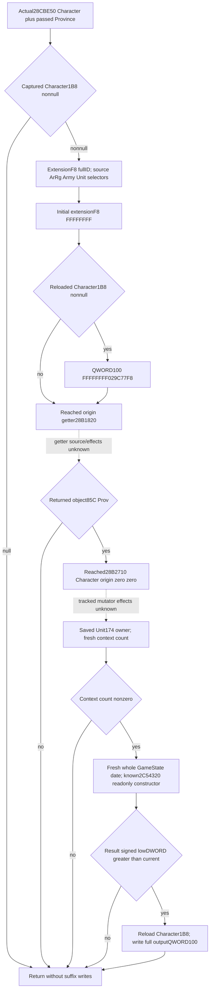
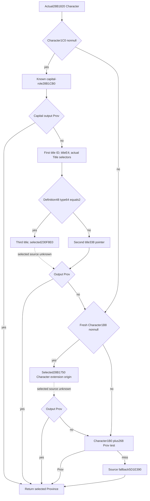
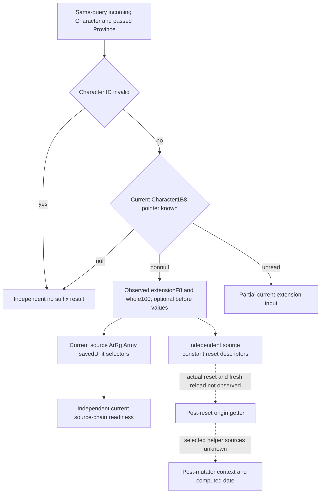
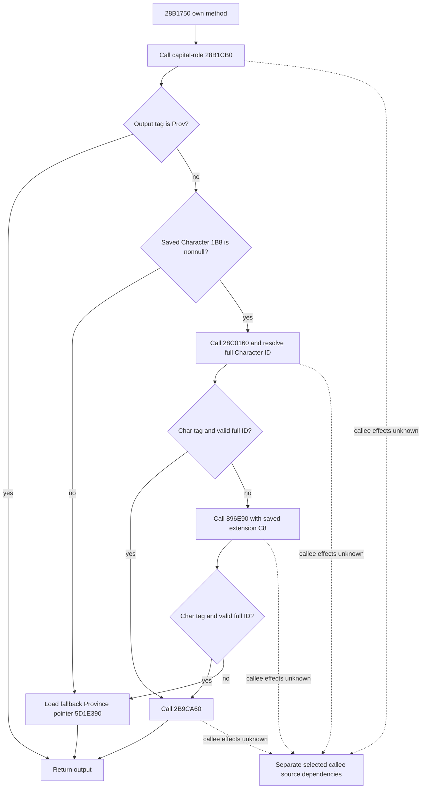

# Character detachment suffix — CK3 1.20.0.4

Frozen source: CK3 **1.20.0.4**, Steam **25734779**, EXE SHA-256
`98702f88a547cde2eaf29a85f93b85f68ee4cf8148336a4f7afaeb75319dd518`.
The concrete existing production partial is
`actually_selected28CBE70_inner_effects` in the current detachment DATA pure
consumer's nonnull Character1B8 branch. Outer invalid CharacterID and null1B8
cases already have independent no-call results.

The old complete semantic wrapper `28CBE70..28CC079` was held in a528B cache;
seven trailing padding bytes were excluded. Root's cached runtime ordinal
140151 gave candidate `28CBE50`. The candidate was not bound from its address:
Root separately approved one521B read, and the complete actual
**`28CBE50..28CC059`** matched every old instruction, ordinary control branch,
member/literal operand and ordered relative/RIP edge. Owner current31 confirmed
no earlier actual4 paired receipt. External proof is
`army-future-dates-12004/character-suffix-map01/FAMILY-MAP.json` and its DETAIL.
Fresh cost: **521 actual4 bytes/one read**, no old EXE, new metadata, hashes,
padding or selected helper expansion. This lane's intentional cumulative source
cost is now **1265 bytes/nine reads**; previous milestone costs stay historical.

The wrapper captures Character1B8 once as its initial extension and saves the
passed Province pointer. Null initial extension returns immediately. Otherwise
it reads extensionF8 fullID, resolves ArRg through registry`5D1F340` and
fallback`5D1F338`, then Army through registry`5D1DE48`/fallback`5D1DE50` and
ArRg140, then Unit through registry`5D1E380`/fallback`5D1E378` and Army124.
Selectors use low24 slot indexes, unsigned count2C and complete object10 ID
equality; each later requested member is only read when its registry is
nonnull. A missing slot chooses the source fallback. The saved Unit pointer
is used later, rather than re-resolving that Unit after the Province mutator.

After these selectors it stores initial extensionF8=`0xFFFFFFFF`. It then
reloads Character1B8; a nonnull reloaded extension receives full
QWORD100=`0xFFFFFFFF029C77F8`. This is a source-defined extension reset,
not a Character return value or an observed post-call state.

The wrapper calls actual origin getter **`28B1820(Character)`**. Its returned
object's DWORD85C is compared with `0x50726F76` (`Prov`). A non-Prov result
exits after the reset; Prov selects actual **`28B2710(Character, origin,0,0)`**.
Both helper effects remain unclosed; neither is invoked as a readonly getter
from this source proof. Cached metadata gives the getter's selected first
runtime interval399B and the mutator's first45B fragment; the mutator fragment
is not a complete method. Separate finite plans must precede new body reads.

After the mutator, the saved Unit174 owner is freshly resolved through Character
registry`5C67568`/fallback`5C67570`, comparing complete ID at18. Owner1C0 selects
its+318 context or source fallback`5459D38`; context DWORD+C zero exits. Nonzero
loads current GameState through`5C68C50` and copies its full QWORD+8 into the
already held readonly date constructor **`2C54320`** with saved Unit, original
passed Province and getter-returned origin. Only **signed low-DWORD** result
strictly greater than the captured current low-DWORD writes the constructor's
whole QWORD into freshly reloaded Character1B8+100. Equal/earlier leaves the
source sentinel. Entry date/owner/context are not the source's post-mutator
rereads and cannot stand in for those effects.

Root centrally executed the separately approved actual origin getter interval
**`28B1820..28B19AF`**,399B/one read, with101 completely decoded instructions.
Receipt is `character-origin-map01/SELECTED-GETTER-CAPTURE.json`. Its own body
has no non-stack writes; this does **not** close readonly behavior of its three
selected calls. Total intentional fresh source cost is now1664B/ten reads,
including this Root-owned capture once.

The getter tests Character1C0. Nonnull selects capital helper`28B1CB0`; a Prov
result returns immediately. Otherwise it reads first title ID from fresh
Character1C0's1E0 vector when1EC is nonzero, or Character1D0's68 vector when74
is nonzero, or fullID`FFFFFFFF`. Through held Title registry`5D1DAF8` and
fallback`5D1DAE0` it selects that title, then titleE4's second title. Definition
pointer48's DWORD64 equal2 selects the first title ID in second title110 when
11C is nonzero, otherwise sentinel; this third title role selects
`230F8E0(title)` at`28B194B`. Other definition values use second title338
directly. A Prov output returns; otherwise the getter continues.

The fallback ladder then checks fresh Character1B8: nonnull selects
`28B1750(Character)` at`28B1972`, returning immediately if its output is Prov.
Next Character1B0's268 pointer is tested for Prov; a miss/null1B0 returns the
source fallback Province pointer from`5D1E390`. Source counts here test
**nonzero**, not positive, and complete ID/generation equality is retained.

The existing actual4 detachment binding already identifies capital helper
`28B1CB0`; the new origin getter is not installed or invoked. Its type2 Title
callee has no containing cached runtime interval, and its selected nonnull
extension helper's first cached interval is30B; neither body's effects are
closed by this399B capture. Only necessary selected helper sources may receive
a further finite plan. Independent source-defined direct-field/early-return
arms should be implemented without demanding every unused fallback branch.
Crucially, the parent clears extensionF8/QWORD100 before calling this getter:
an origin queried from the standing pre-reset state is not automatically the
source's post-reset origin. Any after-reset projection must apply the known
reset to the helper's actual source inputs rather than silently substituting
the current native getter output.

The next concrete same-Army MCP input leaf is
`current_character_detachment_inputs_v1`. It retains every existing query's
incoming native index and passed Province, rather than merging calls that happen
to select the same Character. Its standing observations are current Character1B8,
extensionF8 and whole signed64 extension100, plus the wrapper's current
extension-to-ArRg-to-Army-to-saved-Unit selection roles. Army140 is demanded only
when the Army registry is nonnull; Unit124 is demanded only when the Unit registry
is nonnull. An unused missing ID cannot invalidate a source fallback selection.

Invalid Character fullID`FFFFFFFF` and a known null current1B8 have independent
no-suffix results. A known nonnull extension selects independently known reset
descriptors: F8=`FFFFFFFF` and whole100=`FFFFFFFF029C77F8` (signed64
`-4251158536`). These constant values do not require the old fields to be readable.
The source's first F8 store targets the captured extension; its second store
targets a freshly reloaded Character1B8 when nonnull. A standing query does not
observe that reload after a write. The descriptors therefore preserve those two
target roles and cannot credit an observed reset, reached getter, post-reset
origin or computed suffix date. Current selector completeness is separate from
reset descriptor completeness and from whole suffix readiness.

State is **research / complete direct wrapper and own origin-getter source**;
the current input leaf is **AUTHORED_NOTRUN**, an independent five-file candidate.
Native DTO, inline reader and serializer live in
`army_current_character_detachment_inputs_v1.hpp`,
`ck3_12004_current_character_detachment_inputs.hpp` and
`army_current_character_detachment_inputs_serializer_v1.hpp`. The exact4 binder
`BindCurrentCharacterDetachmentInputs12004` supplies the source role only;
`ReadCurrentCharacterDetachmentInputs12004` performs software reads from the
same-query seed and executes no native helper. Python
`normalize_current_character_detachment_inputs_v1` preserves its strict optional
wire; `project_current_character_detachment_inputs_v1` supplies the independent
`current_character_detachment_suffix_v1` result. No shared hook was applied here.
External `CHARACTER-INPUTS-ROOT-DELIVERY.json` and
`character-current-source/SHARED-HOOK-RECIPE.md` provide concrete Root adoption
fragments; Root owns the unified producer, complete registered consumer and
paused exact4 snapshot qualification. This increment used no new EXE bytes.
No native call, import, test, build, SDK query or paused artifact is credited.
Selected origin-helper source closure remains necessary for origin observation.
Mutator/post-call gaps stay selected dependencies, with no forecast prerequisite
added to current legal OODA or migration acceptance.

## Historical extension-origin own-method source recovered on 2026-10-11

The October7 detached source notes `e0075a9b5967f68eff1195a32cc70022f3ce3074`
and `3486eb8ee60618e67999be52205d778cb9a740cc` recorded the complete actual4
own method **`28B1750..28B181B`,203B**. This supplements the earlier30B cache
stop above. It recovers source knowledge only: no old candidate status,
interface, binding, test, native invocation or live qualification is restored.
The existing current-input/reset contract remains unchanged.

The four selected ranges are `[28B1750,28B176E)`30B,
`[28B176E,28B1809)`155B, `[28B1809,28B1815)`12B and
`[28B1815,28B181B)`6B; padding before28B1820 is excluded. The prefix preserves
Character inRBX, calls capital-role28B1CB0 and tests output DWORD85C forProv.
A Prov result uses the6B ordinary restore/return with that output unchanged.

Non-Prov reloads Character1B8 into a saved extension pointer. Null selects
the12B fallback. Nonnull calls **`28C0160(Character,&local)`** and retains its
returned pointer. When fresh Character registry5C67568 is nonnull, the DWORD
at that pointer is the requested full ID: low24 selects the slot16+8, while
the candidate's complete18 ID must match. A miss/null registry uses fallback
5C67570. Only tag1C=Char and fullID18!=FFFFFFFF admit the selected Character.
A valid Character calls **`2B9CA60(selectedCharacter)`**, whose output is
returned directly. Otherwise **`896E90(savedExtension+0xC8)`** supplies a
second Character candidate; the same tag/fullID checks select2B9CA60 or the
same fallback. The12B fallback loads the QWORD Province pointer from5D1E390,
restoresRDI and reaches the held return; it reads no fallback-object85C.

Own-body writes are stack saves only. The direct body does not read
extensionF8, extensionQWORD100 or a date. These statements do not close the
selected callees' read sets or effects. Capital28B1CB0,28C0160,896E90 and
2B9CA60 remain separate dependencies; a standing capital/location observation
cannot become the parent's post-reset origin. No whole-helper readonly,
current after-reset origin, post-mutator date or future-loop credit follows.

The historical notes name three Root capture receipts:
`character-extension-origin-map01/SELECTED-EXTENSION-ORIGIN-CAPTURE.json`,
`character-extension-origin-map02/SELECTED-EXTENSION-ORIGIN-SUCCESSORS-CAPTURE.json`
and `character-extension-origin-map03/SELECTED-EXTENSION-ORIGIN-FALLBACK-CAPTURE.json`.
This cleanup review read the exact old Git diffs and compared masterc07ad905;
it did not reopen those raw receipts or reread native bytes. Their recorded
203B own-source closure is preserved here before the detached copies are
retired. Temporary source-cost counters and superseded capture plans are omitted.

The recovered own-method branches are shown below; selected callee effects
remain separate unknown source dependencies.

