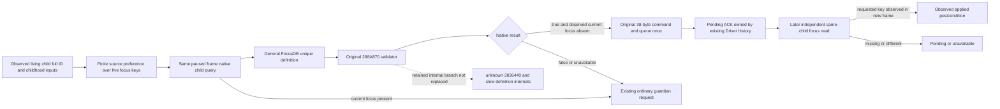

# Child education focus private source entry (1.20.0.4)

The private query resolves an actual child by its complete 32-bit ID and a
unique education definition from the general FocusDB. The played controller
comes from the same published paused frame. The original focus-command
validator at `288A870` evaluates these distinct target/controller inputs; the
host does not substitute the fixed player-lifestyle selection policy.

The admitted keys are `education_diplomacy`, `education_martial`,
`education_stewardship`, `education_intrigue`, and `education_learning`, as
already used by the stock education input projection. Definition lookup keeps
the current-frame native pointer private. Query responses retain the original
validator's true, false, or unavailable result independently from the existing
owned child-current-focus observation.

The three private steps are `private-query-child-education-focus-v1`,
`private-select-child-education-focus-v1`, and
`private-query-child-education-focus-receipt-v1`. Submission constructs the
actual 38-byte focus command with target at `+20`, definition at `+28`, and
controller at `+30`, runs the original validator, and invokes the existing
native clone/queue wrapper once with channel `0E`. Queue acceptance is
`submitted_verification_pending`. An unconfirmed submit is retained as
`submit_unknown` and is not automatically retried.

The receipt reads the same child's current focus in a later published frame.
It preserves the action ID, episode, controller, complete child ID, requested
key and original frame. Only an independent newer revision/token with the
same binding and an available matching current-focus key is
`observed_applied`; missing or differing observations remain pending or
unavailable. This observes the postcondition without claiming action cause or
future education results.

The host uses the existing paused main-thread mailbox with its own explicitly
registered executor. Bridge routing and Runtime source registration remain
under `XAR_CK3_ENABLE_G2_PLAYER_LIFESTYLE_FORMAL_WIRE_PRIVATE_V1`. No native
pointer crosses the JSON boundary. Driver methods reuse the existing private
lifestyle trial permission and bind the actual build through Hello and core
snapshot identity; the generic identity renderer does not invent build fields.

This delivery is **SOURCE_AUTHORED_NOT_RUN**. No import, test, compilation,
native invocation or game observation was performed for these new paths.

Root source adoption: **SOURCE_ADOPTED_NOT_RUN**. The connected native query,
original command, independent receipt, exact executor registration, guarded
Runtime source list, strict Driver and ordinary family caller are adopted
together. No test, import, build, deployment or game operation followed.

Source review found and replaced an intermediate ingress proposal before Root
adopted any child-focus source. Only the final clean ingress patch `0171970d`
is adopted: the existing lifestyle unsupported-step exemption reaches the new
dedicated handler and explicitly registered executor. The old Nonwar outer-OR
proposal and old dependency join are historical, unadopted inputs.
