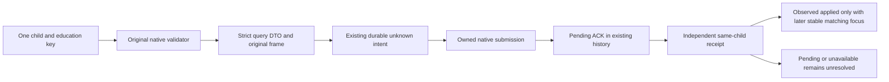

# Child education focus private Driver in current4

The Driver exposes three private methods for the actual child education focus path: query one child/key, submit from that freshly observed native query, and read an independent same-child receipt. They use the existing execute_step command transport and default-off allow_private_lifestyle_formal_trial permission. No public MCP capability is added.

The native API is frozen by [owner35's contract](D:/codex-ck3-background-spill/native71-continuation-20261010/background-g2-source-round-20261011-1152/owner-35/native-focus-tree/FROZEN-NATIVE-WIRE-CONTRACT.md), SHA256 4f4dc593db2a0fa962a24255ca550b3529f1115edf86a1aac34e5fb51b326ce3, and its [shared header](D:/codex-ck3-background-spill/native71-continuation-20261010/background-g2-source-round-20261011-1152/owner-35/native-focus-tree/candidate/ck3_autonomous_player/native_bridge/include/xar_bridge/child_education_focus_private_12004.hpp), SHA256 08f10ce1e219df6fa7dccd67880a387ff0ea0cc71eca8f40ff9c85b9ac434feb. 35 owns the host; 64 owns FocusDB lookup, 43 the original validator and owning command, 46 the receipt, and 55 the actual private dispatcher.

The new [strict helper](../../ck3_autonomous_player/src/xar_autoplayer/bridge/child_education_focus_private_v1.py) retains the native DTO root. Native source_frame/pre_frame/submission/post_observation are preserved. Driver metadata request_id, source_public_revision and source_context bind the same published source to the actual current4 Hello. Full unsigned32 child/controller identity is preserved, including generation bits. The public revision is translated to the same snapshot's native published revision for the request. Native definition pointers never enter a request or result.

| Driver method | Existing transport step | Result |
| --- | --- | --- |
| query_child_education_focus_private_v1 | private-query-child-education-focus-v1 | Native true/false legality or unavailable, with independent current focus |
| submit_child_education_focus_private_v1 | private-select-child-education-focus-v1 | Rejected, unknown, or submitted_verification_pending |
| query_child_education_focus_receipt_private_v1 | private-query-child-education-focus-receipt-v1 | observed_applied, verification_pending, or unavailable |

The exact education keys are education_diplomacy, education_martial, education_stewardship, education_intrigue and education_learning. The native validator decides the actual child/control/definition clauses. The Driver adds no age, educator, whole LIFE or heap gate.

Before submission the helper rereads the original paused controller frame, verifies the copied query's child/key/build/frame and original native legality, and writes action_state_unknown to the existing Driver command history. A failure to persist the intent prevents the send. Native queue acceptance remains pending. Timeout or malformed ACK preserves the unknown intent; no automatic retry is inferred.

Service reads pending from the existing command history, with the original submit result retained by action_request_id. Receipt queries use an independent request ID and preserve the original nested submission. The same actual child, controller and episode must remain bound. An observed_applied result additionally requires an accepted submission, independently published later native frame and stable exact current focus key. The observed state does not prove command causality. Pending and unavailable receipts remain typed results.

The methods are inserted beside the existing player-lifestyle private Driver methods. Their functional Service consumer is owned by 50; that consumer selects and manages actions. This helper does no selection or ranking.

Readiness is SOURCE_AUTHORED_NOT_RUN. No test, import, build, compiler, native command, runtime/log read or game operation ran for this change.

Root source adoption: **SOURCE_ADOPTED_NOT_RUN**. The connected native query,
original command, independent receipt, exact executor registration, guarded
Runtime source list, strict Driver and ordinary family caller are adopted
together. No test, import, build, deployment or game operation followed.
