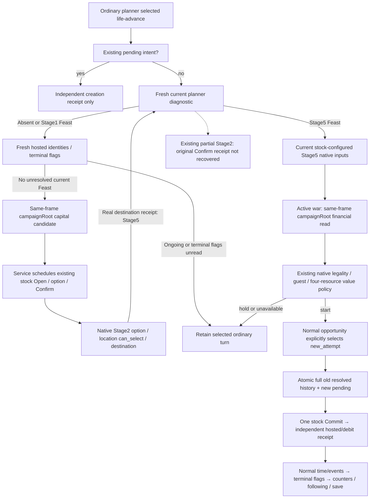
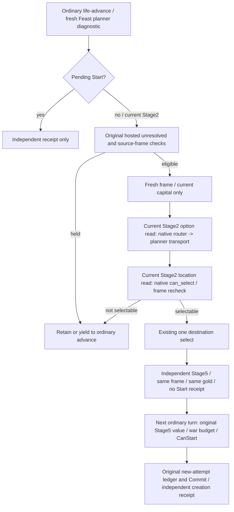

# Ordinary Feast repeats and lifecycle continuation on actual 1.20.0.4

R77 source repair, 2026-10-08. Base: a59b2df4a2b3ab6a951bfdc4f12845faf27439d7.
Status: authored; Root FIRST02 RED, connected repeat pending. No new native ABI, SDK call,
EXE capture, game launch, project import or build was performed by this source owner.

Root FIRST01 had a PYTHONPATH collection failure; FIRST02 ran the connected
compound and found the Open Python helper still admitted only .2/.3 SHA pins
for the router's exact eight-key result envelope. Actual4 uses that same native
envelope without same_frame; this one helper now also selects canonical .4.
All native fields and independent paused-frame checks remain strict. The
connected Stage1/2/destination validators need no parallel SHA-list change.
The source commit was not adopted before this correction; Root repeat is pending.
This review does not qualify every historical CLI helper on actual4.

The R76 durable ledger retained an old .3 completed Feast. The original bounded
consumer always recovered any resolved record, so a later current legal Feast
could not create a new recorded attempt. Its Stage5 assessor also omitted the
existing same-frame campaignRoot argument, leaving active-war financial reserves
unknown despite an available native observation.



With the existing private Feast action switch enabled, ordinary
GameplayBridgeService.plan_turn now selects stock configuration or values the
current Stage5 before an otherwise selected advance. Fresh planner diagnostics
choose the source route. With an absent planner or a selected Stage1 Feast,
fresh hosted identities must contain no Feast with ongoing or unread terminal
flags. The current campaignRoot capital is only a location candidate. Service
then executes the existing typed Open, Stage1 option/Confirm, Stage2 option,
location and destination helpers; native can_select determines legality.
The destination receipt must independently report Stage5, unchanged gold,
unchanged paused frame and no started activity. The next ordinary turn reads
the configured costs, guest route and CanStart through existing Start inputs.
Configuration has no visible Start credit and does not alter the durable ledger.
A held Stage1 attempt yields to an ordinary advance in the same frame.
The route preserves earlier ordinary actions,
uses native CanStart and the qualified guest route, and passes the current
campaignRoot into the existing war-budget consumer. A positive opportunity is
the explicit new-attempt intent; the Service executor passes new_attempt=True
to the durable consumer. Pending always takes the independent receipt route.

The ledger accepts an optional history array. Default consume calls still
recover the existing resolved record. A selected new attempt appends that entire
record, including all historical build, terminal, counter and ACK provenance,
and establishes its new pending intent in the same atomic write. A held decision
does not archive anything. Historical receipts are not relabeled as actual4
observations, and no existing user ledger is edited as part of source deployment.

The native runner's --allow-private-activity-feast-normal option connects this
ordinary opportunity path and the existing lifecycle observer. It does not use
the bounded formal-trial recovery-break path. The old bounded formal-trial
default remains a recovery route. The existing ledger also enables readonly
lifecycle queries during an ordinary continuation without authorizing another
Start. A pending Start is saved and followed by receipt-only ordinary turns;
only an independent creation/debit receipt supplies visible Start credit.
Ordinary Service records the existing one-time following-turn observation.

Both normal and bounded Stage5 assessors query the existing same-frame
campaignRoot during active war and pass player_max_monthly_gold_maintenance_v1
to the current budget policy. Its 18-month coefficient is a discretionary
allocation, not a future war cost bound. Missing actual financial data remains
unknown. War is not an authorization veto.

Native fields and stock operations remain the adopted Activity16 implementation:
[migration source](activity-feast-mcp-migration-12004.md) and
[durable lifecycle](ck3-1.20.0.2-feast-durable-lifecycle.md). This minimum repair
uses those same stock Open → stage1 → stage2 → destination helpers from the
ordinary Service executor, so configuration is not limited to a bounded CLI
trial. A pre-existing partial Stage2 planner remains a source seam: these
helpers require the real original Confirm receipt, which this package does not
recover or invent. Ambiguous native configuration exceptions retain their
existing stop behavior. Native CanStart decides current stock
eligibility; raw date differences and old Feast absence do not prove a cooldown.

Root FIRST recipe:

```text
python -B -m pytest ck3_autonomous_player/tests/unit/test_r77_feast_normal_repeat_compound_v1.py -q
```

Run only in Root's selected source environment after adoption. The one compound
case covers default historical recovery, an absent planner reaching Stage5
through the production typed helper chain and only native wire substitutions,
normal Service opportunity selection,
the active-war 18-month reserve, complete history retention, unresolved pending
without resend, independent creation/debit resolution, a following ordinary
turn and explicit terminal/counter observation. Native frames/reads, physical
Commit and unrelated baseline/succession scheduling are fixture seams; the
case is not a new native or live qualification. Ordinary Feast OODA completion
is not claimed before Root executes FIRST and a future real paused continuation
demonstrates the lifecycle and material save.

The external source tree, FIRST recipe and report fields are in
Z:/ck3_mod_rewrite_process_assets/g2-background-20261008/r77-feast-normal-loop-repair/.

The real MCP repository entry now also accepts
--allow-private-activity-feast-normal. Its parser configures the existing driver
diag/Start-input/lifecycle/action options before create_server constructs the
ordinary GameplayBridgeService. The prior native_auto_run CLI option alone did
not cover xar-ck3-mcp, and Root hot6ee01 retained its actual argparse rejection.
Default and --private-activity-feast-queries remain unchanged; the latter enables
observation without Start. A separate compact parser/config compound is authored
for Root, with only the game I/O factory and server.run lifetime substituted.
This task does not repeat the earlier connected lifecycle case, run SDK/game
operations or change partial Stage2 recovery. Its source receipt is
Z:/ck3_mod_rewrite_process_assets/g2-background-20261008/r77-feast-mcp-normal-entry/.

## October 12 revision: ordinary re-entry into current Stage2

The earlier Stage2 seam and FIRST attempts above describe their original source
revision. A successful Stage1 Confirm can leave the planner at Stage2 when the
current capital is not selectable. The former ordinary entry then admitted only
Stage1 or Stage5, so a later opportunity could not retry that existing planner.

The ordinary configuration branch now also admits a freshly observed Feast
Stage2 and carries its initial stage to the existing composite executor,
`configure_feast_ordinary_v1(..., resume_stage2=True)`; its default remains false. Pending
Start still takes the independent receipt path first. Hosted unresolved checks,
the single current campaignRoot capital candidate and
`_feast_normal_configuration_frame_v1` yielding to ordinary time are retained.
The absent/Stage1 route continues to use the real Open, option and Confirm.

For current Stage2, the executor binds a fresh current frame and passes
`confirm_observation=None, current_stage2=True` to the two existing typed read
helpers. Their `current_stage2` default remains false and the Confirm keyword
remains required; the ordinary default route passes its actual Confirm. It skips Open,
Stage1 option and Confirm. Open/Stage1/Confirm provenance and
`confirm_native_receipt` are genuinely null; an observed planner is not a
submitted Confirm. The helpers' default bounded mode retains its original
verified-Confirm requirement. Both modes retain the native option/location
shape and same-frame checks. A still-unselectable capital returns
`configuration_held` and allows the ordinary advance. The existing destination
helper and independent Stage5, unchanged-gold, paused-frame and no-Start receipt
remain the only successful configuration route.

The native call graph is reused without a new provider. The nonwar router calls
`HandleActivityFeastPrivate12002`, which binds the current revision/player/date/
paused frame and owns the local query. The planner transport dispatches
`stage_two_read` to `ReadActivityStage2OptionV1` and
`stage_two_location_read` to `ReadActivityStage2LocationV1`; these independently
read the current planner and recheck their option/rows/frame. Destination
`ReadyState` requires current Stage2, previous Stage1 and the original two empty
rows, rather than a historical Confirm receipt. Its current native
`can_select` is immediately rechecked before the existing single select.



The minimum source change is confined to the existing ordinary Service,
`activity_feast_ordinary_v1.py` and the two reads in `native_auto_run.py`.
Stage5 budget/guest policy, capital-only choice, ledger history/pending behavior,
Commit and material/lifecycle evidence rules are unchanged. Source intake:
`owner-02/b11-21-feast-stage2-source-intake/FEAST-STAGE2-MINIMAL-CONTRACT.txt`
in the original 1152 round, 3952 B, SHA-256
`e008c6877df884e40ec14e07886bd2a8ac3cd67091cc1bf33eba494872d7e490`.
Its legacy intake name is retained; this adoption is B12-1.

Status on adoption: `research / SOURCE_ADOPTED_NOT_RUN`. The earlier fixture
recipe and failures remain historical; no new execution queue is created.
No test, project import, build, installed-image read, CK3/Steam/UI/native/RPC
operation or new live artifact is performed. This does not establish a new
Feast start, material benefit, G2 loop or M6 completion.
