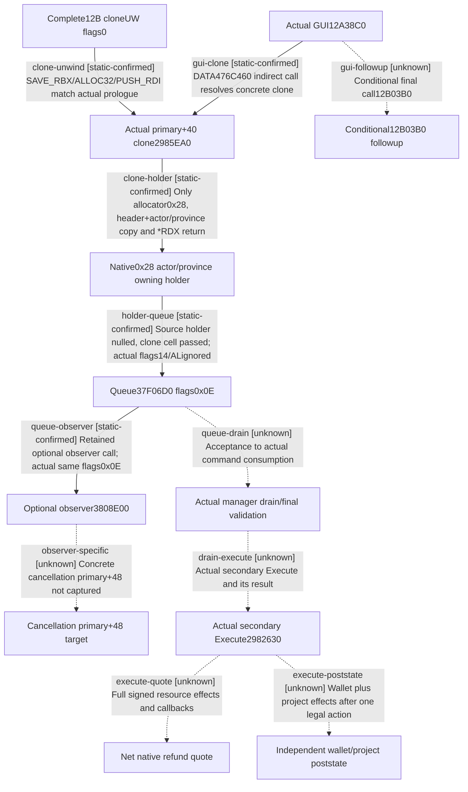

# Research plan: construction-cancel-clone-gui-caller-12004

GENERATED from the supplied research plan; no native semantics are inferred.

Question: What does the actual cancellation clone preserve, and how does its complete GUI handler transfer ownership into the queue?



| Edge | Declared status | Evidence IDs | Open question |
|---|---|---|---|
| gui-clone | static-confirmed | analysis, gui, clone, metadata |  |
| clone-holder | static-confirmed | analysis, clone |  |
| clone-unwind | static-confirmed | analysis, uw, clone, metadata |  |
| holder-queue | static-confirmed | analysis, gui, queue |  |
| queue-observer | static-confirmed | analysis, gui, queue, observer |  |
| observer-specific | unknown | analysis, observer | Optional observer body calls the concrete virtual+48. Cancellation-specific target and descendants are not borrowed from HolyHire. |
| queue-drain | unknown | analysis, queue | Actual manager queue consumer, final gate and secondary+8 dispatch have not been established. |
| drain-execute | unknown | analysis | Neither flags0x0E nor AL nor stack/heap command construction proves actual Execute. |
| gui-followup | unknown | analysis, gui | Direct caller conditions are known; target body/semantics and descendants are not declared GUI-only or pure. |
| execute-quote | unknown | analysis | Actual net refund numeric quote/paid incarnation/current actor vs recorded payer remain unavailable. |
| execute-poststate | unknown | analysis | No Game action was submitted. Independent actual wallet/project readback and UNKNOWN-no-replay required. |

| Observation design | Value |
|---|---|
| mode | offline-only |
| actor_kind | human |
| owner_scope | Actual cancellation GUI submit handler and its concrete native clone, finite static source only. |
| identity_kind | process-ordinal |
| identity_lifetime | Exact image on-disk RVAs and source fields; no live pointer or project-incarnation token. |
| producer_trigger | not-applicable |
| producer | Sole b64 coordinator actual batch04 subset20-22: completecloneUW tail8 and clone123/GUI259 bodies under new Request/Auth/Admission and held source binding. |
| caller | Actual12A38C0 GUI source supplies0x0E independently and calls primary+40 from DATA476C460; no unrelated-command slot inference. |
| consumer | Actual37F06D0 queue receives the native owning clone holder. Actual drain/final validation/Execute and refund quotation remain unknown. |
| cache_lifetime | Fixed Source17 PE/PDATA, prior actualVFT/COL/UW and current held same-file binding are static source provenance only. |
| expected_signal | Clone allocates0x28/copies only shared header+actor/province; GUI transfersclone and ignores queueAL. No net refund quote is created. |
| zero_sample_meaning | Static source body reports no actual Game samples. Neither field absence nor queue acceptance proves native refund outcome. |
| stop_condition | Only three delivered raw files plus retained named sources. No allocator/type/observer recursion or new EXE requests from this plan. |
| runtime_window_ref | None |

| Evidence ID | Declared layer | File | SHA-256 | Supports |
|---|---|---|---|---|
| analysis | source-contract | D:/codex-ck3-background/ck3-java-g2-resume-r4-20261025/resume61/native_refund/CANCEL-CLONE-GUI01.json | f2254e37c79072444b145a885863ac24609e26489e767ff35cbf88deab3afe24 | Manual complete-body/control-flow/field interpretation with explicit unknown calls and no refund authority. |
| clone | exact-build | D:/ck3-state/ck3-java-g2-native-static-resume61/batch04/capture01/window-021.raw | fc2877a751529fbd28bcc2474a77f2698d0bbb7656d06f27d7563c38e607dcc1 | Actual123B clone RF; all32 instructions decoded. |
| gui | exact-build | D:/ck3-state/ck3-java-g2-native-static-resume61/batch04/capture01/window-022.raw | 02a0b60f0c634a2498bca3c86369fd53e519bde4c0365b712fcd923f742f8ebc | Actual259B GUI RF; all66 instructions decoded. |
| uw | exact-build | D:/ck3-state/ck3-java-g2-native-static-resume61/batch04/capture01/window-020.raw | 8c0b2dc95326ef9d4883686a26177393f3ba18a9b6f63884f8d3f7181f936ab6 | Remaining8B cloneUW tail; combines with prior4B header, noCHAIN. |
| batch | exact-build | D:/codex-ck3-background/ck3-java-g2-resume-r4-20261025/resume61/b64_execution/BATCH04-RESULT01.json | 2617d3449748633be7850aefe175da7efe37e1ff05e93e45308d8974c890e13a | Actual Request/Auth/Admission/held identities/closed inputs and three completed managed source phases. |
| metadata | source-contract | D:/codex-ck3-background/ck3-java-g2-resume-r4-20261025/resume61/native_refund/CANCEL-METADATA02.json | 55711cd743136c458931985bb175388f5981d520629fa88228e3bb930e891863 | Actual pairCOL receiver offsets and complete Execute/Gate/GUI fixedUW fields, clone header. |
| queue | source-contract | D:/codex-ck3-background/ck3-java-g2-resume-r4-20261025/resume60/native_refund/CANCEL-CALLER02.json | 577946905a974eeee011cb990406dd915e9eeece594737a2f30d8a7aefc7cce0 | Inherited complete250B queue body and ownership/return semantics; not actual drain. |
| observer | source-contract | Z:/ck3_mod_rewrite/docs/ck3-native-ai/holy-hire-optional-command-observer-12004-2026-10-26.md | 635e813fc247a303ffe5f20a6518202085fd22f7320487f7eca29434b2985e87 | EO independent386B optional observer body. Concrete primary+40/+48 descendants remain command-specific. |

Check result (file integrity and declarations only):

```json
{
  "schema": "xar.native-research-plan-check.v1",
  "result": "plan-consistent",
  "proof_layer": "record-structure-and-file-integrity",
  "semantic_correctness_verified": false,
  "live_execution_performed": false,
  "observation_plan_issues": [
    "offline-only plan does not define a live observation window",
    "the real producer trigger must be located before live sampling"
  ],
  "declared_edges_by_status": {
    "counter-policy": 0,
    "inference": 0,
    "live-confirmed": 0,
    "static-confirmed": 5,
    "unknown": 6
  },
  "enumerated_native_edges": 11,
  "declared_cases_by_status": {
    "pending": 1,
    "observed": 0,
    "not-applicable": 1
  },
  "checked_evidence_files": 8,
  "limitations": [
    "Evidence layers and conclusions are author declarations; hashes bind bytes, not their truth.",
    "Counts cover this enumerated graph only, not all CK3 branches.",
    "A consistent observation plan is not authorization to run or manipulate CK3."
  ],
  "plan_sha256": "fe52a25f82c814e2ed01e8259515e9e417dd0a5e2d653b759c3b5da275173c4d"
}
```
