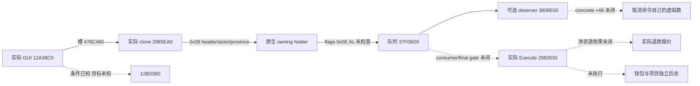

# 取消建设：实际 clone 与 GUI 提交调用链（1.20.0.4）

本轮完整读回取消命令的 `2985EA0..2985F1B`（123 B、32 条指令）与 GUI 提交处理器 `12A38C0..12A39C3`（259 B、66 条指令）。实际调用链为：栈命令 → 具体 clone → 原生 owning holder → `37F06D0` 队列；GUI 独立提供 flags `0x0E`，忽略队列 AL。此结论没有给出净退款报价、项目付款身份、实际 Execute 或钱包／项目后态，取消私有路由继续 OFF，Phase-A 仅提案，退款 credit 为 0。

`machine_id: xenoamess-full-tower-eb9d2c1186`；实际采集观察时间 `2026-10-25T23:05:27.745096Z`，本岗审读 `2026-10-25T23:12:29Z`，用途复核期限 `2026-10-26T08:00:00Z`。EXE 精确 SHA-256 为 `98702f88a547cde2eaf29a85f93b85f68ee4cf8148336a4f7afaeb75319dd518`，preferred image base `0x140000000`。下文均为 RVA，不是实机指针或项目身份。

唯一新采集执行者为 b64。`resume61/b64_execution/BATCH04-RESULT01.json`（34087 B，SHA `2617d3449748633be7850aefe175da7efe37e1ff05e93e45308d8974c890e13a`）保留新 Request/Auth/Admission、held 文件身份及原终态。本岗只消费其 20–22 项：8 B 元数据和 382 B 代码，共 390 B；全批 50 个窗口不计为本岗成果。三受管阶段实际 exit 0、Job 0，输入与运行时前后 MATCH，input CLOSED/unknown 0；这些是静态采集终态。

| 原件（batch04/capture01） | 范围／SHA-256 | 实际用途 |
|---|---|---|
| `window-020.raw`，8 B | `5109D54..5109D5C`；`8c0b2dc95326ef9d4883686a26177393f3ba18a9b6f63884f8d3f7181f936ab6` | clone unwind 尾部 |
| `window-021.raw`，123 B | `2985EA0..2985F1B`；`fc2877a751529fbd28bcc2474a77f2698d0bbb7656d06f27d7563c38e607dcc1` | 取消命令具体 clone |
| `window-022.raw`，259 B | `12A38C0..12A39C3`；`02a0b60f0c634a2498bca3c86369fd53e519bde4c0365b712fcd923f742f8ebc` | GUI 提交处理器完整 RF，未把后 1 B padding 纳入函数 |

clone 的先前实际 unwind header `010a0400` 加本轮尾部 `0a3406000a320670`，得到完整 12 B：version 1、flags 0、prologue 10 B、4 slots，无 CHAIN／handler。`SAVE_NONVOL RBX` 的位置为 final RSP+`0x30`，另有分配 32 B 栈空间与 PUSH RDI，和实际序言一致。共享 unwind 不代表共享命令载荷。GUI 先前固定 unwind 16 B 已含 flags 2 的 handler RVA `4225A64`，其语言专属数据仍未闭合。

实际 clone 唯一直接 call 是 `2985EB5 → 4223B94`，传入 `ECX=0x28`；分配器后代未审，不宣称纯函数。函数先写基类 VFT `448B0A8`，随后写实际 primary `476C420` 与 secondary `476C3F0`（位移 `0x18`），复制以下字段，将新 primary 写入 `*RDX` 并返回 RDX：

| primary 相对偏移 | 复制内容 |
|---|---|
| `+08` | 1 B 通用头 |
| `+0C/+10/+14` | 各 4 B 通用头 |
| `+20` | 4 B 命令角色 |
| `+24` | 4 B 省份 ID |

完整函数没有复制／存储付款成本、项目 incarnation、开工日期或退款报价字段，也没有直接调用取消 mutator 或 copied gate。相邻 ADD materializer `2985DA0` 分配 `0x30`、带额外 slot/type 字段；本轮不借用其载荷含义。

GUI 从 `[receiver+138]` 取 RBX、从 `[receiver+130]` 取 EDI，`[RBX+D8]` 为空时结束。它在栈上构造这对实际 VFT，将 `+08/+0C/+10/+14` 清零，角色来自静态 cell `54DBC00`，省份来自 `[RBX+D8]+10`。`12A392C` 间接调用实际 DATA 槽 `476C460`，该槽已由 batch02 读回为 clone `2985EA0`，不再把 DATA 地址当函数。

处理器取出 returned holder 的 native primary 后清空源 holder，再将 clone 放入传给队列的指针单元。`RSI` 在 `12A38EF` 明确清零，`12A394C` 的 `LEA R8D,[RSI+0E]` 因而独立确认取消 caller 的 flags `0x0E`。`12A395C` 以 manager `5CC1240` 调用 `37F06D0`，之后没有 AL 测试。条件非空的剩余 holder 走其虚表 `+0` 删除路径；本轮没有新增 bridge 分配器或另一套 holder。

处理器尾部比较 `[RBX+EF0]` 和原 EDI；相等时经当前省份 `+688`、`+6F500` 取对象，检查 dword `+38 != 0x4744624F` 后调用 `12B03B0(RBX)`。只闭合直接条件，不把该未审目标称为纯 GUI 刷新或无副作用。完整 GUI body 没有直接调用 primary `+30` gate、secondary Execute、报价查询、钱包读回或项目后态读回。

已有完整 250 B queue 本体的通用事实可复用：bit 3 设置 command `+8 |= 0x20`，bit 2 选择加锁 append；本体没有实际 secondary Execute。可选 observer 的完整 386 B 研究见 [EO 原笔记](holy-hire-optional-command-observer-12004-2026-10-26.md)：调用具体 primary `+40` clone 与 `+48`，另有后代，不能概括为无副作用。本轮独立确认取消 flags 后才复用共同路径；取消自己的 `+48` 未采，不借 HolyHire 目标。queue／observer／pump epoch 仍不能证明 consumer 已执行或形成 barrier。

还需原生净退款报价（含十个有符号资源槽、definition+C8 effect 和 manager callbacks）、记录付款人和当前命令角色的区分、稳定付款项目身份、最终验证／Execute dispatch，以及一次合法提交后的钱包与项目独立读回。ACK、项目消失或单独钱包变化不构成退款归因，结果 UNKNOWN 不重放。

本岗完整审读 `resume61/native_refund/CANCEL-CLONE-GUI01.json`（8485 B，SHA `f2254e37c79072444b145a885863ac24609e26489e767ff35cbf88deab3afe24`）；逐指令派生件 `CANCEL-CLONE-GUI-INSTRUCTIONS01.json`（18201 B，SHA `45b3d318ac796e0cc23fdd8c975380f2c7444f1697ca89f205c2b16cdde6c161`）由 Capstone 5.0.7 解码，98 条指令覆盖全部 382 B。标准 plan check 为 exit 0、8 个文件完整性、5 个 static／6 个 unknown／0 个 live；检查只证明记录结构与字节绑定，不证明语义、实机权限或游戏效果。生成图见 [标准源图](construction-cancellation-clone-gui-caller-12004-2026-10-26.graph.md)。本轮没有申请新 EXE 窗口，不自动递归分配器、RTTI 或 observer。
