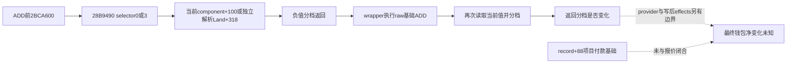

# 取消写前／写后分档读的是当前账户值

实际 `2BCA600` 在 ADD 前后使用的取值函数 `28B9490`，literal 0 读取当前命令角色 component+`100`，literal 3 独立解析当前 Land 并读取 `+318`。它没有项目／付款费用参数，也不返回退款报价。由此可以把基础 ADD 与其后分档比较接起来，仍不能由比较结果推出净退款或可用资金。

`machine_id: xenoamess-full-tower-eb9d2c1186`；新代码采集 `2026-10-26T01:16:24.068828Z`，本岗审读 `2026-10-26T01:22:44Z`，复核期限 `2026-10-26T08:00:00Z`。精确 `.4` EXE SHA 为 `98702f88a547cde2eaf29a85f93b85f68ee4cf8148336a4f7afaeb75319dd518`。b64 唯一执行的 `BATCH12-RESULT01.json` 为 14373 B／SHA `88e656e339e2d9f0afe9d34e8e860038649106b21f518337eb665aa59ae2dcc5`，index 10 绑定新 256 B raw；三静态阶段 exit 0／Job 0／guards MATCH、input CLOSED/unknown 0，不授实机业务资格。

该 RF 的 `28B9490..28B9578` 是 **232 B／59 条代码指令**，余下 24 B 是六项 uint32 RVA 跳转表。11 个本地直接分支和六项 table target 都落在代码指令起点；唯一直接 call 在 `28B9525`，四个 RET 均已覆盖。完整线性反汇编会误把 table 当代码，因此不使用那种计数。新 raw SHA 为 `a321c1283d0c8348674bb0fd9dca7598507d909fbba956c147917a67fe315557`。

完整 UW 8 B 已复用 B01/9 与 B02/43，不重新采集：version 1／flags 0／prologue 4／一项 ALLOC_SMALL 40 B／两字节 padding，无 CHAIN／handler。它与新代码入口 `SUB RSP,0x28` 完全对应。

| selector | 完整实际路径 |
|---|---|
| 0 | component=`[actor+1B0]` 非空时，复制 `[component+100]` 到 caller output；这条路径没有 call。该偏移与取消的 `285EE67` 基础 ADD 字段相同。 |
| 3 | actor+1C0 指针存在时，仅该列表非空才取首 ID；空的主列表不会转试第二列表。仅主指针为空才尝试 actor+1D0。经 `9D6DF0` 解析 full ID，要求 Land tag 与 ID≠−1，复制返回对象 `+318`。 |
| 4 | actor+1C0 非空时复制其 `+4A0`，不猜资源名称。 |
| 1／2／5 | 输出零。 |
| component 为空或 selector 超出 unsigned 0–5 | 输出零。 |

caller 在 `2BCA61F` 传 actor、自己的栈 output 与 literal 0／3。函数保存 output 到 R9，正常返回的 RAX 为该 output 指针。没有 actor-null 检查，不能从 component 的零值分支推出接口支持任意空 context。

唯一 resolver 的完整 57 B 也已在旧缓存：`9D6DF0..9D6E29` 共 17 条指令、4 个本地分支、1 个 RET，没有 call、store、栈调整或 R9 改写。它从全局 manager 按 low24 index 查找并比较 full32 ID，失败返回全局 fallback 指针。原 64 B raw 的最后 7 字节 CC 是 padding；`PHASE-SOURCE-CLOSED` 的 `/full_logical_functions/19` 和 `named-leaf-suffix04` exact-body DETAIL 明确绑定同一 `.4` SHA。原件来源机器仍 unknown，不能因本次读回补认当前 Loaded／指针值。这里只闭合本次实际 callee 对 R9 的保存，不发明通用 ABI。

Land 读取路径会重新解析当前 ID；它与 earlier／later wrapper receiver 的稳定身份不能仅凭相同字段偏移认定。此函数直接写的只有 caller output／本栈，resolver 没有写；整个分档函数的动态分母、provider 和 ADD 后续 effects 仍按各 owner 的来源边界处理。当前余额 getter 也不能取代 paid incarnation、付款人、实际只读净退款报价或提交后的钱包／项目独立后态。

完整人工审读见 `resume61/native_refund/REFUND-INPUT-ANALYSIS01.json`；正式 code/table 派生件 `REFUND-INPUT-INSTRUCTIONS01.json` 为 11073 B／SHA `abff3bac39f590e219a3a61332f1876e877cd0cb29b0b2177915a34455b137f6`。本轮没有生产代码、Game 调用或资金信用变化；private route OFF、credit 0、Phase-A 提案和 UNKNOWN 不重放继续有效。前序 [分档函数](construction-cancellation-prepost-classification-2bca600-12004-2026-10-26.md)与 [资源分派](construction-cancellation-resource-mutator-310db20-12004-2026-10-26.md)保留各自原件范围。
