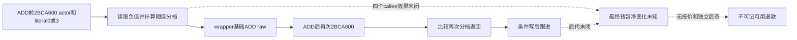

# 取消资源写入前后：2BCA600 的负值分档返回

`285EE40/285EF60` 在直接 ADD 前后调用的 `2BCA600`，本体计算一个负值分档索引；两次返回值供写后比较。完整本体没有直接的钱包写入，也没有接收并改写 ADD 的 raw amount。它的四个直接 callee 仍须各自核实，因此不能据此宣布整个链纯只读或净退款等于基础 ADD。取消仍为 Phase-A 提案，private route OFF、credit 0，没有 Game 提交。

审读机器 `machine_id: xenoamess-full-tower-eb9d2c1186`，时间 `2026-10-26T00:50:41Z`，复核期限 `2026-10-26T08:00:00Z`。历史原件的 `source_machine_id: unknown`，本次读回不补认其来源机器。原件 manifest 明列精确 `.4` EXE SHA `98702f88a547cde2eaf29a85f93b85f68ee4cf8148336a4f7afaeb75319dd518`；这只绑定静态来源，不证明当前安装、Loaded、ABI 或实机执行。

b64 在 `resume61/b64_execution/HELD-SOURCE-REUSE11.json`（5872 B／SHA `f0599841fff3e9eecbeef5d673d5cb5f3217774e26aa8b0d9d3dc92d660fa6f3`）items[1] 找到三份已存原件：`2BCA600..2BCA63C` 60 B、`2BCA63C..2BCA7DB` 415 B、`2BCA7DB..2BCA7DF` 4 B。本岗逐一核 SHA，并验证原 decode 的 135 条 actual 指令与三份 raw 连续逐字匹配。内存拼接 SHA 为 `ac03c15d272c7028716544d6707ef46d8164427160a2b04d995d8239a6b14f64`，没有生成替代 raw，也没有新读 EXE。

最后 4 B 是 `DEC EAX; JMP 2BCA7C8`，由 `2BCA7BB` 条件边到达，不能当对齐丢弃。19 个本地分支均从原始相对位移重算目标并落在指令起点；4 个直接 call、0 个间接 call，RET 位于 `2BCA63B/2BCA7DA`。保留 PDATA 显示三段各属不同 RF／UW：`51BB240/52AD35C/52AD374`。当前未持它们的完整 UW 字节，故这里闭合的是逻辑代码控制流，不是 unwind／CHAIN；独立 4 B 首头 proposal 不包含新代码授权。

实际普通 ADD helper 的入边复用 NativeLoan `SOURCE-RESULT23.json`，不重新解码其 131／137 B：个人路径在 `285EE62/285EE72` 传 actor context 与 literal 0；Land 路径在 `285EF85/285EF98` 传 context 与 literal 3。两次 call 之间发生 `ADD [wrapper+8],raw`；之后比较 EAX 返回值，变化时才继续检查 Char tag、ID、死亡指针及其他跟进条件。取消资源向量 ordinal 6 与本 helper 的 literal 3 分开，不能写成借款 gateway selector 6。

| 本体位置 | 实际行为 |
|---|---|
| `2BCA609..62E` | 仅 selector 0／3 调 `28B9490(context,outStack50,selector)`，取 out qword。该值非负或 selector 不支持时，返回 −1；负值进入续段。 |
| `2BCA649..663` | selector 0 调 `2BCA4C0`，selector 3 调 `2BCA560`；读取返回指针的 qword 作为后续分母输入。callee 本身效果未知。 |
| `2BCA666..6CF` | 分母小于 100000 时条件调 `28C2DF0(context)`，检查返回对象 +40 的 bit 10；成立则采用 100000，否则用原分母。非 cap 分支的分母零返回 table count，负分母返回 count−1。 |
| `2BCA686/6A0` 等 | selector 0／3 分别选 `.data` RVA `5450728/5450898`；读取 table+0C 的 count 与 table 的 threshold pointer。表内容、定义和单位未闭。 |
| `2BCA6CF..7AA` | 对负值取反，再经完整寄存器乘除分支得到 EDX。此处不把编译器大常量解释成退款率，也不化简极值／溢出路径。 |
| `2BCA7AC..7DD` | 按 signed int32 threshold 比较遍历：首个 threshold 大于 EDX 时返回前一个索引；遍历耗尽或 count≤0 则返回 count−1。两个实际 epilogue 恢复并返回。 |

135 条完整本体只直接写本栈的寄存器保存位置，没有非栈 store、钱包 ADD／SUB 或间接 callback。但 `28B9490/2BCA4C0/2BCA560/28C2DF0` 的后代尚未审读，不能把“本体没有直接写”外推成整个函数无副作用。raw amount 由 ADD wrapper 保存使用，没有作为此函数的金额输入；返回分档变化也不撤销已经发生的基础 ADD。

完整审读与精确原件、producer、manifest、135 指令成员位置见 `resume61/native_refund/REFUND-PREPOST-ANALYSIS01.json`。历史 group 名 `phase_advantage_select_debt` 仅用于定位，本文结论来自 actual 指令及 raw；不由旧名字赋予业务接口。整体取消入口和十槽分派见 [资源专题](construction-cancellation-resource-mutator-310db20-12004-2026-10-26.md)。paid project incarnation／付款成本、实际只读净报价、`246CE30` 后续 effects 和最终钱包／项目后态仍未闭合，不新增取消 consumer 或重放未知动作。
