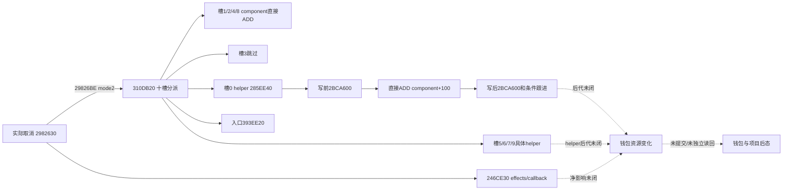

# 取消建设资源函数 310DB20：完整主 RF 的实际分派

实际取消以 mode 2 调用 `310DB20`：其中四个非零资源槽直接累加到当前命令角色的 component 字段；复用 NativeLoan 已持 helper 原件后，slot 0 的普通路径也已闭到 `ADD [component+100],rawSlot0`，slot 6 闭到 `ADD [resolvedLand+318],rawSlot6`。这仍不代表退款率为 100%。付款记录的数值约定、写前／写后和其他 helper、后续 effects／callbacks 未闭合，没有可用净退款报价。取消继续仅作提案，私有路由 OFF、credit 0，没有 Game 提交；不能执行此 mutator 来探测报价。

`machine_id: xenoamess-full-tower-eb9d2c1186`；实际采集观察时间 `2026-10-26T00:06:56.748306Z`，本岗完整审读 `2026-10-26T00:17:03Z`，复核期限 `2026-10-26T08:00:00Z`。精确 `.4` EXE SHA 为 `98702f88a547cde2eaf29a85f93b85f68ee4cf8148336a4f7afaeb75319dd518`。所有地址均为 on-disk RVA。

原始完整取消函数在 `29826BE` 调用本函数，RCX=`record+88` 的十个有符号资源 word，RDX=当前命令角色（不是记录付款人），R8D=2、R9D=0；返回后再调用完整 627 B 的 `246CE30`，涉及 definition+C8 effect 与 manager+408 callbacks，并清 active definition。调用者来源 `m4_research/custody11/NATIVE-CANCEL11.json` 的 SHA 为 `a41f85e837a0b7fa7e469af925444397b7951799a02b273dbb26d7d0d3ce8b8e`。

唯一新采集由 b64 执行。`resume61/b64_execution/BATCH07-RESULT01.json`（19267 B，SHA `beb69b6948738f9cfb395d3c06cf3dcafe3b6711af0931a99849cad06809c8a9`）保留新 Request/Auth/Admission、完整 held 身份及终态。本岗只消费 indices 0–1：UW tail 24 B 和主 RF 1736 B，共 1760 B，没有新增 PE／PDATA／相邻函数。三静态采集阶段 exit 0、Job 0、输入／运行时前后 MATCH，input CLOSED/unknown 0；这些不证明实机退款。

| 原件 | 范围／SHA-256 |
|---|---|
| batch06 `window-000.raw`，4 B | `512C734..512C738`；`58c5c09ec4f997f59b07790bf362553aad52cd9a38753966db301fd1275f1f97` |
| batch07 `window-000.raw`，24 B | `512C738..512C750`；`09a6ff834c83cab7793e2172d830366cb4a7fd0b23d7156b09ed954df6404638` |
| batch07 `window-001.raw`，1736 B | `310DB20..310E1E8`；`7a5395ff01039ba1f852092e17b2a5d399e2d329d9dcb2c60d5b1eb53a703581` |

UW header `011c0c00` 与新 tail 合为完整 28 B（内存拼接 SHA `dfbfead2a7ecc224eb6003c081db658df1eb7740f0de0e3abb555e65078f5207`，不写替代 raw）：version 1、flags 0、prologue 28 B、12 slots、frame register 0，无 CHAIN／handler。保存 RBX／RBP／RSI 到 final RSP+`A0/A8/B0`，分配栈空间 `0x70`，另 push RDI／R12–15，与实际序言逐项相符。PDATA 第 168015 行锁定此 RF，前一 RF 共用 UW 不授行为借用。

RF 包含 **1694 B／381 条代码指令**（至 RET `310E1BD`），之后是 2 B `6690` 对齐和 `310E1C0..310E1E8` 的 40 B 跳转表数据。`310DBF6` 的 indexed jump 从这十项 uint32 RVA 选择分支，再加实际 image base。80 个直接本地分支和十个表项均落在已解码指令起点。初次线性派生件 INSTRUCTIONS01 会把表数据误解成指令，已明确标为 superseded；正式派生件 INSTRUCTIONS02 单独保存 code、padding、table，不使用其 400 条线性计数。

函数保存数组指针到 R15、角色到 RDI、mode 到 R14D、原 R9B 到 R12B；ESI／RBP 从 0 遍历到 9。`310DBD2` 载入当前原始 word 到 RBX，为零直接跳过分派。下表只陈述实际编号／偏移，不按图标顺序猜其他资源名称。

| 槽／分支 RVA | 实际取消 mode 2 路径 |
|---|---|
| 0／`310DBF8` | component=`[actor+1B0]` 非空：`285EE40(component+F8, rawSlot0, actor)`；其普通 131 B body 在两次 `2BCA600(context,0)` 之间直接 `ADD [component+100],rawSlot0`。随后 parent 条件调用 `19EAE80(tracker,0,rawSlot0)`。 |
| 1／`310DC42` | component 非空：`310DCAB` 直接 `ADD [component+130],rawSlot1`。 |
| 2／`310DD2B` | component 非空：`310DD94` 直接 `ADD [component+110],rawSlot2`。 |
| 3／`310E17C` | 直接进入下一槽，没有该槽自己的资源 store／call。 |
| 4／`310DE51` | component 非空：`310DEBA` 直接 `ADD [component+150],rawSlot4`。 |
| 5／`310DF3A` | predicate `2B9D2B0` 为真才经 actor+1C8/+B68 的 fullID storage 或 fallback 取 receiver，调用 `25B9410(receiver,1,rawSlot5,原R9B=false)`。本槽不按 mode 分支。 |
| 6／`310DFB4` | component 与 predicate `2BAFD80` 条件通过后，经 actor 两个列表取首个 ID，`9D6DF0` 解析；要求 `Land` tag／非 −1 ID，调用 `285EF60(record+310,rawSlot6,actor)`。其普通 137 B body 在两次 `2BCA600(context,3)` 之间直接 `ADD [Land+318],rawSlot6`；随后 parent 条件调用 `19EAE80(tracker,3,rawSlot6)`。 |
| 7／`310E073` | `28C2DF0(actor)` 返回对象的 `+40` bit 32 与 predicate `2BAFD80` 同真时 selector=3，否则 0；调用 `28B9700(actor,selector,rawSlot7,4)`。本槽不按 mode 分支。 |
| 8／`310E0B7` | component 非空：`310E119` 直接 `ADD [component+170],rawSlot8`。 |
| 9／`310E18C` | `28B9700(actor,4,rawSlot9,4)` 后进入 epilogue。本槽不按 mode 分支。 |

槽 1／2／4／8 在其他 mode 中有不同路径：mode 3／1 传 callback `28CDC70/28CDC60`；mode 0 在槽 1／2／4 传 `28CDCD0`，并经 `28D7100/28D6FE0/28D7220/28D7340` 等 helper。mode 0 槽 2 还有条件 virtual `+A0`，槽 8 则调用 `856B20`。实际取消 mode 2 绕过这些 alternate 路径，不能把其他 mode 的 setter、通知或回调含义混入本次数据流。volatile call 之后未重新赋值的 R9 不假定为原来的零。

入口无条件 call `393EE20` 的目的／副作用仍未知。其 EAX 返回值随后参与 32 位常量混合，形成传给 alternate helper 的 scratch；RBX 的资源值在这之后才载入，不能把这些乘法常量当退款比例，也不能把入口 helper 宣称为纯 getter。已有 source reader 把 component+100 命名为 `current_gold_raw`；本轮已用真实 caller 加已持 helper 的直接 ADD 指令闭到该字段，不靠命名或相邻 SUB 推断。

两个 base ADD helper 复用 [NativeLoan 普通 body 研究](loan-native-account-add-order-12004-20261026.md)，其 `SOURCE-RESULT23.json`（14645 B，SHA `6616294ef98cc18a1af36bb26debc192cf6515285c2192151fc4628869547e28`）绑定 batch05/window-017 的 131 B（`4a8c83ef8536cdad09b6b5706995a2991aaf361eb0140f14573ea4101695a4e0`）和 window-018 的 137 B（`7aa1ee2830c0599bbc757c28fb276e845e40c0361e808f85c19d1b027f93b3f4`）。本岗没有重取／重复审读这两个 body，只把取消的实际 receiver 与 amount 入边接上。它们本体不检查正 amount／可负担或 clamp；不能把借款 tooltip caller 的 amount>0 门借到取消 parent 的 raw!=0 门。

写前／写后 `2BCA600`、比较后条件 `2BAA6F0/28C3D20/28C3CD0` 仍未知。tag／ID／死亡上下文等写后条件控制后续调用，不阻止已经执行的 ADD；也不能由这个顺序推最终账户差额必等于 raw word。

`19EAE80` 的完整 1323 B 复用 [NativeWarCash 原分配研究](finance-native-budget-positive-allocation-12004-2026-10-26.md)及 `AI-CHEST-POSITIVE-ALLOCATION30.json`（61266 B，SHA `49c4f2fdc031bd14cbe8f4b8cafb38a7895b20eb3940f873da54d5ee13f76fc4`）。本岗只补上述 kind 0／3 入边，不重取或重复审读。该 helper 在 A<0／null S 时直接返回，不撤销之前的 base ADD；正常 0／3 只作 tracker 分配及 own-tier 调用，P／D 不是钱包，也不是当前可花费现金。它不补齐 pre/post、其他 receiver／predicate 或 `246CE30` 后续 effects；不能为退款记 credit。

本体没有构造稳定的报价对象或返回资源向量。父函数不缩放四个槽，不等于付款记录就是可退金额；更不能由省份仍有项目、copied gate、GUI flags 或队列 ACK 推出退款到账。需继续区分付款人／当前命令角色、稳定项目身份、最终验证／Execute、实际只读报价与提交后的钱包／项目独立后态，UNKNOWN 不重放。

完整人工源分析 `resume61/native_refund/REFUND-RESOURCE-ANALYSIS02.json` 为 14959 B／SHA `6220c71373429fd42af9b92f900f5fe86072e0ac6be8441e1a2ab2f3fa14ab35`，继承主 RF 审读并接入上述同源 peer 原件；旧 01 报告保留为交叉原件加入前的范围。分类派生件 `REFUND-RESOURCE-INSTRUCTIONS02.json` 为 56852 B／SHA `1f07db21c90f72cbd8ff862ed1f1abb0ebfae8f44510431ac5358472f7e25ce9`。此处的完整性／边界检查不是语义证明或实机验收。已闭的命令 clone／GUI caller 见 [独立专题](construction-cancellation-clone-gui-caller-12004-2026-10-26.md)；本轮没有自动扩取任何 callee／RF。
