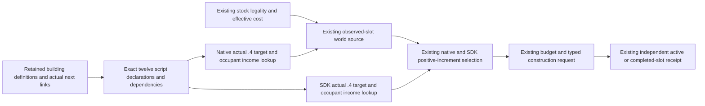

# Higher economic construction tiers on CK3 1.20.0.4

The current construction caller can receive a legal higher-tier building, but its authored-income lookup only admits nineteen tier-one targets and two tier-two upgrades. This successor adds the twelve source-qualified `farm_estates_03` through `_08` and `common_tradeport_03` through `_08` targets. It also values those keys when they are the actual observed slot occupant, allowing the existing selector to compare the next legal upgrade with its predecessor.

| Tier | Farm estate authored monthly income, hundredths | Trade port authored monthly income, hundredths |
| --- | ---: | ---: |
| 3 | 160 | 75 |
| 4 | 205 | 95 |
| 5 | 250 | 115 |
| 6 | 295 | 135 |
| 7 | 340 | 155 |
| 8 | 385 | 175 |

Each value comes from its own native script declaration and complete dependency chain. The exact matched [building-values source](https://raw.githubusercontent.com/jesec/ck3-mod-base/074429b3f6d9352a3cf4c5671725fee2f41267ba/base/game/common/script_values/00_building_values.txt) has SHA-256 `f436f7d9d5ac5506b38d715f0ce02c4f4257eef3addf56597c18a526a6f66825`. The normal and excellent tax declarations use their explicit base, additions and tier references; no value is extrapolated from tier two. Owner63 retained a 2,789-byte finite declaration excerpt and the exact twelve expression/dependency records. The full 103,815-byte mirror body was transient.

The retained `00_standard_economy_buildings.txt` has SHA-256 `33a6253e89acd0da1c0242bd441987817dc5386325694f92bbe635f657fbd0e8`. Farm definitions occupy original lines 6709–7103 and trade port definitions 4541–4968. Their actual `next_building` links connect tiers three through eight; tier eight has no further link. Accepted actual `.4` reuse follows the content-depot provenance already recorded in [the building migration topic](building-adopted-mcp-migration-12004.md) and [the tier-two source package](construction-known-economic-upgrades-12004.md).

The native `.4` economic table has fourteen rows: the two adopted tier-two values and these twelve higher-tier values. Its exact-build selector uses that table for the target and observed occupant, then retains the original tier-one fallback. The world reader reserves space for nineteen plus fourteen known positive targets. This changes neither its existing scan limits nor whether a truncated scan is complete. Older native target and occupant lookup paths retain their original tables.

The SDK uses the same explicit fourteen-row `.4` values. Its existing `domain_construction_private_transport_v1._candidate` reads target income, reads the actual old slot, requires a positive authored increment and feeds the same ranking and result fields. No new construction action or receipt schema is needed. For example, an observed farm estate tier four and a stock-legal tier-five target provide authored values 205 and 250, so the selector can evaluate a 45-hundredth increment. Previously the higher target and occupant values were unavailable. This is a source-derived example and was not executed.

Stock final legality `2C77D30`, effective cost `2C247A0`, observed slot identity, budget, active-state exclusion and independent material receipt keep their existing production roles. Conditional modifiers, realized province or player tax and ROI remain separate observations. A receiver ACK alone does not establish construction or income.

Owner63's `EXTERNAL-SOURCE-DELIVERY.json` pins the source and twelve actual chain spans; owner42 owns the three native leaf hunks, owner45 owns the SDK value leaf, and owner30 owns this topic and the coherent adoption map. Root applies the knowledge and small patches while preserving the adopted tier-two, child-focus, Rite and Activity changes.

Status: **SOURCE_ADOPTED_NOT_RUN**. No tests, application imports, builds, compilation, SDK/RPC, installed-game reads or game execution were performed for this successor. Compiled594 and G2/M6/M7 readiness remain unchanged.

Root adopted 4 production files with this source-first topic.
The existing ordinary construction path consumes the new source-valued keys;
no test, import, build, deployment or game operation followed.
