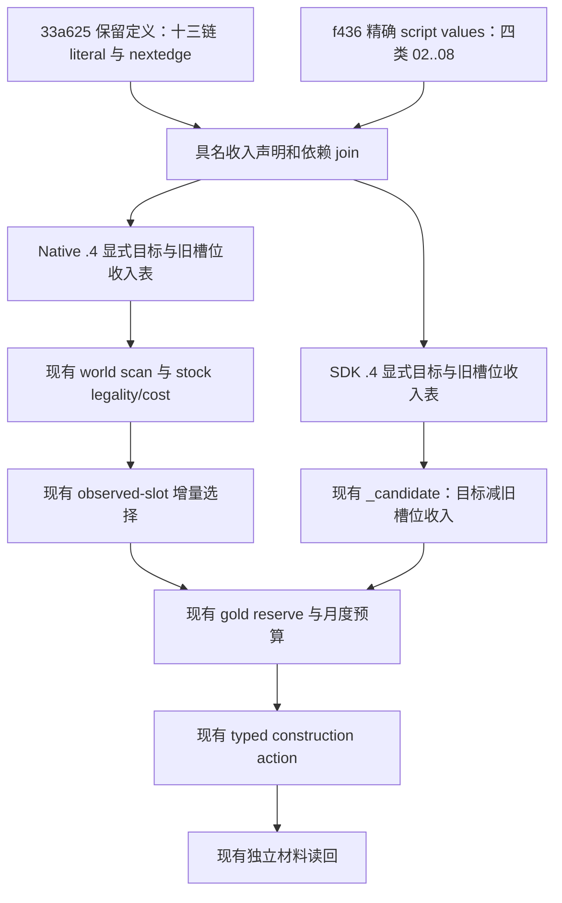

# 其余十三条经济建筑链的实际收入来源（1.20.0.4）

本增量以已采用的 farm_estates/common_tradeport 高阶来源和四条后继经济链为基线，补入其余十三条既有正收入 tier-one 链的 02..08。逐项采用原定义的顶层 `province_modifier.monthly_income`、对应 script-value 声明和实际 `next_building`；十三条链共 91 个新增目标，.4 已知正收入目标从 61 增到 152。新增项同时用于目标收入和实际完成槽位的旧建筑收入比较。

状态为 `SOURCE_ADOPTED_NOT_RUN`。这里只记录源码连接和原文数值，没有执行建筑请求、测试、编译或游戏查询；compiled594 与 G2/M6/M7 实机资格保持原状。

## 原文来源先于实现

保留定义文件是 `artifacts/migrations/2026-09-30/post-update-1.20.0.2/installation/game/common/buildings/00_standard_economy_buildings.txt`，243,292 B，SHA-256 `33a6253e89acd0da1c0242bd441987817dc5386325694f92bbe635f657fbd0e8`。该原件的 .4 内容复用身份已绑定 depot1158311 / manifest5078208590259867811；本轮只读取十三个具名有限片段，没有重新读取安装目录、重哈希或复制全文件。

Script-value 原文来自固定提交的 [00_building_values.txt](https://raw.githubusercontent.com/jesec/ck3-mod-base/074429b3f6d9352a3cf4c5671725fee2f41267ba/base/game/common/script_values/00_building_values.txt)，完整源 SHA-256 `f436f7d9d5ac5506b38d715f0ce02c4f4257eef3addf56597c18a526a6f66825` 与已保留源身份一致。normal、poor、excellent 复用已有精确声明合同；63 的本次必要薄补充只补 good 声明及此前摘录缺少的具名 export 绑定。每个声明都有原表达式和依赖行，不按相邻等级推算。

## 顶层收入与升级边

下表单位为收入百分之一；各行的七项分别对应 02、03、04、05、06、07、08。每条定义链都逐级指向下一项，完整 08 块无 `next_building`。01 的原文表达式和 01→02 边保留为旧槽位对照，既有 tier-one 表继续保留。

| 原始声明类别 | 02..08 原文闭合收入值 |
| --- | --- |
| normal | 55, 75, 95, 115, 135, 155, 175 |
| poor | 40, 55, 70, 85, 100, 115, 130 |
| good | 80, 110, 140, 170, 200, 230, 260 |
| excellent | 115, 160, 205, 250, 295, 340, 385 |

| 原始建筑键前缀 | 实际顶层声明 | 独占来源负责人 |
| --- | --- | --- |
| caravanserai | excellent_building_tax_tier_N | 01 |
| watermills | excellent_building_tax_tier_N | 05 |
| windmills | excellent_building_tax_tier_N | 06 |
| murex_farm | normal_building_tax_tier_N | 07 |
| spice_plantation | normal_building_tax_tier_N | 08 |
| logging_camps | normal_building_tax_tier_N | 09 |
| peat_quarries | normal_building_tax_tier_N | 11 |
| hill_farms | normal_building_tax_tier_N | 14 |
| elephant_pens | normal_building_tax_tier_N | 15 |
| qanats | poor_building_tax_tier_N | 17 |
| quarries | poor_building_tax_tier_N | 20 |
| paddy_fields | good_building_tax_tier_N | 21 |
| cereal_fields | good_building_tax_tier_N | 22 |

每项 literal、行号、定义范围、边和有限原文保存在各来源负责人的小合同，最终采用清单直接引用这些合同。来源合同中的历史暂缺数值通过 63 的真实 export 补充完成依赖连接，例如 excellent tier2；无需重读父定义或改写已冻结合同。

只取上述无条件 province 收入。县税乘数、发展、地形与文化条件、character/county 修正、on_complete 效果和 AI 权重保留各自原义，均不加入此收入表。authored province 值不代表玩家实际税收、条件修正或回报率。

## 两张表接到现有生产调用链

B11-9 已使 world reserve 使用经济表的实际长度，并在既有 .4 分支接入目标和旧槽位 lookup。本增量只扩展 Native `player_world_building_authored_income_v1.hpp` 与 SDK `construction_economic_value_v1.py` 的显式 .4 表。旧 build 的字典和 lookup 保持，未知 key 继续为未知。现有 `_candidate`、formal consumer 和 proposal collector 使用相同收入、增量和预算字段，无需新消费者或键白名单。

原版合法性、成本、实际槽位及链身份、有限扫描和覆盖范围、已有排序与 tie、金钱预留、月度预算、原始 command receiver 和独立 receipt 继续决定能否施工以及是否完成。没有新增门槛或提高扫描上限；收入表扩面不把截断覆盖变为完整覆盖。ACK 仍是 pending。

静态源码示例：实际旧槽位为 paddy_fields_02 时，旧值 80；若原版允许 paddy_fields_03 且现有成本与预算准入，目标值 110，原选择器可比较正增量 30。该例未执行，不声称已升级、收税或收到完成读回。

完整 source-first 顺序和 Native/SDK 精确补丁前后身份由本包最终采用映射记录。此专题接续 [farm_estates/common_tradeport 高阶来源](construction-economic-higher-tiers-12004.md)。

Root adopted 2 production files with this source-first topic.
The existing ordinary construction path consumes the new source-valued keys;
no test, import, build, deployment or game operation followed.
