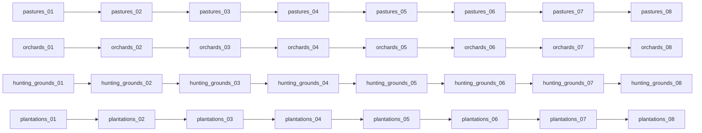

# 四条现有经济建筑链的二至八级收入输入（B11-10）

B11-9 已于 `efe2bc24` 合入并推送，actual .4 的已知目标是十九个原一级 key 加十四个农庄、贸易港升级 key，共三十三个。本包闭合牧场、果园、狩猎场、种植园的二至八级，共二十八个新增 key；两张 .4 表追加这些字面值后为六十一个目标。该输入扩展由现有合法升级路径消费，不增加扫描上限或新的动作类型。

| 建筑链 | 已有一级 | 二至八级 authored income hundredths | exact definitions 收入行（二至八级） |
| --- | ---: | --- | --- |
| pastures | 35 | 55, 75, 95, 115, 135, 155, 175 | 5068, 5129, 5187, 5248, 5310, 5373, 5436 |
| orchards | 35 | 55, 75, 95, 115, 135, 155, 175 | 6196, 6250, 6302, 6354, 6407, 6461, 6518 |
| hunting_grounds | 25 | 40, 55, 70, 85, 100, 115, 130 | 5607, 5686, 5761, 5836, 5915, 5994, 6077 |
| plantations | 25 | 40, 55, 70, 85, 100, 115, 130 | 9685, 9741, 9794, 9847, 9904, 9961, 10018 |

四个 source owner 逐个读取完整 named definition，只选顶层无条件 `province_modifier.monthly_income`。牧场、果园字面字段引用 `normal_building_tax_tier_N`；狩猎场、种植园引用 `poor_building_tax_tier_N`。culture 参数下的种植园 extra income、coastal tax multiplier，以及 county/character/unit 字段、完工 effect、AI 和建造条件不计入这项基础输入。没有缺失或 conditional-only 的目标字段，因此二十八个 key 均有源闭合输入。

所有箭头来自 actual definition 的 `next_building`，四个八级的完整 block 都没有后继。一级至二级的旧槽边分别为 pastures L5015、orchards L6149、hunting_grounds L5536、plantations L9624；一级无条件收入字段分别在 L4990、L6133、L5515、L9605。这里只闭合同一字段、同一链的可比较输入。现有 consumer 仍从实际 completed occupant 取得旧 key，再用其原 lookup 比较 target 与 old-slot 值；已有一级 35/25 沿用已采纳输入。

定义原件是 retained `00_standard_economy_buildings.txt`，SHA-256 `33a6253e89acd0da1c0242bd441987817dc5386325694f92bbe635f657fbd0e8`。其历史 .2 路径标签保留，actual .4 使用来自已采纳 content depot 1158311 / manifest 5078208590259867811；来源规则见 [已采纳建筑源](building-adopted-mcp-migration-12004.md)。

63 使用同一 pinned 外部原件 [00_building_values.txt](https://raw.githubusercontent.com/jesec/ck3-mod-base/074429b3f6d9352a3cf4c5671725fee2f41267ba/base/game/common/script_values/00_building_values.txt)，whole SHA `f436f7d9d5ac5506b38d715f0ce02c4f4257eef3addf56597c18a526a6f66825`，精确闭合新增 normal2 export L1322 和 poor2..8 export L1312..1318；normal3..8 直接复用 B11-9 的闭合原声明。poor base L19 为0.25、scale L29 为0.15、变量 L353..360；normal base L20 为0.35、scale L30 为0.2、变量 L362..369。采用63逐项 exact dependency 的结果，不按 key 名或 ordinal 推数值。

生产增量只需 Native authored-income header 和 SDK .4 income map 的二十八行。原法律过滤、observed slot、cost/cash/reserve、月度预算、排序、coverage bounds、typed receiver 及独立 material receipt 保持既有语义。旧 build 表保持原样。例：实际旧槽 key 若为 hunting_grounds_02，原 stock 合法目标若为 hunting_grounds_03，则基础输入为40→55，可由原 selector 比较15的 authored 增量；当前成本和预算仍由原路径读取。

本包状态为 source closed / authored not run。未运行 tests、应用 imports、build、Game、installed reader 或 RPC；不声称有效税收、实际建造、完成或收入结果。单一 handback 为 owner19 的 `construction-four-chains-tier2to8/SOURCE-ADOPTION-MAP.json`，引用03/24/18/51四个薄合同与63 exact依赖，不复制整份 leaf 或原件。

Root adopted 2 production files with this source-first topic.
The existing ordinary construction path consumes the new source-valued keys;
no test, import, build, deployment or game operation followed.
