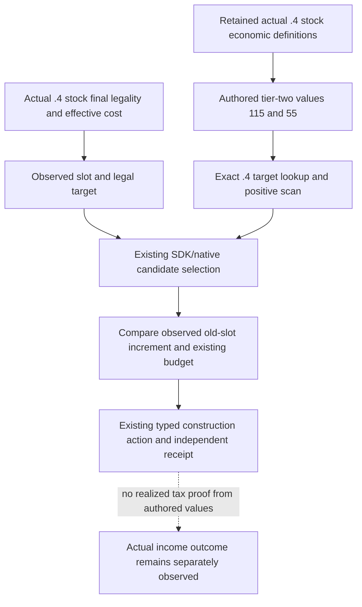

# Two known economic upgrade targets on CK3 1.20.0.4

The existing construction source can observe a legal `farm_estates_02` or
`common_tradeport_02`, but the target-income lookup rejected both keys because
it only selected nineteen tier-one definitions. Their income values were
already retained for comparing an existing slot occupant. This source change
uses those same values as targets on the actual `.4` path.

| Target | Retained unconditional authored monthly income, hundredths | Same-chain tier-one value | Direct authored increment |
| --- | ---: | ---: | ---: |
| `farm_estates_02` | 115 | `farm_estates_01`: 70 | 45 |
| `common_tradeport_02` | 55 | `common_tradeport_01`: 35 | 20 |

These are unconditional province script values. They do not prove realized
province/player tax, return on investment, or a completed building. The actual
observed old slot determines the selector's increment; the table does not force
either upgrade, a particular occupant, or an empty slot.

The retained source is `game/common/buildings/00_standard_economy_buildings.txt`,
original lines 6631 and 4452, SHA-256
`33A6253E89ACD0DA1C0242BD441987817DC5386325694F92BBE635F657FBD0E8`.
Its shared building-values source has SHA-256
`F436F7D9D5AC5506B38D715F0CE02C4F4257EEF3ADDF56597C18A526A6F66825`.
The adopted SDK economic-value source records the unconditional values and
their `.3` inventory origin. The accepted `.4` content-depot reuse is depot
1158311, manifest 5078208590259867811, as recorded in
[the actual building migration source](building-adopted-mcp-migration-12004.md).
No installed game content or executable was reread or hashed for this change.

The production connections are:

- The exact `.4` SDK income lookup feeds the existing transport `_candidate`
  and ordinary formal construction planner.
- The actual `.4` world reader puts these two definitions into the positive
  scan. Its existing stock final legality `2C77D30` and cost `2C247A0` calls
  still supply the legal slot/chain and effective ten-component cost.
- The actual `.4` mailbox calls an explicit `.4` candidate selector. It shares
  the existing increment ranking, observed old-slot comparison, active-state
  exclusion and budget checks. Older callers retain their original public
  selector and tier-one target set.

Only these two retained economic keys are added. Unknown keys, conditional
modifiers and the other existing-only values receive no new target valuation.
The same existing limits still bound the scan; a truncated positive scan does
not become complete coverage. A receiver ACK remains pending, and the original
independent active/completed-slot receipt decides material outcome. Receipt
intent, mismatch classification, income aggregation and current-cash budget
semantics are unchanged.

Status: **SOURCE_ADOPTED_NOT_RUN**. This package performs no tests, project
imports, compilation, linking, SDK/RPC or game execution, and claims no actual
upgrade, completion or income result. Root adopted all six production source files; compiled594 and live readiness remain unchanged.
