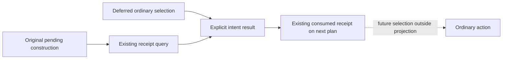

# Construction receipt intent continuity

The existing construction planner sometimes selects a receipt query before the
ordinary selected action. The original pending construction and that deferred
selection now remain explicit in the returned plan/result. A query that confirms
an older building is described as a receipt of that original action.

This reuses the native and planner contracts in
[domain construction AI](domain-construction-ai.md) and the existing
`construction_formal_consumer`/private transport. No new construction is submitted
by this projection; construction eligibility and receipt status rules are unchanged.

The five existing receipt-selection branches retain
`construction_deferred_selected_step`. Service attaches
`construction_selected_intent` after its existing receipt query, associating the
pending request/episode and four-field material tuple with that result. The next
ordinary plan exposes `construction_consumed_intent` for the receipt it already
consumes. Neither field requests replay of the deferred action.

The pure projection distinguishes the requested building, a different observed
building, rollback before the original action and unresolved material results.
Missing original identity stays unknown. A native ACK is not inferred from a
receipt or added as a new gate.

Root integrated63's production source and35's two real Service consumer mounts
from their frozen source594 baseline. This is source adoption only. The owner
cancelled tests and local CK3 operations; imports, execution and new live
qualification for this change are zero. Existing authored cases remain external
and unrun. G2/M4/M6/M7 readiness and saved-day credit do not change.

[63 source/delivery](D:/codex-ck3-background-spill/native71-continuation-20261010/continuation-63/background-g2-offline-20261011/DELIVERY.json),
[35 connected caller delivery](D:/codex-ck3-background-spill/native71-continuation-20261010/continuation-35/background-g2-offline-20261011/FINAL-CONNECTED-DELIVERY.json).
