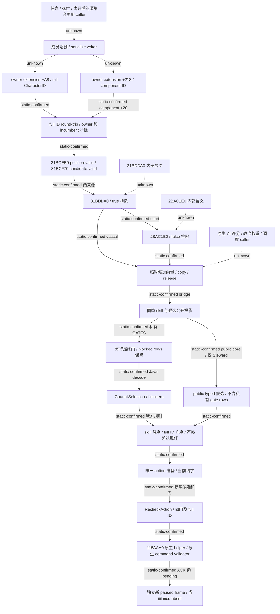

# Council 候选过滤到普通 planner 的当前源树

`machine_id: xenoamess-full-tower-eb9d2c1186`；2026-10-25 UTC 离线核对。原生声明身份为 CK3 `1.20.0.4` / build `25734779` / EXE SHA-256 `98702f88a547cde2eaf29a85f93b85f68ee4cf8148336a4f7afaeb75319dd518`。历史二进制缓存采集机器未核，记为 `machine_id: unknown`。Native 使用冻结 `native10/source60`，Java 使用 Host 可复用 R5 开发树的本次观察；两者不合称已构建或已加载 runtime。复核期限为 `2026-10-26T08:00:00Z`。

本树接续[来源列表回退](council-source-list-null-fallback-12004-resume61.md)，不重做该 131 B 函数。它区分原生候选过滤、我方技能排序以及提交时的最终门，记录下一批具名 filter 源请求；没有新增策略。

原生 `2C47EA0` 的 court 来源是 `owner+1C0/+A8` 的四字节 full CharacterID；vassal 来源是 `owner+1C0/+218` 的四字节 component ID，解析 component 后从 `+20` 取得 Character。两路排除 owner、现任并绑定 owner 上下文，再调用 position-valid `31BCEB0` 和 candidate-valid `31BCF70`。随后两路都从 `2917600(candidate)` 的返回对象构造 `+2374`、`+1E38` 参数，在 `2C4802B` / `2C4826D` 调用 `31BDDA0`，返回 true 时排除。court 分支另在 `2C48043` 调用 `2BAC1E0(candidate, ownerID, GUIbool)`，false 时排除；vassal 分支没有这个调用。这些是直接 caller 事实；尚不把两个未展开 filter 命名为某个脚本变量、关系或评分器。

两条来源集合的成员 add/remove/serialize writer 仍未知。`+218` 的 null 分支在 `2C4811E` 直接使用 `54596D8`；NativeFamily 的婚姻 caller `1A3B9AF` 也引用该地址。这只复用了来源地址，不证明 static data 当前为空，也不能照搬 court 的 `16F2C80` 初始化含义。

Native source60 的 `ReadCouncilCandidates12004` 每次捕获前帧，读取现任实际主技能，初始化并调用原生 producer，复制 full IDs 与技能，释放临时向量，再独立捕获后帧。它不维护 `+A8/+218` 来源集合。私有 action 的 `RecheckAction` 又调用同一候选 reader，要求候选恰好出现一次与 full ID round-trip，再调用实际 gate evaluator。occupied 门会调用原生 CanConfirm；vacant 不把缺失现任转换为“已通过解职”。原生 helper ACK 不证明队列接受或换人，`VerifyCouncilAssignCouncillorActionReceiptV1` 仍要求新的 paused/map-ready 帧、同 owner/position/full task 以及候选实际成为 incumbent。

当前 Java 的 `GovernanceCouncilSupplier` 每次转发真实私有 port。`NativeCouncilReadPort` 创建本轮 GATES/STATUS 请求并从实际封存回执归一化。`CouncilSelection.decodePayload` 保留每行 `final_gate_available`、已经是 councillor、guest、pending interaction 与 occupied CanConfirm 对应的 blockers。`choose` 在没有 blockers 的行中按主技能降序、full ID 升序选择；有现任时只接受严格的技能提升。这个确定性规则属于我方 planner，不能称为原生 AI 评分。

普通 Council 阶段只在原本将 life-advance 时评估，先消费实际 domain/pending/cadence 状态，再按 Steward、Chancellor、Chaplain 顺序查看本轮读回。公共 core 的旧 Council19 点只消费 Steward 公开 typed 候选，不附加私有 gate rows；当前提交路径仍执行上面的原生候选和最终门重验。这里只记录两条实际源路径的区别；没有真实重复失败或生产复现，因此不据此新增 guard、改排序或宣称缺陷。

下一源入口已交唯一 `b64_execution`：`31BDDA0..31BDE82` 的 226 B 与 `2BAC1E0..2BAC261` 的 129 B（共 355 B / 两窗）。范围来自原缓存 `NEW-PDATA-DIRECTORY.bin` 的有界二分。本次三目标检索合计读取该缓存 696 B / 58 次，包含 `2917600` 未找到 containing unwind 的 240 B / 20 次；没有读 EXE。两个 filter 的范围是 unwind 范围，须收到结果并检查 RET、尾跳和分支后才判断完整逻辑体。成员 writer、原生 AI 分数和更新 cadence 继续分别未闭；不等这批研究替代首场必要软件或游戏验收。

精确源引用见 [SOURCE25](D:/codex-ck3-background/ck3-java-g2-resume-r4-20261025/resume61/native_governance/COUNCIL-FILTER-PLANNER-SOURCE25.json)。本轮无生产修改、编译、JUnit、原生执行或 Game 验收。
