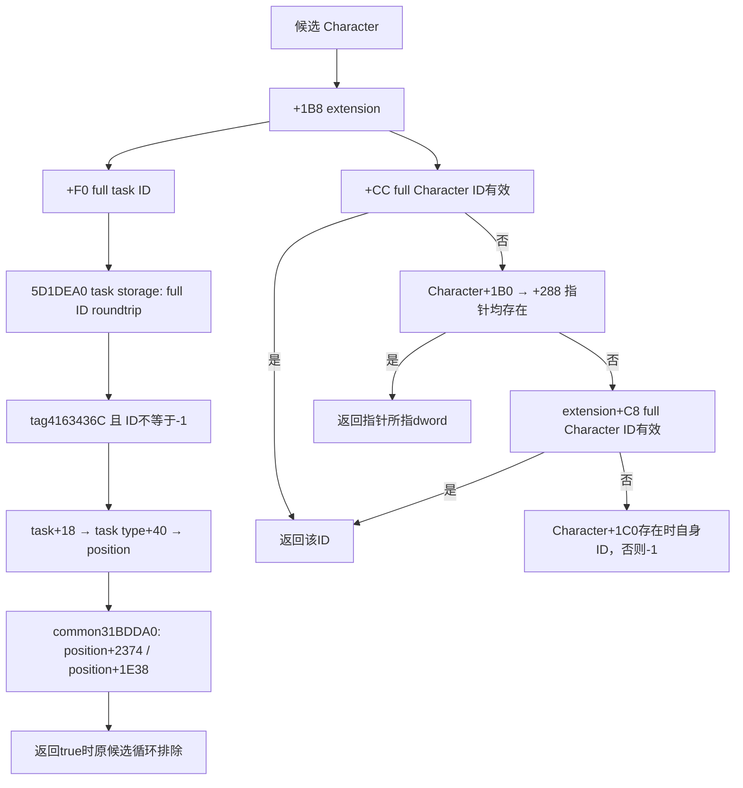

# Council 候选当前席位与第二 ID 的实际来源

machine_id: `xenoamess-full-tower-eb9d2c1186`。观察时间：2026-10-25T22:39:41Z；用途复核：2026-10-26T08:00:00Z。来源为统一采样岗 batch03 的两段实际字节，438B。完整引用在 `resume61/native_governance/COUNCIL-CANDIDATE-POSITION-ID-SOURCE29.json`；本岗未读取 EXE、执行原生函数或启动 Game。

新证据把 [过滤器专题](council-native-filters-and-confirmation-mode-12004-resume61.md) 的两条未知输入向上接通。共同过滤器使用的对象不是候选 Character 的 extension 本体；它来自候选当前 active Council task 的 task type，再取该 type 的 position。宫廷分支的第二 ID 则是一个有明确优先顺序的多来源读取结果，不能仅凭最终 owner 比较便命名为 guest/employer。

`2917600` 收到的采样范围仍登记为 176B prefix。实际首个入口的所有可达路径都在前 170B 内返回，后 6B 是 `int3`；46 条指令、11 条条件跳转均在这 170B 内，无 CALL。该结论不依赖假定下一 unwind 的名字或扩大 prefix 范围。

该入口读 `Character+1B8` 和 `extension+F0`，使用 task storage `5D1DEA0`、task fallback `5D1DDF8`，按低 24 位索引并核完整 ID `+10`，再检查 `+14 == 4163436C` 和 ID 非 `-1`。通过后重新解析同 ID，返回 `task+18 -> type+40`；无 extension 或类型/ID 检查失败时返回全局槽 `5D1F7A0` 的值。该槽实际数据和默认对象内容没有采集。

source60 的 `ck3_12004_council_candidates.hpp:27–33` 已持相同 storage/fallback、task type `+18` 和 task-type position `+40` 合同。因此当前闭合的是候选所持 task 的 position 路径；没有把 `4163436C` 单独当作新 RTTI 类名证明。调用者随后把此 position 的 `+2374` 与 `+1E38` 交给 `31BDDA0`。两个字段的正式脚本名称仍待 parser 或具名 getter 证据，不能直接命名为 `can_reassign` 或 `can_change_once`。

`28C0160..28C0266` 是完整 262B unwind 区域，69 条指令，无 CALL，16 条条件跳转均在区间内。其输出顺序如下：

1. `+1B8` 为空，立即写 `-1`。
2. 否则尝试 extension `+CC` 的完整 Character ID，要求 storage 容量、完整 generation、Character tag 与 ID 非 `-1`；成功即输出原 ID。
3. 失败后，若 `Character+1B0` 与其 `+288` 指针均非空，直接输出该指针所指 dword。此分支没有 Character generation/tag 校验；即使该 dword 为 `-1`，也不会继续尝试下一项。
4. 两指针路径不成立，再对 extension `+C8` 做同样的完整 Character ID 解析。
5. 仍不成立时，`Character+1C0` 非空便输出自身 `+18` ID，否则输出 `-1`。

该读取器只直接写栈暂存与调用者提供的输出 dword，不写这些成员。原 `2BAC1E0` GUI 特例使用上述结果比较目标 owner；其普通路径仍要求 `28BFC50` 返回对象的 ID 等于 owner，且 extension 不存在或 `+CC == -1`。所以不能把某一回退来源当作所有情况下的唯一宫廷关系。

原生 AI 人选评分、持久成员 writer、这些关系字段的正式业务名称、引擎任命/空缺调度 caller 仍未闭合。已有 Java/native 候选与最终提交合同无需根据这次只读研究改动；无编译、测试、运行或新任命信用。
