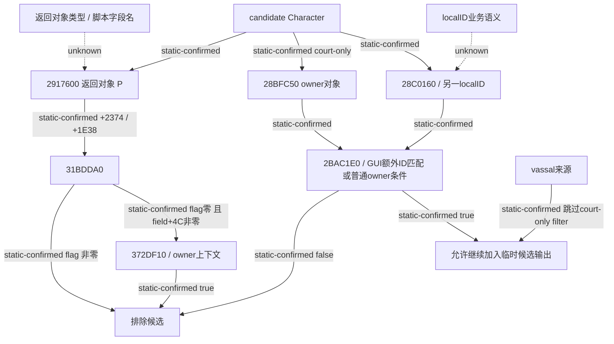

# Council 原生过滤与确认 mode 的实际来源

`machine_id: xenoamess-full-tower-eb9d2c1186`；解释时间 `2026-10-25T22:12:45Z`，复核期限 `2026-10-26T08:00:00Z`。唯一执行者 `b64_execution` 的 batch02 于 `22:08:31Z` 交付三窗 483 B；本岗实际核对三个 raw 的字节数、SHA 与反汇编。采集结果记录 input CLOSED、unknown read outcomes 0 和三阶段退出；本岗没有重新取得整个执行资格，也没有运行游戏。来源身份是 `1.20.0.4` / `25734779` / EXE SHA-256 `98702f88a547cde2eaf29a85f93b85f68ee4cf8148336a4f7afaeb75319dd518`。

本次实际展开了[此前候选源树](council-candidate-filter-planner-tree-12004-resume61.md)中的两个未知 filter，并闭合 CanConfirm 的一个寄存器问题。没有据此改策略、门禁或 ABI。

`31BDDA0` 的 226 B 正常路径完整闭合：先读取第二参数指向的一个 byte，非零就返回 true；byte 为零时，再看第三参数 `+4C` 的 dword，零则返回 false。非零则构造局部上下文，填入 literal word `4` 与 owner fullID，调用 `372DF10` 并返回其 AL，随后释放局部临时存储。两条原生候选来源都会在该返回值为 true 时排除候选。因此这是一条直接 deny flag 加可选布尔求值的路径，没有产生候选效用分数。

这里保留一处来源更正：旧请求26称 `+2374/+1E38` 来自候选的 unlanded extension，证据不足。原生 caller 实际先调用 `2917600(candidate)`，再相对其返回对象取这两个地址。该返回对象的类型尚未闭合；本次不命名具体脚本字段，也不把它当作 court 成员索引。

`2BAC1E0` 的 129 B 也有完整正常路径。它调用已持的 `28BFC50(candidate)` 得到 owner 对象 C，再通过 `28C0160(candidate,&localID)` 取得另一 ID。当 GUI 模式为 true、C 未通过 Character tag / 非 `-1` 身份检查且 localID 等于请求 owner 时，额外接受该候选。其余路径要求 C 的 fullID 等于请求 owner，并且候选 `+1B8` 为空，或该扩展 `+CC` 为 `-1`。失败则返回 false，由 court 来源循环排除。vassal 来源循环没有调用这条 filter。`28C0160` 和 `+CC` 的业务名仍未知，不按结果猜成 guest、employer 或其他角色。

第三窗按 128 B prefix 采集。其首入口 `A66CA0` 的全部可达路径实际上在 `A66CD8 RET` 结束，长度 57 B：它通过 `5D1DEA0` 的 storage、low24 索引界限和对象 `+10` 的全 ID 相等检查解析 task，失败返回 `5D1DDF8` fallback。没有 CALL、间接跳转或 R9 写入；所有分支都在首入口体内。后面是 padding 和另一个 lookup，不能把整窗称为一个函数。

这使旧 CanConfirm 的 mode 变得可证：`1160533` 清零 R9D，`116053D` 设置 `R9B=(candidateID!=-1)`；该 helper 保留 R9，之后到 `11605AD -> 2C477C0` 之间没有其他调用或 R9 写入，所以最终 mode 为候选 ID 是否存在的 0/1。旧手册在 helper 未展开时保留 UNKNOWN 是正确边界；现在由新增原件关闭。Clergy 单独 CanFire 的 mode 0 与 replacement CanConfirm 的 mode 1 仍分开；当前桥接字段 `incumbent_can_be_fired` 记录原版组合 CanConfirm 结果，不能据名字改成手写的独立解职条件。

下一批只追两个真实剩余 callee：`2917600` 的返回对象与 `28C0160` 的 localID 来源，已向唯一执行者提出 176 B prefix 加 262 B unwind 范围的新批请求。没有扩大旧卡。来源集合的持久成员 writer、原生 AI 人选评分和调度仍未知；我方普通 planner 的严格技能提升规则仍是我方规则。

精确 raw、caller、寄存器结论及更正见 [SOURCE27](D:/codex-ck3-background/ck3-java-g2-resume-r4-20261025/resume61/native_governance/COUNCIL-FILTER-CALLEES-SOURCE27.json)。三 raw SHA 分别为 `294c62224bdd23df2ec71cb915ab48e05955df1eab9e6556aadd620a71b7eef2`（226 B）、`b4be3563facf2a55f785b5d31aed15058c353866c74e8cfae69b1f1be84cba39`（129 B）与 `19201a3cad109b803aa4ef6fcbc46df53c049f3ff72883a47422a79414f254aa`（128 B）。无生产改动、编译、JUnit 或实机验收信用。
