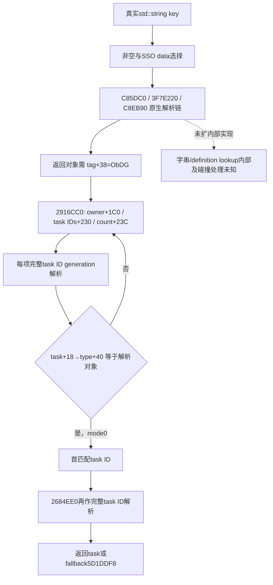

# Council key 到 owner task 的实际缓存链

machine_id: `xenoamess-full-tower-eb9d2c1186`。观察时间：2026-10-25T23:18:54Z；复核：2026-10-26T08:00:00Z。历史映射采集的机器身份仍为 `unknown`。此次只读两个既有 mapped cache，共 658B，无新 EXE 读取或原生执行。

ROOT 的 `Position` 行按 requested key 写入，但它调用的原生 `2684EE0` 并非只返回任意非空 task。既有完整体显示：入参 key 先经原生 definition 解析链，随后 `2916CC0` 明确比较 owner task 的 `task+18 -> type+40` 与解析所得 definition 指针相等，才返回 task ID。ROOT 自己的列表唯一性和完整身份检查仍是另一个已持生产者合同，本体不会替代它们。

`2684EE0..2685038` 的 344B 包括最后 1B `int3`；入口正常体为 343B、84 条指令、13 条局部分支。它检查 string `+10` 非零，按 capacity `+18` 是否达到 16 选择 data 指针，再取得零终止长度。`3F7E220` 的结果 EAX 被送给 `C8EB90`，数据库上下文来自 `C85DC0`。本次没有扩展这三个 helper；“hash”只能作为这段键解析的推断简称，不是已证明的函数名称或完整比较算法。

返回对象的 `+38` 必须是 `4744624F`（ObDG）。通过后以 owner、输出 ID、该对象指针和 `R9D=0` 调用 `2916CC0`。返回 ID 再经 task storage `5D1DEA0` 的低 24 位边界及完整 ID `+10` 校验，失败使用 `5D1DDF8`。无效 definition 分支还有未展开的调用和全局 dword 的 `lock xadd`；不能把整个 wrapper 宣称为没有任何写入的纯函数。

`2916CC0..2916DFA` 的 314B 包括最后 1B `int3`；正常体为 313B、86 条指令、16 条局部分支、无 CALL。它遍历 owner `+1C0` extension 的 `+230` 四字节 task IDs 和 `+23C` count，用相同 storage/fallback 解析每项，然后比较 `task+18` 所指 type 的 `+40` 与传入 definition 指针。mode0 返回第一个匹配 task 的完整 `+10` ID，不要求席位已占用或空缺。另一 mode 会继续根据 incumbent 的 Character 解析分支筛选，本次 key lookup 固定传 0，不将它改造成 vacancy-only 查找。

这条链直接闭合了 task position 指针匹配，不是直接读取 type key 字符串。原生 definition helper 的内部实现、异常/无效数据状态及所有间接来源未补齐；不据此判定生产故障、增加测试伪造的坏 lookup 或新增 guard。原生人选评分、成员 writer 和任命/空缺调度不在本次范围。

精确缓存、迁移 DETAIL 与检查范围见 `resume61/native_governance/COUNCIL-POSITION-TASK-LOOKUP-SOURCE33.json`。完整新缓存都逐字节等于各自 DETAIL.new，完整 normalized old/new 相等；本岗没有把旧版 ABI 当作当前安装或实机资格。Java 编译与 CK3 验收均未执行。
