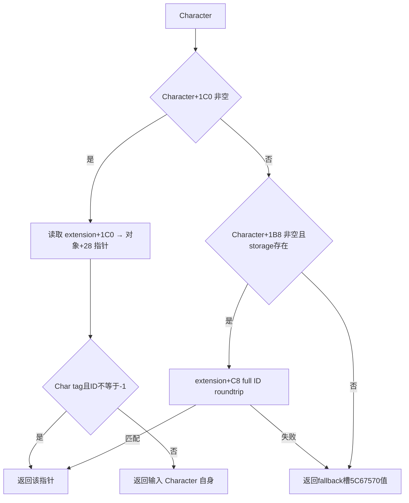

# Council 主关系读取器的既有完整缓存

machine_id: `xenoamess-full-tower-eb9d2c1186`。本次观察：2026-10-25T22:43:28Z；复核：2026-10-26T08:00:00Z。原历史采集未核机器身份，保留 `machine_id: unknown`。本岗只读既有缓存，没有新 EXE 读取或 Game 执行。

`2BAC1E0` 的两条输入现在都能追至实际读取体：[前一专题](council-candidate-held-position-and-secondary-id-12004-resume61.md) 闭合第二 ID，本次找到主关系 getter `28BFC50..28BFCC6` 的既有完整 118B。它包含 31 条指令、8 条区间内条件跳转、无 CALL，无直接内存写入。

两支的验证不同：`+1C0` 支路直接检查所取指针的 `+1C` Character tag 和 `+18 != -1`；`+C8` 支路做完整 ID/generation 比较，但本体没有另查 Character tag。失败/空输入 extension 使用 Character fallback 槽；本次没有读取其数据或授予空值语义。主读取器与第二 ID 读取器不是同一函数，后者的 `+CC`、`+1B0/+288` 路径不能补到本体中。

来源是现有 faction `leaf01/immediate_liege-DETAIL.json` 与 shared-span-cache。原映射使用两侧相邻 runtime 边界的一致偏移定位 `old28BFC70 -> new28BFC50`，再比较完整 118B；没有用统一 RVA 漂移代替实际体。此次实际核对：旧 ABI 的 118B 全等于 DETAIL.old，DETAIL.new 全等于缓存原始 118B，完整 normalized 字节相等，两个 RIP data 槽的 old/new 目标分别保持 `5C67568` 和 `5C67570`。完整条件跳转的局部拓扑也相等。

旧 `immediate_liege_self_12003_abi.json` 明确属于 1.20.0.3，称该函数为 immediate-liege/self，并记录旧生产者将返回自身解释为独立角色。它作为旧具名合同与完整字节迁移的上游保留，不能被写成新鲜的 1.20.0.4 安装/实机观测。faction 研究岗也明确该映射只补字节迁移及旧具名输入，不能补 court writer 或所有关系字段的业务含义。故本次继续使用“主关系读取器”描述这条 Council 调用边。

这一结果补全了候选过滤器的实际输入来源，不改变成员集合、评分、最终合法性或 Java 策略。持久成员 writer、`+2374/+1E38` 的具名字段、原生 AI 评分及任命/空缺调度仍未闭合。精确引用和检查范围见 `resume61/native_governance/COUNCIL-PRIMARY-RELATION-SOURCE30.json`。
