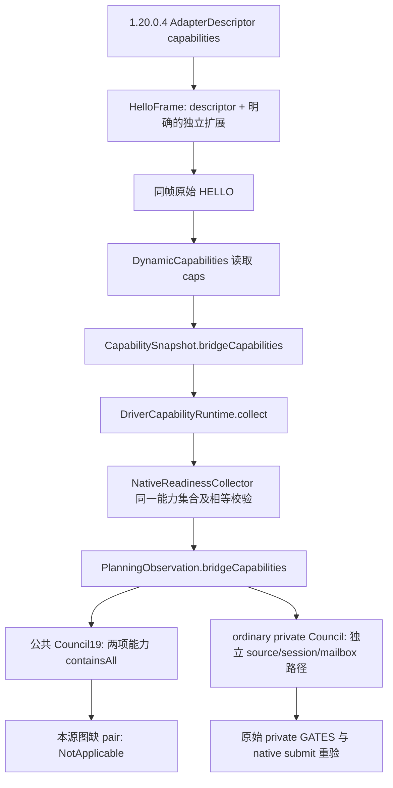

# Council 公共能力声明的实际生产路径（resume61）

machine_id: `xenoamess-full-tower-eb9d2c1186`。观察时间：2026-10-25T22:28:05Z；用途复核：2026-10-26T08:00:00Z。本次只读审查 source60 原生源码和 Host 可复用 Java 开发源码，未核验已加载 DLL，未编译、运行测试或启动 CK3。

当前源图不会让公共 Council19 路径获得两个必需的公开能力。普通规划器的 private Council 路径独立存在。因此，先前看到 `CouncilSelection.fromComposition` 不包含 private 最终门禁行，不能由此认定普通 Council 当前存在绕过门禁的业务故障，也不据此增加反制或修改策略。

原生 `src/ck3_12004_adapter.cpp:54–191` 的完整能力表没有 `game.query.council-composition-candidates-v1` 或 `game.action.assign-councillor-v1`。`src/bridge.cpp:2292–2374` 的整个 `HelloFrame` 遍历该表，额外扩展只有 rite、player-control、lifestyle、prewar、war overview/results 和 mandatory choice；没有 Council 扩展。不能因为头文件中存在 capability 常量，便认为 HELLO 实际公布了该能力。

Java `DynamicCapabilities.java:249–256` 从原始 HELLO 收集集合，`:348` 将同一集合写入 `bridge_capabilities`。`DriverCapabilityRuntime.java:454–457` 返回该 snapshot 的集合。`NativeReadinessCollector.java:1084–1089` 将其放入当前捕获，`:590–600` 要求 planning inputs 的集合与当前 projection 相等，然后构造 `PlanningObservation`。这里没有补造 Council 能力。

消费者 `GovernancePolicies.java:169–171` 明确要求上述两项同时存在，否则公共 Council19 返回 `NotApplicable`。`:181` 开始的普通 private Council 是另一个入口；它的原生候选、过滤、Java 选择及最终提交连接见 [候选与 planner 树](council-candidate-filter-planner-tree-12004-resume61.md)。本结论不表示 private 路径已经实机完成，也不授予将来新增公开能力后的业务资格。

精确引用在 `D:/codex-ck3-background/ck3-java-g2-resume-r4-20261025/resume61/native_governance/COUNCIL-PUBLIC-CAPABILITY-SOURCE28.json`。Java 引用绑定本次观察内容，不追认为冻结 runtime 的来源。仍未闭合的前沿是候选成员 writer、任命/空缺引擎更新 caller、原生 AI 评分，以及等待统一采样返回的两个实际 callee；本笔记不声称补齐这些未知。
