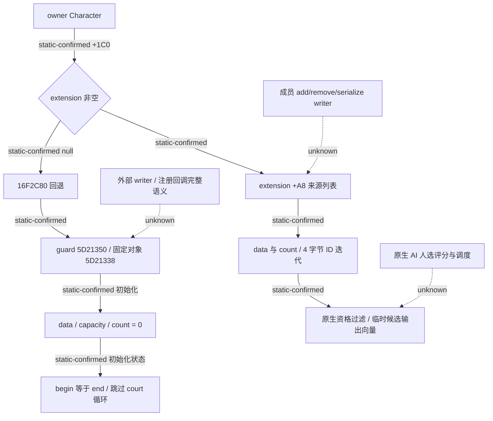

# Council 候选源集合的空扩展回退

`machine_id: xenoamess-full-tower-eb9d2c1186`；观察时间 `2026-10-25T21:38:46Z`。这是现有缓存的静态研究，原始采集机器为 `machine_id: unknown`。声明来源为 CK3 `1.20.0.4` / Steam build `25734779` / EXE SHA-256 `98702f88a547cde2eaf29a85f93b85f68ee4cf8148336a4f7afaeb75319dd518`；不证明当前安装、部署或实机状态。复核期限为 `2026-11-01T21:38:46Z`。

本轮从已有共享缓存找到了完整 `0x16F2C80..0x16F2D03` 的 131 字节函数，完整解码 131 字节；没有读取 EXE。它回答了旧 Council02 的 128 字节待采计划所问的回退类别，因此这个问题无需再采一次。旧计划和旧未执行结论原样保留。

原生候选生产者 `0x2C47EA0` 在 `0x2C47F3B` 读取 owner 的 `Character+0x1C0`。非空时使用 `extension+0xA8`；为空时在 `0x2C47F4F` 调用回退函数。两条路随后读取列表 `+0` 的 data 与 `+0xC` 的 signed count，计算 `data + count * 4`。begin 等于 end 时，原生代码跳过这段 court 候选循环。这是候选的来源集合；生产者另有自己分配、复制、释放的临时输出向量。

回退函数使用线程 epoch 与 `0x5D21350` 的 guard。快路径返回固定对象地址 `0x5D21338`；初始化路径把该地址及 `+8` 的两个 qword 清零，把 `+0x10` 设为 `0x54DE398`，然后注册 `0x433B360` 回调并结束 guard。按直接调用方读取的字段，初始化时 data、capacity、count 均为零。函数没有写入 Character 扩展、owner 成员集合或成员 ID。

线程 epoch、guard、固定对象地址与回调注册符合进程静态容器的初始化形态；具体运行库符号名与回调语义仍是推断。初始化的零 count 能解释直接调用方跳过 court 循环，不能证明整个进程寿命中没有其他 writer，也不能据此给实际空列表附加 AI 评分或成员更新含义。

下一定位目标仍是实际 `extension+0xA8` 与 `extension+0x218` 的成员增删、序列化 writer 和失效回调。回退初始化不是这些集合的 writer。GUI 候选顺序、原生 AI 政治权重和我方桥接策略也继续分开。

精确原件与逐指令范围见 [SOURCE23](D:/codex-ck3-background/ck3-java-g2-resume-r4-20261025/resume61/native_governance/COUNCIL-FALLBACK-SOURCE23.json)。关键原件为 `Z:/ck3_mod_rewrite_process_assets/g2-background-20261007/upstream-build-migration/shared-span-cache/new-016F2C80-016F2D03.bin`（131 B，SHA-256 `028f1ba1dd7ccbde71a4134dd15bbd5db947c8763144bc9c8636bbb8ae8040ae`），调用方为 `council-government/native-candidates/capture01/council_candidate_producer-DETAIL.json`（SHA-256 `08fd1c707d9bac92f43fb6fdf95e8df93b730e18668efe2e9dce67b0ab40f0d9`）。没有生产代码改动、构建、JUnit、原生执行或 Game 验收信用。
