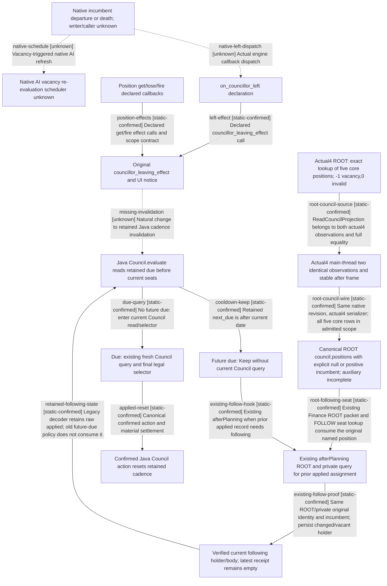

# Research plan: council-vacancy-cadence-invalidation-12004-resume61

GENERATED from the supplied research plan; no native semantics are inferred.

Question: Does a natural Council vacancy or a vanilla councillor-leaving hook invalidate the currently selected Java optional Council cadence before its future due date?



| Edge | Declared status | Evidence IDs | Open question |
|---|---|---|---|
| native-left-dispatch | unknown |  | Locate the current-build incumbent writer and exact on-action dispatch; script comments do not close this edge. |
| left-effect | static-confirmed | on-actions, effects |  |
| position-effects | static-confirmed | positions, position-schema, effects |  |
| native-schedule | unknown |  | Does the engine refresh Council AI immediately, at a pulse, or via a dirty cache after each departure cause? No .4 native caller is located here. |
| missing-invalidation | unknown | java-policy, java-cadence, java-model | No such producer appears in reviewed selected modules. Establish a typed fresh native source and one same-writer revalidated transition before implementing invalidation. |
| cooldown-keep | static-confirmed | java-policy, java-cadence |  |
| due-query | static-confirmed | java-policy, java-cadence |  |
| applied-reset | static-confirmed | java-action-reset, java-cadence |  |
| existing-follow-hook | static-confirmed | java-follow |  |
| existing-follow-proof | static-confirmed | java-follow |  |
| retained-following-state | static-confirmed | java-state, java-policy |  |
| root-council-source | static-confirmed | native-root4, native-root4-contract |  |
| root-council-wire | static-confirmed | native-root4, native-root-route |  |
| root-following-seat | static-confirmed | native-root-route, native-root4, java-follow |  |

| Observation design | Value |
|---|---|
| mode | offline-only |
| actor_kind | engine |
| owner_scope | Vanilla Council owner/councillor scripts and current H5 Java ordinary Council policy; no Game is accessed. |
| identity_kind | definition-key |
| identity_lifetime | Script keys are bound to the pinned installation files; actual incumbent generation identity and engine dispatch are not observed. |
| producer_trigger | on-action |
| producer | Script on_councillor_left -&gt; councillor_leaving_effect and position get/fire callbacks; actual engine vacancy writer/caller remains unlocated. |
| caller | Vanilla callback declarations and actual Java GovernancePolicies.Council.evaluate; the native callback dispatch is unknown. |
| consumer | Java OptionalCheckCadence.deferred and GovernanceCadenceActions.publish/reduce. |
| cache_lifetime | Java future due is 720 raw hours = 30 days; episode change and confirmed actual Java governance action have explicit transitions. Natural vacancy invalidation input is absent from reviewed selected governance modules. |
| expected_signal | Source branch ordering: Council.evaluate returns Keep on future cadence before councilRoot/current candidate query. Script callbacks supply notifications/effects but no connected Java invalidation producer. |
| zero_sample_meaning | This offline review collects zero live samples; no native vacancy, AI refresh cadence, event firing, Java runtime delay or game result is inferred. |
| stop_condition | Bounded read-only review of named installed scripts and exact held Native/Java sources; no binary sampling or Game access. Separate Java candidates13/14 remain unadopted and unexecuted. |
| runtime_window_ref | None |

| Evidence ID | Declared layer | File | SHA-256 | Supports |
|---|---|---|---|---|
| installation | exact-build | D:/codex-ck3-background/ck3-java-g2-resume-r4-20261025/resume61/formal_release/INSTALLATION-WITNESS01.json | b231f7f355062b573d32704d227316d6debe6e421e6f29e78bde88fcd33be0b9 | Same-machine metadata witness of installed 1.20.0.4/build25734779; reuses prior full hash, does not newly rehash EXE or prove loaded runtime. |
| on-actions | source-contract | Z:/SteamLibrary/steamapps/common/Crusader Kings III/game/common/on_action/councillor_on_actions.txt | 4f7e9646703314d783957d58fdb51434e108dde0ef0088422de44422b06cdcb7 | Lines1-39 declare leave/fire delayed events and on_councillor_left calling councillor_leaving_effect; comments state scope/call order, not a binary dispatch proof. |
| effects | source-contract | Z:/SteamLibrary/steamapps/common/Crusader Kings III/game/common/scripted_effects/00_councillor_effects.txt | 48105e7f44a132c1b65ef6a3609893901086a930309a16cf9ab2d648800cab46 | got/fired effects at15/73 change original flags/opinion; councillor_leaving_effect at732 checks departed councillor relation and emits departure notifications. No Java cadence input is declared. |
| positions | source-contract | Z:/SteamLibrary/steamapps/common/Crusader Kings III/game/common/council_positions/00_council_positions.txt | 31fa258dfbf35a07e9ee08d1d1dfdcd26712d3974cd65ec74255c284e4df0a2a | Chancellor/Steward/Marshal/Spymaster declared get/fire callbacks call corresponding original effects; not proof of native incumbent writer or AI scheduler. |
| position-schema | source-contract | Z:/SteamLibrary/steamapps/common/Crusader Kings III/game/common/council_positions/_council_positions.info | 3018b801e7fe01aad8d8b2f78fa691da4e6924737f4430f0ed19757f03d67b29 | Lines39-69 document assign validity/get/lose/fire scopes and lose-before-fire ordering, a source contract only. |
| java-policy | source-contract | D:/codex-ck3-background/ck3-java-g2-resume-r4-20261025/resume61/governance_ordinary/compile12/GovernancePolicies.java | c764f500a835cb5a60cc3b12243fb97b944057cf4539e701ad6611eeda1ebeb0 | Current H5 exact policy plus API-only repair: normal Council checks pending/scene and cadence before current councilRoot/candidate reads. Policy logic unchanged by compile12. |
| java-cadence | source-contract | D:/codex-ck3-demos/2026-10-25-java-g2-complete31-h5r5/java/ck3-control/planning-runtime/src/main/java/org/xar/ck3/control/planning/optionalcadence/OptionalCheckCadence.java | 361e4205bc3de8ecfec3c8d7bc1805d20d57b5e0fe6c1dd087ec8146d49323ea | deferred checks only episode/date against retained row; record(actualAction=true) clears due; third complete no-action and technical read failure set future due. No vacancy invalidation transition is present. |
| java-model | source-contract | D:/codex-ck3-demos/2026-10-25-java-g2-complete31-h5r5/java/ck3-control/planning-runtime/src/main/java/org/xar/ck3/control/planning/optionalcadence/CadenceModels.java | 393dedbbfe13f1c1579284cbe625cdc5779d6f479d92b35b8e8bd7162e39c553 | RAW_PER_DAY=24 and COOLDOWN_RAW=720. Retained row has no Council incumbent/seat fingerprint. |
| java-action-reset | source-contract | D:/codex-ck3-demos/2026-10-25-java-g2-complete31-h5r5/java/ck3-control/local-service/src/main/java/org/xar/ck3/control/service/root/GovernanceCadenceActions.java | 968790d3a0d27da671225f743b52512b1786d3c58e54ad2d4fe5d19f34845c8c | publish/reduce accepts canonical APPLIED_CONFIRMED governance action receipt with material verification; Council action maps to Council row reset. Natural engine vacancy is not such a receipt. |
| java-follow | source-contract | D:/codex-ck3-background/ck3-java-g2-resume-r4-20261025/resume61/governance_ordinary/cadence13/RootGovernanceDomains.before | 9d6f933229b3e48b668447264cabfc641c67ab0f7f4eb3980a73ab6243c88cd8 | Exact retained current H5 predecessor: afterPlanning already obtains ROOT/private Council originals for prior applied assignment; FOLLOW reducer verifies archive, complete request identity and matching incumbents, retaining current changed/vacant position and next_turn_consumed=false. |
| java-state | source-contract | D:/codex-ck3-background/ck3-java-g2-resume-r4-20261025/resume61/governance_ordinary/compile12/GovernanceStateSupplier.java | 725913106f124741a3de6e3c704d972e408e27ef45d7e4415ee58be126a62dd6 | Current H5 exact StateSupplier with API-only repair retains applied JSON while intentionally keeping ActionReceipt.latest empty; real body read binds actual head/slot/schema/complete producer sources. |
| native-root4 | source-contract | D:/codex-ck3-background/ck3-java-g2-resume-r4-20261025/native10/source60/ck3_autonomous_player/native_bridge/src/ck3_12004_campaign.cpp | f3cf628798f63daf996f4905d1f634cb8e11ac4f2e404a531172e96b44a9c279 | Actual4 ReadCouncilProjection1515-1588 iterates five fixed core keys via exact2684EE0 lookup, task storage and owner task-list uniqueness; Position1423-1448 represents incumbent -1 as null and rejects0; scope772 excludes landless/nomadic/celestial. Outer921/974-1004 reads two observations and checks stable after frame; default equality125 includes Council and diffmask136 identifies it. Serializer3311-3320 emits every position incumbent field. |
| native-root4-contract | source-contract | D:/codex-ck3-background/ck3-java-g2-resume-r4-20261025/native10/source60/ck3_autonomous_player/native_bridge/include/xar_bridge/ck3_12004_campaign.hpp | 03738f2c5d81a2b920a1f45442475dae7c58023a652095bc873990859f1cd339 | Actual4 native environment adds exact council-position lookup; declared ReadCampaignRootContextV1 and serializer are actual4 entry points, not legacy11906 projection inference. |
| native-root-route | source-contract | D:/codex-ck3-background/ck3-java-g2-resume-r4-20261025/native10/source60/ck3_autonomous_player/native_bridge/src/bridge.cpp | c4b78a7e9fa1e51752fbca374fa30e7f09bfec65eeb3776d5cf478f523c1284c | Typed actual4 campaign callback11675 uses ReadCampaignRootContextV1; preflight13758-13814 binds expected snapshot/revision and application-main mailbox. Result13917/7866-7905 selects actual4 serializer and emits query-campaign-root-context-v1 campaign_root_context. |

Check result (file integrity and declarations only):

```json
{
  "schema": "xar.native-research-plan-check.v1",
  "result": "plan-consistent",
  "proof_layer": "record-structure-and-file-integrity",
  "semantic_correctness_verified": false,
  "live_execution_performed": false,
  "observation_plan_issues": [
    "offline-only plan does not define a live observation window"
  ],
  "declared_edges_by_status": {
    "counter-policy": 0,
    "inference": 0,
    "live-confirmed": 0,
    "static-confirmed": 11,
    "unknown": 3
  },
  "enumerated_native_edges": 14,
  "declared_cases_by_status": {
    "pending": 3,
    "observed": 0,
    "not-applicable": 0
  },
  "checked_evidence_files": 14,
  "limitations": [
    "Evidence layers and conclusions are author declarations; hashes bind bytes, not their truth.",
    "Counts cover this enumerated graph only, not all CK3 branches.",
    "A consistent observation plan is not authorization to run or manipulate CK3."
  ],
  "plan_sha256": "4f93f08cf176449580bf4e4fc8cbffe27dc3732ff448cbc299e5c6456c4bdd06"
}
```
