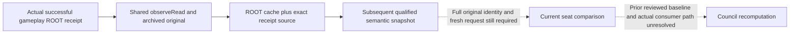
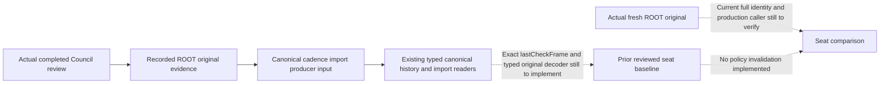

# Council departure callbacks and the Java cadence boundary

`machine_id: xenoamess-full-tower-eb9d2c1186`. Static source review on 2026-10-26
Beijing time. The installation witness observed at `2026-10-25T21:40:38.451021Z`
binds CK3 `1.20.0.4`, Steam build `25734779`, EXE SHA-256
`98702f88a547cde2eaf29a85f93b85f68ee4cf8148336a4f7afaeb75319dd518`.
That witness reuses the prior full EXE hash after matching metadata; this worker
did not rehash the EXE, start CK3, read a live frame, or prove a loaded binding.

The current Java Council policy can retain its future review date without
consuming a changed-seat observation already recorded by the existing Council
following producer. This is a source-level behavior, not an observed lost
appointment or proof of a native AI delay. The existing cadence row has no
incumbent or seat fingerprint. Its explicit action reset requires a confirmed
Java governance receipt and material verification. A following seat observation
is a separate input and must not acquire action credit.

The [generated graph and exact source table](council-vacancy-cadence-invalidation-12004-resume61-graph04.md)
come from
`D:/codex-ck3-background/ck3-java-g2-resume-r4-20261025/resume61/governance_ordinary/council-vacancy-plan01.json`.
The existing `native_research_plan.py check` returned `plan-consistent` with all
fourteen files checked: eleven declared source-confirmed edges, three unknown edges,
and three pending cases. This checks record structure and file integrity; it does
not verify semantics or run a game. The plan intentionally has no live window.

## What the installed vanilla scripts establish

`common/on_action/councillor_on_actions.txt` separates several callbacks:

- `on_leave_council` removes the firing lock and declares a resignation notice
  after one day.
- `on_fired_from_council` declares a fired notification after one day. Its scope
  comment distinguishes the old councillor, active task and possibly empty new
  councillor.
- `on_councillor_left` is documented for leaving court, immediately before
  `on_leave_court`, and calls `councillor_leaving_effect`.
- `on_councillors_swapped` is documented after the two position-get callbacks.
  Its visible effect handles ministry title changes.

`common/council_positions/_council_positions.info` defines position-get,
position-loss and fired callbacks separately; loss precedes firing. The ordinary
position definitions call `got_council_position_effect` and
`fired_from_council_position_effect`. The effects retain opinion, flag and
notification behavior. `councillor_leaving_effect` distinguishes marriage and
inheritance departure messages after checking the old employer relation.

These declarations identify script consumers and their documented scope/order.
They do not locate the current-build engine incumbent writer, prove that every
death takes one of these script paths, or establish when native Council AI
rebuilds candidates. Searching `common/on_action/death.txt` found no Council
reference; that narrow negative result does not prove the engine has no death
callback. Native member writers and candidate/final-gate trees remain owned by
the separate Council research lane.

## Actual4 ROOT seat producer

This is a selected-source integration check against the existing
[core-seat producer contract](campaign-root-core-council-seats-12004.md) and
[ordinary Council following behavior](m4-normal-council-planner-12004.md).
Those topics already document five core seats, explicit vacancy and the older
ordinary following branch. The review here binds the held source60 files to the
Java FOLLOW consumer; it is not a new native mechanism discovery or a new live
qualification of those older candidates.

The source60 `ck3_12004_campaign.cpp` is the current-build implementation;
the separate `campaign_root_context_v1.cpp` belongs to the older11906 namespace
and is not evidence of the actual4 reader. Actual4 `ReadCouncilProjection`
lines1515-1588 iterates Chancellor, Steward, Marshal, Spymaster and Court Chaplain
through the exact position lookup at RVA2684EE0. It verifies each returned task
against task storage and requires exactly one matching task ID in the current
actor's task list. It emits five sorted core rows in its admitted scope.

The independent [position-key to owner-task source trace](council-position-key-to-owner-task-cache-12004-resume61.md)
binds the held current-build344-byte lookup and314-byte owner scan. The scan
compares the task's position-type pointer to the resolved definition pointer;
this selection is stronger than a non-null task check. It selects the first
match in mode0, so the ROOT producer's separate task-list uniqueness check still
matters. Definition/hash helper internals remain outside that trace, and the
wrapper's reference-count branch prevents treating the entire lookup as pure.

`Position` lines1423-1448 reads owner and incumbent from that task. Incumbent-1
means an explicit vacant row; incumbent0 is rejected; positive IDs are resolved
before the occupied row is accepted. Wire serialization lines3311-3320 always
emits `incumbent_character_id`, including JSON null for vacancy. The contract
still marks auxiliary vacancy coverage incomplete. Scope admission at772
excludes landless adventurer, nomadic and celestial government; core coverage
must not be generalized to those scopes or to auxiliary positions.

The actual4 outer reader at921 samples two complete observations, including the
Council member in default equality, and checks the after frame for stability.
Council differences also have their own diagnostic mask bit. The bridge's
typed application-main campaign callback calls this reader and selects the
actual4 serializer for `query-campaign-root-context-v1`. These source facts
support the existing FOLLOW consumer's named-seat/null semantics. They do not
prove a loaded bridge, a fresh native query, a natural departure callback, or
the complete Java publication/replan execution. The one-seat ROOT value in the
authored isolated policy tests remains an explicit synthetic I/O seam.

## What the selected Java path establishes

The reviewed `GovernancePolicies.Council.evaluate` is the current H5 policy with
the independent `compile12` API-only constructor repair. Its business ordering
is unchanged:

1. Require the baseline advance, actual durable state and clear Council state.
2. Require the paused/map-ready scene.
3. Return `Keep` when the retained Council due date is still in the future.
4. Otherwise read current native Council roles/candidates and run the existing
   deterministic legal selector.

Thus the cooldown branch occurs before the fresh current-seat query in this
method. The applied-receipt following-turn comparison also appears after that
branch. This source review does not claim that every ordinary turn reaches this
method: earlier priorities and other policies retain their existing ordering.

`OptionalCheckCadence` uses `RAW_PER_DAY=24` and `COOLDOWN_RAW=720`, hence a
30-day interval. A third completed no-action review can set that future date;
the technical-read defer also sets a future date without awarding no-action or
action credit. `deferred` compares the current episode/date to the row.
`record(..., actualAction=true)` clears the due date. The retained row includes
check/action markers, catalogue and technical diagnostic, but no current-seat
identity.

`GovernanceCadenceActions.publish/reduce` requires an actual canonical
`APPLIED_CONFIRMED` governance receipt, original settlement and the native
material verifier before this action reset. A Council action also requires the
bound civic material settlement. A natural resignation, death or external
appointment is not such a Java action receipt, and must not be manufactured as
one to reset cadence.

The vanilla departure notification itself has no connected Java cadence
invalidation producer in the reviewed modules. A later caller review found a
different existing source: `RootGovernanceDomains.afterPlanning` follows a
previous actual applied Council assignment by reading Finance ROOT and the
private Council query under the original Session. Its `FOLLOW_COUNCIL` reducer
checks archived read provenance, identical before/source/session, and matching
incumbents in both reads. It retains `next_turn_consumed=false`, the actual
current position, snapshot, native revision and date when the assigned holder
no longer persists. This path already observes either a changed holder or an
explicit vacancy; it is not a new event listener.

`GovernanceStateSupplier.decodeLegacyCouncil` intentionally retains that applied
JSON while leaving `ActionReceipt.latest()` empty. The old policy's typed-receipt
following branch therefore does not consume the raw persisted following result,
and the future-due `Keep` occurs earlier. `SessionController` consumes a domain
`Published` result by replanning before dispatch. That establishes the required
ordering, but does not prove that the next ordinary observation can consume a
following marker bound to the previous complete frame.

## Next distinct implementation and observation boundary

The independent `cadence13/SOURCE-DELTA13.json` candidate consumes only this
existing verified following path. Its shared field builder/typed reader reside
in the existing `GovernanceStateSupplier`, and Root calls the builder at the
original following reducer point. The new metadata binds complete
`ObservationIdentity`, original `G2Source` and session through their existing
codecs. Old records missing those fields are unavailable for the exception.
Only an exact current changed/vacant following result allows the existing
Council policy to perform a fresh final-gates review before its optional due
date. It neither submits on the old observation nor resets the writer's cadence.
A complete no-candidate review through this exception retains advance without
another no-action count inside cooldown. Pending/UNKNOWN behavior and candidate
scoring are unchanged.

Seven regression tests are authored over the shared following field producer,
real `DomainBodies.reduceImport`, actual state supplier, Collector strict raw
decoder and Council policy. Native/storage I/O are explicitly synthetic seams;
the test distinguishes public revision77 from native revision9. Tests include
missing/stale/wrong types, foreign Game birth/source/session, explicit vacancy,
no legal candidate, unavailable new query, and pending/UNKNOWN intent. The
candidate and tests are **source-only, not compiled or run**; no RED/GREEN or
actual pipeline success has been claimed.

The existing `hasConsumedAt` suppression still uses native revision/date.
Missing new fields or a same-pair record from another Game/source do not gain a
new poller or an identity relaxation: they retain cooldown until the existing
producer obtains a later original. Actual complete pipeline reachability,
including the following publication and replan, remains to be verified. Natural
vacancy without a previous actual applied following record is outside this
candidate.

### Replan reachability finding at 2026-10-25T22:36:44Z

Further source tracing found an actual production seam that the seven authored
tests do not execute. `SessionController` line390 invalidates the entire round
after a domain publication. The next ordinary capture goes through
`NativeReadinessCollector.capturePhysical` line1110 to
`NativeGameTransport.observe` lines684-694. Once its current snapshot occurrence
has been delivered, that transport entry waits for another undelivered snapshot;
it does not requalify the same received occurrence under the new writer head.

The held source60 `bridge.cpp` lines5883-5887 derives snapshot identity as
`native:<revision>`. Ordinary `PublishSnapshot` lines12725-12734 deduplicates an
unchanged native snapshot and increments revision for a changed publication.
The explicit fresh-full read at lines15664-15665 also publishes a new revision.
Thus a next ordinary frame is not proven to preserve the complete `before`
identity required by candidate13. Repeated FOLLOW publication and replan may
also prevent dispatch while each subsequent frame requires a new FOLLOW update.
This is a source-derived reachability concern, **not an executed failure**.

Candidate13 therefore remains an unadopted, unverified candidate. Its isolated
shared-field/Domain/policy tests must not be reported as a complete producer to
replan regression or a working vacancy fix. The strict identity check has not
been relaxed to make the tests pass.

The Collector owner confirmed that the existing `withOwnedPublicPlanning` entry
can requalify an actually received packet against the current writer head and
Driver facts. It is not currently selected by the ordinary observation path.
Any continuation must be issued by the actual legal domain publication, bind
its physical/source/session and actual writer transition, and use that shared
qualification producer. Existing Holding and deferred-read private tickets are
not general Council publication authority. The ordinary session, Collector and
Root assembly owners are coordinating this seam; no extra reader, listener or
runner was introduced here.

The subsequent `cadence14/SOURCE-DELTA14.json` source candidate supplies the
Council side of that seam. Its private continuation is staged only after the
actual FOLLOW domain commit/readback and exact domain-only reduction. Root's
existing M7 Ready-publication tail retains source DATA during the active capture;
the ordinary observer may then consume one actual publication continuation and
call the existing Collector to produce a new observation from the same received
occurrence and current Driver/head. Complete before/source/session equality
remains required. Root assembly and Collector owners reviewed the source ABI and
actual installation order. The candidate remains unadopted and uncompiled; the
complete Root publication-to-replan regression is **not run**. The available
software writer/Collector fixture cannot itself create the required real Root
Core, ManagedGameSession or Council original publication authority.

Before choosing that implementation, locate the actual native departure/death
caller and document whether a usable dirty signal or current-seat source already
exists. A UI notification, delayed event, cached holder or queue ACK cannot stand
in for that source. Native AI refresh timing remains unknown; it should not be
copied from the notification delay or from the Java 30-day policy.

The selected Host runtime has not adopted this candidate. No native bridge,
query route, listener, second writer or candidate score was added. There is no
new appointment, saved day, M4 material credit or live acceptance. This work
does not add a first-live prerequisite.

### Existing ROOT-cache source seam at 2026-10-26T00:31:40Z

This is a read-only trace of the current reusable Host source on
`machine_id: xenoamess-full-tower-eb9d2c1186`; it is not an engine death callback
or an executed vacancy fix. The source root is
`D:/codex-ck3-demos/2026-10-25-java-g2-complete31-h5r5/java/ck3-control`.

The actual `DriverCapabilityRuntime.afterKnown` caller at398-422 passes a
successful gameplay ROOT original to
`DriverCapabilityStateProducer.observeRead`. At322-338 that shared producer
loads and compares the archived receipt, checks its original frame, preserves
its exact receipt reference in the cache source table, and publishes
`campaign_root_context_query`. Its pure `campaignRootFromOriginal` projection
at681-704 retains the complete normalized ROOT object and binds snapshot,
public/native revision, date, actor, bridge PID and connection generation.
The current ROOT wire contains the previously documented five core seats.
`DriverObservationAssembler.projectFull` at104-117 joins these actual Driver
auxiliary fields into the subsequent semantic snapshot. There is therefore an
existing source from which to investigate a fresh seat observation without
adding a death listener or a new native query producer.

Freshness and reachability are still required. `OrdinaryFinanceCollector`
spending at89-105 obtains a real ROOT read only after its actual retained
spending state is available and clear. Finance's mercenary stage is conditional
on war and the ordinary frame; its gift stage is conditional on a quiet draft
and ordinary frame. These branches do not establish that every Council review
has a current ROOT original. A retained cache entry alone does not bind the
complete Game birth/source/session or prove that it belongs to the current
planning request; a consumer must validate the actual original receipt and
current qualification. Nor does an observed vacancy, without a prior reviewed
seat baseline, prove a new seat change. Repeatedly bypassing cooldown for the
same vacant seat would introduce different scheduling behavior. No such bypass
or baseline schema change was made here.

The same-occurrence continuation has a separate source-level identity result.
`NativeDriverObservationProducer` at332 selects a fixed observation contract;
at343-355 public revision comes from the accepted receiver occurrence plus the
fixed transport offset. Current Driver version and epoch are recorded
separately at397-398. `DriverObservationAssembler` at86-88 constructs the full
observation identity from Game, actor, native/date/snapshot/public revision,
episode and contract version. A Driver stamp change alone therefore does not
change that identity. This supports retaining the strict comparison in
candidate14; it does not prove actual publication, qualification or replan
success. The Collector owner independently checked that source seam and
confirmed that no shared-fixture execution covers the complete Gov path.

Exact files read for this trace, with relative paths under the above root:

| File | Bytes | SHA-256 |
| --- | ---: | --- |
| `application/src/main/java/org/xar/ck3/control/application/driver/DriverCapabilityStateProducer.java` | 75883 | `0880ff356196cf574b94b406ef74a00724d65718141e58a2506bd355c11cad5c` |
| `local-service/src/main/java/org/xar/ck3/control/application/driver/DriverCapabilityRuntime.java` | 52282 | `0e52e373c5fe7cce99048645c820b7d5e74a4433d252012fc083edd58f7f0913` |
| `local-service/src/main/java/org/xar/ck3/control/application/driver/NativeDriverObservationProducer.java` | 35559 | `a9bd605f8a31ebe5a48937918612d619a0c1ec87063495403bc8b9f15f84a196` |
| `application/src/main/java/org/xar/ck3/control/application/driver/DriverObservationAssembler.java` | 21358 | `8a9bf4a5d6e725c6e2608c99930f50873b4f6abff9e8c0e5e97ef92c1a980260` |
| `application/src/main/java/org/xar/ck3/control/application/planning/finance/OrdinaryFinanceCollector.java` | 26072 | `2f12570c40b4727cb3ae6f532279caf608cbb467db7deb4df279c2f79b5145c8` |
| `application/src/main/java/org/xar/ck3/control/application/planning/finance/OrdinaryFinancePolicies.java` | 28630 | `de1305ea41e922c4f20fbffbd87589c1363ce3e18f59b28b99d030b242b2999f` |

No source selection, compilation, test or game execution was performed by this
trace. The earlier generated graph04 and plan check keep their original scope;
this additional Java caller trace is not presented as another native window or
as new evidence of the engine's vacancy writer.

### Historical completed-review originals at 2026-10-26T02:09:57Z

Further read-only tracing on the same machine and Host source root identifies
an existing possible baseline for a future seat-change comparison. It does not
require adding a seat fingerprint to the cadence JSON merely to retain old
observations. `GovernanceCadenceReplay` at53,87,157-179 records the actual
Council ROOT read closure. In the private full-review path,
`GovernancePolicies.Council` at212-229 obtains the current ROOT before reviewing
the other roles and recording completed no-action cadence. A different branch
must not be assumed to have made that read.

`GovernanceCadencePublication` at141-159 persists the actual plan, previous
body and original read evidence as the canonical `OPTIONAL_CADENCE` import's
producer input. Its plan at35-51 distinguishes completed Council review from
technical deferral; the latter cannot receive completed no-action credit.
The cadence row retains `lastCheckFrame`. A prospective baseline reader can
therefore investigate the actual completed-review import for that marker and
its archived ROOT original. It must distinguish the historical read from a
current observation and validate the selected original's complete source,
Game, session, actor and request binding. The presence of a similarly shaped
old ROOT result is insufficient.

The shared storage boundary already exposes both needed canonical-edge readers:
`Session.readHistoricalTransition(Pin)` and
`requireHistoricalImport(slot, sequence, exactAfterDigest)`. The actual
`ContinuityWriter` implementations at214-232 and332-375 check the captured
canonical event pin, sequence path, predecessor/after state and event identity;
the import reader additionally resolves the real immutable producer input and
evidence, registered source closure, material identity and domain-only reducer.
The existing `OrdinaryCycleTransitions` at758-760 demonstrates enumeration of
captured event pins through that same typed reader. Filename selection is not
the proof: the writer revalidates the actual event and its ancestry. There is
no need to guess a ledger path or create a warm `PreparedImport` for history.

This narrows a possible implementation; it does not establish a working
baseline consumer or a successful producer-to-policy test. The current
publication input decoder is private, and selection of the right historical
ROOT receipt and its owning decoder still needs an actual regression. No new
cadence input schema, storage reader, domain publication, policy bypass or
native listener was added. Candidate13/14 remains separate and its complete
Root execution remains unrun. The engine's departure/death writer and dirty
caller remain unknown.

Exact additional current source files read:

| File | Bytes | SHA-256 |
| --- | ---: | --- |
| `application/src/main/java/org/xar/ck3/control/application/planning/governance/GovernanceCadencePublication.java` | 19663 | `579a3e8368db1f14b371007d4392483894ee8d1010540d5ae6ada4d03a4e9985` |
| `application/src/main/java/org/xar/ck3/control/application/planning/governance/GovernanceCadenceReplay.java` | 16737 | `18cb0795870683efbbc2d64ce49bc7a45a253f6d0e2329f5ed7b847b265717e5` |
| `application/src/main/java/org/xar/ck3/control/application/planning/governance/GovernancePolicies.java` | 37333 | `c764f500a835cb5a60cc3b12243fb97b944057cf4539e701ad6611eeda1ebeb0` |
| `planning-runtime/src/main/java/org/xar/ck3/control/planning/optionalcadence/CadenceModels.java` | 8395 | `393dedbbfe13f1c1579284cbe625cdc5779d6f479d92b35b8e8bd7162e39c553` |
| `continuity-core/src/main/java/org/xar/ck3/control/continuity/writer/ContinuityStorePort.java` | 7285 | `f1b3f6233f83377840e70290b81774977aae4cba0483e64ae2c21225d28957f0` |
| `adapters-storage/src/main/java/org/xar/ck3/control/continuity/writer/ContinuityWriter.java` | 80289 | `08e1c06f6b15a0e26652522f17fee5ed56c691d75dca3a442b9eb2579e3a0ea6` |

### Archived ROOT decoder boundary (2026-10-26T03:55:36Z)

Source inspection on `machine_id: xenoamess-full-tower-eb9d2c1186`, with the
Finance owner checking the same current APIs: the actual ordinary installer
at175-178 records the Finance ROOT receipt and its installed definition source.
The existing session-bound archive can load that exact receipt;
`NativeRecordedEvidenceVerifier.requireRead` checks its native receipt/ACK
custody. `FinanceReadContracts.decodeOriginal` at136-140 selects the owning
installed contract's replay. Its decoder at177-198 verifies the original
packet, frame, result token and versioned ROOT arguments, then normalizes using
the original request's date and native revision. These operations do not prove
that a selected receipt belongs to the historical cadence import: its evidence
membership and complete Plan observation/source/session binding remain separate.

There is a further limit: `ReadContract.replay` at175-180 still calls
`requireAdoptedReuse` at279-282. If the archived receipt has adoption material,
the ROOT predicate at201-222 also checks the adopted request's live deadline.
Thus the available replay API does **not** establish that every historical or
adopted ROOT receipt can be replayed after that deadline. The actual installer
uses `context.reads()` rather than Finance's private `CanonicalRootReads`, but
the real recorded receipt's adoption branch must still be inspected. Do not
remove adoption, replace its deadline, or infer a fresh read from a cached ROOT.
No baseline reader or bypass was implemented from this source review.

| Current file | Bytes | SHA-256 |
| --- | ---: | --- |
| `application/.../action/ReadContract.java` | 24559 | `4e91199c3e26880080caa50fab4e31b5cb85f1179102cff4ead44c4934b4ad33` |
| `application/.../planning/finance/FinanceReadContracts.java` | 19473 | `8178af57cd008ff783d7f915c404cab42460b9ef885fb60d4ae0f2842a400bc9` |
| `local-service/.../root/GovernanceOrdinaryRuntimeInstaller.java` | 21880 | `e124e911670d93aeeb26ce0526c34970fc81fff6f4ed236c268f6954a6921647` |

The current Gov producer branch was then traced to its concrete receipt
constructor at2026-10-26T03:58:01Z. `RootRuntimeContext.reads()` at61 returns
`RootPlanningReads`, whose borrowed `read` at28-30 directly calls the one
installed coordinator. `PlanningReadCoordinator.read` at185-187 enters
`readLocked` at200-202 with `retainOriginal=false`; the success branch at340
constructs a six-argument `PlanningReadReceipt`, archives that same object at353
and returns it at357. The receipt constructor at42-45 explicitly supplies
`Optional.empty()` adoption. Late adoption at493-501 is a separate API, which
the current ordinary Gov ROOT caller does not select. Therefore this current
successful source path produces an unadopted receipt; the historical raw
receipt still needs to match that exact path before using this conclusion.
Other callers, old producers and adopted receipts retain the deadline limit
above. This is a source closure, not an executed historical baseline test.

| Additional current file | Bytes | SHA-256 |
| --- | ---: | --- |
| `local-service/.../root/RootRuntimeContext.java` | 29004 | `1a6ee83322063892267f6b9477b2a6e7efd01d8a21a6c9de66b1cc9c32b07695` |
| `local-service/.../root/RootPlanningReads.java` | 5113 | `8dc885007cfcf2220ed641c907920e4341ee655b255f865263db496f23fda0b3` |
| `application/.../action/PlanningReadCoordinator.java` | 46592 | `46b2249823f1d7f94564cfc197f5f0f5c5ea108589c008ed506ce9ac1072307d` |
| `application/.../action/PlanningReadReceipt.java` | 4294 | `d703d614881a88975dc8dfe70952f59ff84acb21e1ca1ecbc325533e9492421a` |

### Explicit unavailable ROOT council is not an observed empty council

The normalizer's existing actual4 branch at167-174 allows an available outer
ROOT with `council.status=unavailable`, the original reason
`actual4_council_position_key_source_unavailable`, and `positions=[]`. Its
readiness check at117 requires `council_ready=false`. The current
`GovernanceCollector.councilRoot` at205-226 checked the outer ROOT and array but
dropped that inner availability state, producing `Known` with no seats. The
ordinary policy at212-229 could consequently keep its steward read, skip the
other roles and produce completed-review cadence. This is a named producer and
consumer contract difference, not an observed engine failure or evidence that
the native candidate set is empty.

Root authorized the independent minimal consumer successor
`resume61/governance_ordinary/council_root40/SOURCE-DELTA40.json` (7932 bytes,
SHA-256 `6763a35da47fce5897640cdba694963696f0a9768d58f983c7bdcdcba9093f07`).
It preserves the exact unavailable reason and decodes seats only for explicit
available status. Two authored regressions in the existing collector suite
reuse the pinned original normalizer oracle and run the real Java normalizer,
collector and policy with explicit unit I/O doubles. They cover no completed
credit for unavailable data, unchanged available full review and an independent
legal steward choice. The candidate was submitted to Host and G2 but is not
yet adopted, compiled or executed. It does not implement a vacancy cooldown
bypass, FOLLOW continuation, a native writer or an AI score change.
