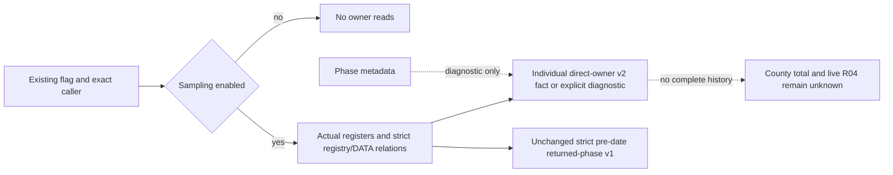

# County-primary direct writer ownership v2

`county_primary_direct_owner_at_writer_v2` is an optional child of an actual
loss-writer event. Its exact source is the CK3 1.20.0.4 return address
`0x24E25EE`; the executable SHA-256 is
`98702f88a547cde2eaf29a85f93b85f68ee4cf8148336a4f7afaeb75319dd518`.
The caller must bind the actual executable, process, observer lifetime and query
fences before consuming these facts. Source-code checks and synthetic inputs do
not qualify a native producer or close R04.

The production normalizer retains the entire direct child, including its native
capture failure flags and exact skip reason. A complete child requires actual
sampling ON with a nonzero epoch, the captured R13 CArmy and RCX writer receiver,
full-generation Army/Unit/ArRg identities, stable resolved registry matches,
the actual writer thread and clock event, game-state date, and a unique actual
CArmy ArRg-array occurrence. Generation zero is valid; `-1` is invalid.

Every DATA record must map to its native-selected physical slot. The normalizer
checks persistent-regiment registry identity, ordinal 0..6, the exact address
`Regi + 0x18 + ordinal * 0x24`, and the physical owner/ordinal/ArRg triple. The
consumer joins these associations to the parent event's complete DATA aliases
and existing physical before/after evidence. An ownership flag cannot replace
physical debit proof, and current selected-query membership cannot fill missing
invocation identities.

`active_phase_*` fields are diagnostics. Missing, unknown or post-date phase
observations can coexist with complete direct invocation facts. They never
establish a pre-date parent or satisfy the strict v1 returned-phase contract.
Missing MASM writer-register capture is different: it retains
`writer_registers_missing` and cannot establish direct ownership.

`evaluate_county_primary_direct_owner_evidence_12004` returns retained individual
positive and nonpositive calls separately. Global journal continuity and its
failure baseline remain independent of those target-scoped calls. The consumer
always leaves `county_total_debit` unknown, `complete_army_loss_history` false,
and `returned_phase_parent_claimed` false. Token reuse, cross-Army/full-ID/date
joins, contradictory registry pointers and mismatched physical associations
cannot produce an individual positive. Old events lacking the new child remain
unknown. The existing v1 normalizer and returned-phase consumer are unchanged.

The family may also carry the all-or-none optional pair
`unbound_county_primary_direct_diagnostics_v2` and
`unbound_county_primary_direct_diagnostics_overwritten_v2`. This separate global
64-slot diagnostic ring preserves calls whose original writer event could not
be bound to a valid regiment. Each exact wrapper is `{diagnostic_only: true,
ownership: <incomplete v2 child>}`, with nonzero native failure flags. These
records have no selected-Army membership and never enter `events`, its counters,
individual positives or global journal continuity. Their separate overwrite
count remains visible. Old responses without the pair remain unchanged.

The portable compound chains the production normalizer, direct ownership
consumer and existing physical consumer. Its registers, registries, phase
diagnostics and physical premises are explicitly synthetic; it executes no SDK,
native DLL or game calls. After integration:

```text
py -B ck3_autonomous_player/tests/unit/test_county_primary_direct_owner_12004.py --repo <repo> --output <new-external-result.json>
```

Before integration, add `--package-root <external-delivery-root>` to exercise
the exact in-memory contract postimage and candidate module without repository
writes. This mode also checks the contract's exact preimage; fuzzy application
is not supported.


## Integration, native ABI and qualification boundary

Source integration observer: `machine_id: desktop-3fevhd2-1c74096080`;
2026-10-19 UTC. Candidate base is `ba3528fc04621529ed528930623b5d34826a46a4`.
The upstream Faith tooltip changes in `bridge.cpp` are preserved; only the
county callback hunk is composed into the newer source. The existing MASM
writer entry, original-call path and strict v1 Python consumer are unchanged.

The existing `XAR_ENABLE_ACTUAL_COUNTY_PRIMARY_OWNER_12004` flag remains OFF
by default. V2 creates no new native call, detour, mutation or MCP endpoint.
Its pure serializer is always linked so the OFF build has no missing symbol.
When enabled at the exact caller, sampling OFF prevents owner reads; sampling
ON captures the real writer register context and strict registry/DATA relation.
The bounded unbound ring preserves explicit failure diagnostics without
inserting those records into selected-Army events or positive accounting.



Official Runner reuses its existing MSVC producer to build
`xar_test_county_primary_direct_owner_v2_12004` and
`xar_test_county_primary_owner_12004`; CTest resolves their actual artifacts.
The new native synthetic wire is then pinned by its actual bytes/SHA and fed
through the registered Python normalizer, physical consumer and strict v1
negative boundary. This wiring is pending actual CI execution at source
integration time. It is not a native/cold PASS, SYSTEM registration, production
DLL qualification or live ownership result. Root's new a38 build/cold and a
separate admitted live window remain necessary; a37 cannot publish v2.

[Ordered source contract](evidence/county-primary-direct-owner-v2/ordered-source-delivery.json)
retains the candidate pins; [integration source record](evidence/county-primary-direct-owner-v2/integration.source.json)
records the composed Bridge identity and explicit limits. The actual
[R217 missing-owner evidence](episode04-r217-county-owner-entry-12004.md)
is unchanged. Research10/14, business7/11, formal dynamic0/11 and ABC0/3
are unchanged; no R218 result is implied by this source package.

Actual4 county receiver/ArRg data flow is bound to the already-held complete body. Army/Unit/Regi registry layouts reuse adopted source contracts; this integration performs no fresh EXE read or independent reconstruction of those other bodies. `actual4_source_qualified` denotes that source binding, never OS identity, process ownership, cold qualification or a live business result. The caller must still bind the current process/executable/observer/query fences.

## Exact source CI、ID0 与 a38 独立资格补注（2026-10-19 UTC）

旧整合段的 pending 状态是当时历史，保留不改。`machine_id: desktop-3fevhd2-1c74096080` 的[实际封包](evidence/county-primary-direct-owner-v2/source375-exact-ci-close.actual.json)记录 source `375a48cb15b0e590160a331b86c12d39386083ed`：Official39196000014 于04:10:56Z、Linear39195999960 于03:43:45Z 均 success。新 fixture 使用真实 owned installer→生产 MASM hook→trampoline→Original；direct v2 与严格 v1 CTest 2/2，native synthetic wire 的15例进入真实 normalizer/physical/direct consumer，3例预期 physical7 positive、其余12例无 positive，Python -O 九组通过。[原始 ingress 结果](evidence/county-primary-direct-owner-v2/source375-owned-installer-native-ingress.actual.json)保留 machine unknown 的 native JSON 边界及 CI Python 来源机器；这不代表游戏执行。

[旧9c失败](evidence/county-primary-direct-owner-v2/history/source9c-native-ingress-red.actual.json)未改写：当时 fixture 未实际安装使生产 physical consumer 正确拒绝 observer 状态。修正的是 fixture 的真实安装链，生产 installed 守卫未放宽。后续当前源码 `3e7d337dc4edadde26642ad23fee85df5e41ecf9` 的 Official39203172231 Step19 同样实际通过，但整个 workflow 因 Step54 的实验 WAL 临时 patch setup 失败而 RED；不能称整个3e CI绿色。[有界 trace 与公共路径影响判定](evidence/county-primary-direct-owner-v2/exact3e-wal-impact.actual.json)只证明未发现该实验 setup 对未打补丁公共 Driver 的直接影响，没有修复或授予实验 WAL 资格。

[ID0窄审](evidence/county-primary-direct-owner-v2/full-id-zero-review.actual.json)绑定3e源码及[精确源 pins](evidence/county-primary-direct-owner-v2/full-id-zero-source-pins.actual.json)。Army、Unit、ArRg、Regi 的合法完整 ID0 与 optional0 均可通过原类型解析；拒绝哨兵是 -1/None，不能以 truthiness 把0当缺失。registry 非空对象指针、完整 generation 相等、Unit/Army 回链、roster occurrence、Regi DATA物理槽和实际 debit 守卫仍须全部成立。指针0仍是 null，token/epoch等既有正数条件不改；此源审查没有声称某个实际 Regi0 存在，也没有新增 live 结果。

05:43:42Z 的[本机 a38 qualification](evidence/county-primary-direct-owner-v2/a38/qualification.actual.json)独立绑定 **compiled/runtime source3e**、native tree `a288c6475a171aeacab625431126e76d7c65abed`：6个生产输出、5个 EXE 的 SYSTEM SID18 精确设置读回、v2/v1/declarations 三项 focused cold 及15例 strict wire consumer 均通过。[build completion](evidence/county-primary-direct-owner-v2/a38/build-completion.actual.json)、[cold step](evidence/county-primary-direct-owner-v2/a38/focused-cold-step.actual.json)和[consumer](evidence/county-primary-direct-owner-v2/a38/wire-consumed.actual.json)保留小原件。完整 SYSTEM receipt、EXE/DLL 和 wire body仅引用原 Q 的 pins，没有重读或复制。

该 a38 结果是来源机器的 production bytes/SYSTEM 与 synthetic cold 资格；`live_CK3_qualified`、`gameplay_qualified`、`R04_closed`、`external_DR_admitted` 均 false。后续纯知识 master 提交不等于新的编译来源；实际运行冻结3e与 master 记录提交须分开。研究10/14、业务7/11、正式动态0/11、ABC0/3 不变。
