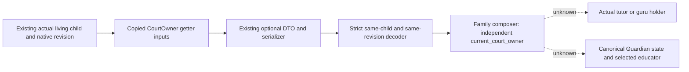

# Current child CourtOwner copied source input

This leaf reuses the held complete actual4 `28BFC50` getter and existing Core
current-generation storage contract. It supplies each actual child's court
owner without a clergy appointment, chaplain seat, rite, played actor, parent
or heir requirement. It invokes neither the getter nor any native function.

The source is the existing Faction
`faction/leaf01/immediate_liege-DETAIL.json`, complete118B
`[28BFC50,28BFCC6)`, with no CALL or delegate. Its previous mapper cache and
qualification are reused; this delivery performs no binary capture or scan.
The adopted clergy header supplies the typed CourtOwner meaning. Its comment
that landed characters return themselves is a simplification: the literal
getter can return a valid Character from the landed context.

The getter loads Character `+1C0` and `+1B8` before branching. A nonzero
landed pointer selects `[landed+1C0]+28`; a non-Character tag or fullID
`FFFFFFFF` returns the input child, otherwise it returns that candidate.
The unlanded path selects `relation+C8`, indexes actual Character storage
`5C67568` by the low24 bits, and compares all32 fullID bits at object `+18`.
Missing relation or failed native lookup returns the pointer value stored at
`5C67570`, which is not assumed to be zero.

`ReadCurrentChildCourtOwnerReadonly12004` uses a supplied guarded reader,
actual4 module binding, actual child fullID and positive owning query native
revision. It resolves that child through the current storage, copies only
reached source fields and rechecks their scalar values. A positive returned
owner must resolve to the same pointer through the current fullID selection.
No child age, death, role or guardian condition is introduced here; the owning
descendants reader keeps its original roster and living-child qualification.

Results distinguish `resolved`, `known_null` and `unavailable`. The complete
fallback path returning zero, or an observed fallback Character with invalid
fullID `FFFFFFFF` rejected by Core, supplies known-null after stable child and
field bookends. An unreadable field, null inner landed dereference, unresolved
positive owner or changed field supplies unavailable. A nonzero fallback with
another ID keeps its unclosed semantics and supplies no owner identity.
Raw getter return/path remain separate from qualified current owner fields.

Owner55 owns the real per-child route, DTO and serialization hunk. It must pass
the original distinct child row's raw full32 ID and the existing owning query
revision once per row, using the admitted reader. The new JSON append helper
serializes the copied result; it creates no query or synthetic scope. The
Python `child_court_owner_from_current_child_source_12004` consumes that
validated row field and checks the same child and positive revision before
providing its local frozen four-field `ChildCourtOwnerObservation12004` to
the actual child composer. It imports no unadopted educator selector. The
result records court-owner facts only; educator selection remains separate.

Owner26 owns the later exact court-position holder source. A resolved result
supplies its owner fullID/address provenance; known-null can skip the court
owner branch only after qualified Guardian absence. An unavailable owner
cannot prove absent tutor/guru. Generic Guardian peer material from25/26
continues to prove neither `HasGuardian` nor canonical Guardian absence, and
readonly holder candidates still do not prove an event's random educator.

Status is source candidate `AUTHOR_NOT_RUN`: no new tests, imports, compile,
link, native call, Game, RPC or SDK execution. The old selector,64b/64d/64e
and all prior qualification records remain unchanged.

Root adopted the nine connected production files on 2026-10-11: the existing selected-child job supplies its full32 identity and owning native revision to the copied-source reader, the existing DTO/serializer publishes the independent optional input, and strict decoding plus the family composer consumes it. No new query, TU, CMake registration or unadopted selector is required. Exact build is CK3 1.20.0.4 / Steam 25734779 / EXE SHA-256 `98702F88A547CDE2EAF29A85F93B85F68EE4CF8148336A4F7AFAEB75319DD518`. Qualification remains `research / SOURCE_ADOPTED_NOT_RUN`; Native84/SDK84 remain compiled Source594. Local tests, project imports, compilation and Game/Steam/live queries were not run; the source commit skips CI. Actual adoption receipt: `D:/codex-ck3-background-spill/native71-continuation-20261010/ROOT-CHILD-COURT-OWNER-SOURCE-ADOPTION-20261011.json`.

