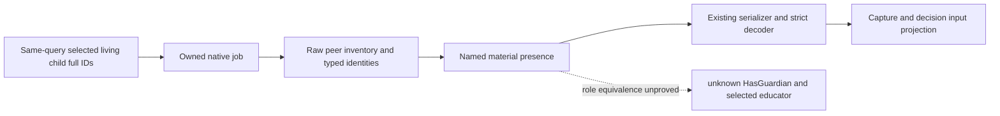

# 当前子女材料源与 Python 消费（CK3 1.20.0.4）

2026-10-11 源码交付：`current_child_relation_materials_v1` 使用既有暂停态 family job 与相同查询的所选子女输入；严格解码、capture 和决策输入投影均保留该可选字段。状态为 **research / SOURCE_ADOPTED_NOT_RUN**。最高用户指令已取消新测试、导入、编译与实机执行，本包没有申请 GO，也没有回放既有 Guardian 5/19/9/21 资格。

## 实际源码路径

1. `bridge.cpp` 从既有 `child_inputs` 的 available/partial 行取各 `character_id`，保留完整 signed32 位模式为 uint32，复制给既有 Guardian job。成功复制空行列表时可得到已绑定空列表；失败复制保持未绑定。
2. `ck3_12004_current_child_relation_materials.hpp` 逐个所选 full ID 调用拥有副本的 generic peer carrier，再调用 named-material projection。`guardian_factory_discovery_job_v1.hpp` 输出可选 `current_child_relation_materials_v1`，沿用原 before/after/reclaim/completion 资格。
3. `validate_guardian_factory_create_inputs_v1` 先沿用原 command/request/native revision/date/played/heir/completion 校验，再解码该字段。完成的集合与同查询规范化 `child_inputs.rows` 的 uint32 ID 顺序完全一致；partial 输入行仍可提供已选 full ID，不额外要求所有子叶可用。
4. `capture_with_connected_driver` 在返回值中保留严格解码后的字段；`project_guardian_family_decision_inputs_v1` 独立深复制它。没有新增查询，也不重算 native relation 或教育结果。

## 字段含义

顶层 `roster_bound` 描述所选输入的绑定，`collection_available` 描述逐行集合是否完成。完成集合不等同于每个 peer 或 named-material 观察均可用。原生异常分支可能留下未完成 ID 副本；该 unavailable 外壳不被解释成已知空集合。completion 未通过时，原生输出 bound/collection false 与空 ID/行列表。

每个子女保留其 full ID、raw address 与 `resolved` / `known_null` / `unavailable` 状态。peer 行保留物理顺序、重复 full ID、raw material QWORD、可空 lookup/observed full ID/tag/address 及独立身份资格。已观察的零值与不可读的 null 保持不同。

`guardian_named_material.named_material_present` 是 generic peer 材料对当前 named descriptor 的源投影：available true/false 均为可见事实，unavailable 保持 null。材料 true 可以同时具有 known-null 或 unavailable 的角色 witness；不要求所有 peer 身份解析成功。材料 false 不证明 `Character.HasGuardian` 缺席，known-null peer 也不证明 guardian-null。本包不赋予 guardian 角色等价、已任命教育者、教育 fallback、自然 C8 触发或 action 成功结论。

## 精确源交付

生产文件共 9 个：26 peer carrier、25 named material、48 focus readonly、52 bundle/job、55 child helper/Bridge、59 strict/capture。Bridge 仅包含 55 的具体消费 hunks；不覆盖完整共享 Bridge，也不包含 authored case 或旧首包补丁。

- 原生 job：`8dee65c8c6f5a9252ca7403c2a504c5e99dfe010fe05ed70b9d8b3bec5c251e7`
- bundle：`3292d0e147473ea0c53a0f62d65fa9c52c28e60ef94412d8426e5e58045c2acc`
- peer carrier：`1675608170c6c2b065b329042e58f759b40591b484e0f8b9ec1d73218e762d58`
- named material：`4a275fb07134e7f56d6ae3e6a05a4cdb4653acd82ad7d5ca0e62be66631519a0`
- Python strict：`e67d3f04d405e3d90808d506ab1cf5db5ca5a8553e4985cb2e8e6a3d491d99f1`
- capture：`e9e680fd94923c2dc5937cbc7aa7820bcae071b6e04b5e98cc3359dd1fa7bc0e`

外置交付根为 `D:/codex-ck3-background-spill/native71-continuation-20261010/continuation-59/background-g2-offline-20261011/guardian-child-materials`。`ROOT-G2-CURRENT-CHILD-PRODUCTION-ADOPTION-MANIFEST.json` 与 `patch-current-child-production-nine.diff` 固定所有生产源、当前 preimage 和 patch。原首版 Python a193/68e postimage 是本次增量基线；Person 独立包保持原样。历史 lower-relation 9/21 资格仍仅覆盖当时的分支，不外推本新字段已验。

存储使用原 59 共用 4 MiB source allowance，不新增预留；活跃源 review 的复核期限仍为 2026-10-11T08:41:22.843427Z，无自动续期。

## Root integration

Recorded 2026-10-11T06:21:46.771176+00:00. Root adopted the nine production files into master and preserved
the actual Bridge hunks. Patch line endings were adapted to the repository.
The root receipt records the actual repository bytes:
[ROOT-CHILD-MATERIAL-SOURCE-ADOPTION-20261011.json](D:/codex-ck3-background-spill/native71-continuation-20261010/ROOT-CHILD-MATERIAL-SOURCE-ADOPTION-20261011.json).
The native build and physical SDK were not changed. Exact archived CK3 is
1.20.0.4 / Steam25734779, executable SHA-256
`98702F88A547CDE2EAF29A85F93B85F68EE4CF8148336A4F7AFAEB75319DD518`.

The next functional dependency is the actual child court-owner and educator
selection/action source. Generic material false alone cannot select a fallback.

## 2026-10-12：普通同查询材料接线源码采用

Root采用三Python文件的ordinary材料入口：已启用private family且有state root时，用一个独占临时目录向原family QueryNative提供sidecar路径；从该同请求完成的原生导出经既有严格validator取`current_child_relation_materials_v1`，交给现有education needs。没有额外query/RPC，也没有调用capture wrapper或保留每轮完整command-result副本。八项完成标志、必需nullable error键、request、暂停前后native revision/date/played/heir、PID/generation与所选子女顺序均沿原资格检查；available、unavailable、legacy absent分别保留。generic witness不能升为已任命educator。

Python最多读4MiB+1并拒绝超限；这是读取上限，不是Native sidecar物理写入上限，实际运行仍受任务整体容量门禁。临时目录正常退出即回收；进程被终止留下的残件按通用策略复核，不宣称自动GC已部署。本次源码已审阅，未运行测试或实机；冻结SDK87/f9仍保留旧普通入口，本增量待后继SDK采用。M6仍partial。

## 2026-10-12：教育材料与总军事值源码接线

Root逐hunk采用Provider V4原生owned DTO和Wiring05 SDK：原成功family查询的同请求导出独立携带`current_child_education_provider_inputs_v1`，保留完整子女roster、重复出现位置、25项特质membership、目标文化参数`better_ward_education`的true/false/null与culture full ID。原before/after、回收、request、实际build、revision、date、played/heir门禁保持；8项完成标志与原可空error仍须通过。当前输入异常不能转成已知空名单；特质membership必须按catalog严格递增，拒绝乱序而不排序。

SDK新pure validator精确校验17个顶层字段与13个行字段，在复制前限制该leaf为64KiB UTF-8 JSON；缺席或null仍为unknown。孤立非null叶不能被legacy早返吞掉。普通transport分别附加教育与generic材料，education needs只读投影两者的独立来源。没有新query、RPC、rank或readiness；实际导师、Rite教育键、education_type/progress仍为null，`m6_inputs_complete=false`与`guardian_role_equivalence_qualified=false`保持。

正式教育脚本的`better_ward_education`检查位于`scope:educator`，不是由参数名称推断的child scope。当前Provider所读同名参数明确属于child文化，只保留该目标的事实，不能替代实际educator的文化输入；guardian相关字段继续null。Source06的15路复核尚未找到权威educator producer，新增外置文件0B。

另采用`total_martial_callback_v1`：通过既有actual4 total-skill绑定读取请求secondary actor的总军事值，保留完整target身份、两次一致采样、原始有符号数值（包括0）、before/after alive及角色bookend。该5-key可选字段与原raw skill及教育表达式来源独立，不能据此更改原教育评分。三处源分别为request技能header、ordinary interaction实现与strict Python decoder。

本批只有源码采用与独立静态审阅，没有运行测试、fixture、FIRST或教育业务重验。冻结SDK87/f9与Native86不含本批增量。后继native owner closure需按实际共享header枚举：Bridge323/492/493三项编译，保留Native86的324/Runtime504及其597成员archive，仅DLL重链；本条是源依赖结论，尚未执行后继构建。M6保持partial。

采用回执：[Provider V4与SDK Wiring05](D:/codex-ck3-background-spill/native71-continuation-20261010/runtime-01/native84-resume-20261012/ROOT-PROVIDER-V4-SDK-WIRING05-SOURCE-ADOPTION.json)、[Martial04](D:/codex-ck3-background-spill/native71-continuation-20261010/runtime-01/native84-resume-20261012/ROOT-MARTIAL04-SOURCE-ADOPTION.json)。来源仍受原4GiB范围和2026-10-12T16:47:28.264315Z复核期限约束，未续期。

### 2026-10-12 06:51 CST — R102 配对保存／关闭与 SDK88 源码冻结

当前原普通战役暂停保存 **6082 天／H10187／raw53290296**，Robert29829、episode native-29829-2bc2d599f7f9；本次新增天数0。四条不同建设回执的恢复记录保留；原540继承人关系读取失败不重发、不补写根因。SAVE SHA为`bfe44dc34383f23faac789575aa8d1f4b71d5821f3c0275a855889a6e7ae9a55`；当前环境ab9b19ee，XARoff／pact absent。

持有应用kernel handle的observer实际观察SDK application exit0，外层reader也实际exit0；SAVE persistence barrier独立GREEN，未证明fsync或断电耐久。游戏一次WM_CLOSE与一次原生“退出到桌面”后仍未退出，随后精确受管job stop实际kernel退出1，normal_Game_exit=false。13项冻结共3,582,031,120B，其中完整Driver3,397,902,660B；gift193已应用身份未重置，原输入保护期限10-18保持。旧R101 application退出码unknown、旧R100 application1与各强制退出记录保留，不外推当前0。屏幕keeper实际CAS2097释放。

SDK88实际固定完整主线`306473f1`：45,796源码文件，45,773不可变同卷硬链接，所有变化文件独立；all5保留入口实际大小／SHA读回，Git实际干净detached head。共享Git对象仍依赖Z仓库，相关祖先pins按原期限保护；不得在SDK88硬链接源码运行checkout／生成器或写入。SDK88仅SOURCE_COMPLETE_NOT_RUNTIME_REBOUND。

Native87初次prepare因把917对象与714实际argv误要求全等而RED，零compiler；已保留原源码与小回执，仅非递归移除确认为空的新输出目录。修正prepare后实际5个compiler均返回2／D8037，原始CP936日志保留，archive0／DLL0／无canonical发布。记录的编译环境只有四工具链变量，缺Windows系统项；后继attempt02正在补明确OS白名单，原因仍以实际构建回执为准。失败输出15,702,046B、后继额度4,277,168,098B与2MiB收据预留合计仍原4GiB；原runtime40GiB与10-12T16:47:28Z截止均不续。

[实际配对SAVE](D:/codex-ck3-background-spill/native71-continuation-20261010/runtime-01/native84-resume-20261012/native86-r0102/ordinary-native87-adoption-save01/ROOT-ACTUAL-ADOPTION-SAVE.json)、[完整13项冻结](D:/codex-ck3-background-spill/native71-continuation-20261010/runtime-01/native84-resume-20261012/r102-final-saved-complete13-freeze/ROOT-ACTUAL-COMPLETE13-FREEZE.json)、[SDK88源码执行](D:/codex-ck3-background-spill/native71-continuation-20261010/runtime-01/native84-resume-20261012/sdk88-source-preparation/SDK88-SOURCE-EXECUTION.json)、[原Native87实际RED](D:/codex-ck3-background-spill/g2-native87-production01/ROOT-NATIVE87-RESULT.json)。四研究组继续按各16任务复用子线程，不以64派发容量冒充持续活跃数；没有tests／fixture／FIRST。M4 complete、G2 6/8=75%、NW2 2/4=50%、M6 partial、M7 incomplete、自然跨代0保持。

### 2026-10-12 07:39 中国标准时间 — Native88／SDK89 实际采用与 R103 配对保存

Native88实际补编修正后的493，复用attempt02四GREEN与Native86其余真实来源，597成员archive及DLL链接均exit0；R103/SDK89已有13项恢复资格GREEN。这只证明构建和当前普通战役恢复，未验证新family字段或M6完整性。

监护人request preference v2已源码整合至master `ff0e25d2`：martial focus消费独立validated total callback，缺失仍unknown，无raw fallback；保留0、负值、原profile与其他raw skills，source basis进入分组，普通materializer/CanSend/intent门禁不改。formal stock `$SKILL$`表达式getter链与effect educator仍未闭，不能据独立API冒教育表达式资格。当前SDK89/bdb仍v1；详细实际结果与后续源码边界见[当日日报](../autonomous-agent-progress/daily/2026-10-12.md)。

### 2026-10-12 08:30 中国标准时间 — actual4 静态字符串与引用候选

Root对本机Steam实际build25734779的1.20.0.4固定EXE做一次身份SHA读回：`98702f88a547cde2eaf29a85f93b85f68ee4cf8148336a4f7afaeb75319dd518`，101,040,248B，mtime_ns1791307594040564100；image base5368709120。先64KiB文件头，后新explicit plan扫描file-backed .rdata strings/pointers、.data pointers和.text code，并读完整exception directory；没有Game/API调用、完整EXE复制或旧Driver/SAVE读hash。原source4GiB／flatleaf128KiB／复核期限不续。

声明范围（半开RVA）：.rdata [71147520,88271466)、.data [88272896,96844288)、.text [4096,71145544)，exception [98316288,101249508)。保守重复读取上限116,960,384B；实际116,960,346B、1.227152秒、可控单buffer峰值1,048,594B；OS RSS未知。headers与xref两次独立准入均exit0，xref四phase COMPLETE，未重试或截断候选。剩余section与其他指令形式未扫，负证据仅限已声明匹配模式。

| 名称 | ASCII字符串RVA | QWORD pattern slots RVA |
| --- | ---: | --- |
| martial | 72280072 | 71543824、74359816 |
| learning | 72280056 | 71543848、74364728 |

| LEA pattern RVA | 7字节 | 指向字符串 | pdata半开范围 |
| ---: | --- | --- | --- |
| 927407 | 488d1552c14004 | martial | [905904,932302) |
| 928157 | 488d1554be4004 | learning | [905904,932302) |
| 5921185 | 488d05608ef403 | martial | [5921168,5921320) |
| 5921505 | 488d05108df403 | learning | [5921488,5921640) |
| 14325800 | 488d15d94f7403 | martial | [14324000,14326565) |
| 14326015 | 488d15f24e7403 | learning | [14324000,14326565) |

六个pattern的完整7B均落在所匹配pdata范围内，unmatched=[]；这仍不是verified instruction boundary或高层函数身份。四候选owner共29,267B，此步未读其body。QWORD字段类型、formal expression注册／callback、接收者Character与effect-selected Educator、数值scale全部未qualified；不能以该表替代独立total-martial API或stock教育operand证明。下一步只对这些明确候选做有新数值准入的有限静态反汇编，优先两个152B小范围。

[原始header回执](D:/codex-ck3-background-spill/native71-continuation-20261010/runtime-01/native84-resume-20261012/sdk85-source-preparation/sdk86-candidates/m6-static-pe-intake-source12/SOURCE12-ROOT-ACTUAL-HEADERS.json)、[固定xref计划](D:/codex-ck3-background-spill/native71-continuation-20261010/runtime-01/native84-resume-20261012/sdk85-source-preparation/sdk86-candidates/m6-static-pe-intake-source12/SOURCE12-ROOT-XREFS-PLAN.json)、[完整xref回执](D:/codex-ck3-background-spill/native71-continuation-20261010/runtime-01/native84-resume-20261012/sdk85-source-preparation/sdk86-candidates/m6-static-pe-intake-source12/SOURCE12-ROOT-ACTUAL-XREFS.json)。回执formal_registration_qualified与receiver_type_qualified明确false；保存结果不提升M6完成状态。
