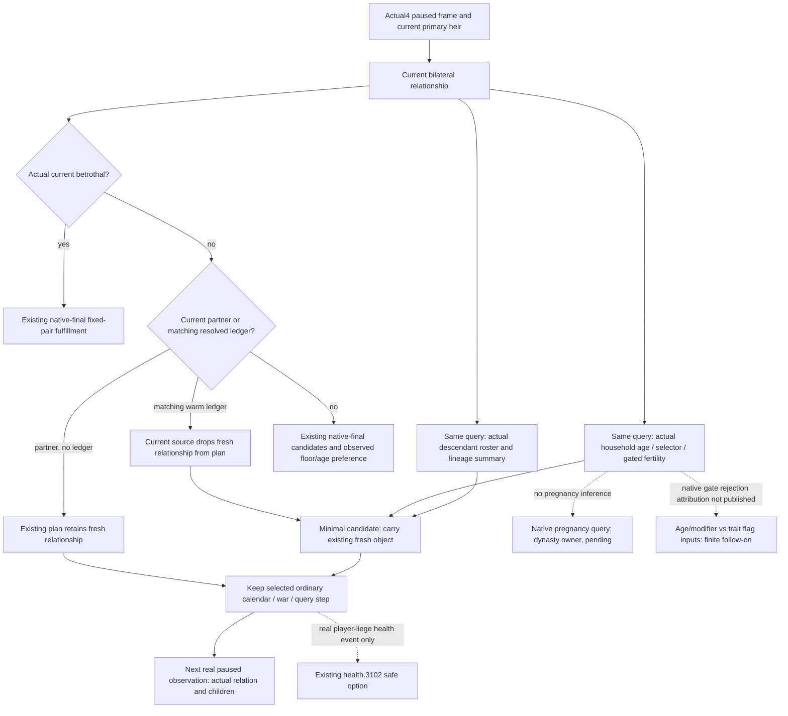

# Current first-heir family decision inputs, Runtime31

Source-first seal: 2026-10-08, Asia/Shanghai. This packet changes no game state.

## Identity and supplied qualification

Runtime31 source is `Z:/gbs-runtime31-source32-repair02`, pinned by the parent to
`96773ac0163c2ffcab5dfe89a0621cc86fdb228e`. Native identity is CK3 `1.20.0.4`,
Steam build `25734779`, EXE SHA
`98702f88a547cde2eaf29a85f93b85f68ee4cf8148336a4f7afaeb75319dd518`.
No EXE, process, Driver, save, import, SDK, build, test or FIRST is used here.

The current household observer originated at
`ccec7768874a4c547789f08048d89bc03857450d`. The parent supplied Runtime31 GREEN
for its seven native scenes and registered consumer, indexed by
`Z:/ck3_mod_rewrite_process_assets/g2-background-20261008/runtime31-first01/ROOT-FOUR-NEW-FIRST-RESULTS.json`.
That result is reused, not executed again. The historical source document's
AUTHORED_NOT_RUN label describes the earlier authoring phase.

## Native observer tree

`ck3_autonomous_player/native_bridge/include/xar_bridge/ck3_12004_first_heir_reproductive_inputs.hpp:14`
uses the actual current relationship's heir, primary spouse, spouse array and
betrothed IDs, in that order with deduplication. Each value is double-read through
the existing `family_value::ReadCharacterValue(..., true)` (lines 50–75).
The current relation and paused frame are checked again at lines 77–84.
The observer publishes actual signed age, native sex selector and gated current
fertility; a failed row stays unavailable and is not native zero.

The mapped existing fertility gate cache is
`Z:/ck3_mod_rewrite_process_assets/g2-migration-20261007/marriage-family/actual4-heir-lineage/function-map/adopted-existing-fertility-gate-DETAIL.json`.
Its complete cached 324-byte actual4 body at `0x28BB4C0` was inspected as saved
decoded metadata; no new native bytes were read. Its actual branches are:

- selector zero jumps to the trait loop, bypassing the female age calculation;
- the other selector uses an extended-data parameter lookup for native ID `0xBF`,
  native age override `Character+0x6C` when nonnegative, otherwise `+0x68`, and
  the actual loaded DWORD at `0x5C6A1A8`; an age above the calculated native limit
  returns false;
- the trait loop resolves each current trait from `Character+0xF8/+0x104`; a
  zero bit 5 of the resolved definition's DWORD at `+0x4A4` returns false;
- otherwise the gate returns true. The parameter's name and trait flag's name
  are not inferred here. This is source attribution, not a new diagnostic read.

The effective fertility getter proof at `0x28C6340` and the adopted reader
already distinguish missing extension/native rejection from a signed cached
raw value at extension `+0x2E0`, scale 100000. No future birth probability,
pregnancy or named trait diagnosis follows from that single-character raw.

## Actual production consumer tree

`ck3_autonomous_player/src/xar_autoplayer/bridge/service.py:1815` runs the
existing fixed-betrothal opportunity before the ordinary family opportunity.
`current_first_heir_betrothal_formal_consumer.py:209` returns the original plan
when no actual betrothal exists. A fulfilled existing betrothal retains its fresh
current relationship at lines 189–191. No pregnancy/children wait was found.

`family_marriage_formal_consumer.py:572` queries the fresh current relationship.
The no-ledger already-partnered branch at 622–625 retains it and leaves the
preselected ordinary step. The warm resolved-ledger branch at 620–621 instead
calls `_plan_existing_resolution` with the original plan and discards this
fresh relation from the resulting plan. The helper at 116–157 can only preserve
the old result/alliance evidence that it received. Thus fresh household values
and newly observed descendants are lost at this concrete consumer seam, even
though they were read and validated. The history may still hold the query;
the missing object is the current formal plan input.

The minimal source candidate carries the existing
`family_marriage_current_relationship` object through that call. It adds no new
wire field, getter, query, action, readiness gate, rank or probability. Existing
new-heir/ended-relation routing happens before the patched call. The unavailable
relation/cold fallback at line 582 is left intact.

For an actual new unpartnered heir, the existing native-final candidate route
and `first_heir_native_reproductive_preference.py` already consume observed
floor/age pass, partial and fail evidence without excluding fallback choices.
They are not rebuilt in this packet.

## Native action and outcome limits

A still-married pair can continue the existing calendar action. A current adult
betrothal may use the existing native-final fixed-pair fulfillment action. A
truly unpartnered heir may use the existing native-final candidate route. An
active player-liege `health.3102` event can use its existing qualified safe
treatment option for a court patient; `health-consumption-diagnosis.md:231`
documents that source tree. No present treatment event for the current heir or
spouse is supplied, so this is an existing conditional entrance, not a current
health action or asserted fertility improvement.

The current query's native descendant summary can distinguish known living
direct children and played-Dynasty matches. Neither a later query's positive
child count nor fertility implies a newly born child without before/after
material evidence. Natural succession credit remains separate.

Current native pregnancy is owned by `/root/dynasty_birth_inputs`; its named
registry research is not duplicated. Health alone is not a birth model, and
adding a health/null field without a reached controllable support opportunity
does not improve the current calendar route. The finite construction entrances
and exact limits are in `MINIMUM-INPUT-PLAN.json`.

## R95 exact1.20.0.4 ordinary current-family during-read RED

Native80/source452 and fullSDK80/source452, Runtimearchive664, ownedGame169496,
originalRobert29829 at saved6077/raw53290176. Retained ordinary005 is589B and
only reports `current first-heir relationship frame changed during read`.
[Actual failure](D:/codex-ck3-background-spill/native71-continuation-20261010/runtime-01/native80-r0095/ROOT-ACTUAL-ORDINARY-FAMILY-FAILURE.json)
has no native failed-conjunct field. Source bridge.cpp19478 short-circuits final
ReadSnapshot failure, complete Snapshot inequality and local relationship
frame_changed into that text. This is not a Python public revision comparison.
Prior004 accepted marriage/cold recovery for38822/38718 has no ending_snapshot,
so it is not a replacement same-frame proof. No day/SAVE or root-cause credit.
The next construction entry is a failure-only diagnostic using the existing
Snapshot diff and failed-read information without another native read or a
changed acceptance predicate. Exact-build EXE SHA remains
98702F88A547CDE2EAF29A85F93B85F68EE4CF8148336A4F7AFAEB75319DD518.

## First-heir during-read diagnostic: actual FIRST6 GREEN, source adopted

Root actually compiled, linked and ran the six new diagnostic scenarios once,
both exit0 at 2026-10-11T00:50:56.751525+00:00. No old tests or Game queries were replayed.
[Actual FIRST/adoption](D:/codex-ck3-background-spill/native71-continuation-20261010/continuation-63h-r0095/root-first/ROOT-ACTUAL-FIRST-AND-ADOPTION.json)
and [source delivery](D:/codex-ck3-background-spill/native71-continuation-20261010/continuation-63h-r0095/DELIVERY.json)
bind the new inline header, two Bridge hunks and standalone fixture. The same
one ReadSnapshot and original three conditions/order remain. Error diagnostics
distinguish snapshot_read_failed/full_snapshot_changed/relationship_frame_changed,
include only existing owned fields and the fresh failed-read stage if available.
Success wire and native acceptance are unchanged. State remains static-ready;
actual005 conjunct and repair remain unknown. Native81 is one Bridge compilation
and DLL link with Runtime664 archive reuse, then complete SDK81/cold load and
one actual family reproduction.07/61/10 prepare those independent packages.
Five remaining dailySAVEs and all milestone counts remain unchanged. This task
is committed/pushed directly to master with the retained R95 actual status.

## Native81 production compile RED: include order corrected before retry

Recorded at 2026-10-11T01:00:20.412332+00:00. Actual Source81 supersession/finite plan both exit0.
Production compile001 of attempt01 exited2 at00:58:20.845166Z, no DLL link:
ck3_12004_activity_migration_v1.hpp12 resolved kExecutableSha256 in the new
xar::bridge::ck3_12004 diagnostics namespace after the diagnostic was included
at the top of Bridge. The minimal correction moves only that new include after
the existing nonwar_private_snapshot_guard_diagnostics_v1 include. Diagnostic
logic/header/fixture and six actual GREEN cases are unchanged, not replayed.
[Original failed producer](D:/codex-ck3-background-spill/g2-native81-build01/attempt01/ROOT-NATIVE81-RESULT.json)
remains RED. Native81 retry02 will compile one Bridge and link one DLL; no
Runtime/archive producer or native live credit. SDK81's first execution also
stopped before writes because its child lacked the existing quota reference;
10 appended that existing field, preserving the original child and RED. SDK
physical source remains452 until the actual corrected execution succeeds.

R95 SDK normally exited0 at00:53:50.879368Z, Game/keeper remain paused/held.
Root actually retired its zero-day derived Driver3045974106B at00:55:54.344089Z,
[actual reclaim](D:/codex-ck3-background-spill/native71-continuation-20261010/runtime-01/native80-r0095/ROOT-ACTUAL-RETIRED-R95-DERIVED-DRIVER-RECLAIM.json).
Original005/loop failure and authoritative R94 complete6077 full12/fullDriver
remain; no body read/hash/copy/freeze, no newday/SAVE. R96 will use that existing
complete recovery. Counts G2 5/8/M4 2/3/M6partial/M7incomplete/natural0 unchanged.
This source correction is committed/pushed directly to master; required actual
production build, not a repeat standalone fixture, verifies its include order.

## R96 actual Native81 cold13 GREEN; original ordinary loop underway

Recorded at 2026-10-11T01:34:07.396567+00:00. [Actual paused proof](D:/codex-ck3-background-spill/native71-continuation-20261010/runtime-01/native81-r0096/managed/operator/ROOT-R85-COLD-PAUSED-SNAPSHOT-QUALIFIED.json) is
13/13 GREEN at 2026-10-11T01:30:53.931010Z. Actual Game131616 is minimized;
Robert29829 is alive, paused/map-ready at original date53290176, saved6077/H10120.
Native, compiled, qualified and fullSDK source remain749809a7; Runtime archive
source remains664c85d9. R96 allocation96/execution69ba5c07-3b1a-434d-a64e-e2f3eff38208
and fresh Steam-offline/Toast0 were actually observed. Seven core-readiness
queries (six earlier timeouts retained) and exactly one history-free full snapshot
produced the proof; no extra family query or new allocation was issued.

01 immediately started the original ordinary controller/session28556: first600
normal, then original daily SAVEs toward6082. First600 actually executed/applied
at01:33:19.659528Z, selected private-query-player-construction-receipt-v1,
ending raw53290176/public3/native2/actor29829/original episode. This is the
existing construction's cold result query, not a new construction action.
[Actual first ordinary result](D:/codex-ck3-background-spill/native71-continuation-20261010/runtime-01/native81-r0096/ROOT-ACTUAL-NATIVE81-FIRST-NORMAL.json).
No additional priority bypass or diagnostic Game request. At this recording
boundary no new day/SAVE or family failure branch is credited. The new diagnostic is loaded in production, but
does not constitute a fix of R95's still-unidentified failed conjunct. Keeper60843
holds source7498 unchanged until SDK/Game/keeper/CAS closure.

32's [single actual timing read](D:/codex-ck3-background-spill/native71-continuation-20261010/continuation-32/persist-phase-parser-sdk81/actual-r0096-first-read01/RESULT.json) at01:30:25.090745Z--
01:30:25.179784Z saw writer_wait7200ns and state_wait4400ns (child token
907903738220800, source lines1/2). JSON+LF, UTF8, atomic wrapper and aggregate
were not yet present in that read; missing rows are not failures or zero values.
No sum, aggregate join or runtime-speedup conclusion is made. The source7498
and previous docs c6db official static CI succeeded; source tests were not replayed.

Readiness increment: actual production-live primitive cold observation and the
first ordinary query for Native81/SDK81. Daily loop outcome is pending. G2 5/8, NW2 2/4,
M4 original material2/3, M6partial, M7incomplete, natural succession0 stay unchanged.
This report is committed/pushed directly to master; the running SDK checkout is
independent of the newer documentation HEAD.

## R96 ordinary marriage result RED; completed persistence costs observed

Recorded at 2026-10-11T01:41:00.624742+00:00. Native81/fullSDK81/source7498 actual cold13 GREEN and the
four ordinary construction-result queries succeeded at original raw53290176.
Original ordinary004 started01:35:13.827104Z and failed01:39:07.995843Z:
`heir marriage private command RED: observed-heir marriage result needs a later paused frame`.
[Original response](D:/codex-ck3-background-spill/native71-continuation-20261010/runtime-01/native81-r0096/managed/operator/gameplay-responses/610-r0096-native81-days03-07-chunk01-000004-normal.json) has is_error=true/structured_content=null,
with no retained plan/result/native diagnostic in that envelope. Ordinary
controller28556 exited1 at01:39:08.091427Z. No new day/SAVE; saved6077/H10120 and
the complete R94 twelve-stream recovery packet remain authoritative.

This is a different actual trigger from R95's generic during-read relationship
failure; Native81's newly loaded failure diagnostic was not reached here.63 is
the sole source owner for this exact production error. No retry, optional Game
query, duplicate marriage submission, new allocation or restart was issued.
Game131616/SDK64795/keeper60843 stay paused/held, with SDKsource7498 unchanged.
The actual trigger and minimal fix are pending; no family fix or material credit.

32's [completed small-log read](D:/codex-ck3-background-spill/native71-continuation-20261010/continuation-32/persist-phase-parser-sdk81/actual-completed-read02/RESULT.json) at01:35:00Z executed once:
38 lines, five complete child groups and one then-partial group, five independent
aggregate rows, issues0. Complete atomic-wrapper durations were17.2069761,
17.7650871,17.7520893,17.7489237,17.3705247s; JSON+LF16.9956831,15.7055008,
14.6619730,14.8786677,15.1719220s; UTF8 1.3959788--1.7398051s. Lock waits were
at most7.2us. Independent aggregates34.0997363--36.3948561s are not token-joined
or claimed equal to summed children.31 is examining the existing synchronous
atomic wrapper's source for the smallest useful timing split; no extra SDK
switch is scheduled for profiling.35 confirmed the existing history-free query
optimization is already in held7498/currentmaster, reusing32's prior60 GREEN;
no duplicate patch or QA. Full Driver/history/persistence semantics stay intact.

G2 5/8, NW2 2/4, M4 original material2/3, M6partial, M7incomplete/natural0 remain.
Root records this actual failure and cost evidence directly on master and will
continue from the concrete source diagnosis rather than adding unrelated work.
