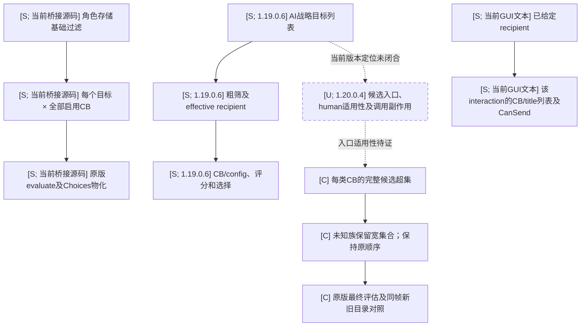
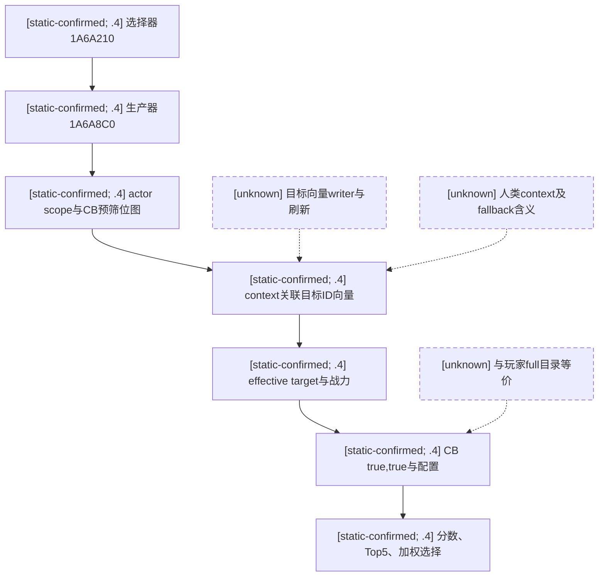

# 宣战候选生成优化评估（1.20.0.4，未部署）

Machine: `xenoamess-full-tower-eb9d2c1186`. 2026-10-16，只读预研；没有MCP、Native调用、活跃Driver读取、DLL加载、游戏/SDK/桌面/队列写入。此报告属于既有128KiB工作包的小型补充，源文件哈希另见[source-pins.json](evidence/declaration-candidate-generation-12004/source-pins.json)。当前原版数据只证明被读取的安装文件；未新采集运行中compiled CB定义或mod覆盖来源。

用户提出的“先借口、再找对应人、最后原版评估”是合理优化方向。必须减少每类借口的候选集合；仅交换两重循环仍是N×C。现有接口足以做少数已给定目标的最终复核，还不足以证明有完整的反向目标枚举。当前不应直接替换全目录接口，也不应把自己推导的候选生成称作已经还原原版搜索。

先看原版路径：当前`common/character_interactions/00_war.txt:12–39`已给定recipient，检查非本人、is_playable_character、未交战，然后调用`has_any_display_cb_on(recipient)`与`allows_declaring_war_against_target_trigger`。`gui/interaction_declare_war.gui:90,121,366,411,756–757`显示既有attacker/defender、该context的CB/title列表和CanSend/Send。这是目标在先的UI路径，没有证明它提供“按某CB反查全球对手”的API。

仓库`docs/ck3-native-ai/war-declaration.md:22–34,95–113,326–364`早已记录**仅1.19.0.6**的另一条AI路径：战略目标列表→粗军力门→effective recipient→更细战力/hostage→CB/config→评分/Top5。当前安装debug GUI仍有`AIWatchWindow.CalculateCBCandidates/GetCBTypeItems`（720/737行），这是值得先追的原生入口；但本次未找到已经资格验证的1.20.0.4候选生成ABI、human actor可调用性和无副作用合同。旧地址不能当当前接口，AI评分后的子集也不能当全合法目录。此前桥接层的全storage×CB实现复用了原版单次evaluator，**没有因此复刻原版候选生成流程**。

可施工候选与边界：

|借口族|可缩集合的来源依据|现有可复用部分|仍需Native研究/开发或宽回退|
|---|---|---|---|
|claim|`00_claim.txt:52–182,273`按claimant对title的claim与title规则生成；可从可代打claimant的完整claim title集合反向到holder，再解析实际war recipient|给定TitleID的玩家claim查询、title holder/immediate/top liege查询；target-only CB最终复核helper|玩家claims接口**只查询调用方给定TitleIDs**，不枚举全部claim；也不覆盖所有可代打claimant。完整claim索引和defender/liege重定向未闭合；只取本人或top liege可能漏项|
|de jure|`00_dejure_war.txt:322–361`要求创新/政府与has_de_jure_claim_on；县目标处于玩家或有关上级所持法理层级内。应从合法法理子树到外部holder及可能recipient|title-holder与root已持头衔/关系数据能作种子和复核|没有已验证的完整反向法理子树查询。不能只取当前边界邻居：玩家full模式不等于`ai_only_against_neighbors`，飞地及上级法理区域可能漏项|
|minor/religious/major holy war|`00_religious_war.txt:20–30,102–139`有信仰/政府前提、原版宗教目标trigger、neighbor_land_or_water与de_jure_regions_above|宗教上下文、邻接外部holder与liege关系可作种子|现有province adjacency不等于原版陆海外交邻域/法理向上集合；不能只以异教或陆地相邻替代原版trigger。三类及其他宗教CB需分别证明|
|make_tributary|`00_tributarize.txt:23–30`明确defender必须独立且landed；可先收集所有这类统治者，再原版evaluate|immediate/top liege getter与关系读取可复用为新Native采集基础|完整landed/独立统治者目录尚无本次已证公共API；需复用原版搜索或新增一次原生采集。邻接条件在display_regardless块，不能据此裁掉full目录项|
|其它/未知CB|必须有该类的必要条件或原版候选来源证明|现有完整evaluator保留|未知、动态脚本/mod覆盖或索引不完整时，该族回退旧宽集合；不按名字或planner支持程度删除|

两个容易误用的字段：`_casus_belli.info:63–70`明确allowed_for_character的root虽为attacker，但defender可能有效。不能一律“每CB只做一次actor检查”。只有证明该加载规则及其递归scripted trigger依赖确实与目标无关，且取得合格的原生独立precheck调用入口，才可提升到循环外；这里尚未证明此ABI。`*_display_regardless`失败不阻止显示CB；`ai_only_against_neighbors`只约束AI语义。当前full查询的调用参数不能代替对其实际语义的证明；不能直接套用AI邻接/评分筛选。

已实现能力的准确表述：`player_claims_contract.py:1,14,23–32`接受1..4096个**已有TitleID**；`title_holder_contract.py:86–108`提供该title的holder/immediate/top liege；campaign-root合同提供adjacent_external_province_holder与相关角色，但其Native实现1125–1174仅遍历玩家subrealm省份的map adjacency。`ReadDeclarableWarsForTarget:301–320`能复核一个已给定target的全部启用CB，是原生内部helper；未因此证明已有批量“按CB找对手”MCP接口。以上可复用源码不等于本轮重新做了实机验收。

建议优先顺序：先闭合当前版本原版AI/交互候选入口的调用者、目标列表来源、human actor适用范围、AI/UI/full三种语义；能复用原生搜索就复用。确认没有合适入口后，才建立上表的族级安全超集并复用最终evaluator。短期若做“附近可用机会”查询，应明确是有scope的机会结果，保留full API，不把它返回的空集合改写成全球无可宣战对象；普通能力覆盖与机会scope变更由Root明确集成，不能暗中降级。

full语义优化应采用：`每CB已证明安全超集S_cb→原版evaluate→原有Choices物化`，成本变为`Σ|S_cb|`，未知族仍宽回退；候选关系先收集并去重，再仍按原target-major/CB ordinal执行，保留原生configuration序号、claimant和有序TitleID。证明不足时不以缓存/推测排除目标。

同帧shadow验证必须在未来必要资格场次做，不能后台跨帧拿旧目录比较：同一paused actor/Game/episode/date/native revision、加载规则来源下，分别运行旧full与新候选，比较完整行键、配置、claimant、有序头衔和输出顺序；记录per-CB候选数/evaluate数/耗时、before/after frame与missing/extra。族内漏项或帧漂移则该族宽回退并离线归因。完整catalogue要求严格相等；机会scope只能证明该scope内相等，不能证明全球完整。未开展shadow或新Native构建，不能报告提速倍数。

数据解释边界：query119曾有38,346×92=3,527,832次evaluate、911输出行，其中tributary613、investiture254。只优化claim/de jure的少数行，不足以承诺6秒变几十毫秒；必须以per-CB实际评估成本和缩减集合验收。旧P20约96%producer wall在evaluate中，但那是wall计时，含未量化的profiling开销，不是CPU采样。

提示词纠偏建议：实现前必须分别列出“原版实际候选生成流程”“当前版本已验证入口”“我们自定义策略与scope”“尚未知部分”；不得用单个原生条件函数的成功绑定代替原版搜索流程还原。对每个裁剪条件标出来源、必要性、完整性与回退；先复用原版索引，再做最小自实现。研究应有小窗口和收口期限，未知据实标注，不让研究阻塞既有游戏任务。原生源分析与提示词修改分别记录；本页不代表运行中桥接已采用新候选生成。

以下图分别标出旧版原生 AI、当前玩家 GUI、当前桥接与待验证方案，避免把我方实现画成原版流程。
`[S]` 表示上述来源支持的静态结论；`[U]` 是当前版本迁移缺口，相关边为虚线；`[C]` 是我方待实现方案。
本次只做只读源分析，未进行新的原生调用、构建、同帧对照或性能验收。

执行与委派使用 [原版优先实施提示词](vanilla-first-implementation-prompt.md)。本页是评估，不是新接口部署或提速回执。

## 2026-10-16：当前版本原生候选链的离线定位增量

`machine_id=xenoamess-full-tower-eb9d2c1186`，CK3 1.20.0.4，EXE SHA-256
`98702f88a547cde2eaf29a85f93b85f68ee4cf8148336a4f7afaeb75319dd518`。
本次复用已核 EXE 身份，只读文件，无 Game/MCP/SDK/Driver/队列操作或 Native 构建、加载。
这项增量补到当前版本的真实 producer/consumer，不把下面仍未知的人类适用性追认为已验证。

| 当前源入口 | 已定位的事实 | 尚未证明的范围 |
| --- | --- | --- |
| `1A6A210 → 1A6A26D → 1A6A8C0` | 选择器直接调用候选生产器；context 由调用者传入 | 更上游调度、GUI callback 及人类 context 来源 |
| `1A6AA43/B17C70 → 1A6AA72` | 先构造 actor-root CharacterScope 并注入 actor named scope | 不能据此假设所有脚本都不依赖 defender |
| `1A6AA90/372DF10` | 在遍历目标前，检查 `rule+1F9`、`type+6CB`，求值 `rule+58/type+48/type+118`，建立 CB 位图 | 字段稳定语义及传递依赖；不是完整玩家合法性筛选已获证明 |
| `1A6AB39/19EC4D0` | `context+20` 非空时，取得该对象 `+A8` 的 CharacterID 向量 | 向量 writer、刷新/失效、完整性及人类对象；null 分支的全局 fallback 不是已证空目录 |
| `1A6AB60 → 2C13440/1A23220` | 遍历目标 ID 向量，解析角色、effective target 并做原生战力评估 | 不能把 AI 战略目标集合当全部合法宣战对象 |
| `1A6B132/31F4520` | AI 路径用 `true,true` 评估 CB；生成 `0x908` 字节候选 | 当前 full 桥接用 `false,false`，两种合同不能直接互换 |
| `1A6A360/1A6A48D/1A6A5DB` | 消费候选分数、最多保留五项并按输入 seed 加权选择 | 全调用图副作用及人类纯读可调用性 |

`31F4520` 的本次小函数分析进一步说明语义差别：第六参数 true 时跳过一段 actor-rule 求值；
第五参数 true 才求值另外的 actor/defender 项。完整桥接在已注入 defender 的 scope 下逐目标评估，
AI 则先预筛再用另一组参数。把 AI 的整个位图或 Top5 直接移植到 full 查询会改变合同；
每个可以上提或裁剪的条件仍须单独证明。当前 GUI 的 `CalculateCBCandidates` 与 `GetCBTypeItems`
字符串已定位，但限定代码邻域的注册引用未命中；字符串定位不算 callback 已绑定。

下一步只定位 context 获取、`+A8/+B4` 写入和人类适用性，再决定复用原生目标集合或建立族级必要条件索引。
不得伪造 context 或把 fallback 空集合解释为全球无候选；目前没有可调用 provider 补丁、同帧对照或新速度验收。
本次九个代码窗口共 6,091 原始字节，工作包 123,185 字节，未以全量反汇编扩大研究范围。

精确窗口、同源图及证据边界保留于 [研究正文](D:/codex-ck3-demos/2026-10-14-robert-30year/continuation42-cold-prep/cb-discovery-vanilla-12004-research02/CURRENT-CHAIN.md)
（SHA-256 `3b621ca8c8167806770cf84c14904cfa9a1bc4955f1474180c7c6f0c2c165ec7`）及
[MANIFEST](D:/codex-ck3-demos/2026-10-14-robert-30year/continuation42-cold-prep/cb-discovery-vanilla-12004-research02/MANIFEST.json)
（SHA-256 `f3425979ba091b6a7b7b3b0224934ab45c5045b8c333dca8f172ffb471d3e5b8`）。
这是来源机器的限期研究资产，继续保留与可用性按清单及统一存储策略复核；不是其他机器的安装或实机证明。

### 2026-10-16 研究03：human 排除与真正的 target writer 边界

当前 EXE `98702F88A547CDE2EAF29A85F93B85F68EE4CF8148336A4F7AFAEB75319DD518` 的静态窗口补齐了 context 构造／刷新链：`1A2FA50/1A2FAF0` 先调用 `2BAA6F0`；命中当前玩家对象向量（`+22358/+22364`）后在 `1A2FA6A/1A2FB12` 提前返回，未进入 context 构造。未命中才沿 actor extension `+1B0 → +278` 进入 `1ACBB70/1ACBF00`。前者分配 context 并加入 manager，后者分配／替换 strategy，均有实际写入。默认构造 `19E8B00` 清空 strategy `+A8/+B4`，这是空存储初始化，**不是目标 population writer**。

已跟到 manager `1A2F110 → 1A22D10 → 1A32930 → 1A30E00 → 1A335E0 → 1A34EE0 → 1A36890 → 19E7CE0`，但非默认 `+A8/+B4` population writer、具体每日触发、失效／生命周期与 human 缓存仍未知。`19EC550` 写的是 `+128`，`19EC5E0` 只是读取 `+A8`，不能把它们误报成目标写入器。常规构造／刷新跳过 human，也不证明 human 永远不会保留旧 AI context。缺失、null 或空的 human AI 缓存必须解释为 **unavailable**，不能解释为玩家合法宣战目录为空；不得调用有写入的 manager 来填充玩家缓存，也没有证明 AI Top5 与 full 玩家目录等价。

最小 shadow 施工点是 [ReadDeclarableWars](../../ck3_autonomous_player/native_bridge/src/ck3_12002_declarations.cpp) 既有目标枚举 `344–360`（研究输入源 SHA-256 `c93e3b1f919625d0e6da9e4a36c6fe12b17358752a9950d391baeac28e43261f`）。未来可在**同一暂停 mailbox 帧**只读复制已存在 context 的完整 `+A8` ID 集合，明确 human/AI、可用性、数量和帧；getter/raw layout 尚需精确 ABI 审核，不能构造／刷新 context。复用既有 `false,false` full pass，顺手记录合格输出是否落在短名单之外，**不再运行第二遍 N×C**；完整原输出及 target-major、CB ordinal、configuration、claimant、有序 title 和行序均保留。缺缓存、坏 ID、漂移或截断只能使实验过滤失效；单帧零漏项不能升级成全局完整性证明。新的族级裁剪也仍须必要条件及完整索引证明，未知／modded CB 保留宽回退。

来源为 [研究03原文](D:/codex-ck3-demos/2026-10-14-robert-30year/continuation42-cold-prep/cb-discovery-vanilla-12004-research03/CURRENT-CHAIN.md)，SHA-256 `8e9ad8163f2cb9e848fad90e5ce6e42dbccbaad46c08a20d3e8e05ea5e7d08a3`；[MANIFEST](D:/codex-ck3-demos/2026-10-14-robert-30year/continuation42-cold-prep/cb-discovery-vanilla-12004-research03/MANIFEST.json)，SHA-256 `bfcb80f1f11ae70df857029adca5f07a1dd721efd4fa9708dca19fcf9085004f`。17 个小原始窗口共8,674B；结构校验不等于语义或实机验收。研究本身没有运行调用、构建、provider 或提速成绩；新增工程实现另行验收。派生报告48小时复核，关键窗口／pin 保护至2026-10-23复核，不自动续存。
