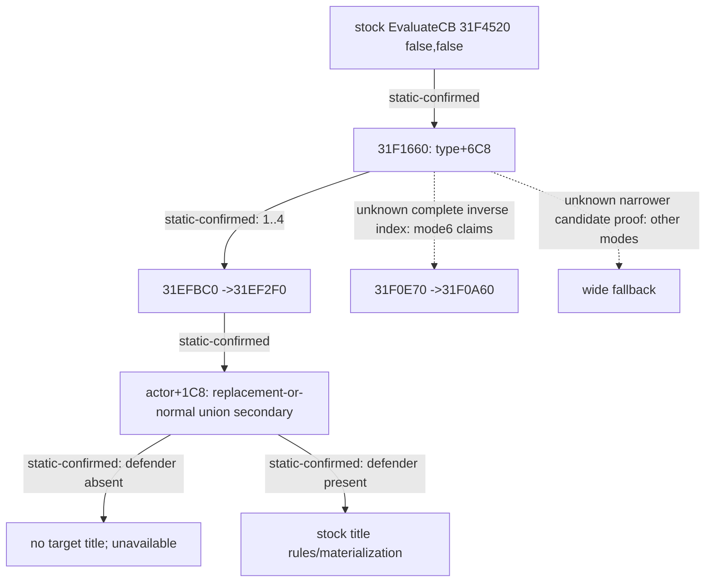

# 1.20.0.4 宣战候选生成首版

2026-10-16；`machine_id: xenoamess-full-tower-eb9d2c1186`。当前机器 Steam EXE 来源 SHA 沿用已核绑定
`98702F88A547CDE2EAF29A85F93B85F68EE4CF8148336A4F7AFAEB75319DD518`。
本包静态读本体、修改源码及离线 fixture；未连接游戏、SDK、Driver、pipe、MCP 或桌面，未部署 Native。
构建与实机由运行负责人另行记录；源码与 fixture 不能代替实机性能、战争或三十年验收。

## 原版实际候选前置与边界

此前找到的 AI strategy `+A8` 不是本包候选来源。其普通 context 构建跳过人类玩家，目标填充 writer 尚未定位，不能作为玩家完整目录的安全裁剪。

当前本体的实际链为 `31F4520` 原版完整 CB 验证 → `31F1660` 头衔模式分发。
模式 `0` 单独求值；模式 `6` 进入 `31F0E70` 宣称路径；其余模式进入 `31EFBC0`。
后者在 `31EFD67` 读取实际 CB 定义的 `+6C8`，模式 1–4 必经 `31EF2F0`。
该函数先查攻击者 `+1C8` 的当前 realm 缓存：若 `+8EC` 非零，取 `+8E0` 指针向量，否则取 `+688`；再查 `+7B0`。
`B2E360` 对向量做 **Character 对象指针相等** 搜索，两个向量都没有防御者时，`31EF3C1 → 31EF700` 返回，不生成头衔。
这不是 AI 排名前五名单，也不要求人类角色持有 AI context。

`31EFBC0` 在 `31EFD63` 初始化成功标志为零，只有接受头衔的路径 `31F0429`、`31F0635` 将其置一，最终 `31F0683` 读回。
因此，在当前精确版本、实际模式 1–4 下，这份指针 union 是原版完整合法结果所需的候选超集。
原始调用链的缓存缺失分支使用全局 fallback；其内容未证明，本实现遇到缺失缓存时使用完整角色集合，避免假定 fallback 为空。

| 当前 EXE 局部来源 | 字节数 | SHA-256 |
|---|---:|---|
| `31EFBC0..31F07C4` 模式枚举与成功标志 | 3076 | `040dfb36840cebce2d5f749bb7a39c80b7f2e9aca1c93a65e821580a8a0b6abc` |
| `31EF2F0..31EF721` 缓存成员前置与消费 | 1073 | `2666f091d6a153bf2fb6254357076eacf728730bf4375889f714615a6ea29e7f` |
| `B2E360..B2E491` 原版指针 find | 305 | `aeee10b5d170ede89ce07666092a496c114caa0d99745b70f7afb0a7adc1b114` |
| `28BFC50..28BFCC6` 即时领主／宫廷所有者 getter | 118 | `7f713bce578456413e82347434024b5a390a28bd40d17a4779f6eb3c4c7f6da4` |



## 实现和真实入口

`ck3_12004_declaration_candidates.hpp` 直接复制原版选择的两个指针向量。容量／计数非法、缺失缓存、读失败或超过完整读取上限均返回 unavailable，整族回退全角色；不截断后宣称完整。不解引用向量里的未知指针，仅与当前通过原有 slot/full-generation/death/self 校验的角色指针比较。

`ReadDeclarableWars` 的现有入口读取 `DeclarationsBindings.candidate_options`。`cb-first-v1` 每查询只扫描有效角色一次，构建公共索引，再按 **CB → 有依据候选 → 原版 false,false 评估 → 原 materialization** 执行。
模式 1–4 使用上述原版必要索引；其他模式保持完整候选。输出以 stable sort 恢复原 slot 顺序、CB 原生 ordinal 与同 CB 配置生成顺序；claimant 和头衔序列不改。单目标查询、提交前 stock 再评估、完整交互校验和真正宣战命令不改。

独立的脚本硬条件只接收已资格的 source manifest。当前原版 AST 盘点发现 15 个 hard `is_landed` 定义，其中只有 `make_tributary_cb` 另有 hard `is_independent_ruler`。
当前 reader 仅能用原版即时领主 getter 返回的 **当前有效其他角色** 证明非独立；getter 同时覆盖有地领主和无地角色的宫廷所有者。
null、self、fallback、无效 ID 或失读均保持 unknown。**`landed` 当前始终 unknown**，没有把 primary title、camp 或 LandState 猜成 `is_landed`；其 15 个条件暂不因此减少目标。
未知／未资格同名脚本保持 wide。模式 1–4 采用的是实际已加载定义所走的同一原生分支，不依赖硬编码 CB 名或脚本猜测。

## 同一次游戏会话切换与资格

启动时绑定以下环境变量；真实加载来源资格由运行负责人冻结、核对，设置环境变量本身不构成资格证据。

```text
XAR_CK3_DECLARATIONS_CANDIDATE_POLICY_FILE=<获准D盘绝对ASCII路径>
XAR_CK3_DECLARATIONS_CANDIDATE_RULES_SHA256=b7cf0d40a5b049c3e9a1187244276edcccb5e31eab0fddfbffcdd8579d492b27
XAR_CK3_DECLARATIONS_CANDIDATE_SOURCE_MANIFEST_SHA256=e4d77f9575d4491a497359a58760afa548b255b3d9c473b1e607d25eda0713d3
XAR_CK3_DECLARATIONS_PROFILE_JSONL=<获准D盘JSONL输出路径>
```

上面的来源摘要分别绑定运行负责人本轮 `ROOT-CB-HARD-DEFENDER-CONDITIONS.json` 和 `ROOT-CB-LOADED-SOURCE-REVIEW.json`；后者核当前 playset 仅 XAR 内容、无 CB 覆盖／replace_path，以及 DLC 目录无 CB 路径／ZIP。该资格只用于这次冻结来源，不能外推未来 playset。原版源码／覆盖关系变化须重新资格，未核时删除脚本 guard，保留原生模式必要条件及其他 wide 路径。

policy 文件每次已有宣战查询只读最多 33 字节，严格接受 `full`、`shadow-v1` 或 `cb-first-v1`，可有末尾一个 LF／CRLF。缺文件、超过 32 字节、未知或其他内容均走 full。
运行负责人先写 `shadow-v1`，审阅结果后原子替换为 `cb-first-v1`，同一 Game／DLL 下一查询即可切换，不自动升格，也不为切模式重启。
无 policy 时，可用 `XAR_CK3_DECLARATIONS_CANDIDATE_VARIANT` 指定上述单一变体；均不设置则保留默认 full。

## 对照字段与验收范围

shadow **只运行一次原有 target-major full 基线**，逐 CB 检查其每个完整合法 tuple 的目标是否属于该 CB 候选；比较包含 target、CB ordinal/key、configuration、claimant、完整且有序的 target titles，保留重复 tuple。
它总返回原 full 输出；发现漏项不会用不完整候选替换普通结果。
`baseline_evaluations` 是已执行基线调用；shadow 的 candidate `evaluations=0`，`projected_candidate_evaluations` 才是后续候选路径预计调用数，不能把预计值报成实测提速。
cb-first 的 `evaluations` 是实际调用数。每 CB 同时记录 full_targets、candidates、native_target_titles_mode、native_realm_index_used、完整结果行数与 missing/extra_tuples。
查询 profile 总墙钟覆盖索引、基线／实际评估、比较与排序，日志写入失败不影响游戏；原有全目录默认关闭 profiling 行为保留。

查询始终在原有 owning-thread paused mailbox 内运行，前后直接 CoreSnapshot 检查暂停、当前玩家和 date_raw；外层查询回执继续提供 native/public revision 绑定。本 profile 没有虚构这些 revision 字段。

聚焦 fixture 扩展原 `ck3_12002_declarations_test.cpp`：生产 realm layout reader 的正常／替代／第二向量、空／缺失／非法／失读边界；候选实际调用减少与完整 tuple/order 等价；unknown/source-failure wide；shadow 漏项可见且原输出保留；1–4 与 claim6 分界；现有真实入口同进程切 policy。离线构建／运行结论由独立构建回执补充，本提交不先写 PASS。

剩余：当前 mode6 的原版 claim getter 已定位为 `28C6A10`，`31F0A60` 还合并 `2B9E840` 派生 claims，并检查 title holder 与 defender 关系；递归 claimant、held/court claimant 完整来源尚未闭，继续 wide。其他模式和原版 `is_landed` 精确谓词仍未采用猜测。尚无本版实机候选数或墙钟收益，不宣称全部 92 个启用 CB 已加速。

## 本轮离线验证实录

本轮独立构建线程在当前上述机器以 MSVC C++20 `/W4 /WX /permissive- /UNDEBUG` 编译实际冻结声明源码与 fixture，并通过包装 DLL 执行原测试 main；没有生成新 EXE，也没有游戏／桌面调用。
测试最终 `return0 / PASS`，冻结 test SHA `d4a04db091cb466b4053277d0b7a1bf3ec7e353c6d45ad407eb7e28f72fb103f`。
回执为 `D:/codex-ck3-demos/2026-10-14-robert-30year/cb-candidates-native18-01/CB-FOCUSED-FIXTURE-RESULT.json`，SHA `a9e56acaa2802a4cbf673ce7ee36e8f668519c4f78836be6082d21912181e830`；其 `fixture/BUILD-RESULT.json` 保存真实 argv，SHA `0d9cc724a3231066d924635941f0b0bf6938a8eccd90871b9de763cde20fe157`。
DLL SHA `048949105a22ca47a56fdb2bea5fe14bd14cfaaaada55d1496689a34e4f298cf`。
旧 `CB-FOCUSED-FIXTURE-RESULT.windows-stream-lock-RED.json` 保留 Windows 日志 stream 未关就删除的真实失败；仅补测试的 `stream.close()` 后重跑同一 focused，生产四叶未因此改变。
另外一次独立来源对照核实：15 个编译规则的 key、mask、文件 SHA 与原版 AST inventory 完全一致，inventory guard 和运行负责人 loaded-source review 的精确摘要一致。
这些结果证明离线实现与测试范围；完整 Native18 依赖闭包、实际加载及同帧 shadow／CB-first 实机对照仍由运行负责人交付。
