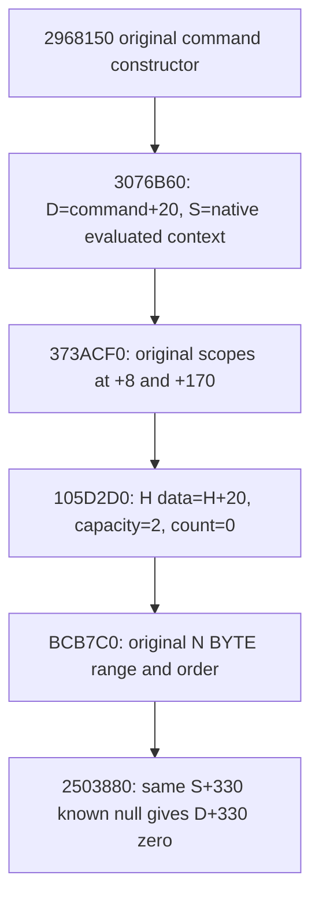

# Actual education option row source and existing query

The existing ordinary interaction Prepare now copies the actual education context's ordered option rows and publishes them through the existing mailbox/query and strict ordinary transport. Each row preserves its declared ordinal, complete uint32 flag, raw uint8 bank value, ordinal selection and the separate flag-getter selection. Duplicate flags and native order are retained.

Exact build: CK3 1.20.0.4 / Steam 25734779 / EXE SHA-256 `98702F88A547CDE2EAF29A85F93B85F68EE4CF8148336A4F7AFAEB75319DD518`. The held complete actual `3078860` getter selects the first declared row with the matching full flag and returns whether that row's bank byte is 1; each ordinal's own bank byte is also preserved. Values 2..255 remain raw data, not selected. The actual canonical table lookup reuses the existing exact-build bindings; an ambiguous/unresolved key remains null without discarding the raw row.

The original counts were sampled earlier and are not reinterpreted as this later bank snapshot. The decoder validates the real first-hit getter semantics independently from ordinal selection. Non-education queries retain their prior wire. Option-row availability alone does not grant education command readiness. The a05 source support branch also requires request-materialization availability and a known-null final special payload; the existing Ready and CanSend checks remain in use.

Root first adopted four connected option-query files, then adopted the ten-file explicit request and existing caller group. The materializer is now called by the real Driver and family planner. No new query, TU or build option was added. The adopted a04/query10 stage retained the zero-option support formula. The a05 source now admits nonzero education option banks through the original same-context command constructor on the normal-return value-copy contract below.

```mermaid
flowchart LR
  A[Existing education Prepare and owned context] --> B[Ordered definition flags and option bank bytes]
  B --> C[First matching flag getter and separate ordinal selection]
  C --> D[Existing mailbox query serializer]
  D --> E[Existing strict ordinary query decoder]
  E --> F[Existing Driver and family caller: explicit child/guardian and keys]
  F --> H[Actual redirected primary roles and local ordinal selection]
  H --> I[Same-query role and bank readback]
  I --> J[Materializer and existing once-claim entry]
  J --> K[Existing same-context command constructor and copy]
  K -. source admitted; execution not run .-> G[Actual education result]
```

Qualification: `research / SOURCE_ADOPTED_NOT_RUN`. No tests, project imports, compilation, Game/Steam operations, live queries or native invocation ran. Native84/SDK84 remain compiled Source594; the source commit skips remote CI. No new live, M6/M7 completion or natural succession credit is claimed.

Source packages: external `continuation-44/background-g2-offline-20261011/type4-source-chain01/DELIVERY.json` and `continuation-55/background-g2-offline-20261011/education-native-entry/dual-rows-canonical-a02/ROOT-ADOPTION-MANIFEST.json`. Actual adoption receipt: `D:/codex-ck3-background-spill/native71-continuation-20261010/ROOT-EDUCATION-OPTION-QUERY-SOURCE-ADOPTION-20261011.json`.

## Explicit request and existing caller source integration

The existing ordinary request accepts an atomic full-uint32 child/guardian pair and an independent optional canonical option-key list. An absent list retains native defaults; an empty list requests all options off. Existing non-education wire behavior is retained. The actual two-role constructor may redirect the primary recipient to a liege: that observed primary recipient, actor and intermediary are retained. A matching secondary pair reuses the same context; a different pair uses the existing all-role constructor with those actual primary roles.

The existing native option callbacks clear and select every matching original ordinal, preserving duplicate flags and order. Final role and bank observations are copied after native validation in the same query. The seven-field `education_request_materialization` annotation describes request/readback matching; it does not establish command-owned copying. The strict decoder keeps raw rows and canonical projections independent.

The actual family caller preserves the already queried relationship, consumes the current child rows, submits explicit pair/options through the existing Driver and reviews that same query with the adopted materializer. Only the existing native readiness and CanSend result can select the existing initiation step. The a04/query10 formula required zero declared options. The a05 source also supports actual .4 education with complete ordered rows and available request materialization, an absent final special payload and honored supplied operands. Unsupplied option keys retain the original native default bank and can use this branch. Existing owner/TLS/frame and once-claim rules are unchanged.

Qualification: `research / SOURCE_ADOPTED_NOT_RUN`. No tests, imports, compilation, Game/Steam/UI/RPC operations or live reads. Actual adoption receipt: `D:/codex-ck3-background-spill/native71-continuation-20261010/ROOT-EDUCATION-EXPLICIT-QUERY-SOURCE-ADOPTION-20261011.json`. Actual command constructor `2968150 -> 3076B60` uses the normal-return source-copy route below; its executed allocation, command and gameplay outcomes have not been observed.

## Normal-return command-copy source and a05 consumer

The original constructor copies the same evaluated source context `S` into `D=command+0x20`. Its option bank is `H=D+0x300`; the source operands are `F=QWORD[S+0x300]` and signed `N=DWORD[S+0x30C]`. On normal return, the bank copy transfers the original `N` BYTEs and their order. It consumes the physical source bank, including native defaults, rather than reconstructing bytes from canonical keys or the first-flag getter count.

The destination initializer's normal-return poststate is inline data `H+0x20`, capacity 2 and count 0. For `N=0` the range is empty. For `N=1..2`, the existing in-capacity branch copies exactly `N` BYTEs and stores count `N`; its ordering helper sees `A==B` and returns without reversal children. For `N>=3`, growth selects capacity `N`, forwards an allocation of `N` BYTEs with `R8D=1`, and copies the middle range of exactly `N` BYTEs; the prefix and suffix lengths are zero. The old inline pointer is `H+0x20`, equal to allocator `P=H+0x18` plus 8, so `855830` skips its release delegates. The resulting header stores the returned data pointer, capacity `N` and count `N`.

The general in-capacity insertion helper `9CF240` reverses `[A,B)`, then `[B,C)`, then `[A,C)`, producing original `[B,C)` followed by original `[A,B)`. This is a raw BYTE ordering contract. The fresh command-bank route has an empty old range and retains every source ordinal, including duplicate flags. The original two scope copies and destination nested `scope+0x118` seeds (`+0x48=FFFFFFFF`, `+0x4C=0`, `+0x4E=0`) remain on the retained constructor/copy route.

The a05 `Prepare` rereads `S+0x330` after final native validation and role readback, before the final owned option-row copy. A known null becomes the existing `special_payload_present=false` and selects `2503880`'s early-null store to `D+0x330`, without the registry or virtual-copy path. An unreadable final payload makes the existing query unavailable; a non-null payload retains its existing unsupported result.

Source support is `(declared_count==0 || education_copy_supported) && final_special_null && request_honored`, where `education_copy_supported` is actual .4 education plus available ordered rows and request materialization. The mailbox uses the same condition. Ready still uses actual alive/shown/CanSend and the existing owner/TLS/frame/source proof, and initiation retains its original once-only constructor, vtable checks and queue. Unsupplied option intent preserves the original native default bank.

Source join: external `D:/codex-ck3-background-spill/native71-continuation-20261010/continuation-30i/ORDERED-COPY-EFFECTS-JOIN.json`, SHA `d5e8154bb65f38c3ee73d65cacd7e027ac5f5869b0a8ccb4018e01ad541f9345`. It joins the initializer, allocation, BYTE ordering, retained scopes and lazy tail in their actual parent order. The a05 consumer is `continuation-55/background-g2-offline-20261011/education-native-entry/normal-return-copy-support-a05/DELIVERY.json` (SHA `4690e49bc1a09e56b618de5aff36323600454a64127cb9b96fd8e63ae31d5858`), with the matching 04 ordinary normalizer. The two native consumers are [ordinary_character_interaction_v1.cpp](../../ck3_autonomous_player/native_bridge/src/ordinary_character_interaction_v1.cpp) and [ordinary_interaction_mailbox_v1.cpp](../../ck3_autonomous_player/native_bridge/src/ordinary_interaction_mailbox_v1.cpp).

Qualification remains `research / SOURCE_ADOPTED_NOT_RUN`: these are normal-return source facts and a source support branch. Native84/SDK84 remain compiled Source594; no tests, project imports, compilation, native calls, Game/RPC or runtime acceptance ran for this source update.

Root actual adoption receipt for the three-file a05 support group: `D:/codex-ck3-background-spill/native71-continuation-20261010/ROOT-EDUCATION-NONZERO-COPY-SOURCE-ADOPTION-20261011.json`. The earlier a04 adoption receipt remains the history of explicit requests and actual caller integration. No current command construction or gameplay outcome has been executed.
