# Actual education option row source and existing query

The existing ordinary interaction Prepare now copies the actual education context's ordered option rows and publishes them through the existing mailbox/query and strict ordinary transport. Each row preserves its declared ordinal, complete uint32 flag, raw uint8 bank value, ordinal selection and the separate flag-getter selection. Duplicate flags and native order are retained.

Exact build: CK3 1.20.0.4 / Steam 25734779 / EXE SHA-256 `98702F88A547CDE2EAF29A85F93B85F68EE4CF8148336A4F7AFAEB75319DD518`. The held complete actual `3078860` getter selects the first declared row with the matching full flag and returns whether that row's bank byte is 1; each ordinal's own bank byte is also preserved. Values 2..255 remain raw data, not selected. The actual canonical table lookup reuses the existing exact-build bindings; an ambiguous/unresolved key remains null without discarding the raw row.

The original counts were sampled earlier and are not reinterpreted as this later bank snapshot. The decoder validates the real first-hit getter semantics independently from ordinal selection. Non-education queries retain their prior wire. The existing support/ready formula remains unchanged; option-row availability does not grant education command readiness.

Root first adopted four connected option-query files, then adopted the ten-file explicit request and existing caller group. The materializer is now called by the real Driver and family planner. No new query, TU or build option was added. Nonzero declared options remain unsupported while the actual command-owned copy source edges are being closed.

```mermaid
flowchart LR
  A[Existing education Prepare and owned context] --> B[Ordered definition flags and option bank bytes]
  B --> C[First matching flag getter and separate ordinal selection]
  C --> D[Existing mailbox query serializer]
  D --> E[Existing strict ordinary query decoder]
  E --> F[Existing Driver and family caller: explicit child/guardian and keys]
  F --> H[Actual redirected primary roles and local ordinal selection]
  H --> I[Same-query role and bank readback]
  I --> J[Materializer and existing once-claim entry]
  J -. nonzero options unsupported; execution not run .-> G[Actual education result]
```

Qualification: `research / SOURCE_ADOPTED_NOT_RUN`. No tests, project imports, compilation, Game/Steam operations, live queries or native invocation ran. Native84/SDK84 remain compiled Source594; the source commit skips remote CI. No new live, M6/M7 completion or natural succession credit is claimed.

Source packages: external `continuation-44/background-g2-offline-20261011/type4-source-chain01/DELIVERY.json` and `continuation-55/background-g2-offline-20261011/education-native-entry/dual-rows-canonical-a02/ROOT-ADOPTION-MANIFEST.json`. Actual adoption receipt: `D:/codex-ck3-background-spill/native71-continuation-20261010/ROOT-EDUCATION-OPTION-QUERY-SOURCE-ADOPTION-20261011.json`.

## Explicit request and existing caller source integration

The existing ordinary request accepts an atomic full-uint32 child/guardian pair and an independent optional canonical option-key list. An absent list retains native defaults; an empty list requests all options off. Existing non-education wire behavior is retained. The actual two-role constructor may redirect the primary recipient to a liege: that observed primary recipient, actor and intermediary are retained. A matching secondary pair reuses the same context; a different pair uses the existing all-role constructor with those actual primary roles.

The existing native option callbacks clear and select every matching original ordinal, preserving duplicate flags and order. Final role and bank observations are copied after native validation in the same query. The seven-field `education_request_materialization` annotation describes request/readback matching; it does not establish command-owned copying. The strict decoder keeps raw rows and canonical projections independent.

The actual family caller preserves the already queried relationship, consumes the current child rows, submits explicit pair/options through the existing Driver and reviews that same query with the adopted materializer. Only the existing native readiness and CanSend result can select the existing initiation step. The support formula still requires zero declared options and an absent special payload, with an additional request-materialization match for supplied operands. Stock education with nonzero options therefore remains unsupported for dispatch. Existing owner/TLS/frame and once-claim rules are unchanged.

Qualification: `research / SOURCE_ADOPTED_NOT_RUN`. No tests, imports, compilation, Game/Steam/UI/RPC operations or live reads. Actual adoption receipt: `D:/codex-ck3-background-spill/native71-continuation-20261010/ROOT-EDUCATION-EXPLICIT-QUERY-SOURCE-ADOPTION-20261011.json`. Actual command constructor `2968150 -> 3076B60` is the continuing source-copy entry; the required child effects remain in the shared source ledger.
