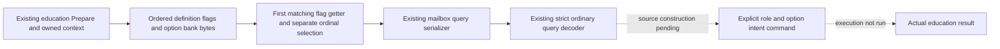

# Actual education option row source and existing query

The existing ordinary interaction Prepare now copies the actual education context's ordered option rows and publishes them through the existing mailbox/query and strict ordinary transport. Each row preserves its declared ordinal, complete uint32 flag, raw uint8 bank value, ordinal selection and the separate flag-getter selection. Duplicate flags and native order are retained.

Exact build: CK3 1.20.0.4 / Steam 25734779 / EXE SHA-256 `98702F88A547CDE2EAF29A85F93B85F68EE4CF8148336A4F7AFAEB75319DD518`. The held complete actual `3078860` getter selects the first declared row with the matching full flag and returns whether that row's bank byte is 1; each ordinal's own bank byte is also preserved. Values 2..255 remain raw data, not selected. The actual canonical table lookup reuses the existing exact-build bindings; an ambiguous/unresolved key remains null without discarding the raw row.

The original counts were sampled earlier and are not reinterpreted as this later bank snapshot. The decoder validates the real first-hit getter semantics independently from ordinal selection. Non-education queries retain their prior wire. The existing support/ready formula remains unchanged; option-row availability does not grant education command readiness.

Root adopted four connected production files. The standalone education materializer remains external until its actual Driver caller and native request/Prepare path can be adopted together. No new query, TU, build option or fake dispatch entry was added. The real command work continues with explicit child/guardian roles and requested canonical option keys.

Qualification: `research / SOURCE_ADOPTED_NOT_RUN`. No tests, project imports, compilation, Game/Steam operations, live queries or native invocation ran. Native84/SDK84 remain compiled Source594; the source commit skips remote CI. No new live, M6/M7 completion or natural succession credit is claimed.

Source packages: external `continuation-44/background-g2-offline-20261011/type4-source-chain01/DELIVERY.json` and `continuation-55/background-g2-offline-20261011/education-native-entry/dual-rows-canonical-a02/ROOT-ADOPTION-MANIFEST.json`. Actual adoption receipt: `D:/codex-ck3-background-spill/native71-continuation-20261010/ROOT-EDUCATION-OPTION-QUERY-SOURCE-ADOPTION-20261011.json`.
